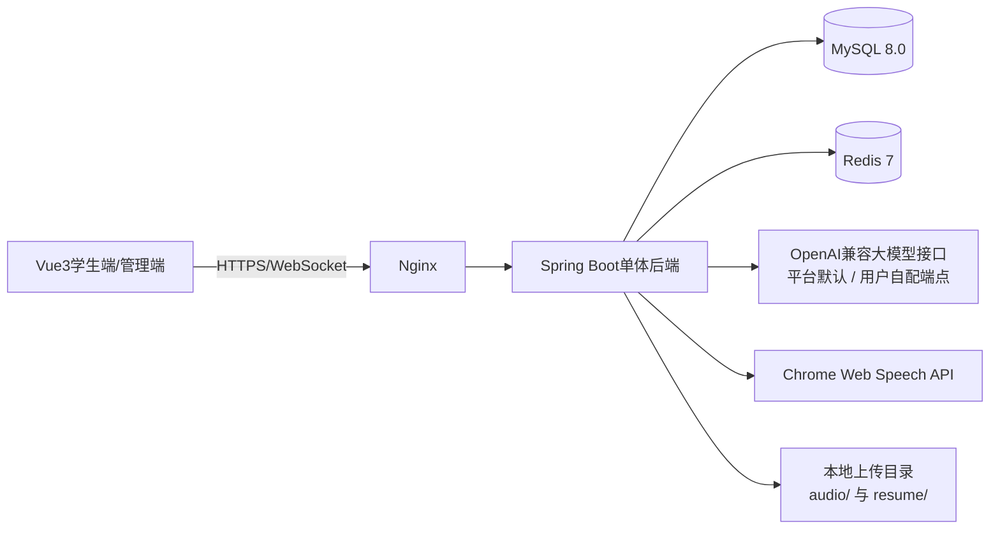

# AI模拟面试与能力提升平台 —— 开发方案

## 1. 文档说明

本方案根据"AI模拟面试与能力提升软件"项目要求编写，面向大学本科 JavaEE 课程设计，是本项目**全部需求与系统设计的唯一来源**。

系统实现以下闭环：

```text
上传简历 → 文本抽取与 PII 脱敏 → AI 多维评分 → 高/中/低风险分级改进建议
                        ↓（可选：作为面试输入）
选择岗位 → 题库组卷（简历偏好）→ AI多轮面试 → 动态追问（结合简历项目深挖）
       → 多维评估 → 生成报告（简历自述 vs 面试实测对比）→ 学习推荐 → 能力成长记录
```

本项目采用固定、简化、可独立运行的技术方案，突出 JavaEE 课程设计中的后端分层、数据库设计、权限控制、REST 接口、WebSocket 实时通信和前后端分离，不引入微服务集群、Kubernetes 或复杂的分布式组件。

### 整合说明

本文档于 2026-10-27 整合自以下三份方案，并吸收 V7（验收修复）、V9（用户级 AI 服务配置）两次库表与能力变更，形成一份完整方案：

| 原文档 | 冻结/交付日期 | 在本文中的位置 |
|---|---|---|
| 《AI模拟面试与能力提升平台_系统实现方案》（基线） | 2026-10-13 | 第 1~20 章骨架，章节编号原样保留 |
| 《…_简历分析与个性化面试_总体开发方案》 | 2026-10-26 | 融入 §2、§3、§4、§5、§6.5、§6.6、§6.8、§7.3、§9、§11、§13、§14、§15、§16、§17、§20 |
| 《…_简历分析与个性化面试_接口协议》 | 2026-10-26 | 融入 §10（R-01~R-10 详细协议、错误码、状态与轮询契约） |

**章节编号约定**：基线方案第 1~20 章及其既有小节编号**完全不变**，其他文档中"方案 §x"形式的引用继续有效；简历分析、个性化面试、用户级 AI 配置的内容以新增小节（§6.8、§9.10~§9.12、§10.7~§10.9、§13.3~§13.4、§20.2~§20.3）或章内段落的形式融入对应章节。原简历方案与接口协议各章节在本文中的位置见 [附录 A](#附录-a-原文档章节对照表)。

### 配套文档

| 文档 | 职责 |
|---|---|
| 《AI模拟面试与能力提升平台_开发计划》 | 后端 M1~M6、前端 F1~F6、简历后端 R1~R4 的任务分解、DDL/类清单、里程碑与验收对照 |
| 《AI模拟面试与能力提升平台_进度记录》 | 唯一进度事实源：里程碑状态、产物清单、决策与偏差（D6~D69）、问题跟踪、环境备忘 |
| 《AI模拟面试与能力提升平台_验收与质量记录》 | M6 验收自检、AI 质量抽测、后端验收检查 → 修复 → 复验的全链路证据 |
| `ai-interview/答辩演示脚本.md` | §19 演示流程逐步映射为可执行命令（含简历环节与故障预案） |

### 目录

1. 文档说明
2. 项目目标
3. 固定技术栈
4. 系统角色
5. 总体架构
6. 核心功能设计（6.1 用户与权限 · 6.2 岗位和能力模型 · 6.3 题库 · 6.4 知识库与轻量 RAG · 6.5 多轮面试与个性化面试 · 6.6 大模型调用设计 · 6.7 语音和文字交互 · 6.8 简历上传与分析）
7. 评分和报告设计
8. 个性化能力提升
9. 数据库设计（12 张表）
10. REST 和 WebSocket 接口（51 REST + 1 WS）
11. 前端页面设计
12. 项目目录结构
13. 关键业务流程
14. 异常和降级方案
15. 安全设计
16. 测试方案
17. 开发计划
18. 部署运行
19. 答辩演示流程
20. 最终验收标准
- 附录 A 原文档章节对照表

## 2. 项目目标

系统面向计算机相关专业学生，解决以下问题：

1. 学生缺少接近真实企业流程的技术面试练习。
2. 传统面试反馈依赖人工，反馈速度慢且难以量化。
3. 通用题库不能体现 Java 后端和 Web 前端岗位的差异。
4. 技术能力、逻辑表达、沟通能力和应变能力缺少综合评价。
5. 简历缺少可量化、可解释的评审反馈；面试练习与学生本人的技术栈和项目经历脱节，难以模拟"简历深挖式"真实面试。

系统至少支持以下两个岗位：

- Java 后端开发工程师
- Web 前端工程师

每个岗位具有独立的能力模型、题库、知识库标签和评分权重。Python 算法工程师可以作为后续扩展，不作为本课程设计的必做内容。

### 简历相关用户故事

| 编号 | 用户故事 |
|---|---|
| US-1 | 作为学生，我想上传简历获得多维度评分和分级的修改建议，以便在投递前针对性完善简历。 |
| US-2 | 作为学生，我想让面试围绕我简历里写的技术栈和项目出题，模拟"简历深挖式"真实面试。 |
| US-3 | 作为学生，我想在面试前看到"这次面试会重点考察我哪些技能"，以便预判和准备。 |
| US-4 | 作为学生，我希望面试报告告诉我"简历上写的技能哪些经得起追问、哪些是水分"。 |

### 范围边界（不做的事）

| 不做的事 | 说明 / 替代 |
|---|---|
| `.doc` 老格式简历 | 仅支持 docx；上传 .doc 返回 40001 并提示"请另存为 .docx" |
| 扫描件 / 图片型 PDF（OCR） | 文本层抽取字符数不足即判定解析失败（10008），提示换文本型 PDF |
| 简历在线编辑、模板生成 | 只读分析，改进意见引导用户线下修改后重新上传 |
| 简历投递 / HR 端 | 不涉及 |
| 简历多语言（中英以外） | 词典与 Prompt 面向中英文，其他语言不保证效果 |
| 管理端简历审核 | 管理端不新增简历接口（后续可选扩展：简历统计看板） |
| 复杂情绪识别 | 语音表达只使用可解释指标（见 §6.7） |
| 微服务、独立向量数据库 | 单体应用 + MySQL FULLTEXT 轻量 RAG（见 §6.4） |

## 3. 固定技术栈

### 3.1 前端

| 技术 | 固定版本/选型 | 用途 |
|---|---|---|
| 开发语言 | TypeScript 5 | 前端开发 |
| 框架 | Vue 3.4 | 构建页面和组件 |
| 构建工具 | Vite 5 | 项目构建和开发服务器 |
| UI 组件 | Element Plus | 表单、表格、弹窗和布局 |
| 状态管理 | Pinia | 保存登录、面试和报告状态 |
| HTTP 客户端 | Axios | 调用后端 REST API |
| 图表 | ECharts | 雷达图、折线图和柱状图 |
| 实时通信 | WebSocket | 推送 AI 问题和面试进度 |
| 语音采集 | MediaRecorder API | 录制面试音频 |
| 语音转写 | Chrome Web Speech API | 将语音转换为文字 |

### 3.2 JavaEE 后端

| 技术 | 固定版本/选型 | 用途 |
|---|---|---|
| JDK | Java 17 | Java 运行环境（构建带 enforcer 门禁，JDK 25 在构建开始时明确报错） |
| 核心框架 | Spring Boot 3.3.x | 后端应用框架 |
| Web 框架 | Spring MVC | REST API |
| 安全框架 | Spring Security 6 + JWT | 登录、鉴权和角色控制 |
| ORM 框架 | MyBatis-Plus 3.5.x | 数据库访问 |
| 数据库 | MySQL 8.0 | 保存业务数据 |
| 缓存 | Redis 7 | 保存登录状态、会话缓存和限流数据 |
| 实时通信 | Spring WebSocket | 面试过程实时推送 |
| HTTP 调用 | Spring WebClient | 调用大模型接口 |
| 参数校验 | Jakarta Validation | 请求参数校验 |
| 数据库迁移 | Flyway | 初始化和升级数据库（V1~V9） |
| 文档解析 | Apache PDFBox 3.0.3 / Apache POI 5.3.0 | 简历 PDF / DOCX 文本层抽取（不做 OCR） |
| 密钥加密 | JDK 内置 AES-256-GCM | 用户级 AI 服务 API Key 密文落库 |
| 构建工具 | Maven 3.9 | 依赖管理和打包 |

### 3.3 AI 与知识库

| 技术 | 固定选型 | 用途 |
|---|---|---|
| 大模型接口 | OpenAI 兼容 Chat API | 生成问题、追问、报告、简历分析与题干改写 |
| 演示模型 | 通义千问 Qwen-Plus | 中文面试对话和评估 |
| AI 调用封装 | `AiProvider` 接口（5 个方法） | 隔离模型调用细节，面试与简历两条链路共用 |
| 离线兜底 | `MockAiProvider` | 无网络或无 Key 时使用规则引擎与模板，结果确定、可解释 |
| 用户级路由 | `RoutingAiProvider` | 按用户自配的 OpenAI 兼容端点路由，无配置回退平台默认 |
| 知识库检索 | MySQL FULLTEXT + 标签过滤 | 召回岗位知识片段 |
| 文本分析 | Java 规则 + 大模型 | 关键词和能力点分析；简历分段、技能识别与 PII 脱敏 |
| 语音分析 | Web Speech API + 音频时长 | 转写、语速和回答时长分析 |

### 3.4 部署

- Docker Compose
- Nginx
- Node.js 20
- Maven 3.9
- MySQL 8.0
- Redis 7

### 3.5 技术选型理由

1. Vue 3 和 Spring Boot 适合前后端分离开发。
2. Spring Security、MyBatis-Plus 和 MySQL 符合 JavaEE 课程教学内容。
3. WebSocket 可以体现实时交互能力。
4. WebClient 可以调用大模型，同时保持后端技术栈统一。
5. MySQL FULLTEXT 和标签检索足以支撑课程设计规模的轻量 RAG。
6. Mock AI 提供离线模式，避免答辩时因网络或 API Key 导致系统无法运行。
7. Docker Compose 可以一次启动完整系统，便于部署和验收。
8. PDFBox 与 POI 是 Java 生态的标准文档解析库，简历抽取无需引入外部服务或 OCR。
9. 用户级 AI 服务配置让使用者可以自带 Key 与模型，平台默认配置与个人配置互不影响。

## 4. 系统角色

### 4.1 学生

- 注册、登录和修改个人资料。
- 选择目标岗位。
- 进行文字或语音模拟面试。
- 查看 AI 动态追问。
- 查看面试评分和评估报告。
- 查看历史面试记录。
- 查看能力成长曲线。
- 获取学习资源和练习计划。
- 上传简历，查看多维评分与按风险分级的改进建议，设置默认简历。
- 选择一份已完成分析的简历发起个性化面试，面试前预览重点考察技能。
- 在个人中心配置自己的 AI 服务端点（接口地址 / API Key / 模型）。

### 4.2 管理员

管理员属于实现扩展角色，用于维护系统数据：

- 管理岗位和能力模型。
- 管理面试题库。
- 管理知识库文档和知识片段。
- 配置评分权重。
- 管理学习资源。
- 管理用户（启用/禁用）。
- 查看系统统计数据。

简历接口对管理员按"本人数据"处理，管理端不提供简历审核能力（见 §2 范围边界）。

## 5. 总体架构



### 5.1 分层结构

```text
表现层 Controller
        ↓
业务层 Service
        ↓
数据访问层 Mapper
        ↓
MySQL / Redis
```

AI 相关调用通过业务层（`AiProvider` 及其编排服务 TurnEngine / ReportService / ResumeAnalysisService）统一完成，不允许 Controller 直接调用大模型。

### 5.2 后端模块

```text
auth       用户、登录和权限
position   岗位和能力模型
question   题库和题目标签
interview  面试会话和问答过程（含音频存储、个性化面试集成）
resume     简历上传、文本抽取、PII 脱敏解析、异步多维分析、技能匹配
aiconfig   用户级 AI 服务配置
knowledge  知识库和检索
ai         大模型调用、用户级路由和提示词
assessment 评分和报告（含简历对比条目）
growth     能力成长、历史和学习推荐
admin      管理员功能
common     统一响应、异常、配置和日志
```

### 简历域模块视图

简历相关能力集中在 `resume/` 包，对既有包的改动全部为**加法**（不修改既有方法签名语义，不传 `resumeId` 的面试与普通面试完全一致）：

```text
com.example.interview
├── resume/                                   简历域
│   ├── controller/ResumeController           R-01~R-08 八个端点
│   ├── service/ResumeService                 上传受理 / 列表 / 详情 / 默认简历 / 逻辑删除 / 配额 / 归属
│   ├── service/ResumeAnalysisService         @Async 异步分析编排（状态机）
│   ├── service/ResumeTextExtractor           四格式魔数校验 + 文本抽取 + 护栏
│   ├── service/ResumeProfileParser           结构化分段 + 技能/项目识别 + PII 脱敏（纯规则，可直测）
│   ├── service/ResumeScoreCalculator         六维聚合、建议分级与数量约束
│   ├── service/ResumeSkillMatcher            组卷偏好 / 报告对比 / focus-skills 三处共用的技能匹配口径
│   ├── storage/ResumeStorageService          安全落盘（照 AudioStorageService 模式）
│   ├── entity/Resume、ResumeAnalysis、ResumeStatus
│   ├── mapper/ResumeMapper、ResumeAnalysisMapper
│   └── dto/...                               VO 与请求对象
├── ai/           AiProvider +analyzeResume/+personalizeQuestions，Mock / OpenAiCompatible / Routing 三实现；PromptBuilder +分析/改写/追问注入段
├── interview/    CreateInterviewRequest +resumeId；PaperAssembler +简历偏好重载；InterviewService.start 题干改写与降级；TurnEngine 注入简历要点
├── assessment/   ReportService 注入 resumeDigest，输出"简历 vs 实测"对比条目
└── common/       ResultCode +10006~10010；application.yml +app.resume.*
```

复用的既有能力：统一响应与错误码、JWT 鉴权与 40401 归属惯例、文件上传安全模式（白名单 + 魔数 + UUID 落盘 + 路径归一化）、multipart 10MB/12MB 限制、AI 双实现与三级容错、`aiExecutor` 异步线程池、岗位能力模型、组卷算法（可注入随机种子）、追问规则引擎与 PromptBuilder、Flyway 迁移体系、测试与 JaCoCo 质量门禁。


## 6. 核心功能设计

### 6.1 用户与权限

登录流程：

```text
用户提交用户名和密码
        ↓
Spring Security 查询 sys_user
        ↓
BCrypt 校验密码
        ↓
生成 JWT
        ↓
前端保存 Token
        ↓
后续请求通过 Authorization 携带 Token
```

统一角色：

```text
ROLE_STUDENT
ROLE_ADMIN
```

管理员接口必须经过角色判断，学生只能访问自己的面试记录和报告。

简历相关接口仅需登录（学生与管理员均按本人数据处理），所有读/写操作校验 `user_id` 归属，越权与不存在统一返回 40401（不暴露资源存在性）。

### 6.2 岗位和能力模型

### Java 后端开发岗位

主要技能：

- Java 基础、面向对象、集合和异常
- 多线程、并发和 JVM
- Spring、Spring Boot
- MySQL、事务、索引和 SQL 优化
- Redis 和消息队列基础
- 项目经历和系统设计
- 沟通表达和问题解决能力

### Web 前端工程师岗位

主要技能：

- HTML、CSS、JavaScript
- 浏览器原理和网络请求
- Vue 3 组件化开发
- 前端工程化
- 性能优化
- 前端安全
- 项目经历和组件设计
- 用户体验和沟通能力

岗位能力模型由以下字段组成：

```text
position_id
skill_code
skill_name
description
weight
required_level
```

### 6.3 题库

每个岗位至少配置 20 道题，建议每个岗位配置 30 道题。

| 题型 | 建议比例 | 示例 |
|---|---:|---|
| 技术知识题 | 50% | 什么是 Spring IOC？ |
| 项目经历题 | 20% | 介绍项目中最复杂的模块 |
| 场景题 | 20% | 线上接口响应变慢如何排查？ |
| 行为题 | 10% | 如何处理团队意见不一致？ |

题目字段：

```text
id
position_id
type
content
background
difficulty
skill_tags_json
reference_answer
key_points_json
deduction_points_json
followup_templates_json
status
version
```

题目难度分为 1～5 级：

- 1 级：基础概念。
- 2 级：简单应用。
- 3 级：综合应用。
- 4 级：复杂场景。
- 5 级：系统设计和开放问题。

组卷规则：

```text
总题数 = 5～8 道
技术题 = 50%
项目题 = 20%
场景题 = 20%
行为题 = 10%
```

个性化面试在题型比例与难度带逻辑完全不变的前提下，仅改变"难度带内挑选"的优先级（见 §6.5 个性化面试）。

### 6.4 知识库与轻量 RAG

### 知识库内容

- Java 后端和 Web 前端技术栈。
- 常见面试考点。
- 技术概念解释。
- 优秀回答范例。
- 常见错误回答。
- 项目设计案例。
- 岗位能力要求。

### 知识库表设计

每篇知识文档切分为多个 `knowledge_chunk`，每个片段包含：

```text
title
content
position_id
skill_tags
keywords
source_type
status
```

### 检索流程

```text
学生回答
  ↓
提取关键词和岗位技能标签
  ↓
MySQL FULLTEXT 检索
  ↓
按 position_id 和 skill_tags 过滤
  ↓
取 Top 3～5 条知识片段
  ↓
拼接到大模型提示词
  ↓
生成追问或评分结果
```

这种方式属于课程设计规模的轻量 RAG：先检索知识，再把检索结果作为上下文输入大模型。系统不引入 Elasticsearch、Milvus 或独立向量数据库，降低部署和调试成本。

### 6.5 多轮面试

### 面试状态

```text
CREATED
  ↓
RUNNING
  ↓
WAITING_USER
  ↓
PROCESSING_AI
  ↓
WAITING_USER
  ↓
FINISHED
```

异常状态：

```text
ABORTED
TIMEOUT
```

### 面试流程

1. 学生选择岗位、难度、面试时长和输入方式。
2. 系统创建面试会话。
3. 根据岗位能力模型选择第一道题。
4. 学生输入文字或使用麦克风回答。
5. 系统保存回答内容和回答时长。
6. AI 分析回答中的关键词和知识点。
7. 系统检索相关知识片段。
8. AI 决定追问、下一题或结束面试。
9. 达到轮次或时间上限后结束面试。
10. 系统生成评估报告和提升计划。

### 动态追问规则

| 回答情况 | 系统处理 |
|---|---|
| 缺少关键知识点 | 追问缺失内容 |
| 回答模糊 | 要求举例或解释原因 |
| 出现技术错误 | 询问边界条件或故障后果 |
| 回答完整 | 提高难度，追问替代方案 |
| 连续两轮低分 | 降低难度或切换基础主题 |
| 连续两轮高分 | 进入项目深挖或系统设计 |
| 同一主问题追问超过 3 次 | 自动进入下一题 |

其中"连续两轮低/高分"规则的口径：升/降难度作用于**追问难度与提示强度**，主问题在 start 组卷时按目标难度一次性锁定，回答期间不漂移。

### 个性化面试（简历驱动）

发起面试时可选一份**已完成分析**的简历（`resumeId` 可选参数，不传则与普通面试完全一致）。选中简历后，面试在四个环节个性化：

**① 入口与校验**：`POST /api/interviews` 新增可选 `resumeId`。校验链：存在且属于当前用户（否则 40401）→ `status=ANALYZED`（否则 10009）→ 通过后会话记录 `resume_id`。简历分析时绑定的岗位与面试岗位**允许不同**：简历摘要 digest 与岗位无关，技能匹配始终按面试岗位的能力模型计算。

**② 组卷偏好（PaperAssembler 扩展）**：题型比例 50/20/20/10 与难度带逻辑**完全不变**，仅在"难度带内挑选"环节增加优先级：

```text
候选题优先级（带内）：
  1) 覆盖未覆盖技能 且 命中简历技能（skill_tags ∩ digest.skills）
  2) 命中简历技能
  3) 覆盖未覆盖技能（普通组卷现状）
  4) 其他（随机，普通组卷现状）
PROJECT 类型：命中简历技能/项目的题优先，保证至少 1 道命中题（若题库存在）
零命中（简历技能与该岗位题库无交集）→ 完全回退现有算法，记 INFO 日志
```

**③ 题干个性化改写（AiProvider.personalizeQuestions）**：

- `start` 时把"岗位 + digest + 本场主问题列表"一次性送 AI，返回与题目一一对应的改写题干；
- 改写保留题目考查点，仅绑定候选人背景，如："结合你在《校园二手交易平台》中使用 Redis 的经历——原题：缓存穿透有哪些解决方案？请说明适用场景。"
- **落库规则**：改写文本存 `interview_message.content_text`，`question_id` 照旧关联 → 逐题评分基准（reference_answer/key_points）不变；第 2 轮起 QUESTION 推送以落库文本为准（改写题干不会在轮次推进时回退为题库原文）；
- **降级**：AI 返回数量/ID 不匹配、超时或解析失败 → 整场使用原题干（all-or-nothing，简单可测），不报错、不打断 start；
- Mock 实现：模板拼接（项目名 + 技术栈 + 原题干），零耗时。

**④ 追问个性化**：追问上下文注入可空 `resumeDigest`；PromptBuilder 追加"候选人简历要点"段（技术栈、项目名与亮点，明确提示"追问可结合其项目深挖实现细节、技术选型原因、遇到的困难"）。Mock 侧追问引擎：PROJECT 轮的追问模板优先选"项目深挖"池并引用项目名。

**⑤ 报告个性化**：报告上下文注入可空 `resumeDigest`。报告生成后，对"digest 技能 ↔ 逐题维度得分"做映射：

- 简历自述技能对应题目得分 < 60 → `weaknesses` 追加"简历中自述掌握 {skill}，但相关题目表现偏弱（{score} 分），建议重点巩固"；
- ≥ 80 → `strengths` 追加"简历中的 {skill} 经受住了追问验证"。

写入现有 `strengths_json / weaknesses_json / report_text` 字段，`evaluation_report` **不加列**；对比条目每侧至多 2 条（按相关题目加权平均分取最极端），无相关题目的技能不输出（本场未考察无从对比）。

**⑥ 重点考察预览（focus-skills）**：组卷前由规则计算（无 AI 参与、无副作用）：`digest.skills ∩ 岗位能力模型` → 命中技能（含岗位权重与简历证据）+ 缺口技能（岗位要求但简历未体现），供前端在面试设置页展示。接口见 §10.7 R-08。

### 6.6 大模型调用设计

后端定义统一接口，面试与简历两条链路的全部模型调用都经由它完成：

```java
public interface AiProvider {
    /** 面试：生成追问或下一题 */
    AiNextQuestionResult nextQuestion(NextQuestionContext ctx);
    /** 面试：对一轮回答评分 */
    AiTurnEvaluation evaluateTurn(TurnEvaluationContext ctx);
    /** 面试：生成结构化评估报告 */
    AiReport generateReport(ReportContext ctx);
    /** 简历：多维分析（评分 + 分级建议 + 摘要），失败抛 AiException 由调用方降级 */
    AiResumeAnalysis analyzeResume(ResumeAnalysisContext ctx);
    /** 个性化面试：主问题题干个性化改写；失败时调用方降级为原题干 */
    AiQuestionPersonalization personalizeQuestions(QuestionPersonalizeContext ctx);
}
```

各 Context 均携带 `sessionId`（会话级熔断键；简历分析传空、不参与会话熔断键空间，避免与面试会话串台）与 `userId`（用户级路由键）。

实际实现：

```text
OpenAiCompatibleProvider  调用任意 OpenAI 兼容 Chat API（演示用通义千问）
MockAiProvider            离线演示和自动化测试：规则引擎与模板，确定性、可解释
RoutingAiProvider         容器内唯一入口：按 ctx.userId 路由到用户自配端点或平台默认实现
```

平台默认实现通过配置切换：

```yaml
ai:
  provider: ${AI_PROVIDER:mock}   # mock / qwen
  api-url: ${AI_API_URL:}
  api-key: ${AI_API_KEY:}
  model: ${AI_MODEL:qwen-plus}
  timeout: 30000
```

`ai.provider=qwen` 但缺少 `AI_API_URL`/`AI_API_KEY` 时启动即失败（配置错误显式暴露，优于静默降级）。

### AI 返回结构

大模型必须返回 JSON，后端校验后才发送给前端：

```json
{
  "action": "FOLLOW_UP",
  "question": "如果 Redis 热点 Key 同时失效，你会如何处理？",
  "targetSkills": ["Redis", "高并发"],
  "difficulty": 4,
  "coveredPoints": ["缓存击穿"],
  "missingPoints": ["互斥锁", "逻辑过期"],
  "confidence": 0.88
}
```

### 三级容错与降级链

如果 JSON 校验失败或调用异常，系统按以下顺序处理：

1. 自动重试一次（退避 1s）。
2. 使用题目预设追问模板。
3. 使用 MockAiProvider 返回固定追问；同一会话连续 3 次失败后锁定为 Mock，直至会话结束释放。

简历与个性化链路的降级：

| 环节 | 失败处理 |
|---|---|
| analyzeResume | 重试 1 次（退避 1s）→ 降级 Mock 规则 → 仍失败置 FAILED（10007，可 reanalyze）；会话键传空、不参与熔断 |
| personalizeQuestions | 重试 1 次 → 降级 Mock 模板 → Mock 也异常则整场使用原题干（用户无感知） |
| 追问/报告注入简历要点 | 按"无简历"上下文生成（既有链路） |

JSON 解析复用 `AiResponseParser` 的围栏容错（```json 围栏剥离、尾逗号容忍等）。

### 简历相关 Prompt 设计（真实 Provider）

- **分析 Prompt**：系统角色"资深技术面试官与简历评审"；输入 = 脱敏简历全文 + 目标岗位能力模型（技能名+权重）+ 六维定义与分档标准；输出强约束 JSON（`response_format=json_object`），字段与 `AiResumeAnalysis` 一一对应，建议须引用原文证据句。
- **改写 Prompt**：输入 = 岗位名 + digest + 题目列表（ID/题型/技能标签/原题干）；输出 = `[{questionId, content}]`，要求保留考查点、每条 10~500 字、不得泄露评分要点。
- **追问注入**：PromptBuilder 在既有追问 Prompt 末尾追加"候选人简历要点"段（null 时逐字节与原 Prompt 一致）。

### Mock 规则（可解释、确定性，答辩离线演示用）

| 能力 | Mock 规则概要 |
|---|---|
| analyzeResume | 按词典命中/板块存在性/STAR 信号词（负责/实现/优化/结果）/量化句比例（含数字+% 的句子占比）/字符带，逐维打分；建议按 §6.8 分级规则生成，证据句取该板块首句；同输入同输出 |
| personalizeQuestions | 模板："结合你在《{项目名}》项目中使用 {技术栈} 的经历——" + 原题干（无项目时仅拼技术栈） |
| 追问（PROJECT 轮） | 项目深挖池模板，引用简历项目名 |

### 用户级 AI 服务配置

每位用户可在个人中心配置一条属于自己的 OpenAI 兼容服务接入信息（接口地址 / API Key / 模型名），**保存即时生效**，无配置时使用平台默认：

- **路由**：`RoutingAiProvider` 根据 `ctx.userId` 查找配置，命中则经 `AiProviderFactory` 按「apiUrl+apiKey+model 组合」缓存一个 `OpenAiCompatibleProvider` 实例（LRU 上限 32）；无配置或密文不可解密则回退平台默认实现（含上面的 qwen/mock 配置与三级容错）。面试主链路（TurnEngine/ReportService/InterviewService/WS）零改动。
- **覆盖范围**：面试出题/追问/评分/报告与简历分析全部经路由；熔断与失败计数按「配置组合 × 会话」分桶，不同用户、不同端点互不影响。
- **密钥保护**：API Key 以 AES-256-GCM 密文落库（`v1:base64(iv+ct)`，随机 12 字节 IV）。密钥来自 `app.cipher-key`/`APP_CIPHER_KEY`（base64 编码 32 字节；为空时使用内置开发密钥并 WARN，非法值启动即失败）。任何出参只返回掩码（>8 位取前 4 + `****` + 后 4，否则全掩码）。密钥轮换后无法解密的旧密文按"未配置"回退（WARN 日志），用户重新保存即可，不做密文迁移。
- **连通性测试**：`POST /api/users/me/ai-config/test` 以极小请求（max_tokens=16，mono 8s 超时）验证端点，结果不落库。

接口见 §10.8，表结构见 §9.12。

### 6.7 语音和文字交互

### 文字模式

文字回答直接提交给后端，并保存到 `interview_message.content_text`。

### 语音模式

```text
点击录音
  ↓
MediaRecorder 录制音频
  ↓
Chrome Web Speech API 实时转写
  ↓
页面显示字幕
  ↓
保存转写文字和音频文件
  ↓
文字进入 AI 分析流程
```

系统要求浏览器支持 Chrome。若浏览器不支持 Web Speech API，页面自动提示学生切换文字输入。

### 语音表达分析

本科课程设计不实现复杂情绪识别，主要使用以下可解释指标：

- 回答时长。
- 转写文字数量。
- 估算语速。
- 停顿次数。
- 语气词数量。
- 回答是否完整。
- 表达是否有明显重复。

估算语速：

```text
语速 = 转写字数 ÷ 回答时长（分钟）
```

### 6.8 简历上传与分析

**设计原则**

1. **对基线零侵入**：不传 `resumeId` 的面试与普通面试完全一致；基线 9 张表结构不变，仅 `interview_session` 增加 1 个可空列 `resume_id`。
2. **AI 可离线**：`MockAiProvider` 完整实现 `analyzeResume` 与 `personalizeQuestions`，无网络、无 Key 时简历功能可完整演示（答辩刚需）。
3. **评分可解释**：Mock 打分规则与维度定义一一对应（词典命中、STAR 信号、量化比例等）；真实 Provider 失败时降级 Mock，分数语义不漂移。
4. **失败不阻塞主流程**：题干改写失败降级为原题；追问/报告注入失败按无简历处理；只有"解析失败"是硬失败并明确告知用户。

### 格式支持与文本抽取

| 格式 | 扩展名白名单 | 魔数校验 | 抽取实现 |
|---|---|---|---|
| PDF | `.pdf` | 头 5 字节 `%PDF-` | Apache PDFBox 3.x `PDFTextStripper`（仅文本层，不做 OCR） |
| DOCX | `.docx` | ZIP 头 `PK\x03\x04` | Apache POI `XWPFDocument`（段落 + 表格文字，按文档流顺序） |
| Markdown | `.md` | 文本可解码校验 | JDK `Files.readString`（UTF-8，失败尝试 GBK 回退 + 控制字符占比护栏） |
| 纯文本 | `.txt` | 文本可解码校验 | 同上 |

- Content-Type 复核沿用音频先例：白名单 + 放行 `application/octet-stream`（浏览器对 md/txt 的 MIME 不稳定）。
- 存储路径：`{app.upload-dir}/resume/yyyyMM/{uuid}.{ext}`，DB 存相对路径；`resolve()` 归一化后必须仍在 upload-dir 内（防路径穿越，照抄 `AudioStorageService` 模式）；`resume/` 与 `audio/` 目录隔离。
- 删除为**逻辑删除**（`deleted=1`，MyBatis-Plus `@TableLogic`，所有查询自动过滤已删数据，文件保留作审计）；历史面试会话中的 `resume_id` 不级联。

**解析护栏**（硬失败，状态置 FAILED，`fail_reason` 记录原因）：

| 场景 | 判定 | 用户提示 |
|---|---|---|
| 加密 PDF | PDFBox 抛 `InvalidPasswordException` | 简历已加密，请去除密码后重传 |
| 损坏/二进制伪装文件 | 魔数不符或抽取抛异常 | 文件无法解析，请确认文件未损坏 |
| 图片型/空文本 PDF | 抽取字符数 < `app.resume.min-text-chars`（默认 200） | 未检测到可分析文本（扫描件不支持），请使用文本型 PDF |
| 超大文件 | > 10MB | 全局 multipart 拦截 → 400/40001 |

校验分两层：**请求级**（扩展名/Content-Type/空文件/大小不合法 → HTTP 400 + 40001）在存储服务完成；**内容级**（魔数/加密/损坏/扫描件 → 落库 FAILED，HTTP 200 + `code=0`，`data.status=FAILED`）在抽取器完成。`fail_reason` 以 `[PARSE] `/`[AI] ` 前缀区分解析失败与分析失败，R-04 错误码按前缀映射（10008/10007）。

### 结构化解析与 PII 脱敏

`ResumeProfileParser` 为纯规则实现（零 Spring 依赖，可直接单测）：

1. **分段**：按标题词典切分文本板块——`教育背景/教育经历`、`专业技能/技术栈`、`项目经历/项目经验`、`实习经历/工作经历`、`荣誉奖项/证书`、`自我评价`；无标题时整段作为"未分段"处理，交给 AI 容错。
2. **技能识别**：内置 46 条技术词典（含 7 类分类，覆盖 Java 后端与 Web 前端）∪ 岗位 `competency_model_json` 技能名，最长匹配/分层词（如"精通/熟悉/了解"分层归属技能深度）。
3. **项目识别**：项目板块内按"项目名：/项目描述："模式切分，提取项目名、技术栈、1~2 句亮点（含量化句优先）。
4. **PII 脱敏**（送模型前执行，正则实现，幂等）：

| 类型 | 规则 | 示例 |
|---|---|---|
| 手机号 | `1[3-9]\d{9}` → 保留前 3 后 2 | `13812345678` → `138****78` |
| 邮箱 | `@` 前保留首字符 | `zhangsan@qq.com` → `z***@qq.com` |
| 身份证 | 18 位（含 X）→ 保留前 3 后 2 | `110101200001011234` → `110**********34` |

解析结果 `profile_json` 与个性化摘要 `digest_json` 均**只存脱敏后内容，且不含任何联系方式字段**。

**digest_json 结构**（个性化面试全链路的数据契约，Mock 与真实 Provider 共用）：

```json
{
  "skills": [
    { "name": "Spring Boot", "category": "BACKEND", "level": "熟悉" }
  ],
  "projects": [
    {
      "name": "校园二手交易平台",
      "techStack": ["Spring Boot", "MySQL", "Redis"],
      "highlights": ["实现秒杀下单，压测峰值 500 QPS"]
    }
  ],
  "experiences": [
    { "org": "某互联网公司", "role": "后端开发实习生", "months": 6 }
  ],
  "education": { "degree": "本科", "major": "计算机科学与技术" }
}
```

### 简历多维评分模型

六个维度（0~100 整数分），总分 = 加权求和后四舍五入：

| 维度 key | 名称 | 默认权重 | 评价内容与可解释信号 |
|---|---|---:|---|
| `basic` | 基础信息完整度 | 0.10 | 姓名/联系方式/求职意向等要素齐全；板块结构完整 |
| `education` | 教育背景 | 0.10 | 学历层次、专业相关度、成绩排名/核心课程 |
| `skill` | 技能与岗位匹配 | 0.25 | 技能对岗位能力模型覆盖率；深度分层表述（精通/熟悉/了解）；与岗位无关技能堆砌扣分 |
| `project` | 项目经历质量 | 0.25 | STAR 完整度（背景-任务-行动-结果）；量化成果比例；技术栈与职责表述准确性；复杂度信号（并发/性能/设计权衡） |
| `experience` | 实习与实践经历 | 0.10 | 实习/竞赛/开源/证书与岗位相关度 |
| `expression` | 表达与排版规范 | 0.20 | 动词开头句比例、量化句比例、篇幅控制（有效字符带 800~4000）、术语一致、重复表述 |

```text
overall = Σ(dimension_score × weight)，weights = 0.10/0.10/0.25/0.25/0.10/0.20
```

- 权重为代码内固定常量（与面试六维权重同样处理方式）；若简历未绑定岗位，`skill` 维度按"通用软件研发技能词典"评估并在结果中注明。
- 真实 Provider 由模型按维度定义打分；Mock 按上表"可解释信号"规则打分，两者维度与区间一致，保证降级时分数语义不漂移。
- 聚合时对各维分数做 0~100 clamp，真实 Provider 缺维时补 40 分兜底。

### 风险分级改进建议

每条建议结构（前端按 `riskLevel` 分组渲染）：

```json
{
  "riskLevel": "HIGH",
  "dimension": "project",
  "title": "项目经历缺少量化成果",
  "issue": "两个项目均只描述功能，没有性能、规模或业务结果数据，难以体现贡献度",
  "suggestion": "为每个项目补充 1~2 个量化结果，例如 QPS、响应耗时下降比例、覆盖用户量",
  "evidence": "负责订单模块的开发和上线"
}
```

**分级规则（Mock 与真实 Provider 输出校验共用）**：

| 风险级 | 触发条件（按维度） | 语义 |
|---|---|---|
| HIGH | 维度分 < 40 | 硬伤，必须修改 |
| MEDIUM | 40 ≤ 维度分 < 70 | 短板，建议优化 |
| LOW | 维度分 ≥ 70 且属 Top2 维度或含量化亮点 | 保持优势 / 锦上添花 |

**数量约束**：总数 3~8 条；按 HIGH→MEDIUM→LOW 排序返回；AI 返回不足 3 条时由规则补齐，超过 8 条截断（保留高风险优先）；聚合时建议的 riskLevel 按维度分数重新计算（不信任模型自报的等级）。

### 分析状态机

```text
            ┌──────────── reanalyze（FAILED/ANALYZED → 覆盖） ───────────┐
            ▼                                                          │
上传: PENDING →(解析成功)→ ANALYZING →(AI 成功)→ ANALYZED ─(reanalyze)─┘
         │                    │
         └──(解析失败)──→ FAILED ←──(AI 失败/超时)──┘
```

| status | 含义 | 可发起个性化面试 |
|---|---|---|
| `PENDING` | 瞬态（上传事务内），前端基本观察不到 | 否 |
| `ANALYZING` | 解析成功，AI 分析中 | 否（10009） |
| `ANALYZED` | 完成，结果与 digest 可用 | 是 |
| `FAILED` | 解析或分析失败，`failReason` 有值 | 否（10009） |

- 上传接口**同步**完成"校验 + 落盘 + 抽取"：抽取成功即返回 `ANALYZING`（抽取失败同步返回 FAILED，用户立刻可感知，无需轮询）。
- 异步分析在**上传事务提交后**由 Controller 触发（跨 Bean 调用保证 `@Async("aiExecutor")` 代理生效）：重抽取 → PII 脱敏 → 规则解析 → AI 六维评分 → ScoreCalculator 聚合 → 事务内 delete+insert 覆盖写 `resume_analysis`，同时把 `profile_json/digest_json` 落回 `resume`。
- ANALYZED 的简历允许重分析（如切换 AI Provider 或修复后），`ANALYZING` 期间重复调用 → 10006（不并发重分析）。

### 配额与默认简历

- 每用户配额：保留 ≤ 20 份（`app.resume.max-count-per-user`）、每日上传 ≤ 10 份（`app.resume.daily-upload-limit`），超限返回 10010；逻辑删除释放保留额度。
- 默认简历：每用户至多一份 `is_active=1`；仅 ANALYZED 简历可设为默认（否则 40001）；设置时原默认自动取消（互斥）。

## 7. 评分和报告设计

### 7.1 评分维度

| 维度 | 说明 |
|---|---|
| 技术正确性 | 技术结论是否正确 |
| 知识深度 | 是否理解原理、边界和实现细节 |
| 逻辑严谨性 | 回答结构是否清晰 |
| 岗位匹配度 | 是否符合目标岗位要求 |
| 沟通表达 | 是否准确、完整、有条理 |
| 语音表现 | 语速、停顿、清晰度和自信度 |

文字面试报告输出前 5 维，语音面试报告输出全部 6 维（缺失的语音维度不以 0 补齐）。

### 7.2 默认评分公式

```text
内容得分 = 技术正确性×30%
         + 知识深度×25%
         + 逻辑严谨性×20%
         + 项目证据×15%
         + 岗位匹配度×10%

表达得分 = 清晰度×30%
         + 流畅度×20%
         + 语速与停顿×20%
         + 自信度×15%
         + 沟通完整性×15%

总分 = 内容得分×50%
     + 表达得分×30%
     + 应变能力×10%
     + 岗位匹配度×10%
```

所有分数范围为 0～100，权重保存到数据库中（岗位 `competency_model_json` 内的 `scoreWeights` 三组），可以按岗位调整；应变能力取追问后得分的回升幅度。

### 7.3 报告内容

报告页面包括：

1. 面试岗位、日期、时长和题目数量。
2. 总分和六维能力评分。
3. ECharts 能力雷达图。
4. 每道题的学生回答和 AI 评分。
5. 命中的关键知识点。
6. 缺失的关键点。
7. 评分理由和证据句。
8. 面试亮点。
9. 主要不足。
10. 具体改进建议。
11. 推荐练习题和学习资源。
12. 个性化面试时的"简历自述技能 vs 面试实测表现"对比条目（写入亮点/不足数组，前缀"简历中的…"，前端按前缀识别渲染）。

逐题证据（第 4~7 项）在报告生成时作为快照落库（`evaluation_report.question_evidence_json`），读取报告不再调用 AI；报告生成失败可通过再次调用 finish 重试，重启后报告可确定性重建。

## 8. 个性化能力提升

### 8.1 能力掌握度

每次面试结束后更新技能掌握度：

```text
新掌握度 = 旧掌握度×0.7 + 本次得分×0.3
```

首次评估直接取本次得分；同一场面试只折算一次（按 `source_session_id` 幂等）。

### 8.2 短板识别

系统将以下情况判定为短板：

- 某技能连续两次得分低于 60。
- 某技能得分低于岗位要求等级。
- 某技能在多道题中都缺少关键知识点。
- 表达维度连续低于 60。

### 8.3 推荐规则

```text
推荐优先级 = (100 - 当前掌握度)
           × 岗位技能权重
```

推荐内容：

- 技术知识文章。
- 典型面试题。
- 错题重新练习。
- 项目讲解训练。
- 文字表达训练。
- 下一次模拟面试。

## 9. 数据库设计

核心数据库共 **12 张表**：基线 9 张（V1 建表，结构冻结，仅按验收修复 V7 增列/加唯一键）、简历 2 张（V8）、用户级 AI 服务配置 1 张（V9）。全部表 InnoDB、utf8mb4；JSON 列经 MyBatis-Plus `JacksonTypeHandler` 映射为类型化对象。

### 9.1 用户表 `sys_user`

```sql
CREATE TABLE sys_user (
    id BIGINT PRIMARY KEY AUTO_INCREMENT,
    username VARCHAR(50) NOT NULL UNIQUE,
    password_hash VARCHAR(255) NOT NULL,
    real_name VARCHAR(50),
    role VARCHAR(20) NOT NULL DEFAULT 'STUDENT',
    major VARCHAR(100),
    status TINYINT NOT NULL DEFAULT 1,
    created_at DATETIME NOT NULL,
    updated_at DATETIME NOT NULL
);
```

### 9.2 岗位表 `position`

```text
id
code
name
description
competency_model_json   技能清单（skill_code/skill_name/weight/required_level）+ scoreWeights 三组评分权重
default_rounds
enabled
created_at
updated_at
```

### 9.3 题目表 `question`

```text
id
position_id
type
content
background
difficulty
skill_tags_json
reference_answer
key_points_json
deduction_points_json
followup_templates_json
status
version
created_at
updated_at
```

### 9.4 面试会话表 `interview_session`

```text
id
user_id
position_id
mode
difficulty
planned_rounds
current_round
status
total_score
started_at
finished_at
created_at
planned_duration_minutes   V7 新增：用户选择的面试时长（start 与重启恢复均读此列）
resume_id                  V8 新增（可空）：个性化面试来源简历；空 = 普通面试
```

### 9.5 面试消息表 `interview_message`

```text
id
session_id
round_no
speaker
input_type
content_text        AI 主问题/追问文本或学生回答；个性化会话存改写后的题干
audio_path
audio_duration_ms
asr_text
question_id         关联题库题目（改写题干不改变此关联，评分基准不变）
keywords_json
created_at
```

主问题序列在 start 事务内一次性写入（`round_no = 0..N-1`），此后不重新组卷；学生视角按 `round_no > current_round` 隐藏未问到的主问题。

### 9.6 知识片段表 `knowledge_chunk`

```text
id
position_id
title
content
keywords
skill_tags
source_type
status
created_at
```

在 `content` 和 `keywords` 字段上建立 MySQL FULLTEXT 索引（ngram 分词）。

### 9.7 评估报告表 `evaluation_report`

```text
id
session_id
total_score
dimension_scores_json
strengths_json             含个性化面试的"简历中的 {skill} 经受住了追问验证"条目
weaknesses_json            含个性化面试的"简历中自述掌握 {skill}，但…"条目
improvement_plan_json
report_text
question_evidence_json     V7 新增：逐题证据快照（QuestionEvidenceVO[]），读取报告不再调用 AI
created_at
```

### 9.8 能力记录表 `ability_record`

```text
id
user_id
position_id
skill_code
score
source_session_id
evaluated_at
```

V7 新增唯一键 `uk_ability_source_skill (source_session_id, skill_code)`，保证同一场面试的掌握度折算幂等（并发报告生成只写一套）。

### 9.9 学习资源表 `learning_resource`

```text
id
position_id
skill_code
title
resource_type
content_url
difficulty
enabled
created_at
```

### 9.10 简历表 `resume`

```sql
CREATE TABLE resume (
    id            BIGINT       PRIMARY KEY AUTO_INCREMENT,
    user_id       BIGINT       NOT NULL,
    file_name     VARCHAR(255) NOT NULL COMMENT '原始文件名',
    stored_path   VARCHAR(500) NOT NULL COMMENT '相对 upload-dir 的存储路径 resume/yyyyMM/uuid.ext',
    file_type     VARCHAR(10)  NOT NULL COMMENT 'PDF / DOCX / MD / TXT',
    file_size     BIGINT       NOT NULL COMMENT '字节',
    position_id   BIGINT       NULL COMMENT '分析对照岗位（空=通用分析）',
    status        VARCHAR(20)  NOT NULL DEFAULT 'PENDING' COMMENT 'PENDING / ANALYZING / ANALYZED / FAILED',
    fail_reason   VARCHAR(500) NULL COMMENT '失败原因（[PARSE]/[AI] 前缀区分解析失败与分析失败）',
    char_count    INT          NOT NULL DEFAULT 0 COMMENT '抽取到的文本字符数',
    profile_json  JSON         NULL COMMENT '结构化抽取（脱敏后，不含联系方式）',
    digest_json   JSON         NULL COMMENT '个性化摘要（skills/projects/experiences/education）',
    is_active     TINYINT      NOT NULL DEFAULT 0 COMMENT '默认简历，每用户至多 1 条',
    deleted       TINYINT      NOT NULL DEFAULT 0 COMMENT '逻辑删除：文件保留审计，列表/引用不可见',
    created_at    DATETIME     NOT NULL DEFAULT CURRENT_TIMESTAMP,
    updated_at    DATETIME     NOT NULL DEFAULT CURRENT_TIMESTAMP ON UPDATE CURRENT_TIMESTAMP,
    KEY idx_resume_user (user_id, deleted),
    KEY idx_resume_position (position_id),
    CONSTRAINT fk_resume_user FOREIGN KEY (user_id) REFERENCES sys_user(id)
) COMMENT='简历';
```

### 9.11 简历分析结果表 `resume_analysis`

一份简历至多一条分析结果，重分析在事务内 delete + insert 覆盖：

```sql
CREATE TABLE resume_analysis (
    id                    BIGINT      PRIMARY KEY AUTO_INCREMENT,
    resume_id             BIGINT      NOT NULL,
    provider              VARCHAR(20) NOT NULL COMMENT '实际产出结果的 Provider：mock / qwen',
    overall_score         INT         NOT NULL COMMENT '总分 0~100（六维加权四舍五入）',
    dimension_scores_json JSON        NOT NULL COMMENT '六维 {basic,education,skill,project,experience,expression}',
    strengths_json        JSON        NOT NULL COMMENT '亮点数组（≤5 条）',
    suggestions_json      JSON        NOT NULL COMMENT '[{riskLevel,dimension,title,issue,suggestion,evidence}] 3~8 条，HIGH 优先',
    summary_text          TEXT        NULL COMMENT '总评（≤500 字）',
    created_at            DATETIME    NOT NULL DEFAULT CURRENT_TIMESTAMP,
    UNIQUE KEY uk_analysis_resume (resume_id),
    CONSTRAINT fk_analysis_resume FOREIGN KEY (resume_id) REFERENCES resume(id)
) COMMENT='简历分析结果';
```

`provider` 记录"实际产出结果的 Provider"：真实 Provider 内部降级到 Mock 时落库为 `mock`；用户自配端点统一记 `qwen`。

### 9.12 用户级 AI 服务配置表 `user_ai_config`

每用户至多一条，存在即生效；无逻辑删除列（DELETE 为硬删）。连通性测试结果不落库。

```sql
CREATE TABLE user_ai_config (
    id              BIGINT        PRIMARY KEY AUTO_INCREMENT,
    user_id         BIGINT        NOT NULL,
    api_url         VARCHAR(500)  NOT NULL COMMENT 'OpenAI 兼容接口地址',
    api_key_cipher  VARCHAR(1000) NOT NULL COMMENT 'API Key 密文（AES-256-GCM，格式 v1:base64(iv+ct)）',
    model           VARCHAR(100)  NOT NULL COMMENT '模型名（如 qwen-plus / deepseek-chat）',
    created_at      DATETIME      NOT NULL DEFAULT CURRENT_TIMESTAMP,
    updated_at      DATETIME      NOT NULL DEFAULT CURRENT_TIMESTAMP ON UPDATE CURRENT_TIMESTAMP,
    UNIQUE KEY uk_user_ai_config (user_id),
    CONSTRAINT fk_user_ai_config_user FOREIGN KEY (user_id) REFERENCES sys_user(id)
) COMMENT='用户级 AI 服务配置（每人至多一条，存在即生效）';
```

### 迁移脚本演进

| Flyway 脚本 | 内容 |
|---|---|
| `V1__init_schema.sql` | 基线 9 张表 DDL（含 FULLTEXT 索引） |
| `V2__seed_users_positions.sql` | 种子账号（admin / demo01）+ 两岗位能力模型与评分权重 |
| `V3__seed_questions_java.sql` / `V4__seed_questions_frontend.sql` | 两岗位各 30 道种子题 |
| `V5__seed_knowledge_chunks.sql` | 知识片段 42 条（每岗 21 条） |
| `V6__seed_learning_resources.sql` | 学习资源 28 条（每岗 14 条） |
| `V7__acceptance_fix.sql` | 验收修复：`evaluation_report.question_evidence_json`、`interview_session.planned_duration_minutes`、`ability_record` 去重 + 唯一键 |
| `V8__resume_feature.sql` | `resume`、`resume_analysis` 两表 + `interview_session.resume_id` |
| `V9__user_ai_config.sql` | `user_ai_config` 表 |

空库从 V1 顺序执行到 V9；存量库按版本增量执行，新增可空列对历史行透明。

## 10. REST 和 WebSocket 接口

全部接口以 `/api` 为前缀（正式环境经 Nginx 80 入口反代），统一返回 `Result` 包装；通用约定、错误码总表与轮询契约见 §10.9。接口总量：**REST 51 个**（认证与用户 5、岗位 3、面试 10、成长 3、管理 18、简历 8、用户级 AI 配置 4）+ **WebSocket 1 个**。

### 10.1 认证与用户接口（5）

```text
POST /api/auth/register      注册（返回 UserVO，不返回 token）
POST /api/auth/login         登录（返回 token / expiresAt / user；按 IP 限流，见 §15）
POST /api/auth/logout        登出（JWT 的 jti 进 Redis 黑名单）
GET  /api/users/me           当前用户（前端启动校验 / 个人中心）
PUT  /api/users/me           修改 realName / major
```

### 10.2 岗位接口（3）

```text
GET /api/positions           启用岗位列表
GET /api/positions/{id}      岗位详情（含 skillCount）
GET /api/positions/{id}/skills   技能 / 权重 / 要求等级
```

### 10.3 面试接口（10）

| # | 接口 | 权限 | 关键契约 |
|---|---|---|---|
| 1 | POST `/api/interviews` | 登录 | 建会话，返回 `InterviewDetailVO`（CREATED）；请求体可带可选 `resumeId`（见下） |
| 2 | POST `/api/interviews/{id}/start` | 本人 | 返回首题 `MessageVO`；WS 同时推 QUESTION；重复 start → 10005 |
| 3 | POST `/api/interviews/{id}/messages/text` | 本人 | **异步受理** `{accepted, roundNo}`；AI 产出走 WS |
| 4 | POST `/api/interviews/{id}/messages/audio` | 本人 | multipart：`file` + `roundNo` + `asrText` + `durationMs` + `pauseCount?`；异步受理 |
| 5 | GET `/api/interviews/{id}/messages/{messageId}/audio` | 本人/ADMIN | 受保护音频回放（binary，Content-Type 按扩展名） |
| 6 | POST `/api/interviews/{id}/finish` | 本人 | **异步受理** `{accepted, status, reportId}`；兼报告重试入口（幂等） |
| 7 | POST `/api/interviews/{id}/abort` | 本人 | 中止，返回 `InterviewDetailVO`（ABORTED） |
| 8 | GET `/api/interviews/{id}` | 本人/ADMIN | 详情（含 `remainSeconds`，个性化字段见下） |
| 9 | GET `/api/interviews/{id}/messages?roundNo=` | 本人/ADMIN | 消息列表；**学生看不到未问到的主问题** |
| 10 | GET `/api/interviews/{id}/report` | 本人/ADMIN | 报告；未生成 → 10004 |

**创建面试的请求体（既有字段 + 1 个可选字段）：**

| 字段 | 类型 | 必填 | 说明 |
|---|---|---|---|
| `positionId` / `mode` / `difficulty` / `rounds` / `durationMinutes` | — | — | 既有字段与校验不变（mode = TEXT/AUDIO，难度 1~5，轮次 5~8，时长 15~60 分钟） |
| `resumeId` | number | 否 | 个性化面试来源简历；须为本人且 `ANALYZED`；**不传 = 普通面试** |

校验顺序与错误码：既有参数校验（40002）→ 简历归属（40401）→ 简历状态非 ANALYZED（10009）。简历绑定岗位与面试岗位允许不同，技能匹配始终按**面试岗位**能力模型计算。

**面试详情 `InterviewDetailVO` 的个性化增量字段**（创建接口同样返回）：

| 字段 | 类型 | 说明 |
|---|---|---|
| `resumeId` | number \| absent | 个性化会话的来源简历 |
| `resumeFileName` | string \| absent | 简历文件名（供房间页展示） |
| `personalized` | boolean | 是否个性化面试（= resumeId 非空）；普通面试为 `false` 且可能因 NON_NULL 缺席 |

**个性化面试明确不变的部分：**

| 项 | 说明 |
|---|---|
| WebSocket | 地址、鉴权、消息类型与负载结构全部不变；个性化题干经既有 QUESTION 推送 |
| 作答接口 | `/messages/text`、`/messages/audio` 契约不变；评分基准仍为题库 `key_points` |
| 报告接口 | 结构不变；对比条目写入既有 `strengths/weaknesses` 数组（前缀"简历中的…"） |
| 消息接口 | `MessageVO` 不变（个性化题干即 `contentText`，`questionId` 照旧指向题库题） |

### 10.4 成长接口（3）

```text
GET /api/users/me/history?page=&size=            分页历史（Page 结构；含进行中/中止/超时；未 start 的草稿不入历史）
GET /api/users/me/growth?positionId=             每技能成长曲线（records 升序 + current；positionId 缺省按技能跨岗位合并）
GET /api/users/me/recommendations?positionId=    短板 Top3 + 资源/练习/错题重练 retryQuestions/下场建议（Redis 缓存 TTL 10min）
```

### 10.5 管理接口（18，全部 ROLE_ADMIN）

| # | 接口 | 关键契约 |
|---|---|---|
| 1 | GET `/api/admin/questions` | `?positionId=&type=&difficulty=&page=&size=` |
| 2 | POST `/api/admin/questions` | 核心字段必填；返回 QuestionAdminVO |
| 3 | PUT `/api/admin/questions/{id}` | 必须带 `version`；乐观锁冲突 → 40003 |
| 4 | DELETE `/api/admin/questions/{id}` | 逻辑删（status=DISABLED） |
| 5 | POST `/api/admin/knowledge` | 新增知识片段；keywords/skillTags 为逗号分隔字符串；触发词典刷新 |
| 6 | POST `/api/admin/knowledge/rebuild` | 重建 FULLTEXT 索引；返回 `{rebuilt:true}` |
| 7 | GET `/api/admin/dashboard` | 用户数 / 场次 / 题量 / 均分 / 近 7 日趋势 |
| 8 | GET `/api/admin/positions` | Page；含停用岗位与完整能力模型 |
| 9 | GET `/api/admin/positions/{id}` | 含 skills + scoreWeights + enabled |
| 10 | POST `/api/admin/positions` | code/name/skills 必填；技能权重和 = 1 |
| 11 | PUT `/api/admin/positions/{id}` | **部分更新**：仅非 null 字段生效；code 不可改；岗位不提供删除 |
| 12 | PUT `/api/admin/positions/{id}/weights` | `scoreWeights` 三组（content/expression/total）；提供的组须完整、组内和 = 1 ± 0.01 |
| 13 | GET `/api/admin/resources` | `?positionId=&skillCode=&resourceType=&page=&size=`；含已下架 |
| 14 | POST `/api/admin/resources` | skillCode 必须对齐岗位能力模型 |
| 15 | PUT `/api/admin/resources/{id}` | **全量替换**语义，字段与新增一致 |
| 16 | DELETE `/api/admin/resources/{id}` | 下架 enabled=0，非物理删 |
| 17 | GET `/api/admin/users` | `?keyword=&page=&size=`；keyword 模糊匹配 username/realName |
| 18 | PUT `/api/admin/users/{id}/status` | body `{status: 0 或 1}`；禁止禁用自己（40001） |

管理员操作经审计切面写入应用日志（`audit.log`），不建操作日志表。

### 10.6 WebSocket 地址

```text
ws(s)://<host>/ws/interviews/{sessionId}?token=<jwt>
```

| 项 | 约定 |
|---|---|
| 鉴权 | 浏览器 WS 不能自定义 Header，token 走 query；连接时验签 + Redis 黑名单 + 会话归属，失败立即 `close(4401)` |
| Origin | 握手 Origin 白名单（`app.websocket.allowed-origins`，正式环境含 80 入口两源），外部来源 403 |
| 方向 | 下行-only；客户端文本消息被忽略 |
| 心跳 | 服务端每 30s 发 PING，浏览器自动回 PONG；60s 无 PONG 关闭 `4408`（与鉴权失败 4401 区分） |
| 多连接 | 同一会话允许多连接（刷新页面）；推送遍历全部连接 |
| 消息结构 | `{type, payload, ts}` |

推送事件：

| type | payload | 触发时机 |
|---|---|---|
| `QUESTION` | `{roundNo, followupCount:0, content, difficulty, targetSkills[]}` | start 后 / 推进下一题（个性化会话 content 为改写题干） |
| `FOLLOW_UP` | `{roundNo, followupCount:1..3, content, difficulty, targetSkills[]}` | AI 追问落库后 |
| `TRANSCRIPT` | `{messageId, asrText}` | 音频回答受理后 |
| `TIMER` | `{remainSeconds}` | 每 30s；最后 60s 每 10s；到期推 0 |
| `PROGRESS` | `{status, currentRound, plannedRounds}` | 推进下一题完成、finish/abort/TIMEOUT |
| `REPORT_READY` | `{reportId}` | 报告落库后 |
| `ERROR` | `{code, message}` | AI 编排异常 / 报告失败 |

**必须理解的异步契约**（前端以"WS 通知 + REST 对账"模型实现）：

1. **回答是异步的**：`POST messages/text|audio` 成功只表示"已受理并落库 USER 消息"；AI 追问/下一题经 WS + `GET messages` 获取。
2. **finish 是异步的**：返回 `{accepted:true, status:"FINISHED", reportId:null}`；报告由后台线程生成，经 `REPORT_READY` 通知；未就绪时 `GET report` 返回 10004，再次调用 finish 是官方允许的重试入口（幂等）。
3. **主问题在 start 时一次性预写**：`round_no=0..N-1` 的 AI 主问题在 start 事务内全部落库；对学生隐藏 `roundNo > currentRound` 的主问题（防偷题），因此**不能用"新消息数量"推断轮次**。
4. **轮次是 0-based 的**：`currentRound` 表示"当前主问题序号"；追问不递增；FINISHED 后 `currentRound = plannedRounds` 使全部消息可见。
5. **报告可能一直失败**：失败时 WS 推 ERROR（code 10004）；报告页必须提供"重新生成"按钮（调用 finish）。

每次收到 WS 事件都应触发一次 `GET detail` + `GET messages` 对账，以服务端消息 ID 去重，不要仅把 WS payload 追加进列表。

### 10.7 简历接口（8）

简历接口仅需登录（学生与管理员均按本人数据处理）；本节编号 R-01~R-08 与 `backend/api.http`、集成测试用例编号一致。简历状态机与前端轮询建议见 §6.8 与 §10.9。

#### R-01 上传简历

```text
POST /api/resumes          Content-Type: multipart/form-data
```

**请求参数（form-data）：**

| 字段 | 类型 | 必填 | 说明 |
|---|---|---|---|
| `file` | file | 是 | 简历文件；扩展名白名单 pdf/docx/md/txt + 魔数校验；≤10MB |
| `positionId` | number | 否 | 分析对照岗位；缺省为通用分析（skill 维度按通用技能词典评估） |

**响应 `data`（上传即返回，解析同步完成）：**

| 字段 | 类型 | 说明 |
|---|---|---|
| `id` | number | 简历 ID |
| `fileName` | string | 原始文件名 |
| `fileType` | string | `PDF` / `DOCX` / `MD` / `TXT` |
| `fileSize` | number | 字节数 |
| `positionId` | number \| absent | 绑定岗位 |
| `status` | string | `ANALYZING`（解析成功，等待 AI；mock 下分析毫秒级完成，也可能直接观察到 `ANALYZED`）或 `FAILED`（解析失败，见 failReason） |
| `failReason` | string \| absent | 仅 FAILED 时存在，带 `[PARSE] ` 前缀 |
| `charCount` | number | 抽取到的文本字符数 |
| `createdAt` | string | ISO 时间 |

**示例：**

```json
// 成功（进入分析）
{ "code": 0, "message": "success", "data": { "id": 3, "fileName": "张三-后端简历.pdf", "fileType": "PDF", "fileSize": 486213, "positionId": 1, "status": "ANALYZING", "charCount": 2317, "createdAt": "2026-10-26T14:30:05" }, "traceId": "..." }

// 上传成功但解析失败（扫描件 PDF）
{ "code": 0, "message": "success", "data": { "id": 4, "fileName": "扫描简历.pdf", "fileType": "PDF", "fileSize": 1200000, "status": "FAILED", "failReason": "[PARSE] 未检测到可分析文本（不支持扫描件），请上传文本型 PDF 或 docx/md/txt", "charCount": 0, "createdAt": "2026-10-26T14:31:10" }, "traceId": "..." }
```

**错误码：** `40001`（格式/缺 file/Content-Type 不合法/positionId 不存在；超 10MB 为 HTTP 400）、`10010`（配额超限）。

#### R-02 简历列表

```text
GET /api/resumes?page=1&size=10
```

**响应 `data`**：`Page` 分页结构（size 上限 50，越界 40002），`records[]` 元素：

| 字段 | 类型 | 说明 |
|---|---|---|
| `id` / `fileName` / `fileType` / `positionId` | — | 同 R-01 |
| `positionName` | string \| absent | 岗位名 |
| `status` | string | `ANALYZING` / `ANALYZED` / `FAILED` |
| `overallScore` | number \| absent | 仅 ANALYZED 时存在（0~100） |
| `isActive` | boolean | 是否默认简历 |
| `createdAt` | string | — |

仅返回当前用户、未删除的简历，按 `createdAt` 倒序。

#### R-03 简历详情（轮询端点）

```text
GET /api/resumes/{id}
```

**响应 `data`：**

| 字段 | 类型 | 说明 |
|---|---|---|
| `id` / `fileName` / `fileType` / `fileSize` / `positionId` / `positionName` / `status` / `failReason` / `charCount` / `createdAt` / `updatedAt` | — | 见 R-01/R-02 |
| `profile` | object \| absent | 结构化抽取（脱敏）：`{basicInfo:{...}, education:{...}, skills:[...], projects:[...], experiences:[...], honors:[...]}`，键可能按简历实际内容缺席 |
| `digest` | object \| absent | 个性化摘要（结构见 §6.8），仅 ANALYZED 时存在 |
| `analysis` | object \| absent | 分析结果，结构同 R-04 的 `data`；仅 ANALYZED 时存在 |

**错误码：** `40401`（不存在、已删除或非本人）。

#### R-04 获取分析结果

```text
GET /api/resumes/{id}/analysis
```

**响应 `data`：**

| 字段 | 类型 | 说明 |
|---|---|---|
| `resumeId` | number | — |
| `provider` | string | `mock` / `qwen`（实际产出结果的 Provider） |
| `overallScore` | number | 0~100 |
| `dimensionScores` | object | 六维分：`{ "basic":72, "education":80, "skill":64, "project":48, "experience":60, "expression":75 }` |
| `strengths` | string[] | 亮点（≤5 条） |
| `suggestions` | object[] | 改进建议（3~8 条，按风险降序），元素结构见下 |
| `summary` | string | 总评（≤500 字） |
| `createdAt` | string | — |

**`suggestions[]` 元素：**

| 字段 | 类型 | 说明 |
|---|---|---|
| `riskLevel` | string | `HIGH` / `MEDIUM` / `LOW` |
| `dimension` | string | 六维 key 之一（basic/education/skill/project/experience/expression） |
| `title` | string | 一句话标题（≤20 字） |
| `issue` | string | 问题描述（引用证据说明为什么是问题） |
| `suggestion` | string | 具体可执行的修改建议 |
| `evidence` | string \| absent | 简历原文证据句（脱敏后），LOW 级亮点项可为空 |

**示例 `data`：**

```json
{
  "resumeId": 3,
  "provider": "mock",
  "overallScore": 63,
  "dimensionScores": { "basic": 85, "education": 78, "skill": 70, "project": 42, "experience": 55, "expression": 66 },
  "strengths": ["技能表述有层次（精通/熟悉/了解区分明确）", "教育背景与目标岗位专业相关"],
  "suggestions": [
    { "riskLevel": "HIGH", "dimension": "project", "title": "项目经历缺少量化成果", "issue": "两个项目均只描述功能实现，没有性能、规模或业务结果数据，难以体现个人贡献度", "suggestion": "为每个项目补充 1~2 个量化结果，例如 QPS、响应耗时下降比例、覆盖用户量、故障率下降等", "evidence": "负责订单模块的开发和上线" },
    { "riskLevel": "HIGH", "dimension": "experience", "title": "缺少实习或实践经历", "issue": "简历中没有实习、竞赛或开源贡献，实践维度证据不足", "suggestion": "补充课程设计以外的实践经历；如暂无，可将课程项目按实习粒度展开（角色/周期/产出）", "evidence": "无" },
    { "riskLevel": "MEDIUM", "dimension": "expression", "title": "量化句比例偏低", "issue": "全文仅 6% 的句子含数据，说服力不足", "suggestion": "将至少 1/3 的职责描述改写为'动作 + 技术 + 结果'结构", "evidence": "参与系统测试与文档编写" },
    { "riskLevel": "LOW", "dimension": "skill", "title": "技能分层表述规范，保持", "issue": "技能板块使用精通/熟悉/了解分层，表述可信", "suggestion": "保持该写法；面试前确保'熟悉'级技能可回答原理类问题", "evidence": "熟悉 Spring Boot、MyBatis，了解 JVM 调优" }
  ],
  "summary": "简历结构与岗位相关性良好，主要短板在项目经历的深度呈现与实践经历缺失，建议优先补量化成果。",
  "createdAt": "2026-10-26T14:30:12"
}
```

**错误码：** `10006`（分析中）、`10007`（分析失败，`[AI]` 前缀）、`10008`（解析失败，`[PARSE]` 前缀）、`40401`。

#### R-05 重新分析

```text
POST /api/resumes/{id}/reanalyze
```

- 适用状态：`FAILED`（重试）或 `ANALYZED`（如切换 Provider 后重评）。**覆盖**旧分析结果。
- 响应 `data`：同 R-01（`status=ANALYZING`）。
- 限制：同一简历 `ANALYZING` 期间重复调用 → `10006`（不并发重分析）。
- **错误码：** `10006`、`40401`。

#### R-06 设为默认简历

```text
PUT /api/resumes/{id}/active
```

- 响应 `data`：`{ "id": 3, "isActive": true }`。每用户至多一份默认（原默认自动取消）。
- 仅 `ANALYZED` 简历可设为默认；否则 `40001`。
- **错误码：** `40001`、`40401`。

#### R-07 删除简历（逻辑删除）

```text
DELETE /api/resumes/{id}
```

- 响应 `data`：`{ "id": 3, "deleted": true }`。删除后列表不可见、不可再被新面试引用、释放保留额度；**历史面试会话中的记录不受影响**（报告仍可查看）。
- **错误码：** `40401`。

#### R-08 个性化重点考察预览

```text
GET /api/resumes/{id}/focus-skills?positionId=1
```

- `positionId` 可选：缺省用简历绑定的岗位；两者皆空 → `40001`。
- 纯规则计算（无 AI、无副作用），供面试设置页展示。

**响应 `data`：**

| 字段 | 类型 | 说明 |
|---|---|---|
| `resumeId` / `positionId` / `positionName` | — | — |
| `matched` | object[] | 命中技能：`{ "skillCode": "SPRING_BOOT", "skillName": "Spring 全家桶", "weight": 0.2, "matchedTerms": ["Spring Boot"] }`，按岗位权重降序 |
| `gaps` | object[] | 岗位要求但简历未体现：`{ "skillCode": "REDIS", "skillName": "Redis 与缓存" }` |
| `hitRatio` | number | 命中岗位技能权重占比 0~1；`0` 表示将按通用策略组卷 |

**错误码：** `40001`（无岗位可用）、`40401`。

### 10.8 用户级 AI 服务配置接口（4）

```text
GET    /api/users/me/ai-config        读取配置（未配置时 data 为空）
PUT    /api/users/me/ai-config        保存/更新配置（保存即时生效）
DELETE /api/users/me/ai-config        清除配置（硬删，回退平台默认）
POST   /api/users/me/ai-config/test   连通性测试（请求体同 PUT；结果不落库）
```

**请求体（PUT / POST test）：**

| 字段 | 类型 | 必填 | 说明 |
|---|---|---|---|
| `apiUrl` | string | 是 | OpenAI 兼容接口地址，≤500 字符 |
| `apiKey` | string | 首次必填 | ≤200 字符；更新时留空 = 保留已保存的 Key；首次保存留空 → 10011 |
| `model` | string | 是 | 模型名，≤100 字符 |

**响应 `data`（GET / PUT）`AiConfigVO`：**

| 字段 | 类型 | 说明 |
|---|---|---|
| `apiUrl` | string | 接口地址 |
| `model` | string | 模型名 |
| `hasApiKey` | boolean | 是否已保存 Key（配置行存在即 true） |
| `apiKeyMasked` | string \| null | 掩码 Key（前 4 + `****` + 后 4；≤8 位全掩码）；`hasApiKey=true` 且本字段为 null 表示密文无法解密（加密密钥已轮换），前端提示重新保存 |

**响应 `data`（POST test）`AiConfigTestVO`：** `{ ok: boolean, message: string, latencyMs?: number }`——以 max_tokens=16 的极小请求验证端点，8s 超时。

**错误码：** `40001`（参数校验）、`10011`（首次保存未提供 API Key）。管理员角色对本组接口同样按本人数据处理。

### 10.9 统一协议约定与错误码

**通用约定：**

| 项 | 约定 |
|---|---|
| Base URL | `http://<host>:8080/api`（无 context-path；正式环境经 Nginx 80 入口） |
| 认证 | 除登录/注册外全部接口需 `Authorization: Bearer <JWT>`；无效/过期 → HTTP 401 + `code=40101` |
| 响应包装 | 所有接口返回 `Result`：`{"code":0,"message":"success","data":{...},"traceId":"..."}` |
| 失败语义 | **业务失败 HTTP 200 + `code≠0`**；协议级错误（参数/401/403/404/405/415/429/500）使用真实 HTTP 状态码 |
| 空值 | `Result` 与部分 VO 使用 `@JsonInclude(NON_NULL)`：字段为 null 时**可能不出现在 JSON 中**，前端需容错；`data` 为空的成功响应（logout/delete）可能省略 `data` |
| 命名 | 字段 camelCase；枚举值大写（如 `ANALYZED`、`HIGH`） |
| 时间 | 无时区的 `LocalDateTime` 字符串，如 `2026-10-26T14:30:00`，时区 Asia/Shanghai |
| 数值 | `BigDecimal` 分数序列化为 JSON number（如 64.46） |
| 分页 | 请求 `page`（从 1 起，默认 1）/ `size`（默认 10）；响应为 MyBatis-Plus `Page` 结构：`records`、`total`、`size`、`current`、`pages`。基线列表（history/管理端）size 上限 100、越界 40001；简历列表 size 上限 50、越界 40002 |
| 上传 | multipart 全局限制：单文件 ≤10MB、请求 ≤12MB，超限 → HTTP 400 + `code=40001` |

统一响应示例（成功）：

```json
{
  "code": 0,
  "message": "success",
  "data": { "id": 1 },
  "traceId": "c4f9e2a1b3d8"
}
```

**错误码总表：**

| code | HTTP | 含义 | 典型场景 / 前端动作 |
|---:|---|---|---|
| 0 | 200 | 成功 | 正常渲染 |
| 10001 | 200 | 用户名已存在 | 注册表单 username 就地报错（含并发注册败者） |
| 10002 | 200 | 用户名或密码错误 | 登录错误提示，不区分账号/密码 |
| 10003 | 200 | 账号已禁用 | 登录页提示联系管理员 |
| 10004 | 200 | 报告尚未生成 | 报告页继续轮询；允许重新调用 finish 重试 |
| 10005 | 200 | 面试状态冲突（非法状态转换） | 重新拉取 detail/messages |
| 10006 | 200 | 简历解析/分析进行中 | 前端继续轮询；ANALYZING 期重分析被拒 |
| 10007 | 200 | 简历分析失败，可重试 | 展示 `failReason`（`[AI]` 前缀），引导 reanalyze |
| 10008 | 200 | 简历解析失败 | 展示 `failReason`（`[PARSE]` 前缀），引导重传 |
| 10009 | 200 | 简历尚未完成分析，无法用于个性化面试 | 提示先完成简历分析 |
| 10010 | 200 | 简历数量/频次超出限额 | 提示删除旧简历或明日再传 |
| 10011 | 200 | 首次保存 AI 配置未提供 API Key | 表单 apiKey 就地报错 |
| 40001 | 400 | 参数校验失败 | 表单字段错误；上传格式/大小/Content-Type 不合法；缺 positionId 等 |
| 40002 | 400 | 参数超出范围 | rounds/difficulty/时长越界；简历列表分页越界 |
| 40003 | 200 | 乐观锁版本冲突 | 管理端刷新最新数据，提示合并/重试 |
| 40101 | 401 | 未登录 / Token 无效或已登出 | 清空登录态跳转登录页 |
| 40301 | 403 | 角色不足 | 跳 403 页（不暴露具体资源） |
| 40400 | 404 | 请求的资源不存在 | 未知路径 / 静态资源 404（区别于归属隐藏的 40401） |
| 40401 | 200 | 资源不存在或不属于当前用户 | 详情页 404 空态；不暴露存在性（含已删除简历、他人简历） |
| 40501 | 405 | 请求方法不支持 | 错误空态 |
| 41501 | 415 | Content-Type 不支持 | 提示请求格式错误 |
| 42901 | 429 | 请求过于频繁（登录限流） | 登录页 60s 倒计时 |
| 50001 | 500 | 服务器内部错误 | 错误态 + traceId；提供重试 |

**简历上传后的前端轮询建议：**

1. 上传返回后立即以 **2s** 间隔轮询 `GET /api/resumes/{id}`，观察 `status`；
2. `ANALYZING` 持续轮询，**上限 60s**（约 30 次）；超时提示"分析仍在进行，可稍后回到列表刷新"（后端分析超时约 30s + 重试，最终必然落到 ANALYZED/FAILED）；
3. `ANALYZED` 停止轮询并渲染 `analysis`；`FAILED` 停止并展示 `failReason` + 重试按钮（R-05）；
4. 列表页进入时对 `ANALYZING` 项做同样轮询（以列表接口刷新为准即可）。

**curl 快速验证（完整用例维护在 `backend/api.http`）：**

```bash
BASE=http://127.0.0.1:8080
TOKEN=$(curl -s -X POST $BASE/api/auth/login -H 'Content-Type: application/json' \
  -d '{"username":"demo01","password":"123456"}' | python3 -c "import sys,json;print(json.load(sys.stdin)['data']['token'])")
AUTH="Authorization: Bearer $TOKEN"

# R-01 上传（positionId=1 Java 后端岗）
RID=$(curl -s -X POST $BASE/api/resumes -H "$AUTH" -F "file=@../qa/samples/resume_demo.md;type=text/markdown" -F "positionId=1" \
  | python3 -c "import sys,json;print(json.load(sys.stdin)['data']['id'])")
sleep 3
# R-03 详情（含 analysis 与 digest）
curl -s $BASE/api/resumes/$RID -H "$AUTH"
# R-08 重点技能预览
curl -s "$BASE/api/resumes/$RID/focus-skills?positionId=1" -H "$AUTH"
# R-09 个性化面试（5 轮文字面试）
SID=$(curl -s -X POST $BASE/api/interviews -H "$AUTH" -H 'Content-Type: application/json' \
  -d "{\"positionId\":1,\"mode\":\"TEXT\",\"difficulty\":3,\"rounds\":5,\"durationMinutes\":15,\"resumeId\":$RID}" \
  | python3 -c "import sys,json;print(json.load(sys.stdin)['data']['id'])")
# R-10 start 后首题即为个性化题干（questionId 保留）
curl -s -X POST $BASE/api/interviews/$SID/start -H "$AUTH"
curl -s $BASE/api/interviews/$SID/messages -H "$AUTH"
```

## 11. 前端页面设计

### 学生端

```text
/login                  登录页
/register               注册页
/home                   首页仪表盘
/positions              岗位选择
/positions/:id          岗位详情
/interview/setup        面试设置
/interview/:id          面试房间
/interview/:id/report   面试报告
/history                历史面试
/growth                 能力成长
/recommendations        学习推荐
/profile                个人中心
/profile/ai-config      AI 服务配置（个人中心子页面：掩码回显 / Key 留空保留 / 连通性测试 / 清除确认）
/resumes                简历管理（后端协议已就绪，前端页面另行排期）
/resumes/:id            简历分析详情（同上）
```

### 面试房间页面

必须包含：

- 当前岗位和难度。
- 面试倒计时。
- 当前 AI 问题。
- 文字输入框。
- 录音按钮。
- 实时转写区域。
- 当前轮次。
- 结束面试按钮。
- 网络和录音状态提示。
- 个性化会话的"个性化面试"标识与来源简历文件名（数据源 `GET /api/interviews/{id}` 的 `personalized/resumeFileName`）。

### 管理端

```text
/admin/dashboard        统计看板
/admin/positions        岗位与技能权重（含"评分权重" tab，?tab=weights）
/admin/questions        题库
/admin/knowledge        知识库（仅新增片段 + 重建索引，无列表接口）
/admin/resources        学习资源
/admin/evaluation       评分权重页别名（复用 PUT /api/admin/positions/{id}/weights）
/admin/users            用户
```

### 简历相关页面约定

前端实现按以下约定消费 §10.7 接口：

| 页面/改动 | 内容 |
|---|---|
| `/resumes` 简历管理 | 上传区（格式/大小限制提示与错误回显）、简历卡片列表（状态徽标：解析中/已分析/失败+重试）、默认简历标记 |
| `/resumes/:id` 分析详情 | 总分 + ECharts 六维雷达图；建议按 高/中/低风险 三组折叠面板渲染（标题/问题/建议/证据句）；失败态展示 `failReason` 与"重新分析" |
| `/interview/setup` 面试设置 | 新增"个性化面试"开关：开启后选择简历（默认选中 `isActive` 简历），调用 focus-skills 展示重点技能 chips 与缺口提示 |
| 面试房间 | 个性化会话展示"个性化面试"标识 |
| 面试报告 | 个性化会话展示"简历技能 vs 实测表现"卡片（数据已含在 strengths/weaknesses 中，按前缀识别渲染即可） |

轮询约定：上传后对 `GET /api/resumes/{id}` 每 2s 轮询，上限 60s（详见 §10.9）。

## 12. 项目目录结构

```text
ai-interview/
├── backend/                        Spring Boot 单体后端（12 个业务包 + common）
│   ├── README.md                   新人 30 分钟启动文档
│   ├── pom.xml / api.http          构建定义 + 接口调试用例（108 组）
│   ├── uploads/                    音频与简历落盘目录（audio/ 与 resume/，运行期生成）
│   └── src/main/
│       ├── java/com/example/interview/
│       │   ├── auth/               认证、用户、JWT、Security 接入
│       │   ├── position/           岗位与能力模型
│       │   ├── question/           题库实体/组卷
│       │   ├── interview/          会话、状态机、TurnEngine、追问规则、WS、定时器、音频存储、个性化集成
│       │   ├── resume/             简历上传/四格式抽取/PII 脱敏解析/异步六维分析/技能匹配
│       │   ├── aiconfig/           用户级 AI 服务配置
│       │   ├── ai/                 AiProvider 三实现（Mock/OpenAI 兼容/用户路由）、PromptBuilder、JSON 容错解析
│       │   ├── knowledge/          知识片段实体、FULLTEXT 检索、关键词词典、管理服务
│       │   ├── assessment/         评分计算、语音指标、报告生成（含简历对比条目）
│       │   ├── growth/             掌握度更新、成长曲线、个性化推荐、历史
│       │   ├── admin/              管理端接口（题库、知识库、岗位、资源、用户、看板）
│       │   └── common/             统一响应、异常、配置、工具、日志
│       └── resources/db/migration/ Flyway V1~V9
├── frontend/                       Vue3 工程（Vite + TS + Element Plus + ECharts + Pinia）
│   └── src/{views, components, stores, api, composables, router, utils, ...}
├── nginx/nginx.conf                静态页 + /api 反代 + /ws 升级（gzip、assets 长缓存、SPA fallback）
├── docker-compose.dev.yml          开发期 MySQL 8（3306）+ Redis 7（宿主机 6380）
├── docker-compose.yml              正式五服务编排（mysql/redis/backend/frontend/nginx）
├── docker-compose.offline.yml      离线（断网）演练叠加编排
├── qa/                             质量与演练脚本（AI 抽测 / 离线演练 / 简历功能冒烟 / 数据清理 / 样例简历）
├── 答辩演示脚本.md                  §19 演示流程的可执行命令映射
└── .env(.example)                  部署环境变量（AI_PROVIDER/AI_API_KEY/APP_CIPHER_KEY 等）
```

## 13. 关键业务流程

### 13.1 提交一轮回答

```text
前端发送文字或音频
        ↓
后端校验 JWT、会话状态和请求参数
        ↓
音频保存到 uploads 目录
        ↓
保存学生回答
        ↓
提取关键词和岗位技能
        ↓
MySQL FULLTEXT 检索知识片段
        ↓
PromptBuilder 拼接岗位、历史对话和知识片段
        （个性化会话追加"候选人简历要点"段）
        ↓
AiProvider 调用大模型（RoutingAiProvider 按用户路由）
        ↓
校验 JSON 结果
        ↓
保存 AI 问题
        ↓
通过 WebSocket 推送给前端（以落库文本为准）
```

### 13.2 结束面试

```text
结束面试
  ↓
统计所有问答
  ↓
调用大模型进行逐题评分
  ↓
计算总分和岗位匹配度
  ↓
生成结构化报告（逐题证据快照落库）
  ↓
（个性化会话）追加"简历自述技能 vs 实测表现"对比条目
  ↓
更新 ability_record（幂等）
  ↓
匹配 learning_resource（报告事件预生成推荐缓存）
  ↓
展示报告和练习计划
```

### 13.3 上传并分析简历

```text
POST /api/resumes (multipart)
      ↓ 安全校验（扩展名白名单 + 魔数 + 大小 + 配额；请求级不合法 → 400/40001）
      ↓ UUID 落盘 {app.upload-dir}/resume/yyyyMM/，DB 建 PENDING 记录
      ↓ 同步：文本抽取（魔数/加密/损坏/扫描件护栏；失败→FAILED/[PARSE] 前缀；字符数<200→FAILED）
      ↓ 状态 ANALYZING，上传事务提交后 @Async("aiExecutor") 异步分析
      │     PII 脱敏 → ProfileParser 分段/技能/项目识别
      │     → AiProvider.analyzeResume（mock 规则 / qwen JSON，三级容错，按 userId 路由用户端点）
      │     → ScoreCalculator 聚合总分 → 建议 riskLevel 重算 + 排序 + 3~8 条约束
      ↓ ANALYZED（结果落 resume_analysis，profile/digest 落 resume）
前端轮询 GET /api/resumes/{id}（2s 间隔，上限 60s）→ 展示雷达图 + 分级建议
```

### 13.4 发起个性化面试

```text
POST /api/interviews {positionId, ..., resumeId?}
      ↓ resumeId 非空：归属校验(40401) + 状态=ANALYZED(否则 10009)
      ↓ 会话落库（interview_session.resume_id）
POST /api/interviews/{id}/start
      ↓ PaperAssembler.assemble(..., resumeDigest)    ← 组卷偏好（题型比例/难度带不变，带内优先命中简历技能）
      ↓ AiProvider.personalizeQuestions(...)          ← 题干改写（失败整场降级原题干，用户无感知）
      ↓ 主问题（含改写文本）在 start 事务内落库（question_id 保留，评分基准不变）
      ↓ 首题推送（WebSocket / REST，消息结构不变）
面试中 TurnEngine → PromptBuilder 注入简历要点 → 追问围绕项目深挖
结束时 ReportService → 报告增加"简历技能 vs 实测"对比条目（写入既有字段，不加列）
```

## 14. 异常和降级方案

| 异常情况 | 处理方案 | 用户感知 |
|---|---|---|
| 大模型接口超时 | 重试 1 次（退避 1s）后使用题目模板追问 | 无感 |
| API Key 不可用 | 切换 MockAiProvider（会话连续 3 次失败锁定 Mock） | 无感 |
| AI 返回格式错误 | AiResponseParser 容错解析 → 重试 → 使用模板 | 无感 |
| 语音识别不可用 | 提示使用文字输入或手工转写 | 明确提示 |
| 浏览器不支持录音 | 隐藏语音按钮，保留文字模式 | 明确提示 |
| 网络中断 | 当前输入保存在浏览器（房间草稿），恢复后重新提交；WS 断线按退避重连并轮询对账 | 离线条提示 |
| 报告生成失败 | 保存问答记录，允许重新生成（finish 重试；重启后确定性重建） | 报告页提供重试 |
| 知识库无匹配结果 | 严格（2 词 AND）→ 宽松（4 词 OR）回退检索；仍无则使用岗位通用题目和通用知识 | 无感 |
| 简历文件损坏/加密/扫描件 | 状态 FAILED + `failReason`（`[PARSE]` 前缀） | 详情页展示原因，可重传 |
| AI 简历分析超时/失败 | 重试 → 降级 Mock 规则 → 置 FAILED（10007） | 提示"分析失败，可重试" |
| AI 返回简历分析 JSON 不合规 | AiResponseParser 容错 → 重试 → 降级 Mock | 无感（结果仍产出） |
| 题干改写失败 | all-or-nothing 整场降级原题干 | 无感（面试正常进行） |
| 简历技能与题库零交集 | 回退通用组卷，记 INFO 日志 | focus-skills 显示"未命中，将按通用策略出题" |
| 用未分析简历发起个性化面试 | 10009 | 提示先完成简历分析 |
| 分析进行中请求结果 | 10006 | 前端继续轮询 |
| 超配额上传/保留 | 10010 | 提示删除旧简历或明日再传 |
| 用户自配 AI 端点不可用/密钥不可解 | RoutingAiProvider 回退平台默认实现（WARN 日志） | 无感（按平台配置继续） |

## 15. 安全设计

1. 使用 BCrypt 加密用户密码。
2. 使用 JWT 进行身份认证（登出 jti 进 Redis 黑名单）。
3. 使用 Spring Security 控制接口权限。
4. 查询面试记录时校验用户归属关系（越权统一 40401，不暴露存在性）。
5. 限制上传文件大小和格式（全局 multipart 10MB/12MB）。
6. 音频与简历文件保存在受保护的本地目录（不对公网直读，仅后端内部按归属读取）。
7. 不在日志中保存密码、JWT 和模型密钥。
8. 使用 MyBatis-Plus 参数绑定防止 SQL 注入。
9. 对文本内容进行长度限制，防止恶意超长请求。
10. 管理员操作记录写入应用日志（audit.log 切面），不建操作日志表。
11. **PII 不出域**：手机号/邮箱/身份证在送模型前正则脱敏；`profile_json/digest_json` 不含联系方式；Prompt 与日志不落原文 PII。
12. **简历文件安全**：扩展名白名单 + 魔数双重校验；UUID 重命名落盘；路径归一化校验防穿越；`resume/` 与 `audio/` 目录隔离。
13. **简历配额**：每用户保留 ≤20 份、每日上传 ≤10 份（10010），删除释放额度。
14. **简历注入防护**：简历文本进入 Prompt 前不做任何拼接执行；AI 返回仅作为数据渲染，前端以文本节点渲染（防 XSS 由框架默认转义保证）。
15. **用户级 AI 配置密钥**：API Key 以 AES-256-GCM 密文落库，任何出参只回掩码；日志红线与基线一致（不记录 Key 明文）。
16. **登录限流**：每 IP 每分钟失败次数 ≤5（成功登录清零），Redis 原子计数；Nginx 前置时仅信任 `X-Real-IP`（防伪造 XFF 绕过）。
17. **Origin 白名单**：WebSocket 握手 Origin 校验 + HTTP CORS 收窄到 `/api/**`，防跨站 WebSocket 劫持。
18. **访问日志脱敏**：Nginx 使用不记录 query string 的安全日志格式（query 中含 WS token），`/ws` 关闭 access 级日志，保证日志无 token 旁路。

## 16. 测试方案

### 16.1 单元测试

使用 JUnit 5 和 Mockito 测试（不起 Spring 容器，秒级）：

- JWT 登录和角色权限。
- 面试状态转换。
- 题目筛选和随机组卷（含简历偏好组卷、固定种子可复现、题型比例不破坏）。
- 动态追问规则。
- 评分计算与语音指标。
- 能力掌握度更新（幂等）。
- 推荐优先级计算。
- 简历四格式抽取与护栏（魔数不符、加密 PDF、短文本）。
- 简历分段、技能识别与 PII 脱敏。
- 简历六维聚合与建议数量/排序约束。
- Mock 简历分析规则确定性（同输入同输出）。
- 简历配额边界。
- 用户级配置加密与路由（SecretCipher / RoutingAiProvider）。

### 16.2 集成测试

使用 Spring Boot Test 和 MockMvc 测试（真实 MySQL 测试库 + `ai.provider=mock`）：

- 注册和登录（含限流、并发注册）。
- 岗位和题库接口。
- 创建和结束面试（含 finish 重试、竞态、重启恢复）。
- 提交文字回答与音频回答。
- 获取报告和成长曲线（报告读取不调 AI）。
- 管理员题库/岗位/资源/用户增删改查与安全边界。
- 简历上传 → 轮询至 ANALYZED → 详情断言；非法格式 40001；越权 40401；配额 10010。
- 简历失败文件 → FAILED → reanalyze 覆盖；analysis 未就绪 10006。
- 带 resumeId 建会话 → start 首题为改写题干且 question_id 保留 → 报告含对比条目；未分析简历 10009；不带 resumeId 回归基线行为。
- 用户级 AI 配置保存 / 掩码回显 / 连通性测试 / 清除。

### 16.3 端到端测试

使用 Playwright（Chromium）完成以下流程：

```text
登录 → 选择岗位 → 创建面试 → 完成多轮问答（文字/语音）
→ 结束面试 → 查看报告 → 查看历史 → 查看成长曲线 → 学习推荐 → 管理端维护
```

另覆盖认证异常、角色跳转、接口降级、跨标签页结束、WS 断线重连与 AI 服务配置页。简历前端页面排期后补充简历 E2E。

### 16.4 AI 质量测试

面试抽测：每个岗位准备 20 条人工标注的标准问答（好/中/差三档构造），检查：

- 追问是否与回答相关。
- 评分是否符合 Rubric。
- 报告字段是否完整。
- 改进建议是否对应学生短板。
- AI 评分与人工评分误差是否控制在 15 分以内（达标线 80% 条数）。

简历抽测：准备 5~8 份样例简历（好/中/差 + 扫描件 PDF + 无标题 md），检查：

- 维度分与人工评估误差 ≤15 分。
- 每条建议均能在原文找到证据句。
- HIGH 建议对应的维度分确实 <40。

真实 Provider 冒烟：`ai.provider=qwen` 跑通 上传 → 分析 → 个性化面试 全链路，验证 JSON 契约与 Bearer 鉴权（`qa/verify_resume_feature.sh`；无真实 Key 时以本地 stub 做协议级验证）。

**质量门禁**：后端 `mvn verify` 全绿 + JaCoCo 行覆盖率 ≥60% 固化进 pom；前端 `lint / type-check / 单测（行 70%、分支 60% 阈值）/ build / 契约检查`（契约检查覆盖前端已消费的 REST 与错误码，简历接口随前端排期纳入）。

## 17. 开发计划

项目按"后端基线 → 前端 → 增量功能"三个阶段推进。本章仅保留总览；任务级分解（编号、交付物、验收标准）见《AI模拟面试与能力提升平台_开发计划》，实际交付状态与偏差决策见《进度记录》。

### 后端基线（M1~M6，6 周）

- 第 1 周（M1）基础工程：创建工程与数据库；完成登录、JWT 和角色权限；完成岗位、能力模型和题库 CRUD。
- 第 2 周（M2）文字面试：面试会话状态机；题目组卷；接入大模型接口；文字问答和动态追问；WebSocket 消息推送。
- 第 3 周（M3）报告和历史记录：逐题评分；结构化报告；雷达图和历史接口；能力记录。
- 第 4 周（M4）语音和知识库：MediaRecorder 与 Web Speech 接入；音频与转写存储；MySQL FULLTEXT 知识检索并注入提示词；真实大模型 Provider。
- 第 5 周（M5）个性化提升：能力短板识别；资源推荐与练习计划；成长曲线；管理端补全。
- 第 6 周（M6）测试和部署：质量门禁与 AI 抽测；Docker Compose 五服务部署；离线演练与验收自检；文档收口。

### 前端（F1~F6）

| 里程碑 | 内容 |
|---|---|
| F1 | 工程基座 + 认证 + 应用外壳（含液态玻璃视觉体系） |
| F2 | 面试主流程（文字 + WS + 倒计时 + 终态处理） |
| F3 | 报告与历史（雷达图/逐题证据/10004 轮询/分页历史） |
| F4 | 语音 + 成长 + 推荐 + 个人中心 |
| F5 | 管理端 7 页 |
| F6 | 质量 + 部署修复 + 验收 |

### 简历分析与个性化面试（R1~R4，仅后端）

| 里程碑 | 内容 | 预估工作量 |
|---|---|---|
| R1 | 简历上传与解析闭环：依赖/配置/V8 迁移/存储/四格式抽取/基础 CRUD 接口 | 1.5 天 |
| R2 | 简历分析：结构化解析与脱敏、analyzeResume 双实现、异步编排与状态机、评分聚合与分级建议 | 2 天 |
| R3 | 个性化面试：resumeId 校验链、组卷偏好、题干改写与降级、追问/报告注入、focus-skills | 2 天 |
| R4 | 测试与收口：全量 verify、覆盖率、qwen 冒烟、README/进度记录/演示脚本收口 | 1 天 |

### 用户级 AI 服务配置（V9，全栈）

单里程碑交付：V9 迁移 + `aiconfig` 包（含密文工具）+ RoutingAiProvider 路由装配 + 个人中心「AI 服务配置」页与连通性测试。

## 18. 部署运行

### 18.1 服务组成

```text
nginx        静态页 + /api 反代 + /ws 升级（gzip、assets 长缓存、SPA fallback）
frontend     node:20 多阶段构建的初始化容器，把 Vue3 产物写入共享 frontend-dist 卷后退出（Exited(0) 为正常态）
backend      Spring Boot 单体（mem_limit 768m；uploads 卷持久化 audio/ 与 resume/）
mysql        MySQL 8.0（数据卷）
redis        Redis 7
```

大模型使用外部 OpenAI 兼容接口，平台配置通过环境变量注入；用户级配置存库即时生效。

### 18.2 配置文件示例

```yaml
spring:
  datasource:
    url: jdbc:mysql://mysql:3306/ai_interview?useUnicode=true&characterEncoding=utf8
    username: root
    password: ${MYSQL_PASSWORD}
  data:
    redis: { host: redis, port: 6379 }
  servlet:
    multipart: { max-file-size: 10MB, max-request-size: 12MB }

ai:
  provider: ${AI_PROVIDER:mock}        # mock / qwen
  api-url: ${AI_API_URL:}
  api-key: ${AI_API_KEY:}
  model: ${AI_MODEL:qwen-plus}
  timeout: 30000

app:
  upload-dir: /app/uploads             # 音频 + 简历落盘（挂载卷）
  cipher-key: ${APP_CIPHER_KEY:}       # 用户级 AI 配置密钥（base64 32B；空=内置开发密钥+WARN，生产必配）
  websocket:
    allowed-origins: http://127.0.0.1,http://localhost   # 正式环境为 80 入口两源
  security:
    login-rate-limit-per-minute: 5     # 每 IP 每分钟失败次数
    trust-proxy: true                  # Nginx 前置时信任 X-Real-IP；dev 直连为 false
  resume:
    allowed-types: pdf,docx,md,txt
    min-text-chars: 200                # 低于此值判解析失败
    max-analysis-chars: 20000          # 送模型文本上限，超出截断（全量仍计 char_count）
    max-count-per-user: 20
    daily-upload-limit: 10
```

### 18.3 启动顺序

```text
# 开发期
docker compose -f docker-compose.dev.yml up -d     # MySQL 3306 + Redis 6380
mvn spring-boot:run                                 # 后端 8080（被占时改 18080）
cd frontend && npm install && npm run dev           # 前端 http://127.0.0.1:5173

# 正式演示
docker compose up -d                                # 五服务一键启动，入口 http://127.0.0.1

# 离线（断网）演练
bash qa/m6_offline_drill.sh                         # internal 网络断网证明 + 13 项业务演练 + 自动恢复
```

开发栈与正式栈共用 mysql 数据卷，两套 mysql 禁止同时运行，切换用 `docker compose down` / `up -d`。

## 19. 答辩演示流程

1. 学生登录系统。
2. 选择 Java 后端岗位。
3. 查看岗位能力要求。
4. 选择文字或语音面试。
5. AI 提出第一道问题。
6. 学生回答，系统保存内容。
7. AI 根据关键词进行追问。
8. 完成 3～5 轮面试。
9. 查看六维评估报告。
10. 查看回答证据、亮点和不足。
11. 查看推荐练习和学习资源。
12. 查看能力成长曲线。
13. 切换 Web 前端岗位，展示题目和评分标准差异。
14. 管理员进入后台修改题目或知识片段。
15. 在无网络环境下切换 MockAiProvider，完成离线演示。
16. 简历环节（mock 离线可完整演示）：
    1. 上传样例简历 → 查看六维雷达图与高/中/低风险分级建议。
    2. PII 脱敏证明：`profile/digest` 落库内容中无完整手机号/邮箱/身份证。
    3. focus-skills 预览重点技能 → 发起个性化面试 → 首题结合简历项目改写（`questionId` 与评分基准不变）。
    4. 查看报告中"简历中的 {skill} 经受住了追问验证"对比条目。

每步对应的可执行命令与故障预案见 `ai-interview/答辩演示脚本.md`。

## 20. 最终验收标准

### 20.1 基线验收标准（15 条）

系统满足以下条件即可达到课程设计要求（编号与《验收与质量记录》自检表逐条对应）：

1. 支持 Java 后端和 Web 前端两个岗位。
2. 每个岗位至少有 20 道题。
3. 题目覆盖技术知识、项目经历、场景和行为四类。
4. 支持文字和语音两种输入方式。
5. AI 可以进行至少 3 轮动态追问。
6. 大模型参与对话管理、回答理解和报告生成。
7. 系统能够检索岗位知识片段并注入 AI 提示词。
8. 报告包含技术正确性、知识深度、逻辑、沟通和岗位匹配等维度。
9. 报告包含分数、证据、亮点、不足和改进建议。
10. 系统保存历史面试记录。
11. 系统能够展示能力成长曲线。
12. 系统能够根据能力短板推荐学习资源和练习计划。
13. 管理员可以维护题库和知识库。
14. 系统可以使用真实大模型，也可以使用 MockAiProvider 离线运行。
15. 项目能够通过 Docker Compose 启动并完成完整演示。

其中第 6/14 条的验收口径：真实大模型的协议级链路（鉴权、JSON 解析、产出、零降级）已经本地 stub 与集成测试验证；**真实 Key 的成功调用待环境验证，未取得 Key 前不宣称 15/15**。

### 20.2 简历分析与个性化面试验收标准

1. pdf/docx/md/txt 四格式可上传并完成分析；非法格式、超限、扫描件均有明确错误反馈。
2. 分析结果含总分 + 六维分，维度定义可解释；建议 3~8 条且按高/中/低风险分组，每条含证据句。
3. PII 脱敏：送模型文本与落库 JSON 中无完整手机号/邮箱/身份证。
4. 配额生效：保留 20 份、每日 10 份，超限返回 10010。
5. 带 resumeId 的面试：组卷命中简历技能（有日志/断言证据）、首题题干个性化、评分基准题不变。
6. 改写降级可用：AI 改写异常时面试以原题干正常进行。
7. 报告包含"简历自述技能 vs 实测"对比条目。
8. 不带 resumeId 的既有面试链路回归通过（既有集成测试全绿）。
9. `ai.provider=mock` 下两功能全流程可离线演示；`qwen` 冒烟通过。
10. `mvn verify` 全绿，JaCoCo 行覆盖率 ≥60% 门禁不回退。
11. 既有 9 表结构不变（仅 `interview_session` 新增可空列），V8 迁移在空库/存量库均可执行。

### 20.3 用户级 AI 服务配置验收要点

1. 保存/更新/清除配置即时生效：后续 AI 调用优先走用户端点，无配置或不可用回退平台默认（日志可见路由与回退）。
2. API Key 全链路安全：密文落库、任何接口只回掩码、日志不出现明文 Key。
3. 连通性测试不落库、8s 超时；密钥轮换后旧密文按"未配置"回退，用户重新保存即可。

---

## 附录 A 原文档章节对照表

**表 1：原《系统实现方案》（基线）→ 本文。** 基线第 1~20 章及既有小节编号在本文中**完全一致**，仅下列位置有内容扩充：

| 基线章节 | 本文中的变化 |
|---|---|
| §3.2 / §3.3 | 技术栈表新增文档解析（PDFBox/POI）、密钥加密（AES-256-GCM）、用户级路由等条目 |
| §4.1 | 学生能力清单新增简历分析、个性化面试、AI 服务配置 |
| §5 | 架构图与模块清单加入 `resume/`、`aiconfig/`；新增"简历域模块视图" |
| §6.5 | 融入"个性化面试（简历驱动）"四环节与 focus-skills（原简历方案 §3.6） |
| §6.6 | 接口扩为 5 方法 / 3 实现；新增三级容错细节、简历 Prompt、Mock 规则、用户级 AI 服务配置 |
| §6.8（新增小节） | 简历上传与分析（原简历方案 §1、§2.3、§3.1~§3.5） |
| §7.3 | 报告内容增加第 12 项简历对比条目与证据快照说明 |
| §9 | 扩为 12 张表：§9.4/§9.7/§9.8 按 V7 增列/唯一键，§9.10~§9.12 新增；附迁移演进表 |
| §10 | 扩为 51 REST + 1 WS；新增 §10.7 简历接口、§10.8 AI 配置接口、§10.9 统一约定与错误码总表 |
| §11 | 学生端路由补 AI 配置页与简历页（规划）；新增"简历相关页面约定" |
| §12 | 更新为最终交付的目录结构 |
| §13 | 流程图融入简历路由与个性化节点；新增 §13.3/§13.4 |
| §14~§18 | 各表/清单融入简历与用户级配置条目；§17 改为三阶段总览；§18.2 配置示例更新 |
| §19 | 新增第 16 步简历环节 |
| §20 | 基线 15 条编号保留（§20.1）；新增 §20.2 简历验收与 §20.3 AI 配置验收 |

**表 2：原《简历分析与个性化面试_总体开发方案》→ 本文**

| 原章节 | 本文位置 |
|---|---|
| §1 需求分析（功能需求/用户故事/范围边界/依赖既有能力） | §2（目标/用户故事/范围边界）、§5（简历域模块视图与复用清单）、§6.8 |
| §2 总体架构（模块视图/端到端流程/设计原则） | §5、§6.8（设计原则）、§13.3 / §13.4 |
| §3.1 上传与存储 | §6.8 格式支持与文本抽取 |
| §3.2 结构化解析与 PII 脱敏 | §6.8 |
| §3.3 多维评分模型 | §6.8 |
| §3.4 风险分级改进建议 | §6.8 |
| §3.5 分析状态机 | §6.8 |
| §3.6 个性化面试设计 | §6.5 个性化面试（简历驱动） |
| §4 AI 能力扩展设计 | §6.6 |
| §5 数据库设计 | §9.10 / §9.11 + §9.4（resume_id） |
| §6 接口总览 | §10.7 / §10.3 |
| §7 前端页面设计 | §11 |
| §8 安全设计 | §15（第 11~14 条） |
| §9 异常与降级 | §14 |
| §10 测试方案 | §16 |
| §11 里程碑概览 | §17 |
| §12 验收标准 | §20.2 |

**表 3：原《简历分析与个性化面试_接口协议》→ 本文**

| 原章节 | 本文位置 |
|---|---|
| §1 通用约定 | §10.9 通用约定 |
| §2 错误码 | §10.9 错误码总表（10006~10010） |
| §3 简历管理接口 R-01~R-08 | §10.7 |
| §4 个性化面试接口扩展 R-09/R-10 | §10.3 |
| §5 状态与轮询契约 | §6.8 分析状态机 + §10.9 轮询建议与 curl |

> 历史文档（《进度记录》决策 D50~D69、《验收与质量记录》、《开发计划》各篇）中"简历方案 §x""协议 §x""本方案 §x"的引用，按本附录对照表定位到本文对应章节。

