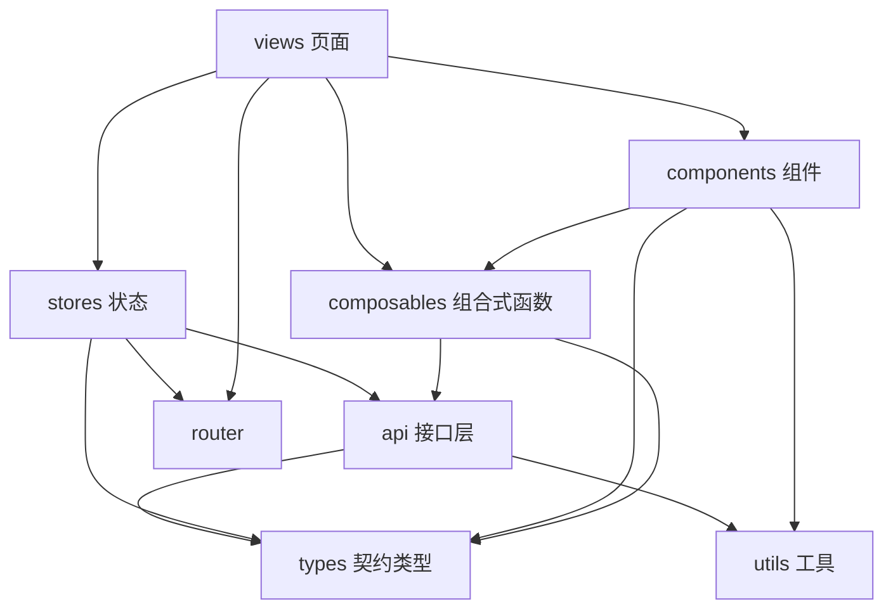
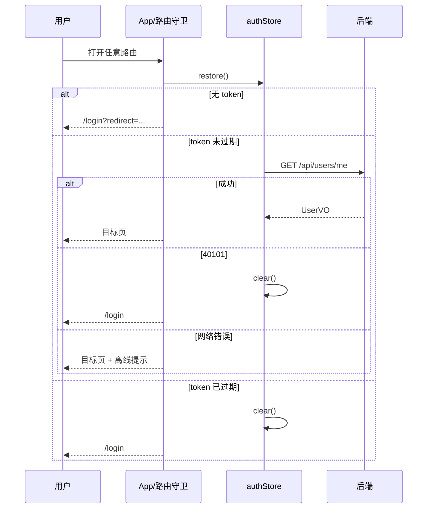
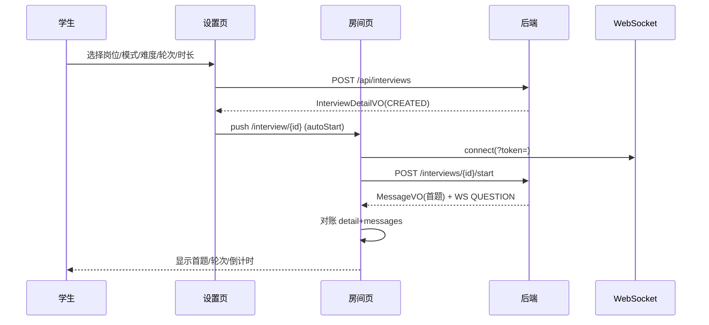
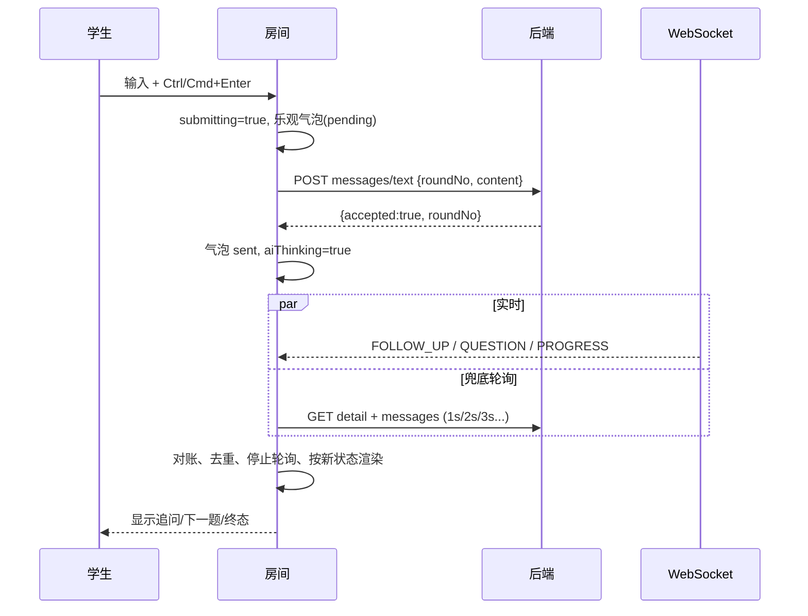
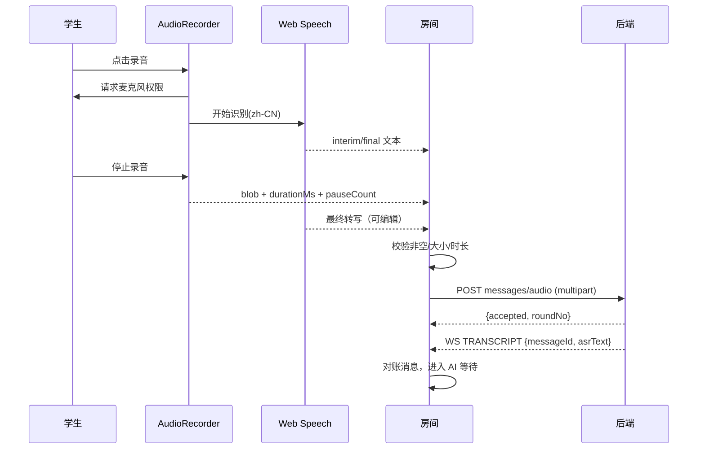
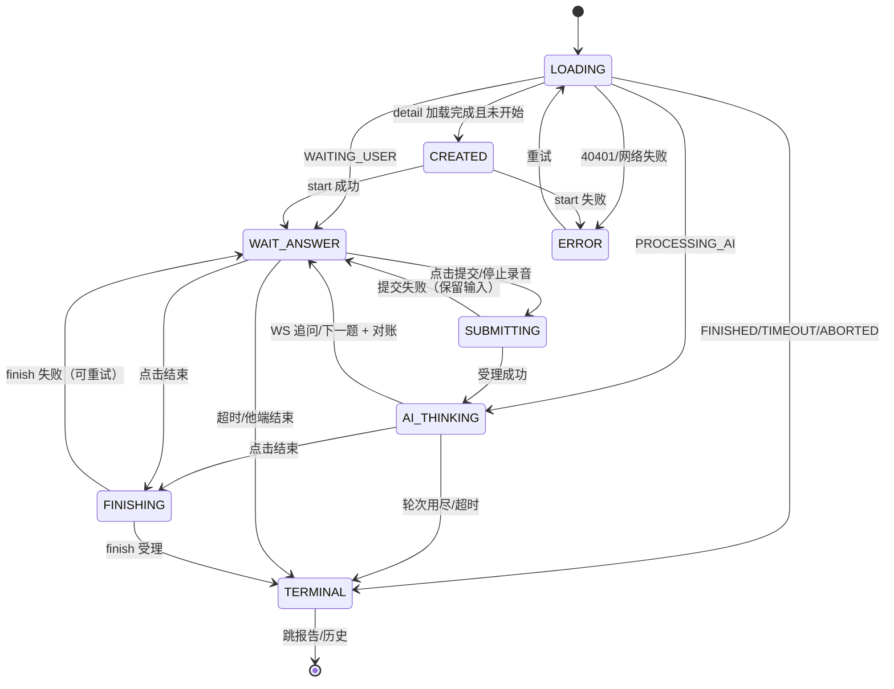
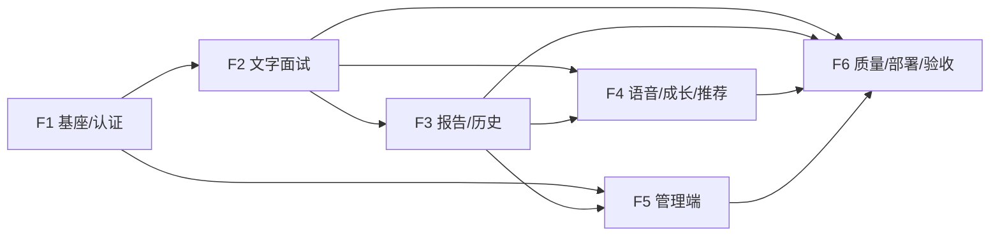

# AI模拟面试与能力提升平台 —— 开发计划

> 本文档为项目全部开发执行计划的整合版（2026-10-27 合并），按立项时间分三篇；**各篇为原计划文档全文保留**（仅将一级标题改为篇标题），篇内章节编号、任务编号（M-x / F-x / R-x）与验收对照表均未改动：
>
> | 篇 | 原文档 | 立项日期 |
> |---|---|---|
> | 第一篇 后端开发计划（M1~M6） | 《AI模拟面试与能力提升平台_后端开发计划》 | 2026-10-13 |
> | 第二篇 前端开发计划（F1~F6，v1.1 含液态玻璃视觉规范） | 《AI模拟面试与能力提升平台_前端开发计划》 | 2026-10-17 |
> | 第三篇 简历分析与个性化面试 后端开发计划（R1~R4） | 《AI模拟面试与能力提升平台_简历分析与个性化面试_后端开发计划》 | 2026-10-26 |
>
> **阅读约定**：文中"计划 / 本计划"指所在篇；"方案 §x"指向《AI模拟面试与能力提升平台_开发方案》（基线方案章节编号未变；简历相关内容的映射见其附录 A）；"简历方案 §x""协议 §x"同样按开发方案附录 A 对照定位。用户级 AI 服务配置（V9）无独立计划篇，交付记录见《进度记录》产物 #27 与决策 D57~D60。
>
> 各篇的实际执行结果、偏差与决策以《AI模拟面试与能力提升平台_进度记录》为准；M6 验收与修复证据见《AI模拟面试与能力提升平台_验收与质量记录》。

---

# 第一篇 后端开发计划（M1~M6，2026-10-13 立项）

> 本计划依据《AI模拟面试与能力提升平台_开发方案.md》（下称"方案"）编写，把方案中的后端要求拆解为可执行、可验证的开发任务。文中"方案 §x"均指向该文档的章节号。
>
> 交付边界：**仅后端 `ai-interview/backend`**。前端只保留目录约定与联调接口契约，不在本计划范围内。

---

## 目录

1. [概述与目标](#1-概述与目标)
2. [开发环境搭建](#2-开发环境搭建)
3. [数据库实施计划](#3-数据库实施计划)
4. [工程结构与模块设计](#4-工程结构与模块设计)
5. [接口实现清单](#5-接口实现清单)
6. [核心业务实现设计](#6-核心业务实现设计)
7. [安全设计落地](#7-安全设计落地)
8. [测试计划](#8-测试计划)
9. [里程碑与任务分解](#9-里程碑与任务分解)
10. [部署方案](#10-部署方案)
11. [风险与应对](#11-风险与应对)
12. [验收对照表](#12-验收对照表)
- [附录A 错误码表](#附录a-错误码表)
- [附录B 配置项清单](#附录b-配置项清单)
- [附录C 核心流程 curl 验证脚本](#附录c-核心流程-curl-验证脚本)

---

## 1. 概述与目标

### 1.1 系统闭环

```text
选择岗位 → 题库组卷 → AI多轮面试 → 动态追问
       → 多维评估 → 生成报告 → 学习推荐 → 能力成长记录
```

后端承担其中全部业务逻辑：认证鉴权、岗位与题库、面试状态机与实时推送、大模型调用与容错、知识库检索（轻量 RAG）、评分与报告、能力成长与推荐、管理端维护。

### 1.2 技术栈（固定，来自方案 §3.2 / §3.3）

| 层 | 技术 | 版本/选型 |
|---|---|---|
| JDK | Java | 17（本机为 JDK 25，用 `--release 17` 编译，见 §2.1） |
| 框架 | Spring Boot | 3.3.x（建议 3.3 线最新补丁版） |
| Web | Spring MVC | 随 Boot |
| 安全 | Spring Security 6 + JWT(jjwt 0.12.x) | 无状态认证 |
| ORM | MyBatis-Plus 3.5.x | 用 `mybatis-plus-spring-boot3-starter` |
| 数据库 | MySQL | 8.0（utf8mb4，FULLTEXT + ngram） |
| 缓存 | Redis | 7（token 黑名单、限流、会话缓存） |
| 实时 | Spring WebSocket | 面试过程推送 |
| HTTP 客户端 | Spring WebClient（WebFlux 仅作客户端） | 调用大模型 |
| 校验 | Jakarta Validation | 请求参数校验 |
| 迁移 | Flyway（flyway-mysql） | 建表与种子数据 |
| 构建 | Maven | 3.9.x |
| AI | OpenAI 兼容 Chat API；演示模型 qwen-plus；`MockAiProvider` 离线兜底 | 默认 `ai.provider=mock` |

### 1.3 已确认的开发决策

| 决策点 | 结论 |
|---|---|
| MySQL / Redis 来源 | Docker Compose 容器提供（本机 colima 已运行，未安装原生 MySQL/Redis） |
| JDK | 本机仅 JDK 25；编译统一 `maven.compiler.release=17`；**运行建议安装 Temurin 17**（规避 CGLIB/ByteBuddy 对新 class 文件版本的兼容问题，见 §11 R1） |
| AI Provider | 双实现齐备，默认 `mock`，离线可完整演示；配置环境变量后切真实千问 |
| 管理员操作日志 | 按方案 §15.10"或应用日志"选项，用 SLF4J 结构化日志记录，**不建第 10 张表**，严守 9 张表约束 |

### 1.4 后端交付物总览

| 交付物 | 说明 |
|---|---|
| `backend/` Maven 工程 | Spring Boot 3.3 单体，10 个业务包 + common（§4） |
| Flyway 脚本 6 个 | V1 建表（9 张表完整 DDL）+ V2~V6 种子数据（§3.4） |
| REST 接口路径 31 个（含 §5.5 扩展组）+ WebSocket 1 个 | 见 §5 接口清单 |
| 单元测试 ≥ 10 个测试类 | 纯逻辑 JUnit5 + Mockito（§8.1） |
| 集成测试 ≥ 7 个测试类 | MockMvc + Testcontainers MySQL（§8.2） |
| `docker-compose.yml` + `Dockerfile` | mysql/redis/backend/frontend/nginx 五服务（§10） |
| `backend/README.md` | 本地启动、联调、切换 AI Provider、常见问题 |

---

## 2. 开发环境搭建

### 2.1 JDK 与 Maven

本机现状（已检测）：JDK 25（Temurin，arm64）、Maven 3.9.16、Docker（colima）运行中、Node 22（仅前端用）。MySQL/Redis 未安装，全部走 Docker。

```bash
# 建议安装 Temurin 17 用于"运行"（编译用 release 17 即可，JDK 25 也能编）：
brew install --cask temurin@17
# 查看与切换：
/usr/libexec/java_home -V
export JAVA_HOME=$(/usr/libexec/java_home -v 17)
```

`pom.xml` 中统一：

```xml
<properties>
  <java.version>17</java.version>
  <maven.compiler.release>17</maven.compiler.release>
</properties>
```

> 若坚持用 JDK 25 运行，遇到 CGLIB/ByteBuddy 报 `Unsupported class file major version` 时，加 JVM 参数 `-Dnet.bytebuddy.experimental=true` 临时规避（§11 R1）。开发环境以 Temurin 17 运行为准，不依赖该参数。

### 2.2 Docker Compose 提供开发依赖

工作目录 `ai-interview/` 下新建 `docker-compose.dev.yml`（开发期只起 MySQL + Redis）：

```yaml
services:
  mysql:
    image: mysql:8.0
    container_name: aiinterview-mysql
    environment:
      MYSQL_ROOT_PASSWORD: root123456
      MYSQL_DATABASE: ai_interview        # Flyway 负责建表，这里只建空库
      TZ: Asia/Shanghai
    command:
      - --character-set-server=utf8mb4
      - --collation-server=utf8mb4_unicode_ci
      - --ngram-token-size=2              # 中文全文检索最小粒度（默认即 2，显式声明）
    ports:
      - "3306:3306"
    volumes:
      - mysql-data:/var/lib/mysql
    healthcheck:
      test: ["CMD", "mysqladmin", "ping", "-h", "localhost", "-proot123456"]
      interval: 5s
      retries: 10

  redis:
    image: redis:7-alpine
    container_name: aiinterview-redis
    ports:
      - "6379:6379"
    healthcheck:
      test: ["CMD", "redis-cli", "ping"]
      interval: 5s
      retries: 10

volumes:
  mysql-data:
```

```bash
docker compose -f docker-compose.dev.yml up -d   # colima 环境端口自动转发到 127.0.0.1
docker compose -f docker-compose.dev.yml ps      # 确认两个服务 healthy
```

要点：

1. colima 会把容器端口自动转发到宿主机 `127.0.0.1`，Spring Boot 直连 `jdbc:mysql://127.0.0.1:3306/ai_interview` 即可。
2. colima 默认 2C/2GB 内存对 MySQL 8 偏紧，若启动缓慢或被 OOM kill：`colima stop && colima start --cpu 4 --memory 6`（§11 R2）。
3. ngram 是 MySQL 8 内置全文解析器，**无需安装插件**，但建 FULLTEXT 索引必须带 `WITH PARSER ngram`，否则中文按空格分词几乎检索不到（§3.3）。

### 2.3 创建工程骨架

```bash
mkdir -p ai-interview/backend && cd ai-interview/backend
# 用 https://start.spring.io 生成（依赖勾选）：
#   web, security, validation, websocket, data-redis,
#   flyway(+flyway-mysql), aop, actuator
# 手工追加依赖：mybatis-plus-spring-boot3-starter、mysql-connector-j、jjwt-api/impl/jackson、lombok、spring-webflux(仅WebClient)
```

`application.yml` 分 `dev` / `prod` 两 profile，dev 直连本机容器端口，prod 用服务名（§10.3、附录 B）。

### 2.4 IDE 与工具约定

- IDEA：装 Lombok 插件、Annotation Processing 开启；项目编码 UTF-8。
- 接口调试：curl / IDEA HTTP Client（`backend/api.http` 纳入版本管理，见附录 C）。
- 数据库查看：IDEA Database 面板直连 `127.0.0.1:3306`。

---

## 3. 数据库实施计划

### 3.1 总体约定

- 9 张表：`sys_user`、`position`、`question`、`interview_session`、`interview_message`、`knowledge_chunk`、`evaluation_report`、`ability_record`、`learning_resource`（方案 §9）。
- 引擎 InnoDB、字符集 `utf8mb4`、排序规则 `utf8mb4_unicode_ci`。
- 时间列 `DATETIME`，默认 `CURRENT_TIMESTAMP`，更新列加 `ON UPDATE CURRENT_TIMESTAMP`。
- **`position` 是 MySQL 保留字**，所有 DDL 与 SQL 一律反引号包裹 `` `position` ``。
- **JSON 列不能建 FULLTEXT 索引**：`knowledge_chunk.keywords`、`skill_tags` 因此用 `VARCHAR` 存逗号分隔值（可全文检索），题目/报告类 JSON 字段用 MySQL `JSON` 类型 + MyBatis-Plus `JacksonTypeHandler`。
- 外键：核心归属关系（question→position、session→user/position、message→session、report→session）建外键，便于课程设计答辩时说明完整性约束；高频写入表（interview_message）外键在压测出现瓶颈时可去掉，默认保留。
- 方案 §9 只给出 `sys_user` 完整 DDL，其余 8 张的 DDL 由本计划补全如下，字段名与方案 §9 字段清单逐一对应，**实施时直接照抄本节 SQL**。

### 3.2 建表 DDL（V1__init_schema.sql 全文）

```sql
-- ========== 1. 用户表（来自方案 §9.1，原文照抄 + 补充索引） ==========
CREATE TABLE sys_user (
    id            BIGINT       PRIMARY KEY AUTO_INCREMENT,
    username      VARCHAR(50)  NOT NULL UNIQUE,
    password_hash VARCHAR(255) NOT NULL,
    real_name     VARCHAR(50),
    role          VARCHAR(20)  NOT NULL DEFAULT 'STUDENT',   -- STUDENT / ADMIN
    major         VARCHAR(100),
    status        TINYINT      NOT NULL DEFAULT 1,           -- 1启用 0禁用
    created_at    DATETIME     NOT NULL DEFAULT CURRENT_TIMESTAMP,
    updated_at    DATETIME     NOT NULL DEFAULT CURRENT_TIMESTAMP ON UPDATE CURRENT_TIMESTAMP,
    KEY idx_user_role (role)
) ENGINE=InnoDB DEFAULT CHARSET=utf8mb4 COLLATE=utf8mb4_unicode_ci;

-- ========== 2. 岗位表 ==========
CREATE TABLE `position` (
    id                   BIGINT       PRIMARY KEY AUTO_INCREMENT,
    code                 VARCHAR(50)  NOT NULL UNIQUE,        -- JAVA_BACKEND / WEB_FRONTEND
    name                 VARCHAR(100) NOT NULL,
    description          VARCHAR(500),
    competency_model_json JSON,                               -- 能力模型 + 评分权重，结构见 §3.5
    default_rounds       INT          NOT NULL DEFAULT 6,     -- 默认主问题数 5~8
    enabled              TINYINT      NOT NULL DEFAULT 1,
    created_at           DATETIME     NOT NULL DEFAULT CURRENT_TIMESTAMP,
    updated_at           DATETIME     NOT NULL DEFAULT CURRENT_TIMESTAMP ON UPDATE CURRENT_TIMESTAMP
) ENGINE=InnoDB DEFAULT CHARSET=utf8mb4 COLLATE=utf8mb4_unicode_ci;

-- ========== 3. 题目表 ==========
CREATE TABLE question (
    id                       BIGINT        PRIMARY KEY AUTO_INCREMENT,
    position_id              BIGINT        NOT NULL,
    type                     VARCHAR(20)   NOT NULL,          -- TECHNICAL/PROJECT/SCENARIO/BEHAVIORAL
    content                  VARCHAR(1000) NOT NULL,
    background               VARCHAR(1000),                   -- 题目背景描述（可空）
    difficulty               TINYINT       NOT NULL DEFAULT 3,-- 1~5
    skill_tags_json          JSON          NOT NULL,          -- ["redis","缓存"]
    reference_answer         TEXT,                           -- 参考答案
    key_points_json          JSON,                           -- 关键得分点
    deduction_points_json    JSON,                           -- 常见失分点
    followup_templates_json  JSON,                           -- 预设追问模板（AI不可用时的兜底）
    status                   VARCHAR(20)   NOT NULL DEFAULT 'ENABLED',  -- ENABLED/DISABLED
    version                  INT           NOT NULL DEFAULT 1,-- 管理端修改题目的乐观锁版本号
    created_at               DATETIME      NOT NULL DEFAULT CURRENT_TIMESTAMP,
    updated_at               DATETIME      NOT NULL DEFAULT CURRENT_TIMESTAMP ON UPDATE CURRENT_TIMESTAMP,
    KEY idx_question_select (position_id, type, difficulty, status),
    CONSTRAINT fk_question_position FOREIGN KEY (position_id) REFERENCES `position`(id)
) ENGINE=InnoDB DEFAULT CHARSET=utf8mb4 COLLATE=utf8mb4_unicode_ci;

-- ========== 4. 面试会话表 ==========
CREATE TABLE interview_session (
    id              BIGINT        PRIMARY KEY AUTO_INCREMENT,
    user_id         BIGINT        NOT NULL,
    position_id     BIGINT        NOT NULL,
    mode            VARCHAR(20)   NOT NULL DEFAULT 'TEXT',    -- TEXT / AUDIO
    difficulty      TINYINT       NOT NULL DEFAULT 3,
    planned_rounds  INT           NOT NULL DEFAULT 6,         -- 计划主问题数 5~8
    current_round   INT           NOT NULL DEFAULT 0,         -- 当前主问题序号（0-based，追问不+1）
    status          VARCHAR(20)   NOT NULL DEFAULT 'CREATED', -- 状态机见 §6.1
    total_score     DECIMAL(5,2),                             -- 结束后回填
    started_at      DATETIME,
    finished_at     DATETIME,
    created_at      DATETIME      NOT NULL DEFAULT CURRENT_TIMESTAMP,
    KEY idx_session_user (user_id, status),
    KEY idx_session_position (position_id),
    CONSTRAINT fk_session_user     FOREIGN KEY (user_id)    REFERENCES sys_user(id),
    CONSTRAINT fk_session_position FOREIGN KEY (position_id) REFERENCES `position`(id)
) ENGINE=InnoDB DEFAULT CHARSET=utf8mb4 COLLATE=utf8mb4_unicode_ci;

-- ========== 5. 面试消息表 ==========
CREATE TABLE interview_message (
    id                 BIGINT       PRIMARY KEY AUTO_INCREMENT,
    session_id         BIGINT       NOT NULL,
    round_no           INT          NOT NULL,                 -- 所属主问题轮次（0-based）
    speaker            VARCHAR(10)  NOT NULL,                 -- AI / USER / SYSTEM
    input_type         VARCHAR(10),                           -- TEXT / AUDIO（仅 USER 消息有值）
    content_text       TEXT,                                  -- 文字内容（AI问题或学生文字回答）
    audio_path         VARCHAR(255),                          -- 音频相对路径 uploads/audio/...
    audio_duration_ms  INT,
    asr_text           TEXT,                                  -- 前端 Web Speech API 转写文本
    question_id        BIGINT,                                -- AI 消息关联的题目/追问来源题
    keywords_json      JSON,                                  -- 后端从回答中提取的关键词（供检索与报告）
    created_at         DATETIME     NOT NULL DEFAULT CURRENT_TIMESTAMP,
    KEY idx_message_session (session_id, round_no, speaker),
    CONSTRAINT fk_message_session FOREIGN KEY (session_id) REFERENCES interview_session(id)
) ENGINE=InnoDB DEFAULT CHARSET=utf8mb4 COLLATE=utf8mb4_unicode_ci;

-- ========== 6. 知识片段表（轻量 RAG 数据源） ==========
CREATE TABLE knowledge_chunk (
    id          BIGINT       PRIMARY KEY AUTO_INCREMENT,
    position_id BIGINT       NOT NULL,
    title       VARCHAR(200) NOT NULL,
    content     TEXT         NOT NULL,                        -- 300~800 字知识片段
    keywords    VARCHAR(500) NOT NULL,                        -- 逗号分隔；VARCHAR 而非 JSON，为建全文索引
    skill_tags  VARCHAR(200) NOT NULL,                        -- 逗号分隔技能编码，与能力模型 skill_code 对齐
    source_type VARCHAR(20)  NOT NULL DEFAULT 'MANUAL',       -- MANUAL / DOC_SLICE
    status      VARCHAR(20)  NOT NULL DEFAULT 'ENABLED',
    created_at  DATETIME     NOT NULL DEFAULT CURRENT_TIMESTAMP,
    -- 中文全文检索：ngram 解析器 + 联合索引（MATCH 列必须同属一个索引）
    FULLTEXT KEY ft_chunk_text (content, keywords) WITH PARSER ngram,
    KEY idx_chunk_position (position_id, status)
) ENGINE=InnoDB DEFAULT CHARSET=utf8mb4 COLLATE=utf8mb4_unicode_ci;

-- ========== 7. 评估报告表 ==========
CREATE TABLE evaluation_report (
    id                    BIGINT        PRIMARY KEY AUTO_INCREMENT,
    session_id            BIGINT        NOT NULL UNIQUE,
    total_score           DECIMAL(5,2)  NOT NULL,
    dimension_scores_json JSON          NOT NULL,            -- 六维得分 {"technical":82,...}
    strengths_json        JSON,                              -- 亮点数组
    weaknesses_json       JSON,                              -- 不足数组
    improvement_plan_json JSON,                              -- 改进建议/练习计划数组
    report_text           TEXT,                              -- AI 生成的整体评语
    created_at            DATETIME      NOT NULL DEFAULT CURRENT_TIMESTAMP,
    CONSTRAINT fk_report_session FOREIGN KEY (session_id) REFERENCES interview_session(id)
) ENGINE=InnoDB DEFAULT CHARSET=utf8mb4 COLLATE=utf8mb4_unicode_ci;

-- ========== 8. 能力记录表 ==========
CREATE TABLE ability_record (
    id                BIGINT       PRIMARY KEY AUTO_INCREMENT,
    user_id           BIGINT       NOT NULL,
    position_id       BIGINT       NOT NULL,
    skill_code        VARCHAR(50)  NOT NULL,                  -- 对应能力模型 skill_code
    score             DECIMAL(5,2) NOT NULL,                  -- 该技能本次掌握度（0~100）
    source_session_id BIGINT,
    evaluated_at      DATETIME     NOT NULL DEFAULT CURRENT_TIMESTAMP,
    KEY idx_ability_query (user_id, position_id, skill_code, evaluated_at),
    CONSTRAINT fk_ability_user FOREIGN KEY (user_id) REFERENCES sys_user(id)
) ENGINE=InnoDB DEFAULT CHARSET=utf8mb4 COLLATE=utf8mb4_unicode_ci;

-- ========== 9. 学习资源表 ==========
CREATE TABLE learning_resource (
    id            BIGINT       PRIMARY KEY AUTO_INCREMENT,
    position_id   BIGINT       NOT NULL,
    skill_code    VARCHAR(50)  NOT NULL,
    title         VARCHAR(200) NOT NULL,
    resource_type VARCHAR(20)  NOT NULL,                      -- ARTICLE / QUESTION / PRACTICE / PROJECT
    content_url   VARCHAR(500),
    difficulty    TINYINT      NOT NULL DEFAULT 2,
    enabled       TINYINT      NOT NULL DEFAULT 1,
    created_at    DATETIME     NOT NULL DEFAULT CURRENT_TIMESTAMP,
    KEY idx_resource_match (position_id, skill_code, enabled)
) ENGINE=InnoDB DEFAULT CHARSET=utf8mb4 COLLATE=utf8mb4_unicode_ci;
```

### 3.3 FULLTEXT 检索说明（实施时直接使用）

```sql
-- 检索 SQL（KnowledgeChunkMapper 中 @Select 实现，BOOLEAN MODE，词间 + 连接）：
SELECT id, title, content, skill_tags,
       MATCH(content, keywords) AGAINST(:kw IN BOOLEAN MODE) AS score
FROM knowledge_chunk
WHERE status = 'ENABLED'
  AND position_id = :positionId
  AND MATCH(content, keywords) AGAINST(:kw IN BOOLEAN MODE) > 0
ORDER BY score DESC
LIMIT 5;
```

注意：ngram `ngram-token-size=2`，**单个汉字查询不命中**，关键词提取阶段必须保证查询词 ≥ 2 个汉字（§6.5）。

### 3.4 Flyway 脚本拆分

| 脚本 | 内容 | 行数量级 |
|---|---|---|
| `V1__init_schema.sql` | §3.2 全部 DDL | ~150 |
| `V2__seed_users_positions.sql` | 管理员账号（admin，BCrypt）、演示学生、2 个岗位 + 能力模型 JSON | ~80 |
| `V3__seed_questions_java.sql` | Java 后端岗 30 题（技术 15 / 项目 6 / 场景 6 / 行为 3） | ~500 |
| `V4__seed_questions_frontend.sql` | Web 前端岗 30 题（同比例） | ~500 |
| `V5__seed_knowledge_chunks.sql` | 知识片段：两岗位各 ≥ 20 条（合计 ≥ 40） | ~700 |
| `V6__seed_learning_resources.sql` | 学习资源：两岗位各 ≥ 10 条（合计 ≥ 20） | ~60 |

种子数据中的 BCrypt 密码散列开发期用固定值（如 `123456` 的散列），生成方式：`htpasswd -bnBC 10 "" 123456` 或写一个临时测试用 `BCryptPasswordEncoder.encode` 产出。

### 3.5 `competency_model_json` 结构约定（两岗位共用 Schema）

```json
{
  "skills": [
    { "skillCode": "java_basics", "skillName": "Java基础与面向对象",
      "description": "集合、异常、面向对象设计", "weight": 0.15, "requiredLevel": 70 }
  ],
  "scoreWeights": {
    "content":  { "technical": 0.30, "depth": 0.25, "logic": 0.20, "evidence": 0.15, "match": 0.10 },
    "expression": { "clarity": 0.30, "fluency": 0.20, "pace": 0.20, "confidence": 0.15, "completeness": 0.15 },
    "total": { "content": 0.50, "expression": 0.30, "adaptability": 0.10, "match": 0.10 }
  }
}
```

- 六个评分维度编码固定：`technical`（技术正确性）、`depth`（知识深度）、`logic`（逻辑严谨性）、`match`（岗位匹配度）、`communication`（沟通表达）、`voice`（语音表现）。
- `scoreWeights` 落库于岗位，管理端可改，实现方案"权重保存到数据库中，可以按岗位调整"（§7.2）。缺省时使用上述默认值。
- 两岗位技能清单：Java 后端取方案 §6.2 的 7 组技能映射为 `java_basics / concurrency_jvm / spring / mysql / redis_mq / project_design / communication`；前端取 `html_css_js / browser_network / vue3 / engineering / performance / security / project_ux`。各技能 `weight` 之和 = 1。

### 3.6 种子题库清单（V3/V4 内容规划）

**Java 后端岗 30 题**（type/difficulty/技能标签/题目）：

| # | 类型 | 难度 | 技能标签 | 题目 |
|---|---|---|---|---|
| 1 | TECHNICAL | 2 | java_basics | 谈谈 Java 面向对象三大特性，结合项目举例说明多态的使用场景 |
| 2 | TECHNICAL | 2 | java_basics | HashMap 的底层实现原理是什么？JDK 8 做了哪些优化？ |
| 3 | TECHNICAL | 3 | java_basics | ArrayList 与 LinkedList 的区别？各自适合什么场景？ |
| 4 | TECHNICAL | 3 | java_basics | Java 异常体系分为哪几类？受检异常和非受检异常如何选择？ |
| 5 | TECHNICAL | 3 | concurrency_jvm | synchronized 和 ReentrantLock 的区别与选择 |
| 6 | TECHNICAL | 3 | concurrency_jvm | 线程池的核心参数有哪些？任务提交后的执行流程是什么？ |
| 7 | TECHNICAL | 4 | concurrency_jvm | 谈谈 JVM 内存区域划分，以及哪些区域可能 OOM |
| 8 | TECHNICAL | 4 | concurrency_jvm | 什么是 volatile？它和锁的区别是什么？ |
| 9 | TECHNICAL | 2 | spring | 什么是 Spring IOC 和依赖注入？它解决了什么问题？ |
| 10 | TECHNICAL | 3 | spring | Spring Bean 的生命周期和作用域 |
| 11 | TECHNICAL | 3 | spring | Spring 事务传播行为有哪些？REQUIRED 和 REQUIRES_NEW 的区别？ |
| 12 | TECHNICAL | 4 | spring | Spring Boot 自动装配的原理是什么？ |
| 13 | TECHNICAL | 3 | mysql | MySQL 索引为什么用 B+ 树而不是 B 树或哈希表？ |
| 14 | TECHNICAL | 3 | mysql | 什么情况下索引会失效？如何分析一条慢 SQL？ |
| 15 | TECHNICAL | 4 | redis_mq | Redis 常见数据结构及使用场景；缓存穿透/击穿/雪崩的区别与对策 |
| 16 | PROJECT | 3 | project_design | 介绍你项目中最复杂的模块，复杂在哪里、你是如何设计的 |
| 17 | PROJECT | 3 | project_design | 你的项目中遇到过最棘手的 bug 是什么？讲讲排查过程 |
| 18 | PROJECT | 4 | project_design | 你的项目如果用户量增长 100 倍，哪些地方会先成为瓶颈？ |
| 19 | PROJECT | 3 | project_design | 项目中你负责的模块与其他人如何协作？接口如何约定？ |
| 20 | PROJECT | 2 | project_design | 项目中你使用过哪些设计模式？为什么要用？ |
| 21 | PROJECT | 4 | project_design | 如果让你重构你的项目，你会改进哪三点？为什么当初没这么做？ |
| 22 | SCENARIO | 3 | mysql | 线上接口响应从 50ms 变成 3s，说说你的排查思路 |
| 23 | SCENARIO | 4 | redis_mq | 秒杀场景下如何防止超卖？说说你的方案 |
| 24 | SCENARIO | 3 | spring | 接口偶发返回旧数据（缓存与库不一致），如何定位与解决？ |
| 25 | SCENARIO | 4 | concurrency_jvm | 服务频繁 Full GC 导致超时，如何应急处理与根治？ |
| 26 | SCENARIO | 4 | project_design | 部署后数据库 CPU 飙到 100%，你按什么顺序排查？ |
| 27 | SCENARIO | 3 | redis_mq | 消息队列消息积压了百万条，怎么办？ |
| 28 | BEHAVIORAL | 2 | communication | 和团队成员技术方案意见不一致，你是怎么处理的？举真实例子 |
| 29 | BEHAVIORAL | 3 | communication | 讲一次你在压力下完成任务的经历 |
| 30 | BEHAVIORAL | 2 | communication | 你的学习方法是什么？最近在学什么新技术？ |

**Web 前端岗 30 题**（同比例：技术 15 / 项目 6 / 场景 6 / 行为 3）：

| # | 类型 | 难度 | 技能标签 | 题目 |
|---|---|---|---|---|
| 1 | TECHNICAL | 2 | html_css_js | 说说盒模型，标准盒模型和 IE 盒模型的区别及转换方式 |
| 2 | TECHNICAL | 3 | html_css_js | JS 事件循环（Event Loop）机制；宏任务和微任务的执行顺序 |
| 3 | TECHNICAL | 3 | html_css_js | var、let、const 的区别；什么是暂时性死区？ |
| 4 | TECHNICAL | 3 | html_css_js | 闭包是什么？有哪些实际应用和内存注意事项？ |
| 5 | TECHNICAL | 4 | html_css_js | Promise 和 async/await 的关系；错误如何捕获？ |
| 6 | TECHNICAL | 3 | browser_network | 从输入 URL 到页面渲染经历了什么？ |
| 7 | TECHNICAL | 3 | browser_network | 浏览器同源策略与 CORS 的原理；跨域解决方案对比 |
| 8 | TECHNICAL | 4 | browser_network | HTTP 缓存机制（强缓存/协商缓存）如何工作？ |
| 9 | TECHNICAL | 2 | vue3 | Vue 响应式原理；Vue3 的 Proxy 方案与 Vue2 有何不同？ |
| 10 | TECHNICAL | 3 | vue3 | ref 和 reactive 的区别与使用选择 |
| 11 | TECHNICAL | 3 | vue3 | computed 和 watch 的区别？watchEffect 适合什么场景？ |
| 12 | TECHNICAL | 4 | vue3 | Vue 组件间通信方式有哪些？复杂状态为什么用 Pinia？ |
| 13 | TECHNICAL | 3 | engineering | Vite 为什么比 Webpack 快？ESM 和打包构建的区别 |
| 14 | TECHNICAL | 4 | security | 前端安全：XSS 和 CSRF 的原理与防御 |
| 15 | TECHNICAL | 3 | performance | 首屏加载慢，有哪些测量与优化手段？ |
| 16 | PROJECT | 3 | project_ux | 介绍你做过的前端项目中最复杂的页面/组件，复杂在哪 |
| 17 | PROJECT | 3 | project_ux | 你的项目如何做组件设计？举一个可复用组件的例子 |
| 18 | PROJECT | 4 | project_ux | 项目中前后端接口联调出过什么问题？如何避免？ |
| 19 | PROJECT | 3 | engineering | 你的项目如何管理环境变量、构建与发布流程？ |
| 20 | PROJECT | 2 | project_ux | 项目中用过哪些 UI 组件库？二次封装过组件吗？ |
| 21 | PROJECT | 4 | project_ux | 如果重做你的项目，前端架构上你会改进什么？ |
| 22 | SCENARIO | 3 | performance | 页面列表滚动到 1 万条数据时严重卡顿，如何优化？ |
| 23 | SCENARIO | 3 | browser_network | 用户反馈页面白屏，你怎么定位？ |
| 24 | SCENARIO | 4 | performance | 打包体积过大导致加载慢，如何分析与瘦身？ |
| 25 | SCENARIO | 4 | vue3 | 表单复杂联动 + 频繁输入导致卡顿，你怎么处理？ |
| 26 | SCENARIO | 3 | security | 需要在前端保存登录态，如何权衡安全和体验？ |
| 27 | SCENARIO | 3 | project_ux | 设计稿在不通过的机型上错位，你的适配方案？ |
| 28 | BEHAVIORAL | 2 | communication | 和后端/产品对需求有分歧时你怎么沟通？举例子 |
| 29 | BEHAVIORAL | 3 | communication | 讲一次你赶工期还要保证质量的经历 |
| 30 | BEHAVIORAL | 2 | communication | 你平时如何跟进前端新技术？最近学了什么？ |

每道题的 `key_points_json`（3~6 个得分点）、`deduction_points_json`（2~4 个失分点）、`followup_templates_json`（2~3 条预设追问）在 V3/V4 脚本中逐题补全——**这是 M1 阶段工作量最大的部分，按每天 10 题的节奏推进**。格式样板：

```sql
INSERT INTO question (position_id, type, content, background, difficulty,
                      skill_tags_json, reference_answer, key_points_json,
                      deduction_points_json, followup_templates_json, status) VALUES
(1, 'TECHNICAL', '什么是 Spring IOC？', '假设候选人刚做完一个 Spring Boot 课程项目', 2,
 '["spring"]',
 'IOC 是控制反转……（200~400 字参考答案）',
 '["能说出控制反转与依赖注入的关系", "能结合容器说明对象生命周期托管", "能举出 @Autowired/@Bean 的例子"]',
 '["把 IOC 说成 DI 的同义词且无解释", "无法举出任何实际使用场景"]',
 '["你的项目里哪些对象交给了容器管理？为什么这个适合交给容器？", "如果不用 Spring，你会怎么手动组织这些依赖？"]',
 'ENABLED');
```

### 3.7 知识片段与学习资源种子规划

- **V5 知识片段（每岗 ≥ 20 条）**：按能力模型 7 个技能 × 每技能 3 条左右。内容来自经典面试考点的概念解释、优秀回答要点、常见错误（对应方案 §6.4 知识库内容 7 类）。每条 300~800 字，`keywords` 填 8~15 个逗号分隔关键词，`skill_tags` 与能力模型 `skill_code` 对齐。
- **V6 学习资源（每岗 ≥ 10 条）**：每技能 1~2 条，类型覆盖 ARTICLE（文章）/ QUESTION（面试题）/ PRACTICE（练习）/ PROJECT（项目实战），`content_url` 可用真实公开链接（MDN、MySQL 官方、Vue 文档等）。

### 3.8 能力掌握度的存取约定

- `ability_record` 只追加不更新，**每次面试结束为每个命中的 skill_code 插入一条**；"当前掌握度" = 该 (user, position, skill) 按 `evaluated_at` 最新一条的 `score`。
- 首次面试无历史记录时：`新掌握度 = 本次得分`（不再套 0.7/0.3 公式）；此后按方案 §8.1 `新 = 旧×0.7 + 本次×0.3`。
- 成长曲线数据源：按 `evaluated_at` 升序取全部记录即可画出每次面试后的掌握度变化。

---

## 4. 工程结构与模块设计

### 4.1 目录总览（对应方案 §12）

```text
ai-interview/
├── backend/
│   ├── pom.xml
│   ├── Dockerfile                      # M6 编写（§10.4）
│   ├── api.http                        # IDEA HTTP Client 调试脚本（附录 C 同步维护）
│   ├── uploads/                        # 音频等上传文件（开发期本地目录，部署时挂载卷）
│   └── src/main/java/com/example/interview/
│       ├── InterviewApplication.java
│       ├── auth/        # ① 认证、用户、JWT、Spring Security 接入
│       ├── position/    # ② 岗位与能力模型查询
│       ├── question/    # ③ 题库实体/组卷（管理接口在 admin 包）
│       ├── interview/   # ④ 面试会话、状态机、问答、WebSocket、音频存储
│       ├── knowledge/   # ⑤ 知识片段实体 + FULLTEXT 检索
│       ├── ai/          # ⑥ AiProvider 双实现、PromptBuilder、JSON 容错解析
│       ├── assessment/  # ⑦ 逐题评分、总分计算、语音指标、报告生成
│       ├── growth/      # ⑧ 掌握度、短板识别、推荐、历史
│       ├── admin/       # ⑨ 管理端接口
│       └── common/      # ⑩ 统一响应、异常、配置、工具、日志
│   └── src/main/resources/
│       ├── application.yml / application-dev.yml / application-prod.yml
│       └── db/migration/  # Flyway V1~V6
├── frontend/            # 不在本计划范围，占位
├── docker-compose.yml   # 正式五服务编排（§10）
└── README.md
```

### 4.2 依赖清单（pom.xml 关键项）

| 依赖 | groupId:artifactId | 版本 | 说明 |
|---|---|---|---|
| Web/MVC | org.springframework.boot:spring-boot-starter-web | Boot BOM | REST |
| Security | spring-boot-starter-security | BOM | 认证鉴权 |
| 校验 | spring-boot-starter-validation | BOM | Jakarta Validation |
| WebSocket | spring-boot-starter-websocket | BOM | 面试推送 |
| Redis | spring-boot-starter-data-redis | BOM | 黑名单/限流/缓存 |
| Flyway | org.flywaydb:flyway-core + flyway-mysql | BOM | 迁移 |
| WebClient | spring-boot-starter-webflux | BOM | 仅用 WebClient 调大模型 |
| ORM | com.baomidou:mybatis-plus-spring-boot3-starter | 3.5.7+ | 注意是 boot3 版 starter |
| 驱动 | com.mysql:mysql-connector-j | BOM 管理版本 | scope runtime |
| JWT | io.jsonwebtoken:jjwt-api / jjwt-impl / jjwt-jackson | 0.12.6 | impl/jackson scope runtime |
| Lombok | org.projectlombok:lombok | BOM | optional |
| 测试 | spring-boot-starter-test、spring-security-test | BOM | + org.testcontainers:mysql 1.20.x |

### 4.3 各模块类清单（实施核对表）

> 命名约定：实体与表名一致（`sys_user`→`SysUser`）；Mapper 继承 `BaseMapper<T>`；Service 接口 + Impl 可简化为单类（课程设计规模**直接用类，不强制接口**，答辩可说明取舍）。

**common（⑩）**

| 类 | 职责 |
|---|---|
| `common/result/Result<T>` | 统一响应 `{code, message, data, traceId}`（方案 §10.6） |
| `common/result/ResultCode` | 错误码枚举（附录 A） |
| `common/exception/BizException` | 业务异常（携带 ResultCode） |
| `common/exception/GlobalExceptionHandler` | `@RestControllerAdvice`：BizException→业务码；MethodArgumentNotValidException→40001；AccessDenied→40301；其余→50001 且不泄漏堆栈 |
| `common/config/SecurityConfig` | 过滤链、CORS、无状态会话、路由权限（§7.1） |
| `common/config/WebSocketConfig` | 注册 `InterviewWebSocketHandler` 到 `/ws/interviews/{sessionId}` |
| `common/config/MybatisPlusConfig` | 分页插件；`MetaObjectHandler` 自动填充 created_at/updated_at（或全部依赖 DB 默认值，二选一） |
| `common/config/WebClientConfig` | 超时 30s、连接池、日志过滤器（脱敏 API Key） |
| `common/config/AiProperties` | `@ConfigurationProperties(prefix="ai")`：provider/apiUrl/apiKey/model/timeout |
| `common/util/JwtUtils` | 签发/解析（uid、username、role、jti、exp） |
| `common/util/JsonUtils` | ObjectMapper 单例；JSON 列 TypeHandler 复用 |
| `common/util/TraceIdFilter` | 每请求生成 traceId 写 MDC，响应头回传 |
| `common/log/AuditLogAspect` | `@Around` 切面：admin 包 Controller 自动记录操作日志（脱敏） |

**auth（①）**

| 类 | 职责 |
|---|---|
| `auth/controller/AuthController` | register / login / logout |
| `auth/controller/UserController` | GET/PUT `/api/users/me` |
| `auth/service/AuthService` | 注册（用户名查重、BCrypt 加密）、登录（校验、签发 JWT、Redis 记录 jti）、登出（jti 加入黑名单直至过期） |
| `auth/service/UserService` | 个人资料查询/修改 |
| `auth/entity/SysUser`、`auth/mapper/UserMapper` | 表 1 |
| `auth/dto/RegisterRequest` | username(4~50)、password(6~32)、realName、major |
| `auth/dto/LoginRequest` / `LoginResponse` | token、过期时间、UserVO |
| `auth/dto/UserUpdateRequest` / `UserVO` | 脱敏视图（不含 passwordHash） |
| `auth/security/JwtAuthenticationFilter` | 解析 Bearer Token→装载 `UsernamePasswordAuthenticationToken`；先查 Redis 黑名单 |
| `auth/security/UserDetailsServiceImpl` | 按 username 装载用户与角色（ROLE_STUDENT/ROLE_ADMIN） |
| `auth/security/SecurityContextHolder`（自封装） | 静态取当前 userId/role，供归属校验 |

**position（②）**

| 类 | 职责 |
|---|---|
| `position/controller/PositionController` | GET 列表 / 详情 / skills（方案 §10.2） |
| `position/service/PositionService` | 查询 + 解析 competency_model_json |
| `position/entity/Position`、`position/mapper/PositionMapper` | 表 2 |
| `position/dto/PositionVO`、`SkillVO`、`ScoreWeightsVO` | 能力模型视图 |

**question（③）**

| 类 | 职责 |
|---|---|
| `question/entity/Question`、`question/mapper/QuestionMapper` | 表 3 |
| `question/service/QuestionService` | 供 admin CRUD 复用；`assemblePaper(positionId, difficulty, rounds)` 组卷（§6.3） |
| `question/dto/QuestionAdminVO`、`QuestionUpsertRequest` | 管理端字段校验（content 4~1000 字等） |

**interview（④）——核心模块**

| 类 | 职责 |
|---|---|
| `interview/controller/InterviewController` | §5.3 全部 9 个接口 |
| `interview/service/InterviewService` | 创建/start/回答处理/finish/abort/查询；每步先过状态机与归属校验 |
| `interview/service/TurnEngine` | 一轮问答编排（方案 §13.1 流程的代码化）：存回答→提关键词→检索知识→PromptBuilder→AiProvider→容错→存 AI 消息→WS 推送→推进状态 |
| `interview/statemachine/InterviewStatus`（枚举）+ `InterviewStateMachine` | §6.1 合法转换表 + 乐观更新 |
| `interview/websocket/InterviewWebSocketHandler` | 连接鉴权（query token）、会话注册表、按 type 推送 |
| `interview/websocket/WsMessage`、`WsMessageType` | QUESTION/TRANSCRIPT/FOLLOW_UP/TIMER/PROGRESS/REPORT_READY/ERROR（方案 §10.6） |
| `interview/scheduler/InterviewTimerScheduler` | 每会话定时推送剩余时间；到期自动 TIMEOUT 收卷 |
| `interview/storage/AudioStorageService` | 格式/大小校验，UUID 命名落盘 `uploads/audio/yyyyMM/`，返回相对路径 |
| `interview/entity/InterviewSession`、`InterviewMessage`；对应两个 Mapper | 表 4/5 |
| `interview/dto/CreateInterviewRequest`、`InterviewDetailVO`、`MessageVO`、`TextAnswerRequest`、`AudioAnswerForm`（multipart） | §5.3 |

**knowledge（⑤）**

| 类 | 职责 |
|---|---|
| `knowledge/entity/KnowledgeChunk`、`knowledge/mapper/KnowledgeChunkMapper` | 表 6；Mapper 含 §3.3 的 FULLTEXT @Select |
| `knowledge/service/KnowledgeSearchService` | 检索 Top5；无结果返回空列表（上层降级） |
| `knowledge/service/KeywordExtractor` | 词典匹配法提取关键词（§6.5） |

**ai（⑥）**

| 类 | 职责 |
|---|---|
| `ai/provider/AiProvider` | 接口：`nextQuestion / evaluateTurn / generateReport`（方案 §6.6 原文三方法） |
| `ai/provider/MockAiProvider` | 离线实现：模板追问（用题目 followup_templates）、**规则评分引擎**（关键词命中率→各维分）、结构化报告拼装；保证无网可全流程演示 |
| `ai/provider/OpenAiCompatibleProvider` | WebClient POST `{api-url}/chat/completions`；system prompt 要求只输出 JSON；30s 超时 |
| `ai/prompt/PromptBuilder` | 拼装：岗位能力模型 + 历史对话（近 10 条）+ 知识片段 + 当前指令（追问规则/难度指令）+ 输出 JSON Schema 说明 |
| `ai/parser/AiResponseParser` | 剥离 ```json 围栏→Jackson 反序列化→字段校验；失败重试 1 次→题目模板→抛 AiFallbackException 触发 Mock 降级（方案 §6.6 三级容错） |
| `ai/model/*` | AiNextQuestionResult、AiTurnEvaluation、AiReport、三个 Context、AiChatResponse（OpenAI 兼容响应 DTO） |

**assessment（⑦）**

| 类 | 职责 |
|---|---|
| `assessment/service/ReportService` | finish 编排（方案 §13.2）：汇总逐题→AiProvider.generateReport（失败用 Mock）→六维聚合→权重计算→落库 evaluation_report→回填 session.total_score→触发 growth 更新→WS 推 REPORT_READY |
| `assessment/engine/ScoreCalculator` | §6.6 权重公式；逐题分→总分；维度聚合（题目技能→六维映射） |
| `assessment/engine/VoiceMetricsCalculator` | 语速=转写字数÷时长(分钟)；停顿次数（转写中"……"/时长断裂，取前端上报）、语气词计数（嗯/啊/然后/就是等词典）；产出 voice 维度分 |
| `assessment/entity/EvaluationReport`、`assessment/mapper/EvaluationReportMapper` | 表 7 |
| `assessment/dto/ReportVO`、`QuestionEvidenceVO` | 报告视图：六维分、逐题（题目/回答/得分/coveredPoints/missingPoints/证据句/评分理由） |

**growth（⑧）**

| 类 | 职责 |
|---|---|
| `growth/controller/GrowthController` | growth / recommendations / history（方案 §10.4） |
| `growth/service/GrowthService` | 曲线序列、历史列表（分页，含总分与日期） |
| `growth/service/RecommendationService` | 短板识别→优先级排序→资源匹配→练习计划生成 |
| `growth/engine/MasteryUpdater` | 首次直取，之后 `旧×0.7+本次×0.3`（§3.8） |
| `growth/engine/WeaknessDetector` | 4 条短板规则（方案 §8.2） |
| `growth/engine/RecommendationEngine` | `优先级=(100-掌握度)×技能权重`（方案 §8.3） |
| `growth/entity/AbilityRecord`、`LearningResource`；两个 Mapper | 表 8/9 |
| `growth/dto/GrowthVO`、`RecommendationVO`、`HistoryItemVO` | 视图 |

**admin（⑨）**

| 类 | 职责 |
|---|---|
| `admin/controller/AdminQuestionController` | 题库 CRUD（方案 §10.5），version 乐观锁 |
| `admin/controller/AdminKnowledgeController` | 新增片段 / rebuild（重建全文索引：`ALTER TABLE ... FORCE` 或逐条 REINDEX，简化为 OPTIMIZE TABLE） |
| `admin/controller/AdminPositionController` | 岗位与能力模型/权重维护（方案 §4.2，接口为 §5.5 扩展组） |
| `admin/controller/AdminResourceController` | 学习资源 CRUD |
| `admin/controller/AdminUserController` | 用户列表/启停 |
| `admin/controller/AdminDashboardController` | 统计：用户数、面试场次、岗位题量、平均分、近 7 日面试数 |
| `admin/dto/*` | 各 UpsertRequest / VO |

### 4.4 横切约定

- **JSON 列映射**：实体 JSON 字段类型为 `List<String>` / `Map<String,Object>`，`@TableField(typeHandler = JacksonTypeHandler.class)`，实体加 `@TableName(autoResultMap = true)`。
- **事务**：`TurnEngine` 单轮处理、`ReportService` 报告生成、`MasteryUpdater` 掌握度更新各自 `@Transactional`；**AiProvider 调用放在事务外**（HTTP 调用不持锁）。
- **异步**：AI 调用与报告生成用 `@Async`（专用线程池 `aiExecutor`，核心 4 最大 8），避免 HTTP 请求挂 30s；WebSocket 推送在异步完成后执行。
- **日志**：TRACE/DEBUG 记录 Prompt 与 AI 原始返回（**打码 apiKey**）；INFO 记录业务节点；不打印密码、token、key（方案 §15.7）。

---

## 5. 接口实现清单

统一返回 `{code, message, data, traceId}`；除注册登录外全部 `Authorization: Bearer <jwt>`。**路径与方案 §10 逐字一致**；标注 ★ 的是方案 §4.2/§11 要求但 §10 未列出的管理端扩展接口。

### 5.1 认证与用户（auth）

| # | 接口 | 权限 | 请求 | 响应 data | 校验/错误 |
|---|---|---|---|---|---|
| 1 | POST `/api/auth/register` | 匿名 | `{username, password, realName?, major?}` | `UserVO` | username 4~50 唯一；password 6~32；重名→10001；禁用参数校验→40001 |
| 2 | POST `/api/auth/login` | 匿名 | `{username, password}` | `{token, expiresAt, user:UserVO}` | 错误→10002；限流 5 次/分/IP→42901；status=0→10003 |
| 3 | POST `/api/auth/logout` | 登录 | — | `null` | jti 进 Redis 黑名单至 token 过期 |
| 4 | GET `/api/users/me` | STUDENT/ADMIN | — | `UserVO` | |
| 5 | PUT `/api/users/me` | STUDENT/ADMIN | `{realName?, major?}` | `UserVO` | 不允许改 username/role |

### 5.2 岗位（position）

| # | 接口 | 权限 | 响应 data |
|---|---|---|---|
| 6 | GET `/api/positions` | 登录 | `[{id, code, name, description, defaultRounds}]`（enabled only） |
| 7 | GET `/api/positions/{id}` | 登录 | 详情 + 技能数 |
| 8 | GET `/api/positions/{id}/skills` | 登录 | `[{skillCode, skillName, description, weight, requiredLevel}]` |

### 5.3 面试（interview）——核心

| # | 接口 | 权限 | 请求 | 响应/推送 | 状态约束 |
|---|---|---|---|---|---|
| 9 | POST `/api/interviews` | STUDENT | `{positionId, mode:TEXT\|AUDIO, difficulty:1~5, rounds:5~8, durationMinutes:15~60}` | `InterviewDetailVO{id, status:CREATED, plannedRounds,...}` | 岗位 enabled；rounds 超界→40002 |
| 10 | POST `/api/interviews/{id}/start` | 归属本人 | — | HTTP 返回首题 `MessageVO`；同时 WS 推 `QUESTION`；status→RUNNING→WAITING_USER | 仅 CREATED |
| 11 | POST `/api/interviews/{id}/messages/text` | 归属本人 | `{roundNo, content:1~5000字}` | HTTP 返回 AI 下一条 `MessageVO`（异步：先受理回 `{accepted:true}`，结果走 WS） | 仅 WAITING_USER |
| 12 | POST `/api/interviews/{id}/messages/audio` | 归属本人 | multipart：`file`(webm/wav/mp3 ≤10MB) + `roundNo` + `asrText` + `durationMs` + `pauseCount?` | 同上 | 仅 WAITING_USER 且 mode=AUDIO |
| 13 | POST `/api/interviews/{id}/finish` | 归属本人 | — | `{reportId}`；报告就绪后 WS 推 `REPORT_READY` | WAITING_USER/PROCESSING_AI/RUNNING |
| 14 | POST `/api/interviews/{id}/abort` | 归属本人 | — | `InterviewDetailVO(status:ABORTED)` | 非 FINISHED 均可 |
| 15 | GET `/api/interviews/{id}` | 归属本人/ADMIN | — | `InterviewDetailVO` | |
| 16 | GET `/api/interviews/{id}/messages` | 归属本人/ADMIN | `?roundNo=` 可选 | `[MessageVO]` 按时间序 | |
| 17 | GET `/api/interviews/{id}/report` | 归属本人/ADMIN | — | `ReportVO`（§4.3 assessment） | 报告未生成→10004（允许 finish 后重试生成） |

### 5.4 成长（growth）

| # | 接口 | 权限 | 响应 data |
|---|---|---|---|
| 18 | GET `/api/users/me/growth` | STUDENT | `?positionId=`：`[{skillCode, skillName, records:[{evaluatedAt, score}], current}]` |
| 19 | GET `/api/users/me/recommendations` | STUDENT | `?positionId=`：`[{skillCode, priority, weaknessReasons[], resources[], practices[], nextInterviewSuggested}]` |
| 20 | GET `/api/users/me/history` | STUDENT | 分页 `?page=&size=`：`[{sessionId, positionName, mode, totalScore, startedAt, status}]` |

### 5.5 管理（admin，全部 ROLE_ADMIN）

| # | 接口 | 请求/说明 |
|---|---|---|
| 21 | GET `/api/admin/questions` | `?positionId=&type=&difficulty=&page=&size=` |
| 22 | POST `/api/admin/questions` | QuestionUpsertRequest（§4.3 question） |
| 23 | PUT `/api/admin/questions/{id}` | 同上；带 `version` 乐观锁，冲突→40003 |
| 24 | DELETE `/api/admin/questions/{id}` | 逻辑删（status→DISABLED），保护已引用历史 |
| 25 | POST `/api/admin/knowledge` | `{positionId, title, content, keywords, skillTags}` |
| 26 | POST `/api/admin/knowledge/rebuild` | 重建 FULLTEXT 索引（OPTIMIZE TABLE） |
| 27 | GET `/api/admin/dashboard` | 用户数/场次/题量/平均分/近 7 日趋势 |
| 28★ | GET/POST/PUT `/api/admin/positions`（`/{id}`） | 岗位与能力模型/权重维护 |
| 29★ | GET/POST/PUT/DELETE `/api/admin/resources`（`/{id}`） | 学习资源 CRUD |
| 30★ | PUT `/api/admin/positions/{id}/weights` | 评分权重调整（写 competency_model_json.scoreWeights） |
| 31★ | GET `/api/admin/users`、PUT `/api/admin/users/{id}/status` | 用户列表/启停 |

### 5.6 WebSocket

| 项 | 约定 |
|---|---|
| 地址 | `ws(s)://host/ws/interviews/{sessionId}?token=<jwt>`（浏览器 WS 不能自定义 Header，用 query 传 token，§7.3） |
| 鉴权 | 连接时校验 token 有效性 + 黑名单 + 会话归属；失败立即 close(4401) |
| 下行消息 | `{"type":"QUESTION\|FOLLOW_UP\|TRANSCRIPT\|TIMER\|PROGRESS\|REPORT_READY\|ERROR","payload":{...},"ts":1728800000000}` |
| payload | QUESTION/FOLLOW_UP：`{roundNo, followupCount, content, difficulty, targetSkills[]}`；TIMER：`{remainSeconds}`（每 30s，最后 60s 每 10s）；PROGRESS：`{currentRound, plannedRounds}`；REPORT_READY：`{reportId}`；ERROR：`{code, message}`（如 AI 降级提示）；TRANSCRIPT：语音转写回显确认 `{messageId, asrText}` |
| 心跳 | 服务端 30s PING 帧；客户端 60s 无 PONG 踢除注册表 |
| 并发 | 同一 sessionId 允许多连接（刷新页面），推送时遍历全部连接 |

---

## 6. 核心业务实现设计

### 6.1 面试状态机（方案 §6.5）

```text
CREATED ──start──▶ RUNNING ──发出首题──▶ WAITING_USER
WAITING_USER ──收到回答──▶ PROCESSING_AI ──产出追问/下一题──▶ WAITING_USER
PROCESSING_AI ──轮次用完/时间到──▶ FINISHED
RUNNING/WAITING_USER/PROCESSING_AI ──用户中止──▶ ABORTED
WAITING_USER/PROCESSING_AI ──定时器到期──▶ TIMEOUT（自动收卷走 finish 流程）
```

`InterviewStatus` 枚举内置合法转换表：

```java
enum InterviewStatus {
    CREATED, RUNNING, WAITING_USER, PROCESSING_AI, FINISHED, ABORTED, TIMEOUT;
    private static final Map<InterviewStatus, Set<InterviewStatus>> ALLOWED = Map.of(
        CREATED,        Set.of(RUNNING, ABORTED),
        RUNNING,        Set.of(WAITING_USER, ABORTED),
        WAITING_USER,   Set.of(PROCESSING_AI, ABORTED, TIMEOUT, FINISHED),
        PROCESSING_AI,  Set.of(WAITING_USER, FINISHED, ABORTED, TIMEOUT));
    // FINISHED/ABORTED/TIMEOUT 为终态
}
```

- 数据库 `status` 列是唯一事实源；每次转换用条件更新防并发（乐观锁）：
  `UPDATE interview_session SET status=新 WHERE id=? AND status=旧`，影响行数=0 → 抛 10005（状态冲突），前端收到后刷新会话。
- 双击/重复提交回答：第二次请求因 status 已是 PROCESSING_AI 被拒绝——不额外加分布式锁。

### 6.2 一次回答的完整编排（TurnEngine，对应方案 §13.1）

```text
[同步，事务内]
 1. 校验归属 + 状态(WAITING_USER→PROCESSING_AI，乐观更新)
 2. 保存 USER 消息（content_text 或 asr_text+audio_path+duration）
 3. KeywordExtractor 提取关键词 → 写 keywords_json
[异步 aiExecutor]
 4. KnowledgeSearchService 检索 Top5 片段（可为空）
 5. PromptBuilder 拼提示词（岗位模型+近10条历史+知识片段+追问规则指令）
 6. AiProvider.nextQuestion(context)
 7. AiResponseParser 校验 JSON（失败→重试1次→题目模板→Mock 降级）
 8. 结果决策：
    a) action=FOLLOW_UP 且同题主问题追问<3 → 追问计数+1，WS 推 FOLLOW_UP
    b) action=NEXT_QUESTION（或追问≥3）→ current_round+1：
       还有主问题 → WS 推 QUESTION；用完 → 转 FINISHED 走报告流程
    c) 连续低分/高分规则 → 在 5 的指令中注入升降难度（§6.4）
 9. 状态 PROCESSING_AI→WAITING_USER（或 FINISHED）
```

### 6.3 组卷算法（QuestionService.assemblePaper）

```text
输入 positionId, difficulty(1~5), rounds(5~8)
1. 比例分配（四舍五入后用行为题补齐差额）：
   technical = round(0.5N)  project = round(0.2N)  scenario = round(0.2N)  behavioral = N - 上述和
2. 每类型候选 = status=ENABLED 且 type 匹配的题目
3. 候选内按 |q.difficulty - difficulty| 升序，取前 3 倍配额作为难带
4. 带内随机抽样，且贪心保证 skill_tags 覆盖尽量多技能（优先选含未覆盖技能的题）
5. 输出主问题序列（顺序随机打乱，行为题不放第一题）
约束：某类型题库存量不足配额 → 降级用 TECHNICAL 补足并在日志 WARN（不中断面试）
```

主问题序列**仅在 start 时生成并写入 interview_message（speaker=AI, question_id, round_no）**——避免"每次回答后重新组卷"导致题目漂移；追问动态生成不占主问题名额。

### 6.4 动态追问规则引擎（方案 §6.5 表格逐条落地）

| 方案规则 | 实现点 |
|---|---|
| 缺少关键知识点→追问缺失内容 | Prompt 指令要求 AI 对照 key_points 输出 missingPoints 并就其提问；规则兜底：missingPoints 非空且追问<3 → 从题目 followup_templates 挑一条含该要点的 |
| 回答模糊→要求举例 | AI 判断（responseTooVague 标志）；Mock 实现：回答 < 60 字或无数字/无具体名词 → 模板"能结合一个具体例子说明吗？" |
| 技术错误→问边界/后果 | dedupoints 命中（回答含失分点关键词）→ Prompt 注入"指出其错误边界"指令 |
| 回答完整→提难度/替代方案 | coveredPoints 覆盖率 ≥ 80% → 追问难度 +1，指令"追问替代方案或取舍" |
| 连续两轮低分(<60)→降难度 | TurnEngine 维护 lastTwoScores 队列；命中 → 下一题/追问难度-1，且 Prompt 注入"回到基础主题" |
| 连续两轮高分(≥85)→项目深挖/系统设计 | 同上反向；指令"转入项目深挖或系统设计题" |
| 同题追问 >3 次→下一题 | 硬规则，代码强制（优先级高于 AI 返回的 FOLLOW_UP） |

追问难度漂移范围 clamp 到 1~5。

### 6.5 关键词提取（KeywordExtractor，词典法）

1. 词典来源：岗位能力模型 `skillName` + 全部 `skill_code` + 知识库 keywords 聚合去重（启动时加载进内存，/api/admin/knowledge 新增时刷新）。
2. 匹配：对回答文本做最长匹配，命中词去重；补充分词启发（正则抽取英文技术词 `[A-Za-z][A-Za-z0-9+.#]{1,}`）。
3. 过滤停用词；**保留词长 ≥ 2**（配合 ngram token=2）。
4. 产出 TopN(10) 关键词：`keywords_json` 入库 + 检索查询词（BOOLEAN MODE `+词1 +词2`，词数 > 4 时取权重前 4，避免查空）。

### 6.6 评分与报告（对应方案 §7）

**逐题评分**（AiProvider.evaluateTurn，输入=题目+该轮全部问答+知识片段）输出：

```json
{
  "scores": { "technical": 82, "depth": 75, "logic": 80, "match": 85, "communication": 78 },
  "coveredPoints": ["缓存击穿的概念正确"],
  "missingPoints": ["未提互斥锁方案"],
  "evidence": ["回答中'多个请求同时打到数据库'定位准确"],
  "reason": "概念正确但缺少方案对比，深度一般",
  "targetSkills": ["redis_mq"]
}
```

**语音维度**（mode=AUDIO 时叠加）：`VoiceMetricsCalculator` 产出 `{语速(字/分)、停顿次数、语气词密度、回答时长}`，映射 voice 分（语速 180~260 字/分满分区、停顿少、语气词密度低 → 高分；各指标分段线性打分）。

**总分**（ScoreCalculator，权重来自 §3.5 scoreWeights，缺省用默认公式）：

```text
内容 = technical×.30 + depth×.25 + logic×.20 + evidence×.15 + match×.10
表达 = clarity×.30 + fluency×.20 + pace×.20 + confidence×.15 + completeness×.15
总分 = 内容×.50 + 表达×.30 + 应变×.10 + 岗位匹配×.10      // 方案 §7.2 原式
```

逐题六维按题目技能加权聚合 → 会话六维（写入 dimension_scores_json）。evidence/coveredPoints/missingPoints/reason 逐题保留进报告（满足验收"证据、亮点、不足、建议"）。

**报告生成**（ReportService，方案 §13.2）：逐题评分结果 + 六维聚合 → AiProvider.generateReport 产出 `{summary, strengths[], weaknesses[], improvementPlan[], reportText}` → JSON 校验容错（同三级降级）→ evaluation_report 落库 → session.total_score 回填、status=FINISHED → MasteryUpdater 写 ability_record → RecommendationService 预生成推荐缓存（Redis，TTL 10 分钟）→ WS 推 REPORT_READY。

**Mock 评分规则**（保证离线六维报告可用）：technical/depth 由 key_points 命中率线性映射（命中率 0→40 分，1→90 分，锚定 reference_answer 长度比微调）；logic 由回答结构信号（总分总/序号词/字数适中 200~800）映射；communication 由字数与语气词密度映射；match 由技能标签命中率映射；voice 由 §6.6 指标映射；应变=追问轮回答分数回升幅度。所有映射集中在 MockAiProvider 一处，答辩可解释。

### 6.7 掌握度与推荐（对应方案 §8）

- `MasteryUpdater`：按 §3.8 公式，对本次面试命中的每个 skill_code 取会话内相关题目的加权均分（题目难度高权重高：1~5 → 0.6/0.8/1.0/1.2/1.4）。
- `WeaknessDetector` 四规则：①某技能最近两次记录均 <60；②最新掌握度 < 岗位 requiredLevel；③最近一场面试中该技能 ≥2 道题 missingPoints 命中；④communication/voice 维度连续两次 <60。
- `RecommendationEngine`：`优先级=(100-掌握度)×技能权重` 排序；输出 = 短板技能 Top3 × 每技能匹配 learning_resource（类型覆盖 ARTICLE/QUESTION/PRACTICE）+ 错题重练（最近一场 missingPoints 命中的题目）+ 建议下一次面试配置（短板技能密集的岗位模式、难度建议）。

### 6.8 AI 调用与三级容错（对应方案 §6.6 / §14）

```text
正常：OpenAiCompatibleProvider（WebClient，30s 超时，system 限定只输出 JSON）
  ↓ JSON 校验失败 / 超时 / 5xx
重试 1 次（退避 1s）
  ↓ 仍失败
用题目 followup_templates_json 预设追问（评分场景→规则评分）
  ↓ 模板也不可用（如开放式追问无模板）
MockAiProvider 固定响应；连续 3 次真实调用失败 → 本会话自动锁定 mock 直至结束，日志 WARN
```

- `ai.provider=mock` 时全程走 Mock（默认）；`=qwen` 时按上述容错。
- OpenAI 兼容请求体：`{model, messages:[{role,content}], temperature:0.3, response_format:{type:"json_object"}}`（通义 DashScope OpenAI 兼容模式支持 json_object）。

### 6.9 语音链路边界（前后端契约，方案 §6.7）

后端职责边界（转写在前端浏览器完成）：接收 multipart（音频文件 + `asrText` + `durationMs` + `pauseCount` 可选）→ 校验格式大小 → 落盘 uploads → `content_text=asrText` 进入文字同一分析流程 → 语音指标用 durationMs/pauseCount/字数计算。音频文件**只存档不回放**（M4 可选加受保护回放接口 `GET /api/interviews/{id}/messages/{mid}/audio`，流式返回，做归属校验）。

---

## 7. 安全设计落地（方案 §15 逐条）

| # | 方案要求 | 实现方式 |
|---|---|---|
| 1 | BCrypt 密码 | `BCryptPasswordEncoder`（强度 10）；注册/修改均加密存储 |
| 2 | JWT 认证 | jjwt 0.12 HS256；claims：uid/username/role/jti；exp 24h；secret 走环境变量 `JWT_SECRET`（≥32 字节） |
| 3 | Spring Security 接口权限 | `SecurityConfig`：无状态、禁 CSRF、会话 STATELESS；`/api/auth/register|login`、`/ws/**` permitAll（WS 内部自鉴权），`/api/admin/**` hasRole('ADMIN')，其余 authenticated；方法级补 `@PreAuthorize`（admin 包） |
| 4 | 面试记录归属校验 | Service 层统一 `assertOwner(session)`：学生角色时 `session.userId == 当前 uid` 否则 40401；ADMIN 放行 |
| 5 | 上传限制 | `spring.servlet.multipart.max-file-size=10MB`；扩展名白名单 webm/wav/mp3 + Content-Type 头复核；roundNo/durationMs 数值边界校验 |
| 6 | 音频受保护目录 | 存 `uploads/`（application 配置的**工程外/数据卷目录**，非 classpath、非静态资源映射）；文件名 UUID 防穿越；不注册为静态资源 |
| 7 | 日志脱敏 | TraceIdFilter 与 WebClient 日志过滤器屏蔽 `password/token/api-key/Authorization` 字段；logback pattern 不输出请求体 |
| 8 | SQL 注入防护 | MyBatis-Plus 全参数绑定；FULLTEXT 检索 @Select 用 `#{}`；无字符串拼接 SQL |
| 9 | 文本长度限制 | DTO `@Size`：回答 ≤5000、题目 ≤1000、知识片段 ≤8000；超限 40001 |
| 10 | 管理员操作日志 | `AuditLogAspect` 环绕 admin 包全部 Controller：记录 谁/何时/接口/参数摘要 → SLF4J 独立 logger（audit.log），不建表（§1.3 决策） |

补充：登录限流（Redis INCR，key=`rl:login:{ip}`，5 次/分钟，超限 42901）；JWT 黑名单（logout 的 jti → Redis SETEX 至 exp，`JwtAuthenticationFilter` 先查黑名单）。

---

## 8. 测试计划（方案 §16 后端部分）

### 8.1 单元测试（JUnit5 + Mockito，不起 Spring 容器，秒级）

| 测试类 | 覆盖 | 关键断言 |
|---|---|---|
| `InterviewStatusTest` | 状态机 | 全部合法转换通过；CREATED→FINISHED、FINISHED→RUNNING、WAITING_USER→RUNNING 等 3+ 非法转换抛异常 |
| `PaperAssemblerTest` | 组卷 | rounds=5~8 时四类比例为 50/20/20/10（±1 容差）；难度均值与目标差 ≤1；行为题不在首位；题库不足时 TECHNICAL 补位 |
| `FollowupRuleEngineTest` | 追问规则 | 方案 §6.5 七条规则各一用例（追问≥3 强制换题、连续低分降难度…） |
| `ScoreCalculatorTest` | 评分公式 | 手算样例总分误差 ≤0.01；权重改动后随岗位配置生效；分数 clamp 0~100 |
| `VoiceMetricsCalculatorTest` | 语音指标 | 600 字/200 秒 → 语速 180 字/分；空转写不除零 |
| `MasteryUpdaterTest` | 掌握度 | 旧 70 本次 90 → 76；首次记录=本次得分 |
| `WeaknessDetectorTest` | 短板 | 四条规则各一用例，不误报（单次 55 分不触发规则①） |
| `RecommendationEngineTest` | 推荐 | 优先级排序正确；短板技能资源必现；无短板时输出通用计划 |
| `AiResponseParserTest` | JSON 容错 | 正常 JSON/```json 围栏包裹/半截 JSON 三输入：前两者解析成功，第三个触发模板降级路径 |
| `JwtUtilsTest` | JWT | 签发→解析回 uid/role；篡改签名抛异常；过期 token 抛异常 |

### 8.2 集成测试（@SpringBootTest + MockMvc + Testcontainers MySQL8）

> Testcontainers 直接复用本机 colima 的 Docker。测试 profile 固定 `ai.provider=mock`，保证不依赖外网。每个测试类用 `@TestMethodOrder` 或独立用户隔离数据。

| 测试类 | 流程 | 关键断言 |
|---|---|---|
| `AuthFlowIT` | 注册→登录→me→PUT me→logout→再访问 | 各步 code=0；logout 后旧 token 401；重复注册 10001 |
| `PositionApiIT` | 列表/详情/skills | 两岗位可见；skills 含 weight 求和=1 |
| `InterviewFlowIT` ★核心 | 建会话→start→**文字回答 3 轮（含追问）**→finish→轮询 report | 状态链 CREATED→…→FINISHED；消息表 USER/AI 交替；report 六维均在 0~100；total_score 非空；WS 未连时流程照常（推送失败不影响落库） |
| `AudioAnswerIT` | mode=AUDIO 会话→multipart 提交 | uploads 下生成文件；message 含 asr_text/audio_path/duration；非音频扩展名 40001 |
| `SecurityIT` | 无 token / 学生访问 admin / 跨用户读面试 | 401 / 403 / 40401 |
| `HistoryGrowthIT` | 同用户两场面试→history/growth/recommendations | history 2 条；growth 曲线 2 个点；recommendations 非空且按优先级降序 |
| `AdminCrudIT` | 管理员建题→改题（带 version）→查列表→逻辑删；并发改第二版 | 乐观锁冲突 40003；DISABLED 题不再进入组卷 |

### 8.3 手工验收测试（对应方案 §16.4，M6 执行）

每个岗位人工作答 20 条标准问答（好/中/差三档答案），核对：追问相关性、评分与人工分差 ≤15、报告字段完整、建议对应短板。结果记录进答辩材料。

> 方案 §16.3 的 Playwright 端到端测试依赖前端页面，属于前后端联调阶段工作，不在本后端计划范围内；后端在 M6 用附录 C 的 curl 脚本 + §19 演示流程做等效链路验证。

---

## 9. 里程碑与任务分解

> 承接方案 §17 的 6 周计划，细化为 M1~M6。每个任务给"完成标准"（可执行验证），依赖前一里程碑完成。

### M1 基础工程 + 认证 + 岗位题库（方案第 1 周）

| 任务 | 产出 | 完成标准 |
|---|---|---|
| 1.1 Compose 起 MySQL/Redis | docker-compose.dev.yml | 两容器 healthy |
| 1.2 工程骨架 | pom.xml、application*.yml、主类、common 包（Result/异常/TraceId） | `mvn spring-boot:run` 启动无错，`GET /actuator/health` UP |
| 1.3 Flyway V1+V2 | 9 张表 DDL + admin/学生账号 + 2 岗位 | 启动自动迁移；`SHOW TABLES` 9 张 |
| 1.4 Security+JWT | SecurityConfig、JwtUtils、过滤器、黑名单、限流 | 附录 C 用例 1~5 全通过 |
| 1.5 auth 接口 5 个 | AuthController/UserController | AuthFlowIT 通过 |
| 1.6 position 接口 3 个 | PositionController | PositionApiIT 通过 |
| 1.7 题库 CRUD 4 个 | admin AdminQuestionController | AdminCrudIT 的 CRUD 部分通过 |
| 1.8 种子题 V3（Java 30 题） | V3__seed_questions_java.sql | 题量/比例断言 SQL 通过 |
| 1.9 种子题 V4（前端 30 题） | V4__seed_questions_frontend.sql | 同上 |

### M2 文字面试闭环（方案第 2 周）

| 任务 | 产出 | 完成标准 |
|---|---|---|
| 2.1 interview 实体/建会话/start | Controller+Service+Mapper、状态机 | curl 建会话→start 返回首题；非法 start 被 10005 拒绝 |
| 2.2 组卷 | QuestionService.assemblePaper | PaperAssemblerTest 通过 |
| 2.3 MockAiProvider + PromptBuilder + 解析容错 | ai 包（provider=mock 默认） | AiResponseParserTest 通过；mock 追问可循环产出 |
| 2.4 TurnEngine 文字回答 | §6.2 编排 | 文字回答→（同步或异步）产出下一条 AI 消息落库 |
| 2.5 追问规则引擎 | FollowupRuleEngine | FollowupRuleEngineTest 通过；追问≥3 换题在联调可见 |
| 2.6 WebSocket 推送 | Handler+注册表+消息类型 | wscat/websocat 连接收到 QUESTION/FOLLOW_UP/TIMER |
| 2.7 定时器与 abort | TimerScheduler、abort 接口 | 到期自动 TIMEOUT；abort 后终态不可再答题 |

### M3 评分 + 报告 + 历史（方案第 3 周）

| 任务 | 产出 | 完成标准 |
|---|---|---|
| 3.1 逐题评分 + 六维聚合 | evaluateTurn 链路、ScoreCalculator | ScoreCalculatorTest 通过 |
| 3.2 报告生成与落库 | ReportService、evaluation_report | 跑完一场→report 接口返回完整 ReportVO |
| 3.3 finish/异常收卷 | finish 接口、TIMEOUT 自动 finish | InterviewFlowIT 全绿 |
| 3.4 history 接口 | GrowthController.history | HistoryGrowthIT 的 history 断言通过 |
| 3.5 报告失败重试 | 未生成时 10004 + 重新生成入口 | 断开 AI（mock 抛错模拟）→ 重试成功 |

### M4 语音 + 知识库 RAG（方案第 4 周）

| 任务 | 产出 | 完成标准 |
|---|---|---|
| 4.1 音频上传与存储 | AudioStorageService、audio 接口 | AudioAnswerIT 通过 |
| 4.2 语音指标 | VoiceMetricsCalculator | VoiceMetricsCalculatorTest 通过；AUDIO 场报告含 voice 维度 |
| 4.3 知识检索 | KeywordExtractor、KnowledgeSearchService、V5 种子 | 命中"Redis 缓存"类回答能召回相关片段（SQL 手验） |
| 4.4 Prompt 注入 | PromptBuilder 知识片段段 | DEBUG 日志可见检索片段进入 prompt |
| 4.5 admin knowledge 接口 | AdminKnowledgeController + rebuild | 新增片段立即可被检索 |
| 4.6 真实 Provider | OpenAiCompatibleProvider | 配 `AI_API_KEY` 后 qwen 模式跑通一场（无网自动回 mock） |

### M5 个性化 + 管理端补全（方案第 5 周）

| 任务 | 产出 | 完成标准 |
|---|---|---|
| 5.1 掌握度更新 | MasteryUpdater | MasteryUpdaterTest 通过；两场后 ability_record 有记录 |
| 5.2 growth / recommendations | GrowthController 全部 | HistoryGrowthIT 全绿 |
| 5.3 短板识别+推荐引擎 | Weakness/Recommendation Engine | 对应单测通过 |
| 5.4 管理端扩展接口 ★ | positions/resources/users/weights/dashboard | SecurityIT 确认 403 拦截；dashboard 数据正确 |

### M6 测试 + 部署 + 验收（方案第 6 周）

| 任务 | 产出 | 完成标准 |
|---|---|---|
| 6.1 全量测试 | 单测+集成测试 | `mvn verify` 全绿；覆盖率（行）核心模块 ≥60% |
| 6.2 AI 质量抽测 | §8.3 记录表 | 人工分差 ≤15 的比例 ≥80% |
| 6.3 Dockerfile + docker-compose.yml | 五服务编排（§10） | `docker compose up -d` 一键起全系统，Nginx 80 端口可演示 |
| 6.4 Mock 离线演练 | 断网脚本 | 无网环境完整走通 面试→报告→推荐 |
| 6.5 验收自检 | §12 对照表 15 条（与方案 §20 逐条对应） | 全部勾选并附验证方式 |
| 6.6 文档 | backend/README.md、答辩演示脚本（对应方案 §19 15 步） | 按 README 新人可 30 分钟内启动 |

---

## 10. 部署方案（对应方案 §18）

### 10.1 docker-compose.yml（正式，M6 编写）

```yaml
services:
  mysql:
    image: mysql:8.0
    environment: { MYSQL_ROOT_PASSWORD: ${MYSQL_PASSWORD}, MYSQL_DATABASE: ai_interview }
    command: [--character-set-server=utf8mb4, --collation-server=utf8mb4_unicode_ci, --ngram-token-size=2]
    volumes: [mysql-data:/var/lib/mysql]
    healthcheck: { test: ["CMD","mysqladmin","ping","-h","localhost","-p${MYSQL_PASSWORD}"], interval: 10s, retries: 10 }

  redis:
    image: redis:7-alpine
    volumes: [redis-data:/data]

  backend:
    build: ./backend
    environment:
      SPRING_PROFILES_ACTIVE: prod
      SPRING_DATASOURCE_URL: jdbc:mysql://mysql:3306/ai_interview?useUnicode=true&characterEncoding=utf8
      SPRING_DATA_REDIS_HOST: redis
      MYSQL_PASSWORD: ${MYSQL_PASSWORD}
      JWT_SECRET: ${JWT_SECRET}
      AI_PROVIDER: ${AI_PROVIDER:-mock}
      AI_API_URL: ${AI_API_URL:-}
      AI_API_KEY: ${AI_API_KEY:-}
      AI_MODEL: ${AI_MODEL:-qwen-plus}
    volumes: [ uploads:/app/uploads ]      # 音频持久化
    depends_on: { mysql: { condition: service_healthy }, redis: { condition: service_started } }

  frontend:
    build: ./frontend                        # node:20 构建 → 产物交 nginx
    restart: "no"                            # 构建期服务

  nginx:
    image: nginx:1.27-alpine
    ports: ["80:80"]
    volumes:
      - ./nginx/nginx.conf:/etc/nginx/conf.d/default.conf:ro
      - frontend-dist:/usr/share/nginx/html:ro
    depends_on: [backend]

volumes: { mysql-data: {}, redis-data: {}, uploads: {}, frontend-dist: {} }
```

### 10.2 Nginx 路由

```nginx
server {
    listen 80;
    location /            { root /usr/share/nginx/html; try_files $uri $uri/ /index.html; }
    location /api/        { proxy_pass http://backend:8080; proxy_set_header Host $host; }
    location /ws/         { proxy_pass http://backend:8080; proxy_http_version 1.1;
                            proxy_set_header Upgrade $http_upgrade; proxy_set_header Connection "upgrade"; }
    client_max_body_size 12m;               # 音频上传
}
```

### 10.3 启动顺序（方案 §18.3）

```bash
# 开发期（后端本机跑，依赖容器化）：
docker compose -f docker-compose.dev.yml up -d
cd backend && mvn spring-boot:run            # dev profile 连 127.0.0.1

# 正式演示：
docker compose up -d --build                 # 五服务一键启动
```

### 10.4 backend/Dockerfile（多阶段）

```dockerfile
FROM maven:3.9-eclipse-temurin-17 AS build
WORKDIR /src
COPY pom.xml ./
RUN mvn -B dependency:go-offline             # 依赖层缓存
COPY src ./src
RUN mvn -B package -DskipTests

FROM eclipse-temurin:17-jre
WORKDIR /app
COPY --from=build /src/target/*.jar app.jar
EXPOSE 8080
ENTRYPOINT ["java","-XX:MaxRAMPercentage=75","-jar","app.jar"]
```

---

## 11. 风险与应对

| # | 风险 | 影响 | 应对 |
|---|---|---|---|
| R1 | 本机仅 JDK 25，Spring Boot 3.3 的 CGLIB/ByteBuddy 可能不识别 class file 69 | 启动报 Unsupported class file major version | 首选按 §2.1 装 Temurin 17 运行；应急 `-Dnet.bytebuddy.experimental=true`；升级 Boot 补丁版 |
| R2 | colima 默认 2C/2G，MySQL 8 吃紧 | 启动慢/OOM | `colima start --cpu 4 --memory 6`；compose 里 mysql 不设内存限制、backend 限制 768m |
| R3 | ngram 最小 token=2，单字查询不命中 | 检索空结果 | KeywordExtractor 过滤单字（§6.5）；查询词 ≥2 汉字 |
| R4 | `position` 为 MySQL 保留字 | SQL 语法错误 | DDL/SQL 一律反引号（§3.1）；实体 `@TableName("\`position\`")` |
| R5 | JSON 列无法建 FULLTEXT | 知识检索失效 | keywords/skill_tags 用 VARCHAR（§3.1 已定） |
| R6 | 千问接口超时/限流/欠费 | 面试卡死 | 30s 超时 + 三级容错（§6.8）；演示默认 mock |
| R7 | 浏览器 WS 无法带 Authorization 头 | WS 无法鉴权 | `?token=` query 鉴权 + 连接后立即校验（§5.6） |
| R8 | 用户双击重复提交回答 | 消息重复 | 状态机乐观锁天然拒绝（§6.1） |
| R9 | AI 返回夹带 markdown/多余文本 | JSON 解析失败 | 解析器剥围栏+抽取首个 `{...}` 平衡块（§6.8） |
| R10 | 上传目录在容器重建后丢失 | 音频丢失 | uploads 挂载命名卷（§10.1） |
| R11 | 前后端跨域（开发期 5173→8080） | 接口被拦 | SecurityConfig 放行 CORS（dev profile 允许 localhost:5173，prod 走 Nginx 同源） |
| R12 | 长报告生成阻塞请求线程 | 接口超时 | 报告生成 @Async + WS 通知（§4.4） |

其余降级场景（识别不可用、浏览器不支持录音、网络中断、报告失败可重生成、知识库无匹配）均已在 §6.8/§6.9/§14 对应机制覆盖，与方案 §14 一致。

---

## 12. 验收对照表（方案 §20 → 本计划落点）

| # | 验收标准 | 落点 | 验证方法 |
|---|---|---|---|
| 1 | 双岗位 | V2 种子 + position 模块 | GET /api/positions 返回 2 条 |
| 2 | 每岗 ≥20 题 | V3/V4（各 30 题） | 题量统计 SQL |
| 3 | 四类题型覆盖 | 种子比例 50/20/20/10 | PaperAssemblerTest + SQL 分组计数 |
| 4 | 文字+语音输入 | §5.3 #11/#12、§6.9 | InterviewFlowIT / AudioAnswerIT |
| 5 | AI ≥3 轮动态追问 | §6.4 规则引擎 | 完整跑一场含追问的面试，消息表验证 |
| 6 | 大模型参与对话/理解/报告 | ai 模块三方法（§4.3） | qwen 模式联调 + prompt 日志 |
| 7 | 知识检索注入提示词 | §6.5/§4.4 | DEBUG 日志含检索片段 |
| 8 | 报告多维评分 | §6.6 六维 | report 接口返回 dimension_scores |
| 9 | 报告含分数/证据/亮点/不足/建议 | ReportVO 结构 | InterviewFlowIT 断言字段非空 |
| 10 | 历史记录 | §5.4 history | HistoryGrowthIT |
| 11 | 成长曲线 | growth 接口 | 两场面试后曲线 2 点 |
| 12 | 短板推荐资源/计划 | §6.7 | recommendations 接口断言 |
| 13 | 管理员维护题库/知识库 | §5.5 | AdminCrudIT |
| 14 | 真实大模型与 Mock 双模式 | §6.8 | mock 全流程演示 + qwen 联调记录 |
| 15 | Docker Compose 一键启动 | §10 | docker compose up -d 后走完 §19 演示 15 步 |

---

## 附录A 错误码表

| code | 含义 | HTTP |
|---|---|---|
| 0 | 成功 | 200 |
| 10001 | 用户名已存在 | 200（业务码） |
| 10002 | 用户名或密码错误 | 200 |
| 10003 | 账号已禁用 | 200 |
| 10004 | 报告尚未生成 | 200 |
| 10005 | 面试状态冲突（非法状态转换） | 200 |
| 40001 | 参数校验失败 | 400 |
| 40002 | rounds/difficulty 超出范围 | 400 |
| 40003 | 乐观锁版本冲突 | 200 |
| 40401 | 资源不存在或不属于当前用户 | 200（不暴露存在性） |
| 40101 | 未登录/Token 无效或已登出 | 401 |
| 40301 | 无权限（角色不足） | 403 |
| 42901 | 请求过于频繁（限流） | 429 |
| 50001 | 服务器内部错误 | 500 |

> 业务失败统一 HTTP 200 + code 区分（前后端只看 code），仅协议级错误用 HTTP 状态码——联调前与前端约定写进 README。

## 附录B 配置项清单（application.yml 骨架）

```yaml
spring:
  profiles: { active: dev }
  servlet: { multipart: { max-file-size: 10MB, max-request-size: 12MB } }
  datasource:
    url: jdbc:mysql://${DB_HOST:127.0.0.1}:3306/ai_interview?useUnicode=true&characterEncoding=utf8&serverTimezone=Asia/Shanghai
    username: root
    password: ${MYSQL_PASSWORD:root123456}
  flyway: { enabled: true, locations: classpath:db/migration, baseline-on-migrate: true }
  data: { redis: { host: ${REDIS_HOST:127.0.0.1}, port: 6379 } }

jwt:
  secret: ${JWT_SECRET:dev-only-secret-key-32bytes-minimum!!}
  expire-hours: 24

ai:
  provider: ${AI_PROVIDER:mock}        # mock / qwen
  api-url: ${AI_API_URL:}
  api-key: ${AI_API_KEY:}
  model: ${AI_MODEL:qwen-plus}
  timeout: 30000                     # 方案 §6.6 原配置项名

app:
  upload-dir: ${UPLOAD_DIR:./uploads}  # 音频存储目录（prod 指向挂载卷 /app/uploads）
  interview:
    max-rounds: 8
    min-rounds: 5
    followup-limit: 3                 # 同题主问题追问上限
    default-duration-minutes: 30
```

## 附录C 核心流程 curl 验证脚本（M1 起维护进 api.http）

```bash
BASE=http://127.0.0.1:8080
# 1. 注册
curl -s -X POST $BASE/api/auth/register -H 'Content-Type: application/json' \
  -d '{"username":"stu01","password":"123456","major":"软件工程"}'
# 2. 登录拿 token
TOKEN=$(curl -s -X POST $BASE/api/auth/login -H 'Content-Type: application/json' \
  -d '{"username":"stu01","password":"123456"}' | jq -r '.data.token')
AUTH="Authorization: Bearer $TOKEN"
# 3. 岗位列表
curl -s $BASE/api/positions -H "$AUTH"
# 4. 创建面试（Java 岗=1，文字，难度3，6 题，30 分钟）
SID=$(curl -s -X POST $BASE/api/interviews -H "$AUTH" -H 'Content-Type: application/json' \
  -d '{"positionId":1,"mode":"TEXT","difficulty":3,"rounds":6,"durationMinutes":30}' | jq -r '.data.id')
# 5. 开始（返回首题）
curl -s -X POST $BASE/api/interviews/$SID/start -H "$AUTH"
# 6. 提交一轮文字回答
curl -s -X POST $BASE/api/interviews/$SID/messages/text -H "$AUTH" -H 'Content-Type: application/json' \
  -d '{"roundNo":0,"content":"缓存击穿是指热点key过期瞬间大量请求直达数据库，可以用互斥锁或逻辑过期缓解"}'
# 7. 结束并取报告
curl -s -X POST $BASE/api/interviews/$SID/finish -H "$AUTH"
curl -s $BASE/api/interviews/$SID/report -H "$AUTH"
# 8. 成长与推荐
curl -s "$BASE/api/users/me/growth?positionId=1" -H "$AUTH"
curl -s "$BASE/api/users/me/recommendations?positionId=1" -H "$AUTH"
# 9. WebSocket（另开终端，websocat）
# websocat "ws://127.0.0.1:8080/ws/interviews/$SID?token=$TOKEN"
```

---

> **版本**：v1.0（2026-10-13） · 依据《AI模拟面试与能力提升平台_开发方案.md》制定
> 后端开发按 §9 里程碑 M1 → M6 顺序推进；实施过程中若与方案冲突，以方案为准并回写本计划。

---

# 第二篇 前端开发计划（F1~F6，2026-10-17 立项，v1.1 含液态玻璃）

> **文档性质**：本文是 **JavaEE 课程设计《AI 模拟面试与能力提升平台》的前端开发执行计划**，用于把《系统实现方案》§3.1/§10/§11/§16.3/§19/§20 与已完成的后端交付（39 个 REST 接口 + 1 个 WebSocket）拆解为可执行、可验证、可勾选的前端任务。
>
> **本文是计划与验收基线**；正式实现自 F1 起，F1 已于 2026-10-17 交付，进度以《AI模拟面试与能力提升平台_进度记录.md》为唯一事实源。
>
> **版本**：v1.1（2026-10-17）
> **v1.1 变更**：新增「液态玻璃（Liquid Glass）」视觉体系——§6.7 玻璃设计令牌、§8.3.1 规范、F1-3 基座交付与验收项、R-F18 风险与降级；F1 已按 v1.0 计划完成，F2~F6 继续沿用本视觉基线。
> **契约基线**：后端 M6 收官提交 `4ddcca7`（39 REST + 1 WS，`mvn verify` 114 用例全绿，JaCoCo 89.0%）
> **上游文档**：
> - 需求基线：[`AI模拟面试与能力提升平台_开发方案.md`](AI模拟面试与能力提升平台_开发方案.md)
> - 后端执行计划：[`AI模拟面试与能力提升平台_开发计划.md`](AI模拟面试与能力提升平台_开发计划.md)
> - 后端上手与联调契约：[`../ai-interview/backend/README.md`](../ai-interview/backend/README.md)
> - 进度与决策记录：[`AI模拟面试与能力提升平台_进度记录.md`](AI模拟面试与能力提升平台_进度记录.md)
> - 答辩演示脚本：[`../ai-interview/答辩演示脚本.md`](../ai-interview/答辩演示脚本.md)
>
> **下游产物**：`ai-interview/frontend/`（Vue3 工程）、前端 README、Playwright E2E 报告、答辩 UI 演示路径、课程报告截图。
>
> **契约原则**：前端类型与行为 **以后端实际实现为准**，不以方案文档的早期示意为准；本计划 §2.5 已列出 12 处必须注意的差异，附录 D 记录待确认项。

---

## 目录

- [1. 项目背景、范围与总览](#1-项目背景范围与总览)
- [2. 契约基线与联调铁律](#2-契约基线与联调铁律)
- [3. 技术栈与工程环境](#3-技术栈与工程环境)
- [4. 信息架构、路由与权限](#4-信息架构路由与权限)
- [5. 页面与功能规格](#5-页面与功能规格)
- [6. 前端架构设计](#6-前端架构设计)
- [7. 关键流程与状态机设计](#7-关键流程与状态机设计)
- [8. UI/UX 与视觉规范](#8-uiux-与视觉规范)
- [9. 测试计划](#9-测试计划)
- [10. 工程化、构建与部署](#10-工程化构建与部署)
- [11. 里程碑与任务分解（F1~F6）](#11-里程碑与任务分解f1f6)
- [12. 验收标准与答辩路径](#12-验收标准与答辩路径)
- [13. 风险、问题与应对](#13-风险问题与应对)
- [14. 交付物清单与文档更新规则](#14-交付物清单与文档更新规则)
- [15. 附录](#15-附录)

---

## 1. 项目背景、范围与总览

### 1.1 项目与业务闭环

面向学生求职场景的 **AI 模拟面试与能力提升平台**。学生在 Web 端选择目标岗位后，系统自动组卷并驱动大模型完成多轮模拟面试（文字/语音、动态追问、难度自适应），结束后产出六维评估报告，并给出学习资源、错题重练与成长曲线。

```text
选择岗位 → 能力模型 → 面试设置 → 多轮面试（文字/语音 + 动态追问）
        → 六维评估报告（分数/证据/亮点/不足/建议）
        → 学习推荐 + 错题重练 + 能力成长曲线 → 下一场面试
```

后端 M1~M6 已全部交付；**前端是当前唯一未交付的主链路产物**：`ai-interview/frontend/` 目前只有一个占位 `index.html` 和一个构建容器 Dockerfile（M6-6.3 的占位实现），正式 Vue3 工程尚未创建。

### 1.2 前端在本项目中的价值（课程设计视角）

| 价值点 | 说明 |
|---|---|
| 完整业务闭环 | 让答辩从"curl 演示后端"升级为"浏览器完整走通一场面试"，符合方案 §19 演示流程 |
| 技术栈覆盖 | Vue 3 + TypeScript + Vite + Element Plus + Pinia + Axios + ECharts，满足课程对前端工程化的考核 |
| 实时交互能力 | WebSocket 推送、倒计时、AI 追问、异步受理结果对账，是本项目的技术亮点 |
| 多媒体能力 | MediaRecorder 录音 + Chrome Web Speech 转写 + 受保护音频回放，体现浏览器 API 运用 |
| 数据可视化 | 六维雷达图、七技能成长折线、近 7 日面试趋势柱线组合，支撑报告与看板 |
| 视觉体系 | 液态玻璃（背景光斑 + 玻璃面板 + Element Plus 玻璃化 + 打印/无障碍降级），纯 CSS 不增依赖 |
| 工程化与质量 | TypeScript 严格模式、Vitest 单测、Playwright E2E、构建产物体积门禁，形成可复查证据 |

### 1.3 交付边界

| 类别 | 范围 |
|---|---|
| **本期交付（In Scope）** | 学生端 12 个页面（登录/注册/首页/岗位列表/岗位详情/面试设置/面试房间/报告/历史/成长/推荐/个人中心）+ 管理端 7 个页面（看板/岗位/题库/知识库/学习资源/用户/评分权重）+ 应用外壳与 403/404 + 液态玻璃视觉体系 + API/状态/图表/音频/WS 基础设施 + 单元/组件/E2E 测试 + 前端 README + Docker 构建与 Nginx 静态托管修复 + 答辩 UI 演示路径 |
| **不在本期（Out of Scope）** | 后端业务与接口修改；真实语音识别（ASR 由浏览器 Web Speech 完成，后端只接收转写文本）；短信/邮件/第三方登录；支付/会员；移动端 App/小程序；多语言；深色模式；微前端；服务端渲染；修改后端 9 张表结构 |
| **依赖后端既有契约** | 39 个 REST + 1 个 WS，路径/字段/错误码严格按 §2.2；若确需新增接口（如知识库列表），单独立"后端变更任务"并先改契约，不在前端阶段私自假设 |
| **允许修改的工程文件** | `ai-interview/frontend/**`；为修复静态产物托管，允许调整 `ai-interview/frontend/Dockerfile`、`ai-interview/docker-compose.yml` 中 frontend/nginx 相关段落、`ai-interview/nginx/nginx.conf` 的 gzip/缓存等非业务配置 |

### 1.4 既有资产与开发前提

| 项 | 现状（2026-10-17 实测/文档核对） | 对前端的意义 |
|---|---|---|
| 后端服务 | 运行中，`http://127.0.0.1:18080/actuator/health` = 200（dev profile；8080 当前空闲，历史 P6 曾占用） | 前端联调代理目标需可配置，默认 8080、本机可用 18080 |
| 接口规模 | 39 REST + 1 WS；统一响应 `{code,message,data,traceId}` | 全部页面均可基于真实接口开发，无需 mock 后端（除单测外） |
| 测试账号 | `demo01 / 123456`（学生，已有多场历史/成长数据）、`admin / Admin@123456`（管理员） | 演示与手工验收直接可用 |
| 种子数据 | 2 个岗位、各 30 题、42 条知识片段、28 条学习资源；`demo01` 有历史 | 报告/成长/推荐页面有真实数据可展示 |
| 前端现状 | ✅ F1 Vue3 工程已交付（Vite+TS+Element Plus+液态玻璃基座，2026-10-17）；`frontend/Dockerfile` 仍为占位拷贝式 | F2 起在现有工程上迭代；F6-4 替换 Dockerfile 并修复 frontend-dist 产物卷 |
| 工具链 | Node **v22.23.3**、npm **10.9.9**、pnpm 12.11.2 可用；Docker/colima 可用 | 计划按 Node 20 LTS 兼容写法，本机 22 可直接开发 |
| 开发依赖 | MySQL 3306、Redis 6380 容器 healthy（dev 栈） | 后端可直接启动，前端只关心 8080/18080 |
| 端口 | 5173 空闲；8080 空闲；18080 被本后端占用；80 核对时由临时验收栈占用并返回 nginx 默认页（现已释放） | 前端 dev 固定 5173；不要假设 80 是自己的前端入口 |
| 实测数据卫生 | `GET /api/positions` 当前返回 **3 个**启用岗位，其中 `ACC_c4b462`（defaultRounds=100）是测试残留；管理端题库/资源/用户也含 `acc_*` 测试数据 | 演示前需清理/停用测试岗位；面试设置页必须把轮次钳制到 5~8 |

> **重要现状缺陷（P9）**：现有 `frontend` 构建容器只把 `index.html` 拷进 **镜像内** 的 `/usr/share/nginx/html`，但 `docker-compose.yml` 的 frontend 服务 **没有挂载 `frontend-dist` 卷**；nginx 挂载的空卷被 Docker 用 nginx 镜像默认页初始化。本次核对时的一套临时验收栈（容器名 `aiinterview-accept-*`）的 80 端口返回 `Welcome to nginx!`，frontend 容器 `Exited (0)`。也就是说 M6-6.3 验证只检查了 HTTP 200，没有检查页面内容。**正式 Vue3 前端接入时必须同时修复产物写入卷的问题（F6-4，方案见 §10.3）**，否则答辩现场仍会看到 nginx 默认页。

### 1.5 六条工程原则

1. **契约优先（Contract First）**：所有请求/响应先落到 `src/types/api.ts`，页面不直接拼接后端字段名；契约变更先改类型与契约测试。
2. **异步优先（Async First）**：回答与 finish 都是"受理 + 异步产出"，WS 只是通知，REST 才是事实源；任何页面都必须有轮询/刷新兜底。
3. **可降级（Graceful Degradation）**：Web Speech 不支持、麦克风被拒、WS 断开、报告 10004、无数据、限流 42901 都必须有明确 UI，而不是白屏或重复提交。
4. **离线可演示（Offline Capable）**：不依赖 CDN/外部字体/外部图标库；依赖全部打包；语音识别离线不可用时允许手工转写；断网演练优先文字模式。
5. **单一事实源（Single Source of Truth）**：服务端状态（会话状态、消息、报告）不在前端发明；前端只维护派生 UI 状态（加载/提交中/自动滚动/录音中）。
6. **质量门禁（Quality Gate）**：`type-check + lint + unit + build + E2E` 五道门禁全部通过才允许标记任务 ✅。

### 1.6 术语、状态标记与任务编号

| 术语/标记 | 含义 |
|---|---|
| F1~F6 | 前端里程碑，与后端 M1~M6 平行编号，不复用 M 编号 |
| ⬜ 未开始 / 🔧 进行中 / ✅ 已完成 / ⏸ 暂停 / ❌ 取消 | 与进度记录一致的状态标记 |
| DoD | Definition of Done，任务完成标准（可运行验证 + 证据） |
| 事实源 | 后端数据库/接口返回；前端不得用本地推断覆盖 |
| WS | WebSocket，地址 `/ws/interviews/{sessionId}?token=<jwt>` |
| ASR | 浏览器 Web Speech API 的语音转写（后端不做 ASR） |
| 受理契约 | `POST messages/text` 与 `messages/audio`、`finish` 立即返回 `accepted`，结果异步产出 |
| 轮次 | 主问题序号 `roundNo`，**0-based**；追问不增加 `roundNo` |

### 1.7 计划总览

| 里程碑 | 内容 | 主要页面/模块 | 预估人日 | 依赖 |
|---|---|---|---|---|
| **F1** | 工程基座 + 认证 + 应用外壳 | 脚手架、规范、API 层、类型、Auth 布局、登录、注册、路由守卫、403/404、设计令牌、液态玻璃视觉基座 | 3.5 | 无（可立即开始） |
| **F2** | 面试主流程（文字） | 首页、岗位列表/详情、面试设置、面试房间（文字）、WS 客户端、倒计时、finish/abort | 5.5 | F1 |
| **F3** | 报告与历史 | 报告页（轮询/重试/雷达/逐题证据）、历史列表 | 3.5 | F2 |
| **F4** | 语音 + 成长 + 推荐 + 个人中心 | 录音、Web Speech、音频提交/回放、成长曲线、个性化推荐、资料编辑 | 5.0 | F2、F3 |
| **F5** | 管理端 | 管理外壳、看板、题库、岗位与权重、知识库、学习资源、用户 | 5.5 | F1、F3（复用图表/表格） |
| **F6** | 质量、部署与验收 | 单测/组件/E2E、契约检查、Docker 产物卷修复、gzip、前端 README、答辩脚本、截图、验收自检 | 3.5 | F1~F5 |
| **合计** |  |  | **26.5 人日**（另留 20% 缓冲约 5 人日，单人约 6 周；双人可压缩到 3~4 周） |  |

> 估算口径：1 人日 = 6 小时有效编码/调试；不含等待后端环境、答辩排练。课程设计可按周投入调整，但 **F1→F2→F3 顺序不可颠倒**，F4/F5 可在 F2/F3 后并行。

---

## 2. 契约基线与联调铁律

### 2.1 统一响应、错误码与空值约定

所有接口返回：

```json
{ "code": 0, "message": "成功", "data": {}, "traceId": "ed88aeec984e4682" }
```

- **业务失败**：HTTP 200 + `code != 0`（如 10002/10003/10004/10005/40003/40401）；**协议级失败**：HTTP 400/401/403/429/500 + 对应 `code`（40001/40101/40301/42901/50001）。
- `Result` 与 `RecommendationVO` 使用 `@JsonInclude(NON_NULL)`：空字段可能 **被省略**；其他 VO 默认会输出 `null`。前端类型统一用可选字段 `?:`，并做空值兜底，绝不假设字段一定存在。
- `data` 为空的成功响应（logout/delete）可能省略 `data`；前端包装为 `null`。
- 时间字段为 **无时区** 的 `LocalDateTime` 字符串（如 `2026-10-17T16:46:57`），按本地时间展示；不做 UTC 转换。
- `BigDecimal` 分数序列化为 JSON number（如 64.46），类型用 `number`，展示时 `toFixed(2)`。

**错误码 → 前端动作映射：**

| code | HTTP | 含义 | 前端动作 |
|---|---|---|---|
| 0 | 200 | 成功 | 正常渲染 |
| 10001 | 200 | 用户名已存在 | 注册表单 username 字段就地报错 |
| 10002 | 200 | 用户名或密码错误 | 登录表单错误提示，不区分账号/密码 |
| 10003 | 200 | 账号已禁用 | 登录页 alert：联系管理员；不跳转 |
| 10004 | 200 | 报告尚未生成 | 报告页继续轮询；允许重新调用 finish 重试；不弹全局错误 |
| 10005 | 200 | 面试状态冲突 | 重新拉取 detail/messages；提示"状态已变化，已刷新" |
| 40001 | 400 | 参数校验失败 | 表单字段错误；保留用户输入 |
| 40002 | 400 | 参数超出范围 | 设置页字段错误；回到可修改状态 |
| 40003 | 200 | 乐观锁版本冲突 | 管理端刷新最新数据，提示合并/重试；保留表单草稿 |
| 40401 | 200 | 资源不存在/无权限 | 详情页显示 404 空态；面试房间回历史页 |
| 40101 | 401 | 未登录/Token 失效 | 清空登录态 → `/login?redirect=<当前路径>` |
| 40301 | 403 | 角色不足 | 跳 `/403`（不暴露具体资源信息） |
| 40400 | 404 | 请求的资源不存在 | 未知路径/静态资源 404；显示 404 空态（FIX-11 新增，区别于归属隐藏 40401） |
| 40501 | 405 | 请求方法不支持 | 显示 404/错误空态（FIX-11 新增） |
| 41501 | 415 | Content-Type 不支持 | 提示请求格式错误（FIX-11 新增） |
| 42901 | 429 | 请求过于频繁 | 登录页 60s 倒计时；其他页面提示稍后再试 |
| 50001 | 500 | 服务器错误 | 错误态 + traceId；提供"重试"按钮 |
| 网络错误/超时 | — | 断网/服务不可达 | 顶部离线条 + 重试；面试房间保留本地草稿 |

### 2.2 接口清单（39 REST + 1 WS）

> 路径与后端实现逐字一致；`★` 为方案 §10 未列出、但后端已实现的管理端扩展接口。
> "前端函数"是计划中的 `src/api/*.ts` 导出名，F1-4 按此落地。

#### 2.2.1 认证与用户（5）

| # | 接口 | 权限 | 前端函数 | 用途 |
|---|---|---|---|---|
| 1 | POST `/api/auth/register` | 匿名 | `register()` | 注册（返回 UserVO，不返回 token） |
| 2 | POST `/api/auth/login` | 匿名 | `login()` | 登录（返回 token/expiresAt/user） |
| 3 | POST `/api/auth/logout` | 登录 | `logout()` | 登出（jti 进 Redis 黑名单） |
| 4 | GET `/api/users/me` | 登录 | `getMe()` | 当前用户（启动校验/个人中心） |
| 5 | PUT `/api/users/me` | 登录 | `updateMe()` | 修改 realName/major |

#### 2.2.2 岗位（3）

| # | 接口 | 权限 | 前端函数 | 用途 |
|---|---|---|---|---|
| 6 | GET `/api/positions` | 登录 | `listPositions()` | 启用岗位列表（无 skillCount） |
| 7 | GET `/api/positions/{id}` | 登录 | `getPosition(id)` | 岗位详情（含 skillCount） |
| 8 | GET `/api/positions/{id}/skills` | 登录 | `getPositionSkills(id)` | 技能/权重/要求等级 |

#### 2.2.3 面试（10）

| # | 接口 | 权限 | 前端函数 | 用途/关键契约 |
|---|---|---|---|---|
| 9 | POST `/api/interviews` | 登录 | `createInterview()` | 建会话，返回 `InterviewDetailVO`（CREATED） |
| 10 | POST `/api/interviews/{id}/start` | 本人 | `startInterview()` | 返回首题 `MessageVO`；WS 同时推 QUESTION；重复 start → 10005 |
| 11 | POST `/api/interviews/{id}/messages/text` | 本人 | `submitTextAnswer()` | **异步受理** `{accepted,roundNo}`；AI 产出走 WS |
| 12 | POST `/api/interviews/{id}/messages/audio` | 本人 | `submitAudioAnswer()` | multipart：`file` + `roundNo` + `asrText` + `durationMs` + `pauseCount?`；异步受理 |
| 13 | GET `/api/interviews/{id}/messages/{messageId}/audio` | 本人/ADMIN | `fetchAudioBlob()` | 受保护音频回放（binary） |
| 14 | POST `/api/interviews/{id}/finish` | 本人 | `finishInterview()` | **异步受理** `{accepted,status,reportId}`；兼报告重试入口 |
| 15 | POST `/api/interviews/{id}/abort` | 本人 | `abortInterview()` | 中止，返回 `InterviewDetailVO`（ABORTED） |
| 16 | GET `/api/interviews/{id}` | 本人/ADMIN | `getInterview(id)` | 详情（含 `remainSeconds`） |
| 17 | GET `/api/interviews/{id}/messages?roundNo=` | 本人/ADMIN | `getMessages()` | 消息列表；**学生看不到未问到的主问题** |
| 18 | GET `/api/interviews/{id}/report` | 本人/ADMIN | `getReport()` | 报告；未生成 → 10004 |

> 编号 9~18 共 10 个；方案 §10.3 只列了 9 个，第 13 个受保护回放是 M4 D21 的增补。

#### 2.2.4 成长（3）

| # | 接口 | 权限 | 前端函数 | 用途 |
|---|---|---|---|---|
| 19 | GET `/api/users/me/history?page=&size=` | 登录 | `getHistory()` | 分页历史（Page；含进行中/中止/超时） |
| 20 | GET `/api/users/me/growth?positionId=` | 登录 | `getGrowth()` | 每技能成长曲线（records 升序 + current） |
| 21 | GET `/api/users/me/recommendations?positionId=` | 登录 | `getRecommendations()` | 短板 Top3 + 资源/练习/错题/下场建议 |

#### 2.2.5 管理端（18，全部 ROLE_ADMIN）

| # | 接口 | 前端函数 | 用途/关键契约 |
|---|---|---|---|
| 22 | GET `/api/admin/questions` | `adminListQuestions()` | `?positionId=&type=&difficulty=&page=&size=`；**无 status 过滤** |
| 23 | POST `/api/admin/questions` | `adminCreateQuestion()` | 核心字段必填；返回 QuestionAdminVO |
| 24 | PUT `/api/admin/questions/{id}` | `adminUpdateQuestion()` | 必须带 `version`；冲突 → 40003 |
| 25 | DELETE `/api/admin/questions/{id}` | `adminDeleteQuestion()` | 逻辑删（status=DISABLED） |
| 26 | POST `/api/admin/knowledge` | `adminCreateKnowledge()` | keywords/skillTags 为逗号分隔字符串 |
| 27 | POST `/api/admin/knowledge/rebuild` | `adminRebuildKnowledge()` | 重建 FULLTEXT 索引；返回 `{rebuilt:true}` |
| 28 | GET `/api/admin/dashboard` | `adminDashboard()` | 用户数/场次/题量/均分/近 7 日趋势 |
| 29★ | GET `/api/admin/positions` | `adminListPositions()` | Page；含停用岗位与完整能力模型 |
| 30★ | GET `/api/admin/positions/{id}` | `adminGetPosition()` | 含 skills + scoreWeights + enabled |
| 31★ | POST `/api/admin/positions` | `adminCreatePosition()` | code/name/skills 必填；技能权重和=1 |
| 32★ | PUT `/api/admin/positions/{id}` | `adminUpdatePosition()` | **部分更新**：仅非 null 字段生效；code 不可改 |
| 33★ | PUT `/api/admin/positions/{id}/weights` | `adminUpdateWeights()` | `scoreWeights` 三组；提供的组须完整、组内和=1 |
| 34★ | GET `/api/admin/resources` | `adminListResources()` | `?positionId=&skillCode=&resourceType=&page=&size=`；含已下架 |
| 35★ | POST `/api/admin/resources` | `adminCreateResource()` | skillCode 必须对齐岗位能力模型 |
| 36★ | PUT `/api/admin/resources/{id}` | `adminUpdateResource()` | **全量替换**语义，字段与新增一致 |
| 37★ | DELETE `/api/admin/resources/{id}` | `adminDeleteResource()` | 下架 enabled=0，非物理删 |
| 38★ | GET `/api/admin/users` | `adminListUsers()` | `?keyword=&page=&size=`；keyword 模糊 username/realName |
| 39★ | PUT `/api/admin/users/{id}/status` | `adminUpdateUserStatus()` | body `{status: 0 或 1}`；禁止禁用自己 |

#### 2.2.6 WebSocket（1）

| 项 | 约定 |
|---|---|
| 地址 | `ws(s)://<host>/ws/interviews/{sessionId}?token=<jwt>`（浏览器 WS 不能自定义 Header，token 走 query） |
| 鉴权 | 连接时验签 + Redis 黑名单 + 会话归属；失败立即 `close(4401)` |
| 方向 | 下行-only；客户端文本消息被忽略；心跳由服务端 30s PING / 浏览器自动 PONG |
| 消息 | `{type, payload, ts}`，type ∈ QUESTION / FOLLOW_UP / TRANSCRIPT / TIMER / PROGRESS / REPORT_READY / ERROR |
| 多连接 | 同一会话允许多连接（刷新页面）；推送遍历全部连接 |

### 2.3 五个必须理解的异步契约

1. **回答是异步的**：`POST messages/text|audio` 成功只表示"已受理并落库 USER 消息"，不代表 AI 已产出；AI 追问/下一题经 WS + `GET messages` 获取。HTTP 响应形如 `{accepted:true, roundNo:0}`。
2. **finish 是异步的**：返回 `{accepted:true,status:"FINISHED",reportId:null}`；报告由后台线程生成，经 WS `REPORT_READY` 通知；未就绪时 `GET report` 返回 **10004**。再次调用 finish 是官方允许的重试入口（幂等）。
3. **主问题在 start 时一次性预写**：`round_no=0..N-1` 的 AI 主问题消息在 start 事务内全部落库；`GET messages` 对学生隐藏 `roundNo > currentRound` 的主问题（防偷题）。因此**不能用"新消息数量"推断轮次**（README §7 明确提示）。
4. **轮次是 0-based 的**：`currentRound` 表示"当前主问题序号"；追问不递增；FINISHED 后 `currentRound = plannedRounds`，使全部消息可见。
5. **报告可能一直失败**：报告生成失败时 WS 推 ERROR（code 10004）；前端报告页必须提供"重新生成"按钮（调用 finish），不能只转圈。

### 2.4 WebSocket 事件与前端动作

| type | payload | 触发时机 | 前端动作 |
|---|---|---|---|
| `QUESTION` | `{roundNo, followupCount:0, content, difficulty, targetSkills[]}` | start 后 / 推进下一题 | 刷新 detail+messages（权威）；乐观显示；自动滚动；播报 |
| `FOLLOW_UP` | `{roundNo, followupCount:1..3, content, difficulty, targetSkills[]}` | AI 追问落库后 | 同上；显示"追问 N/3" |
| `TRANSCRIPT` | `{messageId, asrText}` | 音频回答受理后 | 用 messageId 对齐/替换本地转写气泡 |
| `TIMER` | `{remainSeconds}` | 每 30s；最后 60s 每 10s；到期推 0 | 校准本地倒计时；最后 60s 警示 |
| `PROGRESS` | `{status, currentRound, plannedRounds}` | 推进下一题完成、finish/abort/TIMEOUT | 终态：停计时/停输入/跳报告或历史；否则刷新 detail |
| `REPORT_READY` | `{reportId}` | 报告落库后 | 报告页立即拉取；房间显示"查看报告" |
| `ERROR` | `{code, message}` | AI 编排异常/报告失败 | 可恢复错误：提示 + 拉取 detail；不可恢复：引导结束/重试 |

> **实现原则**：WS 事件是"通知 + 可选乐观渲染"，**每次收到事件都触发一次 `GET detail` + `GET messages` 对账**；以服务端消息 ID 去重。不要仅把 WS payload 追加进列表，否则刷新/重连/丢事件时状态会漂移。

### 2.5 契约差异与现状核对（必须写进代码注释/README）

| # | 差异/现状 | 前端对策 |
|---|---|---|
| 1 | 方案 §10.5 只列 7 个管理接口；后端实际 18 个（新增岗位/权重/资源/用户/看板） | 按 18 个开发，管理端菜单覆盖全部 |
| 2 | 方案 §11 有 `/admin/evaluation`，后端没有独立评分接口，只有 `PUT /admin/positions/{id}/weights` | 将该页实现为"评分权重"页：选岗位 + 三组权重编辑，复用 `adminUpdateWeights` |
| 3 | 后端**没有知识片段列表接口**，只有新增与重建索引 | 知识库页按"新增片段 + 重建索引 + 成功回显"实现；页面明确说明暂无列表能力；如需列表另立后端任务 |
| 4 | 题库列表**没有 status 参数** | 不做"仅看启用"的跨页筛选；表格显示 DISABLED 标签；按 positionId/type/difficulty 筛选 |
| 5 | finish 在方案 §5.3#13 写同步 `{reportId}`，实际是异步受理（D16） | 统一按异步处理：轮询 report + REPORT_READY + finish 重试 |
| 6 | `GET messages` 对学生隐藏未来主问题（D12） | 房间只渲染返回的消息；不要请求未来 round 或假设题目已可见 |
| 7 | `pauseCount` 表单参数被后端接受但不落库（D19） | 前端可估算并上送，但不依赖它回显；语音指标以 durationMs + 转写为准 |
| 8 | `currentRound` 0-based；FINISHED 后等于 plannedRounds | 展示"第 currentRound+1 题 / 共 N 题"；完成态显示 N/N |
| 9 | 岗位 `defaultRounds` 管理端允许 3~8，但建面试 rounds 只允许 5~8 | 设置页默认值 **clamp 到 [5,8]**；提示"岗位默认 6 题"等 |
| 10 | 方案称"六维"；TEXT 场报告只有 5 个维度（无 voice） | 雷达图按实际维度渲染；TEXT 场显示"语音维度仅语音面试采集" |
| 11 | 方案 §3.1 浏览器语音要求 Chrome；Web Speech 依赖网络，断网时不可用 | 语音页做能力检测 + 手工转写兜底；断网演练优先文字模式 |
| 12 | `答辩演示脚本.md` §14 的权重请求体写成 `{"weights":{...}}`，与后端 `{"scoreWeights":{...}}` 不一致 | 前端按真实契约调用；F6 修正演示脚本文档（P10） |

**实测环境补充**：

- `GET /api/positions` 当前返回 3 个启用岗位（含 `ACC_c4b462`，`defaultRounds=100`）；`GET /api/admin/questions` 含 DISABLED 题与 `acc_*` 测试数据；`GET /api/admin/resources` 含已下架的冒烟数据。**F6 验收前必须清理/停用测试岗位**，否则答辩选择岗位页会出现异常项。
- `GET /api/users/me/history` 的 `Page` 字段实测为 `{records,total,size,current,pages}`，前端类型按此定义。
- `GET /api/admin/positions/{id}` 的 `scoreWeights` 三组均包含**全部字段**（未使用的为 null），编辑时必须原样保留/提交完整组。
- `GET /api/interviews/{id}/messages` 实测 AI 消息的 `inputType`、`audioPath` 等为 null；`followupIndex` 0=主问题，1+=追问。
- 报告 `QuestionEvidenceVO.evidence`、`coveredPoints` 等可能为空数组（Mock 低分答案常见），页面必须显示"无"的空态而不是报错。

### 2.6 八条联调铁律（写进前端 README）

1. **只看 code**：业务错误 HTTP 200，不要把 HTTP 200 当成功；统一在 axios 响应拦截器判断 `code === 0`。
2. **WS 不是事实源**：事件到达后必须 REST 对账；消息按服务端 ID 去重。
3. **不用"新消息数"推轮次**：用 `detail.currentRound` + 可见消息计算"是否有待答 AI 消息"。
4. **轮次只取服务端值**：提交时 `roundNo = detail.currentRound`，不要用消息计数。
5. **一次只允许一个在途提交**：按钮禁用 + 请求锁；双开/双击导致的 10005 通过刷新消化。
6. **10004 是正常态**：报告页轮询 + 重试，不要当失败弹窗。
7. **终态即停止**：FINISHED/ABORTED/TIMEOUT 后停计时、关 WS、禁输入；跳报告或历史。
8. **不渲染未过滤 HTML**：AI 文本用 `{{ }}` + `white-space: pre-wrap`，禁止 `v-html`；token 不进日志/URL 参数（WS query 除外，属后端既定设计）。

---

## 3. 技术栈与工程环境

### 3.1 固定技术栈（方案 §3.1 原样继承，不引入替代框架）

| 类别 | 选型 | 版本基线 | 用途与说明 |
|---|---|---|---|
| 语言 | TypeScript | 5.x（strict） | 全量类型；禁止 `any` 出现在业务代码（边界处用 `unknown` + 收窄） |
| 框架 | Vue 3 | 3.4.x | Composition API + `<script setup lang="ts">` |
| 构建 | Vite | 5.x | 开发服务器 + 生产构建；`@` 别名指向 `src` |
| UI | Element Plus | 2.x | 表单、表格、弹窗、布局、消息；中文 locale |
| 状态 | Pinia | 2.x | auth/position/interview/report/growth 等 store |
| 路由 | Vue Router | 4.x | 路由表、懒加载、守卫、meta |
| HTTP | Axios | 1.x | 统一实例、拦截器、blob/multipart |
| 图表 | ECharts | 5.x | 雷达图、折线图、柱线组合；按需注册 |
| 实时 | 原生 WebSocket | 浏览器 | 面试推送；不用 Socket.IO（后端是原生 WS） |
| 录音 | MediaRecorder API | 浏览器 | 录制 webm/opus |
| 转写 | Chrome Web Speech API | 浏览器 | `webkitSpeechRecognition`，zh-CN |
| 时间 | dayjs | 1.x（Element Plus 已依赖） | 日期格式化/倒计时计算；不额外引入 moment |
| 单测 | Vitest + @vue/test-utils + jsdom | 最新兼容版 | store/composable/组件测试 |
| E2E | Playwright | 最新兼容版 | 浏览器全链路；Chromium 为主 |
| 规范 | ESLint + Prettier + vue-tsc | 最新兼容版 | 提交前门禁 |

**版本策略**：`package.json` 使用 `^` 范围 + **提交 `package-lock.json`** 锁定；创建时以 Node 20 LTS 兼容为准（本机 Node 22 可直接跑）。不引入 Tailwind、Ant Design Vue、Nuxt、Socket.IO、Vuex、jQuery 等替代栈，避免偏离方案 §3.1。

### 3.2 浏览器与设备矩阵

| 浏览器 | 文字面试 | 语音面试 | 说明 |
|---|---|---|---|
| Chrome ≥ 110 / Edge ≥ 110（桌面） | ✅ | ✅（允许麦克风 + 联网） | **答辩推荐环境**；Web Speech 与 MediaRecorder 均支持 |
| Chrome（`http://localhost`/`127.0.0.1`） | ✅ | ✅ | 视为安全上下文；局域网 IP/HTTP 下语音 API 可能被禁用 |
| Firefox / Safari 桌面 | ✅ | ⚠ 录制/转写能力不完整 | 设置页检测后提示"请使用 Chrome/Edge 完成语音面试"；可回退文字模式 |
| 移动端浏览器 | ✅ 基础浏览 | ❌ 不承诺 | 学生端核心页做响应式；管理端不承诺移动端 |

- 目标分辨率：**1440×900**（答辩）、1366×768、1920×1080；最小支持宽度 1024（管理端表格可横向滚动）。
- 触摸/键盘：所有表单可键盘操作；面试房间提供 `Ctrl/Cmd + Enter` 提交、`Esc` 关闭弹窗。

### 3.3 本地开发环境

```bash
# 1) 后端依赖（若未起）
cd ai-interview
docker compose -f docker-compose.dev.yml up -d      # MySQL 3306 + Redis 6380

# 2) 后端（二选一；本机当前 18080 已有实例）
export JAVA_HOME=~/tools/jdk-17.0.20.1+1/Contents/Home
cd backend && mvn spring-boot:run                   # 8080
# 或：mvn spring-boot:run -Dspring-boot.run.arguments=--server.port=18080

# 3) 前端（F1 创建后）
cd ai-interview/frontend
npm install
npm run dev                                         # http://127.0.0.1:5173
```

- **dev 代理**：Vite 将 `/api` 与 `/ws` 代理到 `VITE_PROXY_TARGET`（默认 `http://127.0.0.1:8080`，本机 18080 用 `.env.development.local` 覆盖）。
- **端口固定**：`server.port=5173` + `strictPort: true`。后端 CORS 只放行 `http://localhost:5173` 与 `http://127.0.0.1:5173`；用代理后同源，不依赖 CORS。
- **不要同时起两套前端**：5173 被占时直接报错退出，避免代理指向错误进程。

`.env.development`（提交仓库）：

```bash
VITE_APP_TITLE=AI 模拟面试与能力提升平台
VITE_API_BASE_URL=                 # 空 = 走 Vite 同源代理
VITE_WS_BASE_URL=                  # 空 = 由 location 推导 + /ws
VITE_PROXY_TARGET=http://127.0.0.1:8080
VITE_ENABLE_AUDIO=true             # 能力检测仍会二次校验
```

`.env.development.local`（本机专用，gitignore，可选）：

```bash
VITE_PROXY_TARGET=http://127.0.0.1:18080
```

`.env.production`：

```bash
VITE_APP_TITLE=AI 模拟面试与能力提升平台
VITE_API_BASE_URL=                 # Nginx 同源反代 /api
VITE_WS_BASE_URL=                  # Nginx 同源 /ws
VITE_ENABLE_AUDIO=true
```

### 3.4 工程初始化（F1-1 执行）

```bash
cd ai-interview
npm create vite@5 frontend -- --template vue-ts
cd frontend
npm install element-plus @element-plus/icons-vue pinia vue-router axios echarts dayjs
npm install -D vitest @vitest/coverage-v8 jsdom @vue/test-utils @playwright/test \
  eslint @eslint/js eslint-plugin-vue typescript-eslint prettier \
  vue-tsc unplugin-vue-components sass
npx playwright install chromium      # E2E 浏览器（联网时预装）
```

> Prettier 原生支持 `.vue` 解析，无需额外插件；Vue API 使用显式 `import`，不引入 `unplugin-auto-import` 的隐式全局，便于课程讲解与阅读。

> 若目录已有 `index.html`/`Dockerfile`，先备份再创建；保留原 `Dockerfile` 到 F6 统一替换，避免 F1 就破坏现有占位部署。

### 3.5 目录结构（目标态）

```text
ai-interview/frontend/
├── index.html
├── package.json
├── package-lock.json
├── vite.config.ts
├── tsconfig.json
├── tsconfig.node.json
├── eslint.config.js
├── .prettierrc.json
├── .env.development
├── .env.production
├── .env.example
├── Dockerfile                      # F6 替换为 node:20 多阶段 + 产物写卷
├── README.md                       # F6 交付：30 分钟上手
├── docs/
│   ├── F1-验收记录.md              # F1 验收/截图/复现（2026-10-17）
│   └── screenshots/f1/             # F1 验收截图（v1.1 液态玻璃版）
├── e2e/
│   ├── fixtures/
│   ├── helpers/
│   ├── student-flow.spec.ts
│   ├── audio-flow.spec.ts
│   ├── report.spec.ts
│   ├── admin.spec.ts
│   └── auth.spec.ts
├── public/
│   └── favicon.svg
└── src/
    ├── main.ts
    ├── App.vue
    ├── env.d.ts
    ├── api/
    │   ├── http.ts                 # axios 实例 + 拦截器 + BizError
    │   ├── auth.ts
    │   ├── position.ts
    │   ├── interview.ts
    │   ├── growth.ts
    │   ├── admin.ts
    │   └── index.ts
    ├── types/
    │   ├── api.ts                  # ApiResult/PageResult/错误码
    │   ├── auth.ts
    │   ├── position.ts
    │   ├── interview.ts
    │   ├── report.ts
    │   ├── growth.ts
    │   ├── admin.ts
    │   └── ws.ts
    ├── router/
    │   ├── index.ts
    │   └── guards.ts
    ├── stores/
    │   ├── auth.ts
    │   ├── position.ts
    │   ├── interview.ts
    │   ├── report.ts
    │   ├── growth.ts
    │   └── ui.ts
    ├── composables/
    │   ├── useAsync.ts
    │   ├── usePagination.ts
    │   ├── useCountdown.ts
    │   ├── useWebSocket.ts
    │   ├── useInterviewRoom.ts
    │   ├── useAudioRecorder.ts
    │   ├── useSpeechRecognition.ts
    │   ├── useEchart.ts
    │   ├── usePermission.ts
    │   └── useUnsavedGuard.ts
    ├── layouts/
    │   ├── AuthLayout.vue
    │   ├── StudentLayout.vue
    │   └── AdminLayout.vue
    ├── views/
    │   ├── auth/LoginView.vue, RegisterView.vue
    │   ├── student/HomeView.vue, PositionListView.vue, PositionDetailView.vue
    │   ├── interview/SetupView.vue, RoomView.vue, ReportView.vue
    │   ├── growth/HistoryView.vue, GrowthView.vue, RecommendationView.vue
    │   ├── user/ProfileView.vue
    │   ├── admin/DashboardView.vue, PositionAdminView.vue, WeightsView.vue
    │   ├── admin/QuestionAdminView.vue, KnowledgeAdminView.vue
    │   ├── admin/ResourceAdminView.vue, UserAdminView.vue
    │   └── error/NotFoundView.vue, ForbiddenView.vue
    ├── components/
    │   ├── common/AppBackdrop.vue, GlassPanel.vue     # 液态玻璃背景层 / 通用玻璃容器
    │   ├── common/AppPageHeader.vue, EmptyState.vue, ErrorState.vue, LoadingSkeleton.vue
    │   ├── common/StatusTag.vue, SkillTag.vue, ScoreBadge.vue, TraceIdText.vue
    │   ├── charts/RadarScoreChart.vue, GrowthLineChart.vue, TrendBarLineChart.vue
    │   ├── interview/MessageBubble.vue, QuestionCard.vue, AnswerComposer.vue
    │   ├── interview/AudioRecorder.vue, TranscriptPanel.vue, TimerBadge.vue, WsStatusBadge.vue
    │   ├── interview/RoundProgress.vue, FinishConfirmDialog.vue
    │   ├── report/ScoreRing.vue, DimensionBars.vue, EvidenceAccordion.vue
    │   ├── admin/JsonArrayEditor.vue, SkillWeightsEditor.vue, ScoreWeightsEditor.vue
    │   └── admin/PaginationBar.vue, AdminTableToolbar.vue
    ├── utils/
    │   ├── format.ts               # 日期/分数/时长/枚举标签
    │   ├── score.ts                # 分数色带/维度名
    │   ├── storage.ts              # 命名空间/localStorage 安全封装
    │   ├── wsUrl.ts
    │   └── constants.ts
    └── styles/
        ├── tokens.css              # 颜色/间距/字体 + 液态玻璃材质令牌
        ├── element-overrides.scss  # Element Plus 玻璃化 + 降级
        ├── global.scss             # 基础样式 + .card/.glass-surface + 无障碍降级
        └── print.scss              # 打印强制白底、关闭 blur
```

### 3.6 编码约定

| 项 | 约定 |
|---|---|
| 组件 | 单文件组件，`<script setup lang="ts">`；Props/Emits 显式类型；`defineOptions({ name })` |
| 命名 | 组件 PascalCase；composable `useXxx`；store `useXxxStore`；API 函数动宾式；CSS 类 BEM-ish + scoped |
| 类型 | 后端 DTO 统一放 `src/types`；页面局部类型就近定义；禁止 `as any`；接口返回 `unknown` 由 `http.ts` 收窄 |
| 状态 | 服务端数据放 store 或页面局部；不把可推导值重复存 store；不持久化非 auth 数据 |
| 请求 | 所有请求经 `http.ts`；页面不直接 `axios`；同一资源避免并发重复请求（可选请求去重） |
| 错误 | 业务错误抛 `BizError`；页面捕获后按错误码处理；全局只做兜底 toast |
| 样式 | 设计令牌 CSS 变量；禁止魔法色值散落；Element Plus 变量覆盖集中在一个文件；液态玻璃材质统一 `GlassPanel`/`.glass-surface`，禁止业务组件自行拼接 blur/阴影魔法值 |
| 提交 | Conventional Commits：`feat(frontend): ...` / `fix(frontend): ...` / `test(frontend): ...` / `docs(frontend): ...` |
| 注释 | 异步契约、WS 对账、状态机分支、浏览器兼容降级必须有注释；不写"什么"写"为什么" |

### 3.7 npm scripts（门禁固化）

```json
{
  "scripts": {
    "dev": "vite",
    "build": "vue-tsc --noEmit && vite build",
    "preview": "vite preview --port 4173",
    "type-check": "vue-tsc --noEmit",
    "lint": "eslint . --max-warnings=0",
    "format": "prettier --write .",
    "test:unit": "vitest run",
    "test:unit:watch": "vitest",
    "test:coverage": "vitest run --coverage",
    "test:e2e": "playwright test",
    "test:e2e:ui": "playwright test --ui",
    "check": "npm run lint && npm run type-check && npm run test:coverage && npm run build",
    "verify": "npm run check && npm run test:e2e"
  }
}
```

**门禁标准（F6 固化）**：

- `type-check` 0 error；`lint` 0 error/0 warning；`build` 成功。
- 覆盖率（`src/api`、`src/stores`、`src/composables`、`src/utils`）**行 ≥ 70%、分支 ≥ 60%**；视图组件不计入阈值但需有组件测试。
- E2E 全绿（至少 6 条，见 §9.4）。
- 首屏入口 JS（gzip）≤ 300KB；任一异步 chunk ≤ 250KB；ECharts 只在图表页加载。

### 3.8 依赖与体积预算

| 项 | 策略 |
|---|---|
| Element Plus | 组件按需自动导入（`unplugin-vue-components` + ElementPlusResolver）；CSS 可全量引入以保证稳定性，gzip 约 40KB |
| ECharts | `echarts/core` + 按需注册 Radar/Line/Bar、Grid/Tooltip/Legend/Title/Radar 组件、CanvasRenderer；不放首屏 |
| 图标 | `@element-plus/icons-vue` 按需 import |
| 字体 | 系统字体栈（PingFang SC / Microsoft YaHei / system-ui），**不引外部字体** |
| 图片 | 仅 favicon/简单 SVG；不引远程图片，保证断网可演示 |
| 工具库 | 不引 lodash/moment；dayjs 已随 Element Plus；日期/分数格式化自写 6 个函数 |
| CDN | 禁止；所有资源进 bundle |
| 液态玻璃 | 纯 CSS（tokens + AppBackdrop + GlassPanel + Element 覆盖）；不引玻璃拟态库、不引外部图片/视频；不增加首屏 JS 依赖 |

---

## 4. 信息架构、路由与权限

### 4.1 角色与能力矩阵

| 能力 | 学生 STUDENT | 管理员 ADMIN |
|---|---|---|
| 登录/登出/改资料 | ✅ | ✅ |
| 岗位浏览 | ✅ | ✅（只读） |
| 创建/进行/中止面试 | ✅ | ❌（前端不提供入口） |
| 查看面试报告 | ✅（本人） | ✅（后端放行，但前端不设入口） |
| 历史/成长/推荐 | ✅ | ❌（前端不提供入口） |
| 管理端全部页面 | ❌ | ✅ |
| 访问对方区域 | 跳 403 | 跳 `/admin/dashboard` |

> 后端对面试/成长接口只要求"已登录"，没有 `STUDENT` 注解；前端按产品语义做角色隔离，避免管理员误建面试污染数据。ADMIN 直接访问学生路由时重定向到管理端首页。

### 4.2 路由表

| 路径 | name | 视图 | 布局 | 权限 | 说明 |
|---|---|---|---|---|---|
| `/` | — | 重定向 | — | — | 已登录：学生 `/home`、管理员 `/admin/dashboard`；未登录 `/login` |
| `/login` | `login` | LoginView | AuthLayout | 匿名 | 已登录访问则跳默认首页 |
| `/register` | `register` | RegisterView | AuthLayout | 匿名 | 注册成功跳登录 |
| `/home` | `home` | HomeView | StudentLayout | STUDENT | 首页仪表盘 |
| `/positions` | `positions` | PositionListView | StudentLayout | STUDENT | 岗位选择 |
| `/positions/:id` | `position-detail` | PositionDetailView | StudentLayout | STUDENT | 岗位详情/能力模型 |
| `/interview/setup` | `interview-setup` | SetupView | StudentLayout | STUDENT | `?positionId=` 必填；缺省跳岗位列表 |
| `/interview/:id` | `interview-room` | RoomView | StudentLayout（专注模式可隐藏侧栏） | STUDENT | 面试房间 |
| `/interview/:id/report` | `interview-report` | ReportView | StudentLayout | STUDENT | 报告 |
| `/history` | `history` | HistoryView | StudentLayout | STUDENT | 历史（分页） |
| `/growth` | `growth` | GrowthView | StudentLayout | STUDENT | 成长曲线 |
| `/recommendations` | `recommendations` | RecommendationView | StudentLayout | STUDENT | 学习推荐 |
| `/profile` | `profile` | ProfileView | StudentLayout | STUDENT | 个人中心（管理员也可访问，见守卫规则） |
| `/admin` | — | 重定向 `/admin/dashboard` | — | ADMIN | — |
| `/admin/dashboard` | `admin-dashboard` | DashboardView | AdminLayout | ADMIN | 看板 |
| `/admin/positions` | `admin-positions` | PositionAdminView | AdminLayout | ADMIN | 岗位与能力模型 |
| `/admin/positions/:id/weights` | `admin-position-weights` | WeightsView | AdminLayout | ADMIN | 评分权重 |
| `/admin/evaluation` | `admin-evaluation` | 重定向 | — | ADMIN | 兼容方案 §11，重定向到 `/admin/positions?tab=weights` |
| `/admin/questions` | `admin-questions` | QuestionAdminView | AdminLayout | ADMIN | 题库 |
| `/admin/knowledge` | `admin-knowledge` | KnowledgeAdminView | AdminLayout | ADMIN | 知识片段新增/重建 |
| `/admin/resources` | `admin-resources` | ResourceAdminView | AdminLayout | ADMIN | 学习资源 |
| `/admin/users` | `admin-users` | UserAdminView | AdminLayout | ADMIN | 用户启停 |
| `/403` | `forbidden` | ForbiddenView | 共享 | 登录 | 无权限 |
| `/:pathMatch(.*)*` | `not-found` | NotFoundView | 共享 | 任意 | 404 |

- 所有页面组件懒加载：`() => import('@/views/...')`；图表页单独 chunk。
- `meta: { title, requiresAuth, roles, layout, keepAlive }`；`afterEach` 设置 `document.title`。
- `/interview/:id` 支持刷新恢复；`/interview/:id/report` 可直接分享给本人（无公开分享）。

### 4.3 布局与导航

| 布局 | 结构 | 用途 |
|---|---|---|
| `AuthLayout` | 左侧品牌区（产品名 + 3 条卖点 + 装饰网格）+ 右侧表单卡片；移动端上下堆叠 | 登录/注册 |
| `StudentLayout` | 顶栏（Logo、面包屑/页面标题、用户下拉）+ 左侧菜单（首页/岗位/历史/成长/推荐/个人中心）+ 内容区；可折叠 | 学生端 |
| `AdminLayout` | 顶栏（管理控制台标识、返回学生端? 不提供、用户下拉）+ 左侧菜单（看板/岗位/题库/知识库/资源/用户/权重）+ 内容区 | 管理端 |
| 专注模式 | 面试房间隐藏左侧菜单、仅保留顶部退出；报告页正常布局 | 减少干扰 |

菜单项与图标：

- 学生：首页 `HomeFilled`、岗位 `Briefcase`、历史 `Clock`、成长 `TrendCharts`、推荐 `MagicStick`、个人 `User`。
- 管理：看板 `DataBoard`、岗位 `OfficeBuilding`、题库 `Document`、知识库 `Collection`、资源 `Link`、用户 `UserFilled`、权重 `Odometer`。

### 4.4 启动、守卫与登录态

**启动序列（App 挂载前）**：

```text
读 localStorage(ai-interview:auth)
  ├─ 无 token → 进入路由；受保护路由重定向 /login
  └─ 有 token
       ├─ expiresAt 已过期 → 清空 → /login?redirect=...
       └─ 未过期 → GET /api/users/me
             ├─ 成功 → 写入 user → 继续
             └─ 40101/10003/网络失败（区别处理）
                   ├─ 40101 → 清空 → /login
                   └─ 网络失败 → 保留 token，进入页面但显示"无法连接服务"重试
```

- `requiresAuth` 路由守卫：无 token → `/login?redirect=encodeURIComponent(to.fullPath)`；登录成功后只允许跳转以 `/` 开头的内部路径，防开放重定向。
- 角色守卫：`meta.roles` 不含当前角色 → `/403`；已登录用户访问 `/login` → 默认首页。
- 管理员访问学生路由 → `/admin/dashboard`（`/profile` 例外，允许管理员修改自己的资料）。
- 路由离开守卫：面试房间在"录音中/提交中"时 `onBeforeRouteLeave` 确认；未完成的面试不静默丢弃，提示可直接离开（服务端定时器会收卷）。
- 401 全局处理：响应拦截器清 auth + 跳登录，携带 `redirect`；多个并发 401 只跳一次（标志位）。

### 4.5 URL 状态约定

| 页面 | 查询参数 | 说明 |
|---|---|---|
| `/interview/setup` | `positionId` | 必填；缺省回岗位列表 |
| `/history` | `page`,`size` | 与服务端分页同步；刷新保持 |
| `/growth`、`/recommendations` | `positionId` | 缺省取第一个启用岗位；切换写回 URL |
| `/admin/questions` | `positionId`,`type`,`difficulty`,`page`,`size` | 与服务端筛选一致 |
| `/admin/resources` | `positionId`,`skillCode`,`resourceType`,`page`,`size` | 同上 |
| `/admin/users` | `keyword`,`page`,`size` | 同上 |
| `/admin/positions` | `page`,`size`,`tab` | `tab=weights` 时定位到权重入口 |
| `/login` | `redirect` | 仅接受站内路径 |

### 4.6 403/404 与异常兜底

- 403：说明"当前账号无权访问该页面"，按钮"返回首页"（按角色跳学生/管理端）+ "退出登录"。
- 404：说明"页面或面试记录不存在"，按钮"返回首页"。
- 全局 `app.config.errorHandler` + `onErrorCaptured`：记录错误、显示可重试的错误卡片，不让白屏。
- 路由懒加载失败（发版后旧 chunk）：捕获 `Failed to fetch dynamically imported module`，提示刷新。

---

## 5. 页面与功能规格

> 每个页面均按"目标 → 数据源 → 结构 → 交互/状态 → 异常 → 验收"描述；验收条目在 F 阶段逐条对照勾选。
> 所有列表页统一具备：加载骨架、空态、错误态（含 traceId）、分页、刷新按钮；所有表单统一具备：必填校验、提交中禁用、后端错误就地展示、成功后反馈。

### 5.1 登录页 `/login`

| 项 | 规格 |
|---|---|
| 目标 | 学生/管理员统一入口；登录后按角色进入不同首页 |
| 数据源 | `POST /api/auth/login`（返回 token/expiresAt/user） |
| 结构 | 左侧品牌区（产品名、3 条卖点、装饰网格）；右侧卡片：账号、密码、登录按钮、注册链接、演示账号提示 |
| 字段 | `username` 必填（4~50，前端仅必填即可，避免与注册规则混淆）；`password` 必填（6~32）；密码可见切换 |
| 交互 | 提交：`authStore.login()` → 写 localStorage → `GET /me` 可由登录响应直接使用 → 跳 `redirect` 或角色默认页；回车提交 |
| 错误 | 10002 表单下方统一提示；10003 alert；42901 按钮 60s 倒计时并显示"尝试过于频繁"；网络错误保留输入 |
| 安全 | 不勾选"记住密码"；可"记住用户名"（localStorage 单独键，不含 token）；日志不打印密码/token |
| 验收 | demo01 登录 → `/home`；admin 登录 → `/admin/dashboard`；错误密码 → 10002；刷新后仍登录；登出后回登录页 |

### 5.2 注册页 `/register`

| 项 | 规格 |
|---|---|
| 目标 | 新学生注册（后端固定 STUDENT） |
| 数据源 | `POST /api/auth/register` |
| 字段 | `username` 4~50；`password` 6~32；`confirmPassword` 必须一致；`realName` ≤50 可选；`major` ≤100 可选 |
| 交互 | 提交成功 → 提示"注册成功，请登录" → 跳 `/login?username=<预填>`；不自动登录（后端不返回 token） |
| 错误 | 10001 → username 字段错误"用户名已存在"；40001 → 展示后端 message；密码确认不一致前端拦截 |
| 验收 | 注册成功；重复用户名提示；密码不一致拦截；注册后可直接登录 |

### 5.3 首页 `/home`

| 项 | 规格 |
|---|---|
| 目标 | 学生进入后的导航与最近状态总览 |
| 数据源 | `GET /me`；`GET /positions`；`GET /history?page=1&size=5`；可选 `GET /recommendations?positionId=<第一个岗位>` |
| 结构 | 欢迎区（姓名 + 一句话）；四个快捷卡（开始面试/历史/成长/推荐）；"最近面试"卡片（最近一条历史，含状态、分数、时间、查看/继续按钮）；"岗位入口"两卡；"推荐预览"（Top1 技能 + 理由 + 跳推荐） |
| 交互 | 开始面试：若只有一个岗位 → 直接 `/interview/setup?positionId=1`；多个 → 岗位列表；最近面试按状态给按钮：进行中→继续房间，FINISHED/TIMEOUT→报告，ABORTED→重新开始 |
| 状态 | 新用户无历史 → 欢迎空态 + 主 CTA；推荐接口失败不影响其他卡片（`Promise.allSettled`） |
| 验收 | 新用户/有历史用户均能正常显示；最近面试按钮路由正确；接口部分失败不白屏 |

### 5.4 岗位列表 `/positions`

| 项 | 规格 |
|---|---|
| 目标 | 展示启用岗位，进入岗位详情或开始设置 |
| 数据源 | `GET /positions` |
| 结构 | 页面标题 + 说明；岗位卡片网格（名称、code、描述、默认题数、`查看能力模型`、`开始面试`）；底部说明"题目覆盖技术/项目/场景/行为四类" |
| 交互 | 卡片点击进详情；开始面试带 `positionId` 去设置页；刷新按钮 |
| 状态 | 空列表（管理员停用了所有岗位）→ "暂无可面试岗位，请联系管理员"；错误→重试 |
| 验收 | 两个种子岗位正常显示；停用岗位不出现；点击跳转正确；测试残留岗位（`ACC_*`）在数据清理后不出现 |

### 5.5 岗位详情 `/positions/:id`

| 项 | 规格 |
|---|---|
| 目标 | 讲清岗位能力模型与评分权重，支撑"选择岗位"决策 |
| 数据源 | `GET /positions/{id}`；`GET /positions/{id}/skills` |
| 结构 | 头部（名称/code/描述/默认题数/技能数）；能力模型表（技能名、编码、说明、权重、要求等级）；权重横向条（ECharts Bar 或 CSS 条）；评分说明卡片（内容 50/表达 30/应变 10/匹配 10，可被岗位权重覆盖）；CTA"开始面试" |
| 交互 | 返回列表；开始面试带 positionId；权重和展示（后端保证=1，前端仍显示校验信息） |
| 异常 | 40401（岗位不存在/已停用）→ 空态 + 返回列表；技能为空 → 提示"能力模型配置中"并禁用开始 |
| 验收 | 7 项技能与权重正确；权重可视化比例正确；40401 有降级；CTA 到设置页 |

### 5.6 面试设置 `/interview/setup?positionId=`

| 项 | 规格 |
|---|---|
| 目标 | 配置一次面试并创建会话，进入房间 |
| 数据源 | `GET /positions/{id}`、`GET /positions/{id}/skills`；`POST /interviews` |
| 字段 | 岗位（只读展示，可切换）；方式（TEXT/AUDIO 卡片，默认 TEXT）；难度 1~5（分段/滑块，默认 3，显示标签入门/基础/中等/进阶/挑战）；轮次 5~8（默认 `clamp(position.defaultRounds,5,8)`）；时长 15~60 分钟（默认 15，选项 15/30/45/60） |
| 语音能力 | 挂载时检测 `MediaRecorder`、`getUserMedia`、`SpeechRecognition`；不支持则禁用 AUDIO 卡片并提示原因；支持 ASR 缺失但 MediaRecorder 可用时，允许 AUDIO 并提示"语音识别不可用，可手工填写转写文本" |
| 交互 | 提交：`POST /interviews` → 成功后 `router.push({name:'interview-room', params:{id}, state:{autoStart:true}})`；防重复提交；失败保留表单 |
| 错误 | 40002 范围错误就地提示；40401 岗位不可用 → 返回列表；409? 无；50001 → 重试 |
| 验收 | 默认值正确（含 clamp）；三种方式/难度/轮次/时长边界不可越界；创建成功进房间；重复点击只建一个会话；后端不可用时有错误提示 |

> 设计决策：**创建与 start 分离**。设置页只创建（CREATED），房间挂载后自动 start（首次），这样房间能先建立 WS、再收首题；start 失败可在房间内重试/中止，不丢会话 ID。

### 5.7 面试房间 `/interview/:id`

#### 5.7.1 目标与必需元素（对照方案 §11）

必须包含：当前岗位和难度、面试倒计时、当前 AI 问题、文字输入框、录音按钮、实时转写区域、当前轮次、结束面试按钮、网络与录音状态提示。

页面结构（桌面 1440）：

```text
┌──────────────────────────────────────────────────────────────┐
│ 顶栏：岗位名 · 难度 · 状态徽标 · 剩余 12:34 · WS 已连接 · 退出 │
├───────────────────────────────┬──────────────────────────────┤
│ 对话区（滚动）                 │ 作答区（固定/粘性）           │
│  AI 主问题/追问气泡            │ 轮次 2/5 · 追问 1/3           │
│  USER 文字/音频气泡            │ ┌ 文字输入 (5000) ┐           │
│  AI 思考中…                    │ │ Ctrl+Enter 提交 │           │
│                                │ └──────────────────┘           │
│                                │ 或 语音：● 录音 转写/编辑      │
│                                │ [结束面试] [中止]              │
└───────────────────────────────┴──────────────────────────────┘
```

移动端单列：对话在上，作答区吸底。

#### 5.7.2 数据与初始化

| 步骤 | 动作 |
|---|---|
| 1 | 读取路由 `id`，`GET /interviews/{id}` 拿 detail；`GET /messages` 拿全部可见消息 |
| 2 | 若 status=CREATED 且 `state.autoStart`：先连 WS，再 `POST start`；start 返回首题用于兜底渲染；失败提示重试/中止 |
| 3 | 若 status=WAITING_USER/PROCESSING_AI：直接恢复；若 PROCESSING_AI，显示"AI 分析中"并启动轮询 |
| 4 | 若 status=FINISHED/TIMEOUT：跳报告页；若 ABORTED：显示已中止 + 回历史 |
| 5 | 若 40401：显示"记录不存在或无权限"，回历史 |
| 6 | 监听 `visibilitychange`/`online`：回到前台或恢复网络时重新拉 detail + messages 对账 |

#### 5.7.3 轮次与"是否可作答"算法（核心）

```ts
const round = detail.currentRound
const roundMessages = messages.filter(m => m.roundNo === round)
const aiCount = roundMessages.filter(m => m.speaker === 'AI').length
const userCount = roundMessages.filter(m => m.speaker === 'USER').length
const awaitingAnswer =
  detail.status === 'WAITING_USER' &&
  aiCount > userCount &&                       // 最后一条 AI 提问尚未被回答
  messages.at(-1)?.speaker === 'AI'            // 双保险
const canSubmit = awaitingAnswer && !submitting && !finishing
const submitRoundNo = detail.currentRound      // 永远用服务端轮次
const displayRound = detail.status === 'FINISHED' || detail.status === 'TIMEOUT'
  ? detail.plannedRounds
  : Math.min(detail.currentRound + 1, detail.plannedRounds)
```

- **禁止**用"消息总数变化"推轮次（主问题在 start 时已预写、未来题被隐藏、追问不增轮次）。
- 追问计数：当前轮 AI 消息数 - 1（clamp 0~3）；用 `followupIndex` 也可，但以消息为准。
- 若 detail 与 messages 不一致（例如刚收到 WS 事件）：先刷新，再渲染；刷新期间保留旧内容避免闪烁。

#### 5.7.4 文字作答

| 项 | 规格 |
|---|---|
| 输入 | `el-input type=textarea`，`maxlength=5000`、`show-word-limit`；Enter 换行，`Ctrl/Cmd+Enter` 提交；IME 组合输入期间不触发快捷键 |
| 提交 | 置 `submitting`；乐观插入 USER 气泡（pending）；`POST messages/text {roundNo,content}`；成功后标记 sent；失败回滚为 failed 并保留文本 |
| 等待 AI | 置 `aiThinking`；启动轮询（1s→2s→3s，最多 60s）；收到 WS QUESTION/FOLLOW_UP/PROGRESS 立即刷新 detail+messages 并停止轮询 |
| 禁用条件 | 非 awaitingAnswer、submitting、finishing、终态、WS 重连中（可输入但不可提交） |
| 草稿 | 按 `sessionId:roundNo` 存 localStorage，提交成功/轮次推进后清除；刷新恢复 |
| 错误 | 10005/40002 → 刷新 detail+messages，提示"状态已更新"；50001/网络 → 保留文本，按钮可重试；不得自动重发（避免重复回答） |

#### 5.7.5 语音作答（AUDIO 模式）

**录音**：

- 首次点击录音时请求 `getUserMedia({audio:true})`；拒绝 → 提示开启权限 + 提供"切换文字面试"说明（需新建 TEXT 会话）。
- 选择 MIME：优先 `audio/webm;codecs=opus`，其次 `audio/webm`；不支持 → 禁用录音并提示浏览器限制。
- `MediaRecorder` 分片收集（`ondataavailable`），停止后合并 `Blob`；扩展名 `.webm`。
- 计时器显示录音时长；单次最长 10 分钟（后端 durationMs ≤ 600000）；大小 >10MB 时停止并提示。
- 停止后保留 blob 预览（`<audio controls>` 本地 objectURL），可重录。

**转写**：

- `SpeechRecognition`（`webkitSpeechRecognition`）：`lang='zh-CN'`、`continuous=true`、`interimResults=true`；final 结果累加，interim 单独显示。
- 录音结束/识别结束：停止识别；`onend` 时若仍在录音则重启（最多 3 次，防死循环）；`onerror` 映射：
  - `not-allowed`/`service-not-allowed` → 权限/服务不可用，提示手填；
  - `no-speech` → 提示"未识别到语音，可重录或手填"；
  - `network` → 提示"语音识别需要网络，可手填转写后提交"（断网演练的关键路径）。
- 转写区域：实时显示 final + interim；停止后允许编辑（`textarea`），并提示"可修正识别错误"。

**提交**：

- 校验：转写非空（1~5000）、durationMs 1~600000、blob 存在且 ≤10MB。
- `FormData`：`file`（`audio/webm`）、`roundNo`、`asrText`、`durationMs`、`pauseCount?`（由识别停顿/静音段估算，可为空）。
- `POST messages/audio`，`onUploadProgress` 显示百分比；成功后按文字同样的等待/对账流程。
- 提交后清空录音 blob/转写/计时；失败保留以便重试。

**回放**：

- 报告页/房间历史消息：对 `inputType=AUDIO` 的消息显示"回放"；点击 `GET /interviews/{id}/messages/{mid}/audio`（`responseType:'blob'`，带 Authorization），`URL.createObjectURL` 播放；组件卸载/切换时 `revokeObjectURL`。
- 不使用 `<audio :src="/api/...">`（无法带 Authorization 头）。

**降级**：

- 不支持 Web Speech 但支持录音：允许录音 + 手工填写转写（页面明确提示"本浏览器不支持自动转写"）。
- 不支持录音：AUDIO 模式禁用；建议回岗位设置选 TEXT。
- 完全断网：ASR 必失败；手工转写 + 录音仍可提交给本地后端（离线栈）。

#### 5.7.6 倒计时与 WS 状态

**倒计时**：

- 初始值取 detail.remainSeconds；null → 不显示（未 start/已终态）。
- 本地每秒递减，收到 TIMER 用服务端值校准（不要累加差值）。
- ≤60s 变红/闪烁 + 文字提示；到 0 禁用提交，提示"已到时间，正在收卷"，等待 PROGRESS/刷新 detail。
- 页面从后台恢复时重新拉 detail 校准（浏览器会节流定时器）。

**WS 状态徽标**：

| 状态 | 展示 | 行为 |
|---|---|---|
| CONNECTING | 连接中… | 输入可用；提交前无需等 WS（REST 可独立工作） |
| OPEN | 实时连接 | 正常 |
| RECONNECTING | 重连中（第 n 次） | 顶部提示；继续轮询保证可用 |
| CLOSED_4401 | 登录已失效 | 清 auth，跳登录（保留 redirect） |
| CLOSED_OTHER | 实时连接断开，使用轮询 | 显示"重连"按钮；自动指数退避 1/2/4/8/15s，最多 8 次 |
| ERROR | 红色提示 | 显示可恢复错误；按事件处理 |

#### 5.7.7 结束与中止

- **结束面试**：`el-popconfirm`/对话框二次确认"结束后将生成报告，不能再作答"；确认后 `POST finish`（禁用按钮，显示"报告生成中"）；轮询 report（10004 正常）；成功后跳报告或显示"查看报告"。
- finish 返回 `reportId=null` 属正常；不要显示"失败"。
- 若轮次用尽自动 FINISHED：WS PROGRESS → 刷新 detail → 显示"面试已结束，正在生成报告"→ 跳报告。
- 若 TIMEOUT：显示"时间到，系统已自动收卷"，同样跳报告。
- **中止面试**：确认"中止后不生成报告，记录将标记为已中止"；`POST abort`；成功后跳历史页。
- 录音中/提交中点击结束：先确认停止录音并取消未完成提交；不强制中止。

#### 5.7.8 刷新、断线、并发与边界

| 场景 | 处理 |
|---|---|
| 刷新页面 | detail+messages 重建；录音/转写丢失（提示过）；倒计时以 remainSeconds 为准 |
| WS 断线 | 轮询 detail+messages（2s）；重连成功后立即对账；不重复渲染 |
| 回答提交后 60s 无反馈 | 刷新 detail：若已推进/终态按服务端；若仍 PROCESSING_AI，显示"AI 响应较慢，可继续等待或结束面试" |
| 双击提交 | 按钮禁用 + submitting 锁；若仍触发 10005，按状态刷新 |
| 会话被另一标签页结束 | 本页 WS PROGRESS/刷新 detail 后跳报告/历史 |
| 会话超时 | 同 TIMEOUT 处理；不弹错误 |
| 40401 | 回历史并提示记录不存在 |
| 令牌过期 | WS 4401/HTTP 401 → 登录页带回跳 |
| 离开页面 | 录音中/提交中确认；直接离开不中止会话（服务端定时器会收卷），返回时从历史继续 |

#### 5.7.9 房间验收标准

1. CREATED 进入 → 自动 start → 显示首题、岗位、难度、轮次、倒计时。
2. 文字回答 → 受理后 3s 内看到 AI 追问或下一题（Mock 模式），轮次/追问标签正确。
3. 连续追问 3 次后强制换下一题（后端行为），UI 不串轮。
4. 语音回答 → 录音、转写、提交、报告 voice 维度可用；ASR 不可用时手工转写可提交。
5. 终态（finish/abort/timeout）→ 停计时、禁输入、跳转正确、WS 关闭。
6. 断网/WS 断开 → 轮询仍可推进；恢复后不重复消息。
7. 刷新任意中间态 → 恢复一致；不出现重复提交或丢失当前问题。
8. 方案 §11 九项必需元素全部可见（逐项检查）。

### 5.8 面试报告 `/interview/:id/report`

| 项 | 规格 |
|---|---|
| 目标 | 让每个分数可解释：总分、维度、逐题证据、亮点/不足/建议、资源 |
| 数据源 | `GET /interviews/{id}/report`（核心）；`GET /interviews/{id}`（日期/时长/状态）；`GET /messages`（AUDIO 回放）；`GET /users/me/recommendations?positionId=`（资源预览，可失败） |
| 结构 | ① 头部：岗位、模式、日期、用时（finishedAt-startedAt）、题数、状态；② 总分环 + 等级文案；③ 六维/五维雷达 + 维度条；④ 总评；⑤ 亮点/不足/改进建议三栏；⑥ 逐题证据折叠面板（题目/回答摘要/得分/覆盖率/缺失点/证据句/理由/音频回放）；⑦ 推荐资源（Top3 技能 + 资源/练习）；⑧ 操作：打印/导出、重练同岗位、看成长、看推荐 |
| 分数 | `totalScore` 保留 2 位；维度分 `toFixed(1)`；色带：<60 红、60~74 橙、75~84 蓝、≥85 绿 |
| 雷达 | TEXT 5 维（technical/depth/logic/match/communication）；AUDIO 6 维 + voice；缺失维度不补 0，图例注明"文本面试不采集语音维度" |
| 逐题 | `questionEvidence` 按 roundNo 升序；默认展开第 1 题；`scores` 显示小徽标；`coveredPoints` 绿、`missingPoints` 红；`evidence` 为空显示"未提取到证据句"；`reason` 必有 |
| 轮询 | 进入先 GET report；10004 → 1s、2s、3s…最多 60s；同时监听 WS REPORT_READY（若 WS 已关则纯轮询）；超时显示"生成较慢/可重试" |
| 重试 | 按钮"重新生成报告" → `POST finish`（幂等）→ 继续轮询；失败 ERROR 提示原因 |
| 音频回放 | 行内"回放"按钮，blob URL；一次只允许一个播放，切换自动暂停 |
| 推荐 | 报告页只做预览（Top1~2 技能 + 首条资源），失败不阻塞报告；完整推荐跳 `/recommendations?positionId=` |
| 打印 | `window.print()` + `print.scss`：隐藏侧栏/按钮，分页不截断证据卡片；可选"另存为 PDF"（浏览器能力） |
| 异常 | 10004 轮询；40401 → 404 空态；ABORTED/无报告 → "该面试已中止，无报告"；网络错误 → 重试 |
| 验收 | 完整报告要素齐全；AUDIO 有 voice；逐题数与面试轮次一致；10004 可自动恢复；打印版式正常；所有 CTA 路由正确 |

### 5.9 历史面试 `/history`

| 项 | 规格 |
|---|---|
| 目标 | 查看所有已开始场次（含进行中/中止/超时），继续或看报告 |
| 数据源 | `GET /users/me/history?page=&size=` |
| 结构 | 筛选条（状态客户端筛选：全部/进行中/已完成/已中止；仅当前页，标注）；表格/卡片：岗位、模式、难度、轮次（current/planned）、状态、总分、开始时间、操作 |
| 操作 | 进行中（WAITING_USER/PROCESSING_AI/RUNNING）→ `继续面试`；FINISHED/TIMEOUT → `查看报告`；ABORTED → `重新开始`（同岗位设置）；CREATED 不在历史 |
| 分页 | `page/size` 同步 URL；size 10/20/50；total 显示 |
| 状态 | 无历史 → 空态 + 开始面试；加载失败重试；状态标签颜色 |
| 验收 | 分页正确；各状态操作正确；abort 场不显示报告按钮；时间/分数格式正确 |

### 5.10 能力成长 `/growth`

| 项 | 规格 |
|---|---|
| 目标 | 按技能展示掌握度随场次的变化 |
| 数据源 | `GET /positions`；`GET /users/me/growth?positionId=` |
| 结构 | 顶部岗位选择 + 说明（掌握度=首次直取，之后旧×0.7+本次×0.3）；ECharts 多折线（x=日期，y=0~100，每技能一条）；技能卡片列表（当前掌握度、变化量、记录点数）；空态 |
| 交互 | 切换岗位重新拉取并写 URL；图例点击显隐；tooltip 显示日期/分数；图表 resize（侧栏折叠/窗口） |
| 数据 | `records` 升序；`current` = 最新；同日多场按时间点显示；日期解析 `new Date(evaluatedAt)`（本地时区） |
| 异常 | 无记录 → 空态"先完成一场面试"；接口失败 → 错误卡片；岗位停用 → 回退第一个启用岗位 |
| 验收 | 多技能多折线正确；切换岗位正确；空态/错误态；ECharts 懒加载；内存无泄漏（dispose） |

### 5.11 学习推荐 `/recommendations`

| 项 | 规格 |
|---|---|
| 目标 | 把报告短板转成可执行的学习/练习/重练计划 |
| 数据源 | `GET /positions`；`GET /users/me/recommendations?positionId=` |
| 结构 | 岗位选择；Top3 技能卡（技能名、优先级、短板理由列表、资源列表、练习列表、错题重练、下场建议）；底部"按建议开始下一场" |
| 交互 | 资源外链 `target=_blank rel=noopener noreferrer`；无 contentUrl 显示"站内练习/题目"不跳转；错题点击展开题干与缺失点；"开始下一场"→ 设置页带岗位与建议难度（可从 `nextInterviewSuggested` 解析，解析失败只带岗位） |
| 数据 | 优先级降序；未考察技能显示"尚无记录，建议摸底"；资源/练习/错题可能为空；`nextInterviewSuggested` 可能仅部分卡片有 |
| 异常 | 新用户也有默认推荐（后端 D24）；失败重试；缓存 TTL 10min，页面提供"刷新"（重新请求，可能仍命中缓存） |
| 验收 | Top3 理由/资源/错题显示；空数组优雅降级；外链安全；开始下一场路由正确 |

### 5.12 个人中心 `/profile`

| 项 | 规格 |
|---|---|
| 目标 | 查看账号信息、编辑资料、退出登录 |
| 数据源 | `GET /users/me`；`PUT /users/me {realName,major}`；`POST /auth/logout` |
| 结构 | 账号卡（用户名、角色、状态、注册信息不含密码）；资料表单（真实姓名、专业）；保存；退出登录；说明"用户名/角色不可修改，密码修改暂未开放" |
| 交互 | 保存成功刷新；未变更禁用保存；退出确认；清理 auth + 跳登录 |
| 异常 | 40001/50001 提示；401 跳登录 |
| 验收 | 修改后回显；退出后 token 失效；不展示密码散列 |

### 5.13 管理端看板 `/admin/dashboard`

| 项 | 规格 |
|---|---|
| 目标 | 一屏看清运营数据与近 7 日趋势 |
| 数据源 | `GET /admin/dashboard` |
| 结构 | 四张统计卡（用户数、面试场次、题目数、平均分）；ECharts 柱线组合（柱=场次，线=平均分，右轴）；刷新按钮；说明口径（场次=已开始；均分=已出分场次） |
| 数据 | `avgScore` 可能 null → 显示"—"；近 7 日 `avgScore` 为 null 的日期折线断点；日期升序 |
| 异常 | 加载骨架；失败重试；无数据不报错 |
| 验收 | 数字与接口一致；图表双轴正确；null 处理；刷新更新 |

### 5.14 管理端岗位 `/admin/positions`

| 项 | 规格 |
|---|---|
| 目标 | 维护岗位、能力模型（技能/权重/要求等级）与启用状态 |
| 数据源 | `GET /admin/positions`（分页）；`GET /admin/positions/{id}`；`POST`；`PUT /{id}` |
| 结构 | 表格：ID/编码/名称/默认题数/技能数/状态/更新时间/操作（编辑、评分权重、查看）；新增按钮；分页 |
| 新建/编辑 | 表单：code（新增必填 2~50，创建后只读）、name（≤100）、description（≤500）、defaultRounds（3~8）、enabled（开关）；技能编辑器（动态行：skillCode、skillName、description、weight、requiredLevel；至少 1 行，权重和=1±0.01，实时显示合计；requiredLevel 0~100）；评分权重可选（默认不展开） |
| 交互 | 保存：新增 POST / 编辑 PUT；成功刷新；`skills` 非空整体替换；编辑不传 code；不提供删除（被题目/历史引用） |
| 校验 | 前端与后端同规则；权重和不为 1 时禁用保存并显示差多少；skillCode 唯一（前端提示重复）；defaultRounds 3~8 |
| 错误 | 40001 字段错误；40401 岗位不存在；保存后回读一致 |
| 验收 | 新增岗位学生端立即可见；禁用后学生端不可见；技能/权重保存回读；校验提示准确；无删除按钮 |

### 5.15 评分权重 `/admin/positions/:id/weights` 与 `/admin/evaluation`

| 项 | 规格 |
|---|---|
| 目标 | 按岗位调整内容/表达/总分权重组（方案 §7.2 "权重保存数据库，可按岗位调整"） |
| 数据源 | `GET /admin/positions/{id}`；`PUT /admin/positions/{id}/weights` |
| 结构 | 岗位选择（来自列表）；三组权重卡片：content（technical/depth/logic/evidence/match）、expression（clarity/fluency/pace/confidence/completeness）、total（content/expression/adaptability/match）；每组实时求和 + 校验；"恢复默认"（前端默认值）；保存；公式说明 |
| 交互 | 加载已有 `scoreWeights`（三组均含全部字段，未用为 null）；保存时提交**完整三组**；成功回读；仅影响后续面试（历史报告不变） |
| 校验 | 每组 5/4 项全部必填、0~1、和=1±0.01；任一组不完整禁用保存；错误就地提示 |
| 兼容 | `/admin/evaluation` 重定向到 `/admin/positions?tab=weights`，避免方案 §11 路由 404 |
| 验收 | 组和校验；保存回读；历史报告不变；页面说明清晰 |

### 5.16 管理端题库 `/admin/questions`

| 项 | 规格 |
|---|---|
| 目标 | 题目 CRUD（逻辑删），维护参考答案/得分点/失分点/追问模板 |
| 数据源 | `GET /admin/positions`（筛选用）；`GET /admin/questions`；POST/PUT/DELETE |
| 结构 | 筛选条（岗位、题型、难度、刷新）；表格：ID/岗位/题型/题干（截断）/难度/技能标签/状态/版本/更新时间/操作；分页；新增按钮 |
| 表单 | positionId、type（TECHNICAL/PROJECT/SCENARIO/BEHAVIORAL）、content（4~1000）、background（≤1000）、difficulty（1~5）、skillTags（1~10，标签输入）、referenceAnswer（≤4000）、keyPoints（≤10）、deductionPoints（≤10）、followupTemplates（≤10）；数组用"每行一条"编辑器；`version` 仅编辑时携带 |
| 交互 | 新增成功刷新；编辑保存后 version+1；删除二次确认（逻辑删 DISABLED）；筛选/分页同步 URL |
| 冲突 | 40003 → 提示"数据已被他人修改"，重新拉取该题并保留用户草稿，用户确认后再保存 |
| 错误 | 40001/40401；学生 token 不会出现于本页（40301 跳 403） |
| 验收 | CRUD 全通；逻辑删后不参与组卷（后端保证）；version 冲突可恢复；筛选分页正确；长文本展示不破版 |

### 5.17 管理端知识库 `/admin/knowledge`

| 项 | 规格 |
|---|---|
| 目标 | 新增知识片段并重建 FULLTEXT 索引（后端无列表接口，页面按现有契约降级） |
| 数据源 | `GET /admin/positions`；`POST /admin/knowledge`；`POST /admin/knowledge/rebuild` |
| 结构 | 说明卡（知识片段如何参与 RAG：关键词→FULLTEXT Top5→注入评分/出题 Prompt）；新增表单：岗位、标题（2~200）、内容（10~8000）、keywords（逗号分隔 4~500）、skillTags（逗号分隔，需对齐岗位技能）、difficulty（1~5 可选）；提交；"重建索引"按钮；成功回显最近提交片段（标题/ID/岗位/技能） |
| 交互 | 保存成功提示"已进入检索词典，下一场面试即可命中"；重建索引二次确认；重建结果 `{rebuilt:true}` 提示；技能标签用岗位技能多选生成逗号串，降低错填 |
| 限制 | 页面明确提示"当前版本后端未提供知识片段列表/编辑/删除接口；如需列表能力请另行立项后端变更" |
| 错误 | 40001 字段错误（含岗位不存在 40401）；重建失败可重试 |
| 验收 | 新增后成功回显；关键词/技能格式正确；重建成功；说明与实际能力一致（不出现假列表） |

### 5.18 管理端学习资源 `/admin/resources`

| 项 | 规格 |
|---|---|
| 目标 | 维护推荐引擎使用的 ARTICLE/QUESTION/PRACTICE/PROJECT 资源 |
| 数据源 | `GET /admin/resources`；`GET /admin/positions/{id}`（技能下拉）；POST/PUT/DELETE |
| 结构 | 筛选条（岗位、技能、类型）；表格：ID/岗位/技能/标题/类型/难度/状态（启用/下架）/创建时间/操作（编辑、下架）；分页；新增 |
| 表单 | positionId、skillCode（必须属于岗位技能）、title（≤200）、resourceType（四类）、contentUrl（≤500，可选）、difficulty（1~5）、enabled（默认 1） |
| 交互 | 新增/编辑全量提交；下架 = DELETE（enabled=0），二次确认；已下架可编辑重新启用；筛选/分页同步 URL |
| 错误 | 40001（技能不对齐/类型非法）、40401；更新后回读 |
| 验收 | CRUD（含下架）全通；技能下拉随岗位变化；下架后推荐不再命中（后端保证）；状态展示正确 |

### 5.19 管理端用户 `/admin/users`

| 项 | 规格 |
|---|---|
| 目标 | 查看用户、启用/禁用账号 |
| 数据源 | `GET /admin/users?keyword=&page=&size=`；`PUT /admin/users/{id}/status` |
| 结构 | 搜索框（用户名/真实姓名）；表格：ID/用户名/真实姓名/角色/专业/状态/操作；分页；当前登录账号标记"当前" |
| 交互 | 状态开关：启用↔禁用，二次确认；成功后刷新；禁用自己时开关禁用（后端也会 40001）；无新增/删除 |
| 错误 | 40001/40401；40301 跳 403 |
| 验收 | 搜索/分页；禁用后该用户登录返回 10003；自己不可禁用；角色标签正确 |

### 5.20 异常页 `/403`、`/404`

| 页面 | 内容 | 操作 |
|---|---|---|
| 403 | 图标 + "无权限访问" + 说明（角色不足） | 返回角色首页、退出登录 |
| 404 | 图标 + "页面/记录不存在" + 说明 | 返回首页、去历史 |
| 全局错误卡 | 错误码 + message + traceId（可复制） + 重试 | 重试、返回 |

---

## 6. 前端架构设计

### 6.1 分层与依赖规则



**依赖规则（Code Review 检查点）**：

1. `views` 可以依赖 `components/stores/composables/api/types/utils`；**`api` 不得依赖 `views/stores/components`**。
2. `http.ts` 不导入 Pinia store（防循环依赖），只从 `utils/authSession.ts` 读写 token，并通过事件通知登录失效。
3. 组件不直接调用 axios；页面不直接操作 localStorage（统一 `utils/storage.ts`）。
4. 一个页面只允许一个"数据编排入口"（`useXxxPage` 或页面 `onMounted`）；子组件通过 props/emits 通信。
5. 服务端 DTO 类型只在 `types` 定义一次；组件不得声明同名局部接口。

### 6.2 API 层设计

#### 6.2.1 axios 实例与拦截器

```ts
// src/api/http.ts（示意，F1-4 落地）
import axios, { AxiosError } from 'axios'
import { getToken, notifyAuthExpired } from '@/utils/authSession'
import type { ApiResult } from '@/types/api'

export class BizError extends Error {
  constructor(
    public readonly code: number,
    message: string,
    public readonly traceId?: string,
    public readonly httpStatus?: number,
  ) {
    super(message)
    this.name = 'BizError'
  }
}

export const http = axios.create({
  baseURL: import.meta.env.VITE_API_BASE_URL || '',
  timeout: 20_000,
})

http.interceptors.request.use((config) => {
  const token = getToken()
  if (token) config.headers.Authorization = `Bearer ${token}`
  return config
})

http.interceptors.response.use(
  (res) => {
    // blob 响应（音频）直接返回
    if (res.config.responseType === 'blob') return res
    const body = res.data as ApiResult<unknown>
    if (body?.code === 0) return body.data
    throw new BizError(body.code, body.message ?? '请求失败', body.traceId, res.status)
  },
  (err: AxiosError) => {
    const status = err.response?.status
    const body = err.response?.data as ApiResult<unknown> | undefined
    if (status === 401 || body?.code === 40101) {
      notifyAuthExpired() // 全局只跳一次登录
    }
    if (body?.code != null) {
      throw new BizError(body.code, body.message ?? err.message, body.traceId, status)
    }
    throw new BizError(-1, '网络异常，请检查后端服务后重试', undefined, status)
  },
)
```

> **循环依赖**：`http.ts` 不 import `useAuthStore`；`utils/authSession.ts` 提供 `getToken/setToken/clearToken/notifyAuthExpired`（内部用 `window` 事件），`App.vue` 监听 `auth:expired` 后调用 store 清空并跳登录。

#### 6.2.2 API 函数规范

```ts
// src/api/interview.ts（示意）
export async function createInterview(payload: CreateInterviewPayload): Promise<InterviewDetailVO> {
  return http.post('/api/interviews', payload)
}
export async function submitTextAnswer(id: number, payload: TextAnswerPayload) {
  return http.post<unknown, SubmitAccepted>(`/api/interviews/${id}/messages/text`, payload)
}
export async function fetchAudioBlob(id: number, messageId: number): Promise<Blob> {
  const res = await http.get(`/api/interviews/${id}/messages/${messageId}/audio`, {
    responseType: 'blob',
  })
  const blob = res.data as Blob
  // 业务失败时后端仍可能返回 HTTP 200 + JSON（code=40401 等）
  if (blob.type.includes('application/json')) {
    const body = JSON.parse(await blob.text()) as ApiResult<unknown>
    throw new BizError(body.code, body.message ?? '音频读取失败', body.traceId)
  }
  return blob
}
```

- 所有函数返回 **data 本体**（不是 `ApiResult`），错误统一抛 `BizError`。
- 分页函数返回 `PageResult<T>`；`records` 可为空数组，`total` 为 0。
- 查询参数只传有值的字段（`undefined`/空串不拼进 URL）；数组参数用重复 key 或后端约定（本项目无数组查询参数）。
- 上传函数接收 `FormData`，超时 60s，暴露 `onUploadProgress`。
- 不自动重试任何 POST；GET 的重试由页面/轮询控制；取消用 `AbortController`（轮询、路由卸载）。

#### 6.2.3 请求超时与取消策略

| 请求 | 超时 | 取消/重试 |
|---|---|---|
| 登录/注册/资料 | 20s | 不自动重试；用户手动 |
| 岗位/历史/成长/推荐/报告 | 20s | 页面重试按钮；轮询用独立 AbortController |
| 创建/start/文字回答/finish/abort | 30s | 不自动重试；提交锁；10005 走刷新 |
| 音频上传 | 60s | 不自动重试；失败保留 blob/转写 |
| 音频回放 | 60s | 失败提示；blob URL 清理 |
| 管理端 CRUD | 20s | 40003 刷新；不自动重试 |

#### 6.2.4 错误呈现策略

- **表单错误**（40001/40002/10001/10002）：就地字段/表单下方，保留输入。
- **状态冲突**（10005/40003）：顶部持久提示 + 自动刷新数据；不吞掉用户草稿。
- **权限/登录**（40101/40301）：全局跳转；页面不重复弹窗。
- **可恢复业务**（10004/42901）：页面内提示 + 倒计时/轮询。
- **未知错误**（50001/网络）：`ErrorState` 组件 + traceId + 重试；不显示堆栈。
- 全局 toast 只用于成功反馈和无法就地展示的错误；同一错误 3 秒内去重。

### 6.3 类型系统（`src/types`）

```ts
export interface ApiResult<T> {
  code: number
  message?: string
  data?: T
  traceId?: string
}

export interface PageResult<T> {
  records: T[]
  total: number
  size: number
  current: number
  pages: number
}

export type Role = 'STUDENT' | 'ADMIN'
export type InterviewMode = 'TEXT' | 'AUDIO'
export type InterviewStatus =
  | 'CREATED' | 'RUNNING' | 'WAITING_USER' | 'PROCESSING_AI'
  | 'FINISHED' | 'ABORTED' | 'TIMEOUT'
export type QuestionType = 'TECHNICAL' | 'PROJECT' | 'SCENARIO' | 'BEHAVIORAL'
export type ResourceType = 'ARTICLE' | 'QUESTION' | 'PRACTICE' | 'PROJECT'
export type WsEventType = 'QUESTION' | 'FOLLOW_UP' | 'TRANSCRIPT'
  | 'TIMER' | 'PROGRESS' | 'REPORT_READY' | 'ERROR'

export interface SubmitAccepted {
  accepted: boolean
  roundNo: number
}
export interface FinishAccepted {
  accepted: boolean
  status: InterviewStatus
  reportId: number | null
}
```

> 完整类型定义见附录 B。**字段空值规则**：凡后端可能返回 null 或省略的字段，类型一律 `?: T | null`；页面使用 `?? fallback`。不要用非空断言 `!` 处理接口字段。

### 6.4 Pinia 状态设计

| Store | state | actions | 持久化 | 说明 |
|---|---|---|---|---|
| `auth` | token, expiresAt, user, initialized | login, logout, fetchMe, restore, clear, isStudent/isAdmin | localStorage `ai-interview:auth`（不含密码） | 唯一持久化 store |
| `position` | list, listLoading, lastFetchedAt, current, skillsCache | fetchList(force), fetchDetail(id), fetchSkills(id) | 否 | 2 个岗位，缓存 5 分钟；管理端修改后失效 |
| `interview` | detail, messages, wsState, aiThinking, submitting, finishing, pollTimer, optimistic | load(id), refresh(), start(), submitText(), submitAudio(), finish(), abort(), applyWsEvent(), reset() | 否（草稿单独 localStorage） | 房间页唯一事实源；页面卸载 reset |
| `report` | cache: Map<sessionId, ReportVO>, polling | fetch(id), pollUntilReady(id), retry(id), clear(id) | 否 | 避免返回报告页重复加载 |
| `ui` | sidebarCollapsed, globalOffline, routeLoading | toggleSidebar, setOffline | 否 | 纯 UI |

**auth store 关键点**：

```ts
const STORAGE_KEY = 'ai-interview:auth'
interface PersistedAuth { token: string; expiresAt: number; user: UserVO }

async function login(username: string, password: string) {
  const res = await api.login({ username, password })
  token.value = res.token
  expiresAt.value = res.expiresAt
  user.value = res.user
  localStorage.setItem(STORAGE_KEY, JSON.stringify({ token: res.token, expiresAt: res.expiresAt, user: res.user }))
}
function clear() {
  token.value = ''; expiresAt.value = 0; user.value = null
  localStorage.removeItem(STORAGE_KEY)
}
function isExpired() { return !expiresAt.value || Date.now() >= expiresAt.value }
```

- 启动 `restore()`：解析 localStorage（try/catch）→ 过期则 clear → 未过期调 `fetchMe()`；`fetchMe` 失败分 40101（clear）与网络错误（保留，设置 `serverUnavailable`）。
- 登出：先调 `POST /auth/logout`（失败也继续）→ clear → 跳登录。
- 多标签页：监听 `storage` 事件；他页登出则本页清 auth 并跳登录。

### 6.5 Composables 设计

| Composable | 签名/返回 | 职责 | 关键约束 |
|---|---|---|---|
| `useAsync` | `{ data, loading, error, run, reset }` | 统一异步状态，支持 `immediate`、`onSuccess` | 卸载后不写状态（isUnmounted） |
| `usePagination` | `{ page, size, total, records, loading, load, change }` | 分页 + 查询参数同步 | 防止快速翻页竞态（请求序号） |
| `useCountdown` | `{ remain, running, start, sync, stop }` | 倒计时；`sync(seconds)` 用服务端值 | 使用 `setInterval` 1s + visibilitychange 校准；卸载清理 |
| `useWebSocket` | `{ state, connect, close, reconnect }` | 原生 WS 封装；指数退避；4401 处理 | 不自动在终态重连；事件回调异常不破坏连接 |
| `useInterviewRoom` | 组合上述 + store | 房间编排：加载、start、提交、轮询、WS 事件、终态 | 所有事件先对账；单一在途请求 |
| `useAudioRecorder` | `{ supported, recording, elapsedMs, blob, start, stop, reset, error }` | MediaRecorder 录制/计时/大小检查 | 停止后释放 MediaStream；重复 start 防护 |
| `useSpeechRecognition` | `{ supported, listening, finalText, interimText, start, stop, reset, error }` | Web Speech 封装、错误映射、自动重启 | 最多重启 3 次；权限拒绝不循环重试 |
| `useEchart` | `{ el, setOption, resize, dispose }` | 初始化/更新/ResizeObserver/销毁 | 组件卸载必须 dispose；option 变更用 `notMerge` 控制 |
| `usePermission` | `{ hasRole, isStudent, isAdmin }` | 角色判断 | 只做 UI 显隐，服务端仍有权限校验 |
| `useUnsavedGuard` | `{ confirmLeave }` | 录音/提交/草稿离开确认 | 与路由守卫/`beforeunload` 配合 |

### 6.6 组件清单（关键 props/emits）

| 组件 | Props | Emits | 说明 |
|---|---|---|---|
| `AppBackdrop` | — | — | 全屏液态玻璃背景（渐变/光斑/网格/颗粒），纯装饰 |
| `GlassPanel` | tone?, hoverable?, padded? | — | 液态玻璃容器；tone=default/strong/subtle/brand，统一 blur/高光/降级 |
| `AppPageHeader` | title, description, backTo? | — | 页面标题/返回/右侧 slot |
| `StatusTag` | status, type? | — | 面试/题目/用户/资源状态统一颜色与文案 |
| `SkillTag` | code, name? | — | 技能标签，tooltip 显示编码 |
| `EmptyState` | title, description?, actionText? | action | 空态插画（CSS/SVG 本地） |
| `ErrorState` | code?, message, traceId?, retryText? | retry | 错误卡片 + 复制 traceId |
| `LoadingSkeleton` | rows, type | — | 列表/卡片/图表骨架 |
| `MessageBubble` | message: MessageVO, pending? | replay | AI/USER 气泡；AUDIO 显示转写 + 回放按钮 |
| `QuestionCard` | content, roundNo, followupIndex, difficulty, skills | — | 当前问题高亮卡 |
| `AnswerComposer` | disabled, maxLength, submitting, mode | submit-text, switch-audio | 文字输入 + 快捷键 + 字数 |
| `AudioRecorder` | disabled, maxMs | recorded(blob, durationMs, pauseCount), error | 录音/重录/计时/大小校验 |
| `TranscriptPanel` | supported, finalText, interimText, editable | update:text | 实时字幕/编辑/错误提示 |
| `TimerBadge` | remainSeconds?, warningThreshold=60 | expire | mm:ss；≤60s 红色 |
| `WsStatusBadge` | state, attempt | reconnect | 实时连接状态 |
| `RoundProgress` | current, planned, followupCount | — | 第 x/N 题、追问 n/3 |
| `FinishConfirmDialog` | modelValue, loading | confirm, cancel | 结束确认 |
| `ScoreRing` | score, size? | — | 总分环（CSS/SVG，非 ECharts） |
| `DimensionBars` | scores: Record<string, number> | — | 维度条 + 色带 |
| `RadarScoreChart` | scores, mode | — | ECharts 雷达；TEXT 5 维 |
| `GrowthLineChart` | series | — | ECharts 多折线 |
| `TrendBarLineChart` | days | — | 看板柱线组合 |
| `EvidenceAccordion` | items: QuestionEvidenceVO[] | replay(audioMessage) | 逐题证据 |
| `JsonArrayEditor` | modelValue: string[], max, placeholder | update:modelValue | 每行一条；去空/去重/限长 |
| `SkillWeightsEditor` | modelValue: SkillItem[] | update:modelValue | 权重和实时校验 |
| `ScoreWeightsEditor` | modelValue: ScoreWeights | update:modelValue | 三组权重实时校验 |
| `PaginationBar` | page, size, total | change | 统一分页 |

### 6.7 样式与设计令牌

`src/styles/tokens.css`（节选）：

```css
:root {
  --color-primary: #2563eb;
  --color-primary-light: #eff6ff;
  --color-success: #16a34a;
  --color-warning: #d97706;
  --color-danger: #dc2626;
  --color-info: #64748b;
  --color-bg: #eef4ff;
  --color-card: #ffffff;
  --color-text: #0f172a;
  --color-text-secondary: #475569;
  --color-border: rgba(148, 163, 184, 0.28);
  --radius-sm: 8px;
  --radius-md: 12px;
  --radius-lg: 16px;
  --radius-xl: 22px;
  --radius-2xl: 28px;
  --shadow-card: 0 4px 16px rgba(15, 23, 42, 0.08);
  --space-1: 4px; --space-2: 8px; --space-3: 12px;
  --space-4: 16px; --space-5: 24px; --space-6: 32px;

  /* 液态玻璃材质（v1.1） */
  --glass-blur: 20px;
  --glass-blur-strong: 32px;
  --glass-blur-subtle: 12px;
  --glass-saturate: 165%;
  --glass-bg: rgba(255, 255, 255, 0.56);
  --glass-bg-strong: rgba(255, 255, 255, 0.74);
  --glass-bg-subtle: rgba(255, 255, 255, 0.4);
  --glass-bg-fallback: rgba(255, 255, 255, 0.94);
  --glass-border: rgba(255, 255, 255, 0.62);
  --glass-border-strong: rgba(255, 255, 255, 0.86);
  --glass-sheen: linear-gradient(135deg, rgba(255,255,255,.62), rgba(255,255,255,.12) 28%, transparent 52%, rgba(255,255,255,.18));
  --glass-shadow: 0 8px 32px rgba(30,64,175,.1), 0 1px 0 rgba(255,255,255,.55) inset;
  --glass-shadow-lg: 0 24px 70px rgba(15,23,42,.16), 0 2px 0 rgba(255,255,255,.65) inset;
  --glass-radius: 20px;
  --glass-radius-lg: 28px;
}
```

- Element Plus 变量覆盖集中在 `element-overrides.scss`（`--el-color-primary`、输入框/弹窗/下拉/消息的玻璃材质与降级），不逐组件改主题。
- 字体：`"PingFang SC", "Microsoft YaHei", system-ui, -apple-system, sans-serif`；正文 14px，标题 18/22/28px；行高 1.6。
- 卡片统一 `--glass-*` 材质：标准卡圆角 20px、强玻璃 28px；页面背景 `--color-bg` + `AppBackdrop` 光斑；内容最大宽度 1280px（管理端 1440px）。
- **材质降级**：`@supports not (backdrop-filter)` → `--glass-bg-fallback`；`prefers-reduced-transparency` 关闭 blur；`prefers-reduced-motion` 停光斑/过渡；打印强制白底（§8.3.1）。
- **分数色带**：`scoreClass(score)` → `<60 danger`、`60~74 warning`、`75~84 primary`、`≥85 success`；图表使用同一色板。
- 图表色板（7 技能）：`#2563eb #0ea5e9 #14b8a6 #22c55e #f59e0b #f97316 #8b5cf6`；雷达面积用 primary 12% 透明度。

### 6.8 安全与隐私

| 风险 | 措施 |
|---|---|
| XSS | AI/用户内容只用文本插值；禁止 `v-html`；外链 `rel="noopener noreferrer"`；不渲染用户提供的 HTML |
| Token 存储 | localStorage（课程设计取舍），文档明确 XSS 风险；不存密码；退出清除；过期主动清 |
| Token 泄露 | 不打日志、不进 URL（WS query 为后端既定协议，避免在页面标题/错误提示展示）；错误上报不含 Authorization |
| WS 鉴权失效 | close 4401 → 清 auth → 登录页；不无限重连 |
| 越权 | 前端角色守卫 + 后端强制校验；不以前端隐藏代替权限 |
| 上传 | 前端只接受录音生成的 webm；≤10MB、时长≤600s；文件名由浏览器生成，不参与路径 |
| 外链 | 学习资源 URL 仅 http/https；非 http(s) 不渲染为链接；`noopener` |
| 隐私 | 面试回答/音频只在本账号可见；音频回放使用带 Authorization 的 blob，不暴露静态 URL |
| 依赖安全 | 不引入来源不明包；F6 执行 `npm audit --omit=dev` 记录结果（不强制阻塞课程交付） |

### 6.9 可访问性与中文体验

- 表单：`el-form-item` label + `aria-label`；错误信息 `role="alert"`；必填标记。
- 对话区：`aria-live="polite"` 播报新 AI 消息；计时器 `aria-live="off"`（避免每秒打扰），60s 警示用文本 + 图标。
- 键盘：全部按钮可 Tab；输入框 `Ctrl/Cmd+Enter` 提交；弹窗焦点捕获（Element Plus 自带）；Esc 关闭。
- 对比度：正文/背景 ≥ 4.5:1；分数不只靠颜色，配文字等级。
- 中文化：Element Plus `zh-cn` locale；日期 `YYYY-MM-DD HH:mm`；数字千分位不必要；空值统一"—"。
- 错误文案：面向学生，不出现 Java 异常类名；技术细节放"详情"折叠（traceId）。

### 6.10 性能与稳定性

- 路由懒加载；ECharts 页面级动态 import；Element Plus 组件按需。
- 图片/图标本地化；不加载外部字体。
- 列表分页（管理端默认 10/20）；面试消息量小（≤40），无需虚拟列表。
- 轮询在页面隐藏时暂停（`visibilitychange`）；恢复时立即拉一次。
- 所有定时器/WS/ResizeObserver/objectURL 在 `onUnmounted` 清理。
- 请求竞态：翻页/切换岗位用递增 requestId，丢弃旧响应。
- 首屏不做重型图表；报告页图表在数据到达后再初始化。

---

## 7. 关键流程与状态机设计

### 7.1 启动与登录



### 7.2 创建并开始面试



- WS 连接失败不阻塞 start；start 返回的首题仍可渲染。
- start 失败：显示"开始失败"卡片 + 重试；用户可中止（abort）后回设置页。
- start 重复（10005）：说明已开始 → 直接刷新进入。

### 7.3 文字作答时序



**轮询策略**：仅在 `PROCESSING_AI` 或"已受理但未见新 AI 消息"时启用；间隔 1s→2s→3s 上限 3s，总时长 60s；收到任意 QUESTION/FOLLOW_UP/PROGRESS 立即停止并刷新；页面隐藏时暂停。

### 7.4 语音作答时序



**离线/不支持降级**：ASR 不可用 → 允许手工填写转写；MediaRecorder 不可用 → AUDIO 禁用并引导 TEXT。

### 7.5 房间前端状态机



| 前端状态 | 判定依据 | 输入 | 计时 | 主要动作 |
|---|---|---|---|---|
| LOADING | 初始 | 禁用 | 显示— | 拉 detail/messages |
| CREATED | detail.status=CREATED | 禁用 | 无 | start / abort |
| WAIT_ANSWER | WAITING_USER 且有待答 AI | 可用 | 运行 | 文字/语音提交、finish、abort |
| SUBMITTING | 本地 submitting | 禁用 | 运行 | 等待受理 |
| AI_THINKING | PROCESSING_AI 或已受理未回 | 禁用 | 运行 | 轮询、finish、abort |
| FINISHING | 本地 finishing | 禁用 | 停止 | 等待受理/轮询报告 |
| TERMINAL | FINISHED/TIMEOUT/ABORTED | 禁用 | 停止 | 跳报告/历史 |
| ERROR | 加载/操作不可恢复 | 禁用 | 停止 | 重试/返回 |

> 独立正交状态：`wsState`（CONNECTING/OPEN/RECONNECTING/CLOSED）与 `audioState`（IDLE/REQUESTING/RECORDING/STOPPED/DENIED）。它们不改变主状态，只在 UI 上叠加提示。

### 7.6 WS 连接生命周期

```text
mount
  → buildWsUrl(sessionId, token)
  → new WebSocket(url)
  → onopen: state=OPEN, attempt=0, 立即拉一次 detail+messages（补漏）
  → onmessage: JSON.parse → 校验 type/payload → 触发对应 handler → 对账
  → onclose:
      code=4401 → 清 auth → 登录页（不重连）
      terminal 状态 → 不重连
      其他 → state=RECONNECTING；退避 1/2/4/8/15s，最多 8 次
              → 成功：拉 detail+messages 对账
              → 失败：显示"实时连接不可用，已切换轮询"；用户可手动重连
  → unmount: 主动 close(1000)，清理重连定时器
```

- URL：`ws(s)://<host>/ws/interviews/{id}?token=${encodeURIComponent(token)}`；dev 用 Vite 代理同源 `/ws`。
- 不做客户端 ping；浏览器自动回 PONG。
- 事件解析容错：非法 JSON/未知 type 只告警，不影响页面。
- 事件处理异常：`try/catch` 包住，避免一个事件打断后续。

### 7.7 报告就绪、轮询与重试

```text
进入报告页
  → GET report
      code=0 → 渲染
      code=10004 → 显示"报告生成中"骨架
          → 轮询 GET report：1s、2s、3s、3s… 最多 60s
          → 同时监听 REPORT_READY（若 WS 仍连）
          → 成功 → 渲染
          → 60s 仍未就绪 → 显示"生成较慢/可能失败"
              → 按钮"重新生成" → POST finish（幂等）
              → 继续轮询（最多 2 轮）
      code=40401 → 404 空态
      code=其他 → 错误卡 + 重试
```

- **避免重复 finish**：页面级 `retrying` 锁；一次失败后才能再点。
- **ABORTED**：不调用 finish；直接展示"已中止，无报告"。
- **TIMEOUT**：可生成报告；按 10004 流程轮询。
- 轮询在页面隐藏时暂停，恢复时立即请求一次；离开页面 abort 请求。

### 7.8 终态处理

| 终态 | 触发 | UI | 路由 |
|---|---|---|---|
| FINISHED | finish / 轮次用尽 | "面试已结束，报告生成中" | 报告页（可先显示生成中） |
| TIMEOUT | 倒计时到期 | "时间到，系统已自动收卷" | 报告页 |
| ABORTED | 用户中止 | "已中止，不生成报告" | 历史页 |
| 40401 | 记录不存在/无权限 | 空态 | 历史/首页 |

终态统一动作：停计时、停轮询、关 WS、禁输入、清理录音/草稿、清除 `beforeunload`。

### 7.9 刷新与断线恢复

| 场景 | 恢复动作 |
|---|---|
| 房间刷新 | detail+messages 重建；start 不重复（status != CREATED）；倒计时取 remainSeconds；录音丢失需重录 |
| WS 断开 | 保持 REST 轮询；重连后对账；消息按 id 去重 |
| 网络断开/恢复 | 顶部离线条；恢复后重新拉 detail+messages；未提交草稿保留 |
| 令牌过期 | 401/4401 → 清 auth → 登录（带回跳） |
| 他端 finish/abort | WS PROGRESS 或轮询发现 → 终态跳转 |
| 后端重启（定时器恢复） | detail 的 remainSeconds 可能变化；以服务端为准；超界会话会被 TIMEOUT |

### 7.10 管理端编辑冲突（40003）

```text
编辑题目（携带 version）
  → 保存 → 40003
  → 提示"数据已被他人修改"
  → 重新 GET 该题最新数据
  → 弹 diff/确认框（至少展示"最新版本号/修改时间"）
  → 用户选择：
       [用我的内容覆盖] → 携带最新 version 重新提交
       [放弃我的修改]   → 关闭弹窗，表格刷新
  → 不静默丢弃用户输入
```

### 7.11 轮次算法（再次强调）

- 提交轮次 = `detail.currentRound`（不是消息数、不是 UI 计数）。
- 可作答 = `status === 'WAITING_USER'` 且当前轮 AI 消息数 > USER 消息数（且最后一条是 AI）。
- 进程状态 `PROCESSING_AI` 期间永远不可作答。
- 追问不改变 `currentRound`；换题才 +1。
- FINISHED 后 `currentRound = plannedRounds`，进度显示 N/N。

---

## 8. UI/UX 与视觉规范

### 8.1 设计原则

1. **一条主线**：学生端任何页面都能回答"我现在该做什么"——首页给 CTA，岗位给能力，房间给问题，报告给结论，推荐给下一步。
2. **状态可见**：加载/提交中/AI 思考/实时断开/报告生成/录音中，全部有明确文案与视觉，不用"转圈到死"。
3. **分数可解释**：每个总分都能下钻到维度、题目、得分点、证据句、理由；颜色只是辅助。
4. **低干扰面试**：房间专注模式，弱化导航；主问题/输入区视觉权重最高；倒计时与网络状态常驻但不喧宾夺主。
5. **不假装实时**：WS 断开明确提示"使用轮询"；报告未就绪明确说"生成中"。
6. **演示友好**：1440×900 首屏完整；字号不小于 13px；图表在投影下可读；关键按钮高对比。

### 8.2 布局栅格与页面骨架

| 断点 | 布局 |
|---|---|
| ≥1280px | 侧栏 220px + 内容区最大 1280px；房间两栏（对话 60% / 作答 40%）；卡片 3~4 列 |
| 1024~1279px | 侧栏可折叠 64px；房间两栏（55/45）；卡片 2~3 列 |
| 768~1023px | 侧栏抽屉；房间单列（作答吸底）；表格横向滚动 |
| <768px | 学生端单列；管理端仅提示"建议桌面端使用"（不阻塞） |

- 页面统一：`AppPageHeader`（标题 + 描述 + 操作）→ 内容卡片 → 底部留白 32px。
- 卡片内边距 24px；卡片间距 16px；表单 label 右对齐/顶部（移动端顶部）。
- 表格：斑马纹弱化、固定表头、操作列右对齐；长文本 `show-overflow-tooltip`。

### 8.3 视觉令牌与组件风格

- 主色 `#2563eb`（与现有占位页品牌一致）；成功/警告/危险见 §6.7。
- 登录页品牌区使用低饱和蓝渐变 + 细网格；不使用外部插画；v1.1 起叠加液态玻璃材质。
- 按钮：主按钮实心蓝、次按钮玻璃描边、危险操作红色描边；禁用降低透明度并禁用 hover。
- 标签：状态用 Element Plus `el-tag` 的 `type` 映射；技能用浅蓝底圆角标签（玻璃浮层内保持白字/深字对比）。
- 图标：Element Plus 图标，尺寸 16/18/24；不引第三方图标库。
- 空态：本地 SVG + 一句行动建议 + CTA。
- **视觉基线**：F2~F5 新增页面统一复用 §8.3.1 的液态玻璃层，不另起一套主题。

#### 8.3.1 液态玻璃视觉规范（v1.1）

> 目标：用“半透明材质 + 背景模糊 + 高光描边 + 多层阴影”建立统一的轻盈质感，同时保证 1440×900 投影可读、1024 宽可用、低端机不卡顿、打印不变形。**纯 CSS 实现，不引入玻璃拟态库或外部图片。**

> 参考实现截图（F1 已交付）：[登录页](../ai-interview/frontend/docs/screenshots/f1/01-login.png)、[学生端](../ai-interview/frontend/docs/screenshots/f1/03-student-home.png)、[管理端](../ai-interview/frontend/docs/screenshots/f1/06-admin-dashboard.png)、[403](../ai-interview/frontend/docs/screenshots/f1/04-forbidden-403.png)。

**三层结构（从底到顶）**

| 层 | 实现 | 说明 |
|---|---|---|
| 背景层 | `AppBackdrop.vue` + `styles/tokens.css` | 固定全屏：柔和渐变 + 4 个模糊光斑（蓝/紫/青/琥珀）+ 48px 细网格 + 颗粒；光斑缓慢漂移，`prefers-reduced-motion` 停止 |
| 材质层 | `GlassPanel.vue`、`.card`、`.glass-surface` | `backdrop-filter: blur(20~32px) saturate(165%)`；半透明白 + 斜向高光（`--glass-sheen`）+ 内外高光描边 + 双层阴影 |
| 内容层 | 页面/表单/图表/表格 | 文本保持深色高对比；不把正文直接放在纯透明背景上 |

**材质等级**

| 等级 | Token | 典型用途 |
|---|---|---|
| 强玻璃 | `--glass-bg-strong` + `--glass-blur-strong` | 登录/注册卡片、403/404、确认弹窗、下拉浮层、MessageBox |
| 标准玻璃 | `--glass-bg` + `--glass-blur` | 业务卡片、报告区块、空态/错误态、岗位卡 |
| 弱玻璃 | `--glass-bg-subtle` + `--glass-blur-subtle` | 标签底、提示条、骨架屏、次级信息块、演示账号框 |

**应用范围**

- 应用外壳：侧栏、顶栏、移动端抽屉遮罩使用玻璃；内容区保持透明，让背景光斑透出。
- 认证页：左侧品牌区为深蓝半透明玻璃 + 镜面高光；右侧表单卡片使用强玻璃；演示账号框/错误提示/验证码区域使用弱玻璃。
- 通用组件：`ErrorState`、`EmptyState`、`LoadingSkeleton`、`TraceIdText`、403/404 卡片、占位卡片全部使用玻璃材质。
- Element Plus：`el-card`、`el-input`、`el-select`、默认按钮、`el-dialog`、`el-message-box`、`el-message`、下拉/选择浮层统一玻璃化；主按钮保留实心蓝渐变以维持操作层级。
- 图表：容器用玻璃，但 ECharts tooltip 必须使用不透明白底 + 阴影（投影可读优先），不在 canvas 内做半透明大面积叠加。
- 表格：表头/悬浮行用弱玻璃或半透明白；表格主体保持可扫读，不把每一行做成玻璃卡片。

**可读性与无障碍（硬约束）**

- 正文与玻璃底对比度 ≥ 4.5:1；主按钮文字保持白色；不使用纯透明背景承载长文本。
- 支持 `@supports not (backdrop-filter: blur(1px))` 回退：降级为 `--glass-bg-fallback`（约 94% 白），不得出现“透明到看不清”。
- 支持 `prefers-reduced-transparency: reduce`：关闭 blur、提升不透明度。
- 支持 `prefers-reduced-motion: reduce`：关闭光斑漂移、页面过渡与 hover 位移。
- 打印：`print.scss` 强制白底、关闭 blur、隐藏 `AppBackdrop` 与导航（见 §8.7）。
- 键盘焦点仍使用 2px 主色 outline；玻璃边框不能替代 focus 样式。

**性能约束**

- 固定模糊层数量：背景光斑 4 个、侧栏/顶栏各 1 个、每个卡片 1 个；禁止在长列表每一行叠加 `backdrop-filter`。
- 模糊半径上限 32px；移动端光斑缩小、模糊降至 56px；避免大面积 `filter: blur()` 动画之外的实时滤镜。
- 动画只作用于 `transform`，不触发布局；复杂页面（报告/房间/管理表格）分块渲染。
- 首屏不新增图片/字体/依赖；玻璃材质全部由 CSS 变量与渐变实现，gzip 预算不因视觉升级放宽。

**禁止项**

- 禁止外部玻璃拟态库、CDN 图片、视频背景、canvas 噪声贴图。
- 禁止在正文、代码块、表格数据区使用强透明底。
- 禁止用玻璃效果替代加载态/错误态/禁用态；状态必须仍有文字和图标。
- 禁止深色模式/主题切换（本期 Out of Scope）。

### 8.4 图表规范

| 图表 | 页面 | 规格 |
|---|---|---|
| 雷达图 | 报告 | 5/6 轴；max=100；splitNumber=4；面积 12% 透明；轴标签中文；TEXT 不显示 voice 轴并加说明 |
| 总分环 | 报告 | CSS conic-gradient 或 SVG；中心大字分数 + 等级；不使用 ECharts（更轻） |
| 维度条 | 报告 | 水平条 + 数值 + 色带；按分数排序或固定顺序（固定顺序便于对比） |
| 成长折线 | 成长 | x=日期（time 轴），y=0~100；每技能一条；legend 可滚动；空点不连（`connectNulls:false`） |
| 看板柱线 | 管理看板 | 柱=场次（左轴），线=平均分（右轴 0~100）；null 分不断裂柱；tooltip 同时显示 |
| 岗位权重条 | 岗位详情 | 横向条或简单表格；权重百分比标签；不额外引图表 |

- 图表统一：字体 12px、轴线 `#e2e8f0`、tooltip 白底阴影（不使用玻璃，保证投影可读）、动画 300ms；无数据时显示 `EmptyState` 而非空图；图表容器可使用玻璃材质（见 §8.3.1）。
- 图表容器固定高度（雷达 320px、折线 360px、看板 320px），避免布局抖动。
- 响应式 resize 用 `ResizeObserver`；侧栏折叠/窗口变化触发 `chart.resize()`。

### 8.5 状态与反馈规范

| 状态 | 展示 |
|---|---|
| 首次加载 | 骨架屏（列表 5 行/卡片 3 个/图表矩形） |
| 局部刷新 | 保留旧数据 + 顶部细进度条/按钮 loading，不整页闪白 |
| 空数据 | `EmptyState`（标题 + 说明 + 主 CTA） |
| 可恢复错误 | `ErrorState`（message + traceId + 重试） |
| 成功 | `ElMessage.success`（≤3s）；表单保存后局部回显 |
| 提交中 | 按钮 loading + 文案（"提交中…"/"生成报告中…"） |
| 离线 | 顶部固定条"网络已断开，部分功能不可用" + 重连后自动消失 |
| 限流 | 登录页倒计时；其他页面"操作过于频繁，请稍后再试" |
| 危险操作 | 二次确认；确认按钮红色；默认焦点在"取消" |

### 8.6 面试房间交互细节

- 新 AI 消息到达：自动滚动到底部（若用户已手动上滚超过 120px，则不强制，显示"有新消息 ↓"按钮）。
- 输入框：聚焦时显示快捷键提示；字数接近 5000 变橙；提交后清空并保留焦点。
- 录音：按钮变为"停止（00:12）"+ 脉冲红点；录音中禁用文字提交；停止后显示波形占位/时长/大小 + 转写编辑 + "重新录制"。
- 倒计时：≤60s 红色 + 数字加粗；到 0 显示"时间到"。
- 网络：WS 断开显示黄色徽标"实时连接断开，已切换轮询"；恢复变绿 2s 后淡出。
- 结束按钮：房间右下固定；确认弹窗列出"已作答 x 题 / 当前第 y 题"。
- 移动端：作答区吸底，键盘弹起时输入框可见；录音按钮 ≥44px。
- 无障碍：AI 消息 `aria-live`；录音状态文字化；快捷键说明可读。

### 8.7 打印与截图

- `print.scss`：隐藏侧栏/顶栏/`AppBackdrop`/按钮；报告宽度 100%；卡片避免跨页（`break-inside: avoid`）；雷达图/分数环使用 `print-color-adjust: exact`。
- 打印强制关闭液态玻璃：`background:#fff`、`backdrop-filter:none`、`box-shadow:none`、隐藏高光伪元素，避免灰底、模糊和色块跨页（§8.3.1）。
- 课程报告截图清单（F6）：登录、岗位详情、面试房间（含追问）、报告雷达与逐题证据、成长曲线、推荐、管理看板、题库编辑。
- 截图统一 1440×900、浏览器缩放 100%、演示账号数据。

### 8.8 性能感知

- 路由切换显示顶部进度条（≤300ms）；骨架屏避免布局跳动。
- 图表/管理端大表格按需加载；报告页先显示分数区，再渲染证据列表（分页/折叠）。
- 图片/图标不阻塞首屏；`font-display: swap` 不适用（系统字体）。
- 首屏 JS gzip ≤300KB；任何页面 3G Fast 下可交互 < 3s（本地环境不作为硬指标，但需避免明显卡顿）。

---

## 9. 测试计划

### 9.1 测试分层与工具

| 层级 | 工具 | 范围 | 运行时机 | 目标 |
|---|---|---|---|---|
| 类型检查 | `vue-tsc --noEmit` | 全量 TS/Vue | 每次提交/CI | 0 error |
| 静态检查 | ESLint + Prettier | `src/**`、`e2e/**` | 每次提交 | 0 error/0 warning |
| 单元测试 | Vitest + jsdom | stores/composables/utils/api 包装 | 每次提交 | 行 ≥70%、分支 ≥60%（核心目录） |
| 组件测试 | Vitest + @vue/test-utils | 关键组件交互/渲染 | 每次提交 | 每个关键组件 ≥2 用例 |
| 契约测试 | Playwright APIRequest / Node fetch | 39 接口关键 shape | F6、联调后 | 字段/错误码不漂移 |
| E2E | Playwright（Chromium） | 学生/管理端主链路 | 每日/F6 | 至少 6 条全绿 |
| 手工验收 | 检查清单 + 截图 | 方案 §19/§20 | F6 | 全部勾选 |

### 9.2 单元测试清单（Vitest）

| 模块 | 用例（至少） |
|---|---|
| `utils/format` | 日期格式化、时长 mm:ss、分数 toFixed、null → "—"、枚举标签 |
| `utils/score` | 色带边界 59/60/74/75/84/85、未知维度、缺失 voice |
| `utils/authSession` | 写入/读取/清理/过期判断/损坏 JSON 容错 |
| `api/http` | code=0 返回 data；code!=0 抛 BizError；HTTP 401 触发事件；HTTP 400 解析 message；blob 分支；网络错误 → -1 |
| `stores/auth` | login 持久化、restore 过期清除、fetchMe 401 清除、logout 失败仍清、isExpired 边界 |
| `stores/interview` | load 合并、refresh 去重、applyWsEvent 各类、reset 清理、提交锁 |
| `composables/useCountdown` | 每秒递减、sync 校准、到 0 停止、stop 清理、visibilitychange |
| `composables/useWebSocket` | 正常连接、4401 不重连、退避重连、最大次数、事件解析容错、卸载关闭 |
| `composables/useAudioRecorder` | 能力检测、开始/停止、MIME 选择、大小超限、权限拒绝、重复 start 防护 |
| `composables/useSpeechRecognition` | final/interim 累积、error 映射、onend 重启上限、权限拒绝不重启、离线提示 |
| `composables/usePagination` | 翻页、size 变更、竞态丢弃、URL 同步 |
| `composables/useAsync` | loading/error/data、卸载不写状态、reset |
| `utils/round` | awaitingAnswer 算法、currentRound 0-based、FINISHED=plannedRounds、无消息边界 |
| `utils/weights` | 三组和校验、±0.01 容差、缺失字段、技能权重和校验 |
| `utils/demoPath`（如实现） | `nextInterviewSuggested` 解析容错 |

### 9.3 组件测试清单

| 组件 | 用例 |
|---|---|
| `MessageBubble` | AI/USER 样式；AUDIO 显示转写与回放按钮；pending 状态；长文本换行 |
| `AnswerComposer` | 字数限制、空内容禁用、Ctrl/Cmd+Enter、IME 组合不提交、提交中禁用 |
| `AudioRecorder` | 不支持提示、录音按钮状态、计时、停止回调、错误提示 |
| `TranscriptPanel` | interim/final 展示、编辑、空态、ASR 错误提示 |
| `TimerBadge` | mm:ss、≤60s 红色、null 不显示 |
| `WsStatusBadge` | 各状态文案/颜色、重连按钮 |
| `RoundProgress` | 第 x/N、追问 n/3、完成态 N/N |
| `RadarScoreChart` | TEXT 5 轴、AUDIO 6 轴、空数据占位（mock ECharts） |
| `EvidenceAccordion` | 展开/折叠、空证据、缺失点/得分点、回放事件 |
| `SkillWeightsEditor` | 增删行、权重和提示、重复 code 提示 |
| `ScoreWeightsEditor` | 三组和、缺失字段禁用保存、重置 |
| `StatusTag` | 所有枚举文案/类型 |
| `EmptyState/ErrorState` | 插槽/按钮/复制 traceId |

### 9.4 E2E 场景（Playwright，Chromium）

| ID | 场景 | 关键断言 | 数据策略 |
|---|---|---|---|
| E2E-01 | 登录与角色跳转 | demo01 → `/home`；admin → `/admin/dashboard`；错误密码 → 10002；登出回登录 | 种子账号 |
| E2E-02 | 文字面试完整闭环 | 选 Java 岗 → 设置 5 轮 → 房间 → 完成 5 轮（含追问）→ 自动/手动 finish → 报告可见总分/雷达/证据 | 用 API 预注册独立学生，UI 完整走一场（Mock 模式响应快） |
| E2E-03 | 追问与轮次推进 | 每轮追问 ≤3；轮次从 1/5 推进到 5/5；不串轮；重复提交被禁用 | 同上；答案用短文本触发追问 |
| E2E-04 | 语音回答 | 伪造麦克风 + 注入 SpeechRecognition stub → 录音 → 转写 → 提交 → 报告含 voice；回放按钮可用 | Playwright `--use-fake-device-for-media-stream` / `--use-fake-ui-for-media-stream`；或走"手工转写"路径 |
| E2E-05 | 报告未就绪与重试 | 修改/模拟 report 第一次 10004 → 页面轮询 → 恢复；或直接 finish 后进入报告页验证"生成中→完成" | 后端 Mock 报告通常 1~3s；用 API 立即进入报告页覆盖 |
| E2E-06 | 历史/成长/推荐 | 两场后面试后：历史分页；成长曲线有点；推荐 Top3 + 资源 + 错题 | API 创建/完成两场（或复用 E2E-02 数据） |
| E2E-07 | 管理端题库 CRUD | 新增题 → 列表可见 → 编辑（version+1）→ 旧 version 40003 提示 → 逻辑删 | admin；创建 `E2E-` 前缀题目，最后删除 |
| E2E-08 | 管理端岗位/权重/资源/用户 | 新建岗位 → 学生端可见；权重组和校验；资源下架；用户启停（不自禁用） | admin；创建 `E2E-` 前缀数据 |
| E2E-09 | 权限与登录失效 | 学生访问 `/admin` → 403；未登录访问 `/home` → 登录；token 失效 → 登录并回跳 | 两个 storageState |
| E2E-10 | WS 断开/轮询恢复 | 拦截 WS 关闭 → 页面提示"已切换轮询" → 仍能完成一轮 | 通过 `page.route`/CDP 模拟；不依赖网络抖动 |

**E2E 规则**：

- 使用 `data-testid` 选择器（`data-testid="answer-input"` 等），不依赖文案/层级；文案变化不破坏测试。
- 每个用例独立创建用户（`e2e_<timestamp>_<rand>`），避免数据污染；管理端数据用 `E2E-` 前缀并在用例结束尽力清理（题目逻辑删、资源下架、岗位停用）。
- 登录限流（5 次/分/IP）：E2E 尽量复用 `storageState`；需要多次登录时，测试环境用环境变量 `APP_SECURITY_LOGIN_RATE_LIMIT_PER_MINUTE=1000` 启动后端（Spring 宽松绑定），并在 README 注明。
- 后端必须在跑：`globalSetup` 请求 `/actuator/health`，失败给出明确提示（不要静默 mock）。
- E2E 超时：单用例 180s；面试 Mock 模式每轮 1~2s；报告轮询最多 60s。
- 截图/视频：失败时保留 trace；F6 生成成功截图供报告使用。

### 9.5 契约检查（F6-3）

独立脚本 `scripts/contract-check.mjs`（Node 22 fetch，不引入额外依赖）：

1. 登录 demo01 → 断言 `code=0`、`data.token` 为 string、`data.user.role=STUDENT`。
2. `GET positions` → 数组、`defaultRounds` 为 number。
3. `GET positions/1/skills` → 数组、每项 `skillCode/weight`。
4. `GET history?page=1&size=1` → `{records,total,size,current,pages}`。
5. `GET growth?positionId=1`、`GET recommendations?positionId=1` → 数组与关键字段。
6. 管理端登录 → dashboard 关键字段、positions 返回 skills/scoreWeights、questions Page、resources Page、users Page。
7. 错误码：错误密码 → 10002；无 token 访问 `/api/users/me` → HTTP 401/code 40101；学生访问 admin → HTTP 403/code 40301。
8. 输出 JSON 报告 `artifacts/contract-check.json`；任一断言失败退出码 1。

> 目的：后端 DTO 若变更（课程设计后期可能微调），前端能快速定位，而不是页面运行时才发现字段变空。

### 9.6 手工验收清单（F6 逐项勾选）

- [ ] 1440×900 下学生端 12 页无横向滚动、无遮挡。
- [ ] 登录/注册/改资料/登出全通；刷新保持登录。
- [ ] 两个岗位均能创建并完成一场文字面试。
- [ ] AUDIO 面试可录音、转写、提交、回放、报告有 voice。
- [ ] 每轮 AI 追问可读；追问计数正确；3 次追问后换题。
- [ ] 结束/中止/超时/刷新恢复/WS 断线 均符合 §5.7。
- [ ] 报告分数/雷达/五要素/逐题证据/推荐均可见；10004 可恢复。
- [ ] 历史分页/状态操作；成长曲线/推荐数据正确。
- [ ] 管理端 7 页 CRUD/校验/分页/权限全通。
- [ ] 403/404/网络错误/空数据 均有合理 UI。
- [ ] 断网（离线栈）下文字模式完整可演示；语音手工转写可提交。
- [ ] `npm run verify` 全绿；构建产物可从 Nginx 正常打开。
- [ ] 打印报告版式正常（可选）。
- [ ] 无 console error（除已知浏览器警告）；无未捕获 Promise。

### 9.7 测试数据与隔离

| 类型 | 策略 |
|---|---|
| 学生 E2E 用户 | 每次注册 `e2e_<timestamp>_<rand>`；通过 API 注册后写入 storageState |
| 管理端 | 使用种子 admin；测试数据统一 `E2E-` 前缀；结束后逻辑删/下架/停用 |
| 面试数据 | E2E 自建会话，不修改 `demo01` 的演示数据；演示前保留 demo01 的历史/成长数据 |
| 岗位 | 测试新建岗位用 `E2E_` code；结束停用；**不修改种子 2 岗位的题库/权重** |
| 数据库 | 测试库/开发库分离（后端已有 `ai_interview_test`）；E2E 对 dev 库有写操作，需在计划中声明并清理 |
| 演示前 | 停用 `ACC_*`/`E2E_*` 残留岗位；确认 `GET /api/positions` 只剩 2 个种子岗位 |

### 9.8 浏览器与兼容性测试

| 项 | 范围 |
|---|---|
| Chromium（Playwright） | 全量 E2E |
| Chrome 桌面（手工） | 文字 + 语音 + 录音 + 回放 + 打印 |
| Edge 桌面（手工） | 文字 + 语音（同 Chromium 内核） |
| Firefox（手工） | 文字流程；确认语音降级提示 |
| Safari（手工，可选） | 登录/文字/报告；语音提示不支持 |
| 分辨率 | 1440×900（主）、1366×768、1920×1080、1024×768 |
| 网络 | 正常、后端不可达、WS 断开、离线栈（Mock） |

### 9.9 质量门禁汇总

```bash
cd ai-interview/frontend
npm run lint          # 0 error/0 warning
npm run type-check    # 0 error
npm run test:coverage # 核心目录行≥70%、分支≥60%
npm run build         # 成功，检查 dist 体积
npm run test:e2e      # ≥6 条全绿
node scripts/contract-check.mjs  # F6
```

> 交付前必须把上述命令与结果写入前端 README/进度记录；E2E 失败时保留 `test-results/` 与 trace。

---

## 10. 工程化、构建与部署

### 10.1 本地联调

```bash
# 终端 A：后端（本机 18080 或 8080）
cd ai-interview/backend
export JAVA_HOME=~/tools/jdk-17.0.20.1+1/Contents/Home
mvn spring-boot:run -Dspring-boot.run.arguments=--server.port=18080

# 终端 B：前端
cd ai-interview/frontend
cp .env.example .env.development.local   # 如需要，填 VITE_PROXY_TARGET
npm run dev
# 浏览器 http://127.0.0.1:5173
```

`vite.config.ts` 关键配置：

```ts
import { defineConfig, loadEnv } from 'vite'
import vue from '@vitejs/plugin-vue'
import Components from 'unplugin-vue-components/vite'
import { ElementPlusResolver } from 'unplugin-vue-components/resolvers'
import path from 'node:path'

export default defineConfig(({ mode }) => {
  const env = loadEnv(mode, process.cwd(), '')
  const target = env.VITE_PROXY_TARGET || 'http://127.0.0.1:8080'
  return {
    plugins: [vue(), Components({ resolvers: [ElementPlusResolver()] })],
    resolve: { alias: { '@': path.resolve(__dirname, 'src') } },
    server: {
      port: 5173,
      strictPort: true,
      proxy: {
        '/api': { target, changeOrigin: true },
        '/ws': { target, ws: true, changeOrigin: true },
      },
    },
    build: {
      target: 'es2020',
      chunkSizeWarningLimit: 800,
      rollupOptions: {
        output: {
          manualChunks: {
            vue: ['vue', 'vue-router', 'pinia'],
            element: ['element-plus'],
            echarts: ['echarts'],
          },
        },
      },
    },
  }
})
```

> 代理的 `/ws` 必须 `ws: true`；生产 Nginx 已经配置 Upgrade，本地 Vite 代理负责开发期同源。

### 10.2 生产构建

```bash
npm ci
npm run build          # 产物 dist/，index.html + assets/
npm run preview        # 本地预览（不含 /api 代理；联调请用 dev 或 Nginx）
```

- `VITE_API_BASE_URL`/`VITE_WS_BASE_URL` 生产留空 → 同源 `/api`、`/ws`。
- 构建时注入的变量在 `import.meta.env`；不要在运行时读取未声明变量。
- `dist/` 不提交（`.gitignore`）；Docker 构建时生成。

### 10.3 Docker 产物链路修复（P9）

现在的链路：

```text
frontend 容器（Dockerfile COPY index.html → 镜像内 /usr/share/nginx/html）→ 退出
nginx 容器（挂载 frontend-dist 空卷 → Docker 用 nginx 镜像默认页初始化）→ 返回 Welcome to nginx!
```

**修复后链路**（F6-4）：

```text
frontend 构建容器（node:20 构建 dist）→ 把 dist 写入挂载的 frontend-dist 卷
nginx 等 frontend 成功退出 → 挂载同一卷 → 返回真正的 Vue 页面
```

`ai-interview/frontend/Dockerfile`（替换）：

```dockerfile
# 前端构建镜像：node:20 多阶段构建，产物交给 frontend-dist 卷
FROM node:20-alpine AS build
WORKDIR /app
COPY package*.json ./
RUN npm ci
COPY . .
RUN npm run build

# 构建期容器：把 dist 写入挂载的 /usr/share/nginx/html（frontend-dist 卷）
FROM alpine:3.20
COPY --from=build /app/dist /opt/frontend-dist
CMD ["sh", "-c", "rm -rf /usr/share/nginx/html/* && cp -r /opt/frontend-dist/. /usr/share/nginx/html/"]
```

`ai-interview/docker-compose.yml` 的 `frontend` 服务增加卷（关键修复）：

```yaml
  frontend:
    build: ./frontend
    volumes:
      - frontend-dist:/usr/share/nginx/html       # 关键：产物写入共享卷（不要 :ro）
    restart: "no"
```

`nginx` 服务保持：

```yaml
    volumes:
      - ./nginx/nginx.conf:/etc/nginx/conf.d/default.conf:ro
      - frontend-dist:/usr/share/nginx/html:ro
    depends_on:
      frontend: { condition: service_completed_successfully }
```

**验收命令（必须验证内容，不只 200）**：

```bash
docker compose up -d --build
curl -s http://127.0.0.1/ | grep -q "AI 模拟面试与能力提升平台" && echo "FRONTEND OK"
docker compose exec nginx sh -c 'ls /usr/share/nginx/html/assets | head'
ASSET=$(curl -s http://127.0.0.1/ | grep -o 'src="/assets/[^"]*"' | head -1 | cut -d'"' -f2)
curl -s -o /dev/null -w '%{http_code}\n' "http://127.0.0.1${ASSET}"   # 期望 200
```

> **离线/网络受限构建策略**：`node:20-alpine` 与 npm registry 可能不可达（本机 Docker Hub 曾超时，P1）。F6 必须在联网时完成 `docker pull node:20-alpine` 与 `docker compose build`；离线演练只做 `docker compose up`，不在断网时 `npm ci`。若现场无法拉取 node 镜像，退路是**宿主机预构建 `dist`**，用 `nginx:1.27-alpine` 直接把 `dist` COPY 进镜像或 bind mount（不依赖 Node 构建），并在计划中记录该退路。

### 10.4 Nginx 静态优化（F6-4 可选但推荐）

在 `ai-interview/nginx/nginx.conf` 的 `server` 内增加：

```nginx
    gzip on;
    gzip_min_length 1024;
    gzip_types text/css application/javascript application/json image/svg+xml;

    location = /index.html {
        add_header Cache-Control "no-cache";
    }
    location /assets/ {
        add_header Cache-Control "public, max-age=604800, immutable";
    }
```

- `/api/` 与 `/ws/` 不加缓存；`client_max_body_size 12m` 保留。
- 若加 `gzip` 后 E2E 无影响；验证 `curl -H 'Accept-Encoding: gzip' -I` 有 `Content-Encoding: gzip`。

### 10.5 正式部署与演示流程

```bash
cd ai-interview
cp .env.example .env
docker compose -f docker-compose.dev.yml stop    # 防双 mysql 共卷
docker compose up -d --build
# 浏览器 http://127.0.0.1
```

演示前检查：

1. `docker compose ps` 五服务状态（frontend 应为 `Exited (0)`，nginx Up）。
2. `curl http://127.0.0.1/` 包含产品名（P9 修复验证）。
3. `/api` 登录、`/ws` 101 升级。
4. `GET /api/positions` 只有 2 个种子岗位（清理 `ACC_*`）。
5. demo01 历史/成长有数据；admin 可登录。
6. 浏览器 Chrome，允许麦克风；准备文字模式兜底。

### 10.6 回滚

- 前端回滚：`git checkout` 回上一版本 + `docker compose up -d --build`；数据库无前端迁移，无数据回滚。
- 部署链路回滚：恢复旧 `frontend` 占位页 Dockerfile 与 compose（不推荐；会回到 nginx 默认页问题）。
- 后端不受影响；前端静态产物与后端 API 版本需通过契约测试确认兼容。

---

## 11. 里程碑与任务分解（F1~F6）

> 状态：**F1 ✅ 已完成（2026-10-17）；F2~F6 ⬜ 未开始**。任务级状态以《进度记录》为唯一事实源；每完成一个任务，按 §14.2 更新进度记录。
> 完成标准（DoD）必须是**可运行验证**，不能只写"页面完成"。

### 11.1 排期建议（单人，6 周）

| 周 | 内容 | 里程碑 |
|---|---|---|
| 第 1 周 | 脚手架、规范、API/类型、登录/注册、布局、权限守卫 | F1 |
| 第 2 周 | 首页、岗位、设置、房间文字闭环、WS、倒计时、finish/abort | F2 |
| 第 3 周 | 报告、历史、图表、轮询/重试 | F3 |
| 第 4 周 | 录音/转写/音频提交/回放、成长、推荐、个人中心 | F4 |
| 第 5 周 | 管理端 7 页 + 管理端测试 | F5 |
| 第 6 周 | 单测/组件/E2E、契约检查、部署修复、文档/答辩/验收 | F6 |

> 双人协作：F1+F2 一人、F3+F4 一人，F5 并行；F6 共同收口，可压缩到 3~4 周。F2 的房间状态机是核心，不建议拆给两人同时改同一文件。

### 11.2 F1 工程基座与认证（3.5 人日）

> 状态：**F1 ✅ 已完成（2026-10-17）**；任务级证据见《进度记录》与 `frontend/docs/F1-验收记录.md`。F2~F6 ⬜。

| 任务 | 内容 | 产出 | 完成标准（DoD） |
|---|---|---|---|
| F1-1 | Vite+Vue3+TS 脚手架、依赖、别名、env、.gitignore | `package.json`、`vite.config.ts`、`tsconfig*.json`、`.env.*` | `npm run dev` 启动 5173；`npm run build` 成功 |
| F1-2 | ESLint/Prettier/vue-tsc/Vitest 配置与 scripts | 配置文件 + scripts | `lint`/`type-check`/`test:unit` 全绿（空用例可先 1 个 smoke） |
| F1-3 | 设计令牌、液态玻璃视觉基座（AppBackdrop/GlassPanel/Element 覆盖）、Auth/Student/Admin 布局、403/404 | `styles/*`、`components/common/AppBackdrop.vue`、`GlassPanel.vue`、`layouts/*`、错误页 | 三种布局可切换；页面无横向滚动；403/404 可达；玻璃层可读且 `@supports`/`prefers-reduced-transparency` 可降级；打印白底 |
| F1-4 | `http.ts` + `authSession.ts` + `types` + 错误映射 + API 模块骨架 | `api/*`、`types/*`、`utils/authSession.ts` | 单测覆盖拦截器；真实登录请求返回 data；401 触发事件 |
| F1-5 | auth store、路由表、守卫、启动 restore、按角色跳转 | `stores/auth.ts`、`router/*` | 刷新保持登录；过期清 token；学生/管理员跳转正确；403 正确 |
| F1-6 | 登录/注册页 + 表单校验 + 错误码处理 | `LoginView`、`RegisterView` | demo01/admin 登录；10001/10002/10003/42901 均有对应 UI；注册→登录 |
| F1-7 | 全局错误处理、离线条、traceId、路由懒加载兜底 | `App.vue`、`utils` | 未捕获错误不白屏；traceId 可复制；懒加载失败提示刷新 |
| F1-8 | API 联调冒烟（Vite 代理） | 手测记录 | 5173 下 `/api` 与 `/ws` 代理通；`GET /me` 成功；无 CORS 报错 |

### 11.3 F2 面试主流程（文字，5.5 人日）

| 任务 | 内容 | 产出 | 完成标准（DoD） |
|---|---|---|---|
| F2-1 | 首页仪表盘 | `HomeView` + 组件 | 新/老用户均正常；最近面试跳转正确；部分接口失败不白屏 |
| F2-2 | 岗位列表/详情 | `PositionListView`、`PositionDetailView` | 2 岗位展示；技能/权重正确；40401 降级；CTA 到设置 |
| F2-3 | 面试设置 | `SetupView`、能力检测 composable | 默认值 clamp 5~8；边界不可越界；创建成功进房间；防重复提交 |
| F2-4 | 房间骨架 + 数据加载 + 轮次算法 | `RoomView`、`useInterviewRoom`、`stores/interview` | CREATED 自动 start；WAIT/THINKING/TERMINAL 渲染正确；刷新恢复 |
| F2-5 | WS 客户端 + 重连 + 对账 | `useWebSocket`、`utils/wsUrl.ts` | QUESTION/FOLLOW_UP/PROGRESS/TIMER 处理正确；4401 跳登录；断线轮询 |
| F2-6 | 文字作答 + 乐观气泡 + 轮询 | `AnswerComposer`、`MessageBubble` | 提交/受理/追问/下一题闭环；无重复消息；失败保留文本；10005 刷新 |
| F2-7 | 倒计时、状态徽标、finish/abort | `TimerBadge`、`WsStatusBadge`、确认弹窗 | 倒计时校准；≤60s 警示；finish/abort 流程与终态正确 |
| F2-8 | 房间边界与 E2E 冒烟 | 测试 + 手工记录 | 刷新/断线/双击/他端结束/超时均正确；E2E 文字主链路通过 |

### 11.4 F3 报告与历史（3.5 人日）

| 任务 | 内容 | 产出 | 完成标准（DoD） |
|---|---|---|---|
| F3-1 | 报告页壳 + 轮询/重试 | `ReportView`、`stores/report` | 10004 轮询自动恢复；重试 finish 幂等；40401 空态 |
| F3-2 | 总分环、雷达、维度条 | `ScoreRing`、`RadarScoreChart`、`DimensionBars` | TEXT 5 维/AUDIO 6 维；色带正确；空维度说明；图表可 resize |
| F3-3 | 逐题证据折叠 | `EvidenceAccordion` | 覆盖率/缺失点/证据/理由正确；空数组降级；默认展开首题 |
| F3-4 | 亮点/不足/建议 + 资源预览 | 报告区块 | 三个列表均有空态；资源预览失败不影响报告；CTA 跳推荐 |
| F3-5 | 历史列表 | `HistoryView`、`PaginationBar` | 分页/状态操作/空态正确；URL 同步 |
| F3-6 | 报告/历史 E2E | `report.spec.ts` | 完整报告断言；10004 路径；历史分页 |

### 11.5 F4 语音 + 成长 + 推荐 + 个人中心（5 人日）

| 任务 | 内容 | 产出 | 完成标准（DoD） |
|---|---|---|---|
| F4-1 | 录音能力检测与 MediaRecorder | `useAudioRecorder`、`AudioRecorder` | 权限/能力检测；录制/停止/重录/计时/大小限制；不泄漏 MediaStream |
| F4-2 | Web Speech 转写 + 降级 | `useSpeechRecognition`、`TranscriptPanel` | final/interim 正确；错误映射；手工转写；离线提示 |
| F4-3 | 音频提交 + 回放 | 房间/报告音频链路 | multipart 正确；TRANSCRIPT 对账；回放 blob 带鉴权；10MB/600s 校验 |
| F4-4 | 成长曲线 | `GrowthView`、`GrowthLineChart` | 多技能曲线；切换岗位；空态/错误；图表 dispose |
| F4-5 | 学习推荐 | `RecommendationView` | Top3/理由/资源/错题/下场建议；空数组降级；外链安全 |
| F4-6 | 个人中心 | `ProfileView` | 修改资料回显；退出登录；不展示密码 |
| F4-7 | 语音/离线 E2E | `audio-flow.spec.ts` | 伪造麦克风或手工转写；报告 voice；离线文字兜底 |

### 11.6 F5 管理端（5.5 人日）

| 任务 | 内容 | 产出 | 完成标准（DoD） |
|---|---|---|---|
| F5-1 | 管理外壳、菜单、路由守卫、权限 | AdminLayout、路由 | 学生访问 403；管理端 7 页可达；刷新保持 |
| F5-2 | 看板 | `DashboardView`、`TrendBarLineChart` | 四卡 + 柱线；null 均分处理；刷新 |
| F5-3 | 题库 CRUD | `QuestionAdminView`、`JsonArrayEditor` | 筛选/分页/新增/编辑/乐观锁/逻辑删全通 |
| F5-4 | 岗位 + 技能权重 + 评分权重 + evaluation 别名 | `PositionAdminView`、`WeightsView`、`SkillWeightsEditor`、`ScoreWeightsEditor` | 技能和/三组和校验；创建/编辑/回读；学生端可见性；evaluation 路由 |
| F5-5 | 学习资源 CRUD | `ResourceAdminView` | 筛选/分页/新增/编辑/下架；技能对齐；状态 |
| F5-6 | 用户管理 | `UserAdminView` | 搜索/分页/启停/自禁用保护 |
| F5-7 | 知识库新增/重建 | `KnowledgeAdminView` | 字段校验/技能多选/成功回显/重建；明确无列表 |
| F5-8 | 管理端 E2E | `admin.spec.ts` | 题库/岗位/资源/用户关键路径；40003 处理 |

### 11.7 F6 质量、部署与验收（3.5 人日）

| 任务 | 内容 | 产出 | 完成标准（DoD） |
|---|---|---|---|
| F6-1 | 单测/组件覆盖率达标 | 测试文件 + 报告 | 核心目录行 ≥70%/分支 ≥60%；`test:coverage` 通过 |
| F6-2 | E2E 全量套件 | `e2e/*` | ≥6 条全绿（建议 10 条）；失败 trace 留存 |
| F6-3 | 契约检查脚本 | `scripts/contract-check.mjs`、`artifacts/contract-check.json` | 39 接口关键 shape/错误码断言全过 |
| F6-4 | Docker 产物卷修复 + gzip | Dockerfile/compose/nginx + 验证记录 | 80 端口页面含产品名；assets 200；gzip 生效；离线栈可启动 |
| F6-5 | 文档/答辩/截图 | `frontend/README.md`、根 README、答辩脚本更新、`docs/screenshots/` | 新人 30 分钟可跑；答辩 15 步 UI 可走；截图齐全 |
| F6-6 | 验收自检与数据清理 | 验收表、清理记录 | §12 全过；`GET /positions` 仅 2 个种子岗位；demo 数据可演示 |

### 11.8 任务依赖图



---

## 12. 验收标准与答辩路径

### 12.1 前端验收标准（25 条）

| # | 标准 | 验证方式 |
|---|---|---|
| 1 | 登录/注册/登出/资料修改全通 | 手工 + E2E-01 |
| 2 | 学生/管理员角色跳转与 403 正确 | 手工 + E2E-09 |
| 3 | 两个岗位均可见，能力模型/权重正确 | 手工 + 契约检查 |
| 4 | 可创建 TEXT 与 AUDIO 会话，参数边界正确 | 手工 + E2E-02/04 |
| 5 | 文字面试可完整走完 5 轮，含追问 | E2E-02/03 |
| 6 | 语音面试可录音/转写/提交/回放 | E2E-04 + 手工 |
| 7 | 倒计时/轮次/追问计数/状态徽标正确 | E2E-03 + 手工 |
| 8 | WS 断线可轮询恢复，刷新可恢复 | E2E-10 + 手工 |
| 9 | finish 异步 + 报告 10004 可自动恢复 | E2E-05 |
| 10 | 报告含总分/维度/雷达/亮点/不足/建议/逐题证据 | E2E-02 + 手工 |
| 11 | AUDIO 报告含 voice 维度；TEXT 不伪造 voice | 手工 + 契约 |
| 12 | 报告可打印/另存 PDF（可选） | 手工 |
| 13 | 历史分页/状态操作正确 | E2E-06 + 手工 |
| 14 | 成长曲线按技能/岗位正确 | E2E-06 + 手工 |
| 15 | 推荐 Top3/资源/错题/下场建议正确 | E2E-06 + 手工 |
| 16 | 管理端看板数字与接口一致 | 手工 + 契约 |
| 17 | 题库 CRUD/逻辑删/40003 全通 | E2E-07 |
| 18 | 岗位/技能/评分权重校验与回读正确 | E2E-08 + 手工 |
| 19 | 学习资源 CRUD/下架正确 | E2E-08 + 手工 |
| 20 | 用户搜索/启停/自禁用保护正确 | E2E-08 + 手工 |
| 21 | 知识库新增/重建与说明一致 | 手工 |
| 22 | 空态/错误态/离线条/限流/404 均有合理 UI | 手工 |
| 23 | `verify` 门禁全绿；构建产物经 Nginx 真实可打开 | 命令 + P9 验证 |
| 24 | 1440×900 无布局问题；报告打印正常 | 手工 + 截图 |
| 25 | 断网 Mock 下文字模式完整可演示 | 离线栈手工 |
| 26 | 液态玻璃视觉体系落地且可读：背景层/玻璃面板/Element Plus 浮层一致；无 backdrop-filter 时降级可读；打印白底无 blur；1440×900 投影下正文对比度达标 | 手工 + 截图；检查 `AppBackdrop`/`GlassPanel`/`element-overrides.scss`/`print.scss` |

### 12.2 对照方案 §20 最终验收标准（前端证据）

| 方案 §20 条目 | 前端落点 |
|---|---|
| 双岗位 | 岗位列表/详情/设置页 |
| 每岗 ≥20 题 | 不直接展示题量；报告题数=5~8；管理端题库可分页查看 |
| 四类题型 | 管理端题库类型筛选/标签 |
| 文字+语音 | 设置页双模式；房间文字/录音；报告 voice |
| ≥3 轮动态追问 | 房间追问气泡 + 追问计数；E2E-03 |
| 大模型参与 | 前端不感知实现；Mock/qwen 均由后端切换；断网演示 |
| 知识检索注入 | 管理端知识库页说明 + 新增；房间无感知（后端行为） |
| 多维报告 | 雷达/维度条/总分 |
| 报告五要素 | 分数/证据/亮点/不足/建议区块 |
| 历史记录 | 历史页 |
| 成长曲线 | 成长页 |
| 短板推荐 | 推荐页 + 报告资源预览 |
| 管理员维护题库/知识库 | 管理端题库/知识库页 |
| 真实大模型/Mock | 前端无感；离线演示走 mock |
| Docker Compose 一键启动 | F6-4 修复后 80 端口真实页面 |

### 12.3 方案 §19 15 步答辩 → UI 路径

| 步 | 演示动作 | 页面/操作 | 讲解要点 |
|---|---|---|---|
| 1 | 学生登录 | `/login` → demo01 | JWT + 角色跳转 |
| 2 | 选择 Java 岗位 | `/positions` → 详情 | 岗位是组卷/评分根 |
| 3 | 查看能力要求 | 岗位详情技能表 | 7 技能权重和=1 |
| 4 | 选择文字/语音 | `/interview/setup` | 模式/难度/轮次/时长约束 |
| 5 | AI 首题 | 房间自动 start | 主问题预写 + 组卷策略 |
| 6 | 学生回答 | 文字/录音提交 | 异步受理 + 关键词/知识检索 |
| 7 | AI 追问 | 气泡/追问计数 | 七条追问规则（后端） |
| 8 | 完成 3~5 轮 | 继续作答/结束 | 轮次推进/自动收卷 |
| 9 | 六维报告 | `/interview/{id}/report` | 加权聚合/总分/voice |
| 10 | 证据/亮点/不足 | 报告逐题折叠 | 分数可解释 |
| 11 | 推荐资源 | `/recommendations` | 短板四规则/资源/错题 |
| 12 | 成长曲线 | `/growth` | 0.7/0.3 折算 |
| 13 | 切换 Web 前端岗位 | 岗位列表 → 新面试 | 岗位隔离 |
| 14 | 管理员后台 | `/admin/questions`、`/admin/knowledge`、`/admin/positions/:id/weights` | ROLE_ADMIN + 乐观锁 + 权重校验 |
| 15 | 断网 Mock | 离线栈 + 文字模式（或手工转写） | 无外网依赖；ASR 需网络，故用文字/手填 |

### 12.4 前端 Definition of Done（每个任务/里程碑）

- 代码通过 `lint + type-check + unit + build`；涉及主链路的任务补 E2E。
- 页面在 1440×900 与 1024×768 下无遮挡/横向滚动（管理端表格允许横向滚动）。
- 加载/空/错误/无权限/离线 至少覆盖该页面会出现的状态。
- 所有接口调用都有失败处理；无未捕获 Promise/console error。
- 关键交互有 `data-testid`，E2E 可稳定复跑。
- 不引入未审批依赖；不提交 token/密码/本地绝对路径。
- 进度记录对应任务勾选 ✅ 并写验证命令/结果。
- 文档（README/页面说明/契约注释）同步更新。

---

## 13. 风险、问题与应对

| ID | 风险/问题 | 概率 | 影响 | 应对 |
|---|---|---|---|---|
| R-F1 | Web Speech API 仅 Chrome/Edge 支持，且依赖网络；离线演示不可用 | 高 | 语音面试无法转写 | 能力检测 + 手工转写兜底；离线演练改用文字模式；答辩设备固定 Chrome + 联网（或提前录屏） |
| R-F2 | MediaRecorder 输出格式因浏览器而异（Safari mp4 不被后端接受） | 中 | 音频上传 40001 | 只支持 webm/opus；不支持时禁用 AUDIO；E2E 用 Chromium fake device |
| R-F3 | 异步受理/WS 丢事件导致 UI 卡在"AI 思考中" | 中 | 无法继续作答 | WS + 轮询双通道；60s 超时提示；刷新/恢复；幂等对账 |
| R-F4 | 报告 10004 持续/生成失败 | 中 | 报告页空白 | 轮询 + finish 重试 + ERROR 提示；后端已有重试入口 |
| R-F5 | WS token 进 query、断线重连风暴 | 中 | 安全/性能 | 4401 不重连；指数退避上限 8 次；终态关闭；不在日志打印 URL token |
| R-F6 | Element Plus + ECharts 体积过大 | 中 | 首屏慢 | 按需导入/路由懒加载/图表独立 chunk；预算门禁 |
| R-F7 | E2E 受登录限流（5 次/分/IP）影响不稳定 | 高 | E2E 偶发失败 | 复用 storageState；测试环境调高限流；每个用例独立用户；失败重试 1 次 |
| R-F8 | **frontend-dist 卷未接产物（P9）** | 已发生 | 80 端口显示 nginx 默认页 | F6-4 增加 volume + 产物写入命令；验证页面**内容**而非仅 200 |
| R-F9 | 开发库测试残留（`ACC_*` 岗位、`acc_*` 用户/题库/资源） | 已发生 | 演示出现异常岗位/数据 | F6 演示前清理/停用；E2E 用 `E2E-` 前缀并清理；设置页 clamp |
| R-F10 | 后端 DTO 后期微调导致前端字段空 | 中 | 页面异常 | 契约测试 + 类型单一来源 + 联调前锁定 commit |
| R-F11 | 后端无知识库列表接口，管理页能力受限 | 确定 | 无法列表/编辑 | 页面明确说明；只做新增/重建；如需列表另立后端任务 |
| R-F12 | 端口/CORS：5174 或直连 18080 可能跨域 | 中 | 登录失败 | 固定 5173 + Vite 代理；README 说明；不依赖后端 CORS |
| R-F13 | Node/npm 镜像网络受限，Docker 构建失败 | 中 | 部署失败 | 提前 pull node:20-alpine、提前 build；退路：宿主机 prebuild dist + nginx COPY |
| R-F14 | 日期无时区，跨时区解析偏差 | 低 | 显示差 8 小时 | 统一按本地时间展示，不做 UTC 转换；不引入时区库 |
| R-F15 | 非 localhost/HTTPS 访问导致麦克风/语音 API 不可用 | 中 | 答辩现场录音失败 | 答辩用 `127.0.0.1`；如需局域网访问，准备 HTTPS 或改文字演示 |
| R-F16 | `defaultRounds=100` 等异常岗位数据 | 已发生 | 设置页越界/后端 40002 | 设置页 clamp 5~8；演示前停用异常岗位；后端仍校验 |
| R-F17 | 打印/PDF 版式在答辩浏览器不一致 | 低 | 截图不美观 | 固定 Chrome 打印；提供屏幕版报告为主 |
| R-F18 | **液态玻璃的 backdrop-filter 在低端机/旧浏览器上卡顿或不可读** | 中 | 首屏掉帧、文字对比不足 | 只对卡片/浮层使用，固定模糊层数量与半径；`@supports` 回退到 94% 白；`prefers-reduced-transparency` 关闭 blur；`prefers-reduced-motion` 停动画；打印强制白底（§8.3.1/§8.7） |

---

## 14. 交付物清单与文档更新规则

### 14.1 前端交付物

| # | 产物 | 路径 | 阶段 | 状态 |
|---|---|---|---|---|
| 1 | 前端开发计划（本文 v1.1） | `开发计划/AI模拟面试与能力提升平台_开发计划.md` | F0（计划） | ✅ 已交付（v1.1 液态玻璃视觉规范） |
| 2 | Vue3 工程 | `ai-interview/frontend/` | F1~F5 | 🔧 F1 完成（工程/认证/外壳/玻璃基座），F2~F5 待交付 |
| 3 | 类型/API 层 | `frontend/src/types`、`frontend/src/api` | F1 | ✅ F1 骨架完成（39 REST + 1 WS），F6 契约测试待补 |
| 4 | 学生端 12 页 | `frontend/src/views/{auth,student,interview,growth,user}` | F1~F4 | 🔧 F1 登录/注册完成，其余 F2~F4 |
| 5 | 管理端 7 页 | `frontend/src/views/admin` | F5 | ⬜ |
| 6 | 单元/组件测试 | `frontend/src/**/__tests__` | F1~F5 | 🔧 F1 34 用例；F6 补覆盖率与组件测试 |
| 7 | E2E 套件 | `frontend/e2e` | F6 | ⬜ |
| 8 | 契约检查脚本 | `frontend/scripts/contract-check.mjs` | F6 | ⬜ |
| 9 | Dockerfile + compose 修复 | `frontend/Dockerfile`、`docker-compose.yml` | F6 | ⬜ |
| 10 | Nginx 优化 | `nginx/nginx.conf` | F6 | ⬜ |
| 11 | 前端 README | `frontend/README.md` | F6 | ⬜ |
| 12 | 答辩 UI 路径/脚本更新 | `ai-interview/答辩演示脚本.md` | F6 | ⬜ |
| 13 | 截图 | `frontend/docs/screenshots/f1/`（F1）；F6 补全 | F1/F6 | 🔧 F1 已留 10 张；F6 补答辩全套 |
| 14 | 验收自检 | 进度记录 F6 + 本节 | F6 | ⬜ |

### 14.2 进度记录更新规则

1. 计划文档交付时：在进度记录 §2 产物表追加 #17（本文），在 §3 追加 F1~F6 里程碑表（当前全部 ⬜；任务明细在 F1 开工后按 §11 回填），§4 登记 D31~D34，§5 登记 P9~P11。
2. 每完成一个任务：勾选状态 + 填写完成日期 + 验证命令/结果；不修改本文计划（偏差记入进度记录）。
3. 每个里程碑结束：更新"总体概览"的当前阶段/整体进度；追加文档更新历史。
4. 每次答辩前：更新环境状态与演示数据清理记录。
5. 后端契约变化：先更新 §2/附录 B 类型，再改代码；在进度记录登记偏差。

### 14.3 计划决策（写入进度记录 D31~D34、D38）

| 编号 | 决策 |
|---|---|
| D31 | 前端按方案 §3.1 技术栈实施：Vue 3.4 + TS + Vite 5 + Element Plus + Pinia + Axios + ECharts + 原生 WS + MediaRecorder + Web Speech；不引入替代框架 |
| D32 | 面试交互采用"WS 通知 + REST 对账"模型；提交/结束异步受理；轮次以 `detail.currentRound` 为唯一依据；报告 10004 按正常态轮询 |
| D33 | 管理端知识库按现有契约实现"新增 + 重建索引"；不新增后端列表接口；页面明确能力边界；`/admin/evaluation` 复用评分权重页 |
| D34 | 前端产物部署采用"构建容器写入 frontend-dist 卷"方案修复 P9；离线演练前预构建镜像；语音面试离线不可用时以文字/手工转写兜底 |
| D38 | **液态玻璃视觉体系**：以纯 CSS 实现 `AppBackdrop`（渐变光斑/网格/颗粒）+ `GlassPanel`（blur/saturate/高光/多层阴影）+ Element Plus 玻璃化；F1 完成基座，F2~F5 复用；必须提供 `@supports`、`prefers-reduced-transparency`、`prefers-reduced-motion` 与打印降级；不新增依赖、不引入外部图片 |

### 14.4 计划外但需记录的问题

| 编号 | 问题 | 处理 |
|---|---|---|
| P9 | frontend-dist 卷未接产物，80 端口实际为 nginx 默认页 | F6-4 修复；验收必须 grep 产品名 + 检查 assets 200 |
| P10 | `答辩演示脚本.md` §14 权重请求体为 `weights`，实际为 `scoreWeights` | F6-5 修正脚本；前端按真实契约实现 |
| P11 | dev 库存在 `ACC_*` 岗位（defaultRounds=100）等测试残留 | F6-6 清理/停用；设置页 clamp；E2E 用前缀并清理 |
| P12 | 方案 §11 的 `/admin/evaluation` 无独立后端接口 | D33 复用权重页；不伪造接口 |
| P13 | 方案 §10 管理接口仅 7 个，实际 18 个 | 以前端 §2.2.5 的 18 个为准；文档已在 §2.5 记录 |

---

## 15. 附录

### 附录 A：完整 TypeScript 类型（`src/types`）

> 以 2026-10-17 实际接口返回为准；字段可空规则见 §6.3。后端字段名保持 camelCase，不做重命名。

```ts
// ===== 基础 =====
export interface ApiResult<T> {
  code: number
  message?: string
  data?: T
  traceId?: string
}

export interface PageResult<T> {
  records: T[]
  total: number
  size: number
  current: number
  pages: number
}

export type Role = 'STUDENT' | 'ADMIN'
export type InterviewMode = 'TEXT' | 'AUDIO'
export type InterviewStatus =
  | 'CREATED' | 'RUNNING' | 'WAITING_USER' | 'PROCESSING_AI'
  | 'FINISHED' | 'ABORTED' | 'TIMEOUT'
export type QuestionType = 'TECHNICAL' | 'PROJECT' | 'SCENARIO' | 'BEHAVIORAL'
export type QuestionStatus = 'ENABLED' | 'DISABLED'
export type ResourceType = 'ARTICLE' | 'QUESTION' | 'PRACTICE' | 'PROJECT'
export type DimensionKey = 'technical' | 'depth' | 'logic' | 'match' | 'communication' | 'voice'

// ===== 认证 =====
export interface UserVO {
  id: number
  username: string
  realName?: string | null
  role: Role
  major?: string | null
  status: number
}

export interface LoginPayload { username: string; password: string }
export interface LoginResponse { token: string; expiresAt: number; user: UserVO }
export interface RegisterPayload {
  username: string
  password: string
  realName?: string
  major?: string
}
export interface UpdateMePayload { realName?: string; major?: string }

// ===== 岗位 =====
export interface PositionVO {
  id: number
  code: string
  name: string
  description?: string | null
  defaultRounds: number
  skillCount?: number | null
}

export interface SkillVO {
  skillCode: string
  skillName: string
  description?: string | null
  weight: number
  requiredLevel?: number | null
}

// ===== 面试 =====
export interface InterviewDetailVO {
  id: number
  userId: number
  positionId: number
  positionName?: string | null
  mode: InterviewMode
  difficulty: number
  plannedRounds: number
  currentRound: number
  status: InterviewStatus
  totalScore?: number | null
  startedAt?: string | null
  finishedAt?: string | null
  createdAt?: string | null
  remainSeconds?: number | null
}

export interface MessageVO {
  id: number
  sessionId: number
  roundNo: number
  speaker: 'AI' | 'USER'
  inputType?: InterviewMode | null
  contentText: string
  audioPath?: string | null
  audioDurationMs?: number | null
  asrText?: string | null
  questionId?: number | null
  keywords?: string[] | null
  followupIndex?: number | null
  createdAt: string
}

export interface CreateInterviewPayload {
  positionId: number
  mode: InterviewMode
  difficulty: number
  rounds: number
  durationMinutes: number
}
export interface TextAnswerPayload { roundNo: number; content: string }
export interface AudioAnswerPayload {
  file: Blob
  roundNo: number
  asrText: string
  durationMs: number
  pauseCount?: number
}
export interface SubmitAccepted { accepted: boolean; roundNo: number }
export interface FinishAccepted {
  accepted: boolean
  status: InterviewStatus
  reportId: number | null
}

// ===== 报告 =====
export interface ReportVO {
  reportId: number
  sessionId: number
  positionName?: string | null
  mode: InterviewMode
  status: InterviewStatus
  totalScore: number
  dimensionScores: Partial<Record<DimensionKey, number>>
  summary?: string | null
  strengths: string[]
  weaknesses: string[]
  improvementPlan: string[]
  reportText?: string | null
  questionEvidence: QuestionEvidenceVO[]
  createdAt: string
}

export interface QuestionEvidenceVO {
  roundNo: number
  questionId: number
  questionContent: string
  answerExcerpt: string
  difficulty: number
  targetSkills: string[]
  scores: Partial<Record<DimensionKey, number>>
  contentScore: number
  coveredPoints: string[]
  missingPoints: string[]
  evidence: string[]
  reason: string
}

// ===== 成长 =====
export interface HistoryItemVO {
  sessionId: number
  positionId: number
  positionName?: string | null
  mode: InterviewMode
  difficulty: number
  plannedRounds: number
  currentRound: number
  status: InterviewStatus
  totalScore?: number | null
  startedAt?: string | null
  finishedAt?: string | null
}

export interface GrowthPoint { evaluatedAt: string; score: number }
export interface SkillGrowthVO {
  skillCode: string
  skillName: string
  records: GrowthPoint[]
  current: number
}

export interface ResourceVO {
  id: number
  title: string
  resourceType: ResourceType
  contentUrl?: string | null
  difficulty: number
}
export interface RetryQuestionVO {
  questionId: number
  questionContent: string
  missingPoints: string[]
}
export interface RecommendationVO {
  skillCode: string
  skillName: string
  priority: number
  weaknessReasons: string[]
  resources: ResourceVO[]
  practices: ResourceVO[]
  retryQuestions: RetryQuestionVO[]
  nextInterviewSuggested?: string
}

// ===== 管理端 =====
export interface DashboardVO {
  userCount: number
  sessionCount: number
  questionCount: number
  avgScore?: number | null
  recent7Days: Array<{
    date: string
    sessionCount: number
    avgScore?: number | null
  }>
}

export interface SkillItem {
  skillCode: string
  skillName: string
  description?: string | null
  weight: number
  requiredLevel?: number | null
}

export interface DimensionWeights {
  technical?: number | null
  depth?: number | null
  logic?: number | null
  evidence?: number | null
  match?: number | null
  clarity?: number | null
  fluency?: number | null
  pace?: number | null
  confidence?: number | null
  completeness?: number | null
}
export interface TotalWeights {
  content?: number | null
  expression?: number | null
  adaptability?: number | null
  match?: number | null
}
export interface ScoreWeights {
  content?: DimensionWeights | null
  expression?: DimensionWeights | null
  total?: TotalWeights | null
}

export interface PositionAdminVO {
  id: number
  code: string
  name: string
  description?: string | null
  defaultRounds: number
  enabled: number
  skillCount: number
  skills: SkillItem[]
  scoreWeights?: ScoreWeights | null
  createdAt?: string | null
  updatedAt?: string | null
}

export interface PositionUpsertPayload {
  code?: string
  name?: string
  description?: string
  defaultRounds?: number
  enabled?: number
  skills?: SkillItem[]
  scoreWeights?: ScoreWeights
}
export interface WeightsUpdatePayload { scoreWeights: ScoreWeights }

export interface QuestionAdminVO {
  id: number
  positionId: number
  type: QuestionType
  content: string
  background?: string | null
  difficulty: number
  skillTags: string[]
  referenceAnswer?: string | null
  keyPoints: string[]
  deductionPoints: string[]
  followupTemplates: string[]
  status: QuestionStatus
  version: number
  createdAt?: string | null
  updatedAt?: string | null
}

export interface QuestionUpsertPayload {
  positionId: number
  type: QuestionType
  content: string
  background?: string
  difficulty: number
  skillTags: string[]
  referenceAnswer?: string
  keyPoints?: string[]
  deductionPoints?: string[]
  followupTemplates?: string[]
  version?: number
}

export interface LearningResource {
  id: number
  positionId: number
  skillCode: string
  title: string
  resourceType: ResourceType
  contentUrl?: string | null
  difficulty: number
  enabled: number
  createdAt?: string | null
}

export interface ResourceUpsertPayload {
  positionId: number
  skillCode: string
  title: string
  resourceType: ResourceType
  contentUrl?: string
  difficulty: number
  enabled?: number
}

export interface KnowledgeChunk {
  id: number
  positionId: number
  title: string
  content: string
  keywords: string
  skillTags: string
  sourceType?: string
  status?: string
  createdAt?: string
}
export interface KnowledgeUpsertPayload {
  positionId: number
  title: string
  content: string
  keywords: string
  skillTags: string
  difficulty?: number
}
```

### 附录 B：WebSocket 类型与 URL

```ts
export type WsEventType = 'QUESTION' | 'FOLLOW_UP' | 'TRANSCRIPT'
  | 'TIMER' | 'PROGRESS' | 'REPORT_READY' | 'ERROR'

export interface WsEnvelope<T = unknown> {
  type: WsEventType
  payload: T
  ts: number
}

export interface QuestionPayload {
  roundNo: number
  followupCount: number
  content: string
  difficulty: number
  targetSkills: string[]
}
export interface TranscriptPayload { messageId: number; asrText: string }
export interface TimerPayload { remainSeconds: number }
export interface ProgressPayload {
  status: InterviewStatus
  currentRound: number
  plannedRounds: number
}
export interface ReportReadyPayload { reportId: number }
export interface ErrorPayload { code: number; message: string }
```

```ts
// src/utils/wsUrl.ts
export function buildWsUrl(sessionId: number, token: string): string {
  const configured = import.meta.env.VITE_WS_BASE_URL as string | undefined
  const base = configured && configured.length > 0
    ? configured.replace(/\/$/, '')
    : `${location.protocol === 'https:' ? 'wss' : 'ws'}://${location.host}`
  return `${base}/ws/interviews/${sessionId}?token=${encodeURIComponent(token)}`
}
```

### 附录 C：环境变量清单

| 变量 | 开发 | 生产 | 说明 |
|---|---|---|---|
| `VITE_APP_TITLE` | AI 模拟面试与能力提升平台 | 同左 | `document.title` 前缀 |
| `VITE_API_BASE_URL` | 空（Vite 代理） | 空（Nginx 同源） | 绝对地址仅在特殊部署时使用 |
| `VITE_WS_BASE_URL` | 空（location 推导） | 空 | 必须与后端 WS 路径匹配 |
| `VITE_PROXY_TARGET` | `http://127.0.0.1:8080`（本机可 18080） | — | 仅 Vite dev 使用 |
| `VITE_ENABLE_AUDIO` | `true` | `true` | 关闭后仅文字模式（演示兜底） |

### 附录 D：契约待确认项（需与后端/答辩文档对齐）

| # | 待确认 | 当前处理 |
|---|---|---|
| Q1 | 是否补充 `GET /api/admin/knowledge` 列表接口 | 不补；页面按现有契约降级；如需补，另立后端任务并更新前端 |
| Q2 | `答辩演示脚本.md` §14 权重 payload 是否修正 | F6-5 修正为 `{"scoreWeights":{...}}`；前端按真实契约 |
| Q3 | `ACC_*` 测试岗位/数据是否在演示前清理 | F6-6 停用/清理；前端 clamp |
| Q4 | TEXT 场报告是否展示第 6 维 | 展示 5 维 + "语音维度仅语音面试采集"说明；不伪造 0 |
| Q5 | 报告接口 `reportText` 是否直接展示 | 以 `summary/strengths/...` 为主，`reportText` 作为"完整报告文本"折叠展示 |
| Q6 | 学习资源外链是否允许非 http(s) | 前端只把 http/https 渲染为链接；其他显示文本 |
| Q7 | 音频回放是否在答辩必须演示 | 计划为 F4 可选增强；若时间紧，保留接口能力但不做 UI 入口，F6 再定 |

### 附录 E：计划一致性自检

| 检查项 | 结果 |
|---|---|
| 方案 §3.1 技术栈全部覆盖 | ✅ Vue3/TS/Vite/Element Plus/Pinia/Axios/ECharts/WS/MediaRecorder/Web Speech |
| 方案 §11 学生端 12 路由 | ✅ §4.2 全部覆盖（另加 403/404） |
| 方案 §11 管理端 7 路由 | ✅ §4.2 覆盖；`/admin/evaluation` 用权重页承接 |
| 方案 §10 REST 接口 | ✅ 39 个（含 18 管理端 + 音频回放） |
| 方案 §10.6 WebSocket | ✅ §2.2.6/§2.4/附录 B |
| 方案 §11 面试房间必需元素 | ✅ §5.7.1 九项 |
| 方案 §16.3 Playwright 流程 | ✅ E2E-02 |
| 方案 §19 15 步答辩 | ✅ §12.3 映射 |
| 方案 §20 验收 15 条 | ✅ §12.2 映射 |
| 后端实际契约差异 | ✅ §2.5 12 条 + 附录 D |
| 液态玻璃视觉体系 | ✅ §6.7 玻璃令牌 + §8.3.1 规范 + F1-3 交付 + §12.1 #26 + R-F18 + D38 |
| 现有部署缺陷 P9 | ✅ §1.4/§10.3/F6-4 |
| 进度记录联动 | ✅ §14.2/§14.3 |

---

> **计划维护**：本文由前端开发会话维护；任务完成状态、偏差与验证证据写入《AI模拟面试与能力提升平台_进度记录.md》，本文只保留计划与契约基线。若后端契约变化，先更新 §2/附录 A/B，再改代码，并在进度记录登记决策/偏差。
>
> 课程：JavaEE 课程设计 · 项目：AI 模拟面试与能力提升平台 · 前端计划 v1.1（2026-10-17 · 液态玻璃视觉升级）

---

# 第三篇 简历分析与个性化面试 后端开发计划（R1~R4，2026-10-26 立项）

> 本计划依据《简历分析与个性化面试_总体开发方案》（下称"本方案"）与《简历分析与个性化面试_接口协议》（下称"协议"）编写，把两个新功能拆解为可执行、可验证的后端任务。
>
> 交付边界：**仅后端 `ai-interview/backend`**。前端只消费协议文档，不在本计划范围内。
>
> 里程碑编号 **R1~R4**（避免与已完成的基线 M1~M6 混淆）。进度事实源仍为《进度记录》，本计划的任务编号（R1-1、R2-3…）供进度记录与提交信息引用。
>
> 硬约束：不破坏基线验收项；既有 9 张表结构不变（仅 `interview_session` 加可空列）；`ai.provider=mock` 下全流程可离线演示；`mvn verify` 与 JaCoCo ≥60% 门禁不回退。

---

## 目录

1. [概述与目标](#1-概述与目标)
2. [前置准备](#2-前置准备)
3. [数据库实施计划](#3-数据库实施计划)
4. [工程结构与类清单](#4-工程结构与类清单)
5. [接口实现清单](#5-接口实现清单)
6. [核心业务实现设计](#6-核心业务实现设计)
7. [安全设计落地](#7-安全设计落地)
8. [测试计划](#8-测试计划)
9. [里程碑与任务分解](#9-里程碑与任务分解)
10. [风险与应对](#10-风险与应对)
11. [验收对照表](#11-验收对照表)
- [附录A 新增错误码](#附录a-新增错误码)
- [附录B 新增配置项](#附录b-新增配置项)
- [附录C api.http 增补用例](#附录c-apihttp-增补用例)

---

## 1. 概述与目标

### 1.1 功能闭环（增量）

```text
F1：上传简历 → 安全校验/落盘 → 4 格式文本抽取 → 结构化解析+PII 脱敏
    → 异步 AI 多维评分 → 高/中/低风险改进建议 → ANALYZED（沉淀 digest）
F2：创建面试(带 resumeId) → 个性化组卷偏好 → AI 题干改写(降级保底)
    → 追问注入简历要点 → 报告"简历 vs 实测"对比
```

### 1.2 增量技术栈（其余沿用基线 §3.2）

| 技术 | 版本/选型 | 用途 |
|---|---|---|
| Apache POI（poi-ooxml） | 5.3.x | docx 文本抽取（XWPFDocument，段落+表格） |
| Apache PDFBox | 3.0.x | pdf 文本层抽取（PDFTextStripper；3.x 用 `Loader.loadPDF`） |
| md/txt | JDK 内置（`Files.readString`，UTF-8→GBK 兜底） | 纯文本读取 |

### 1.3 已确认的开发决策

| 决策点 | 结论 |
|---|---|
| 表数量 | 基线"9 张表"约束属基线范围；本期**新增 2 张**（resume、resume_analysis，总量 11），课程报告需同步说明 |
| 解析失败时机 | 上传接口**同步**完成解析（快、可即时反馈），AI 分析**异步**（`aiExecutor`），对齐报告生成模式 |
| 题干改写策略 | all-or-nothing：AI 改写结果数量/ID 不一致或失败 → 整场用原题干，不做部分替换（可测、可解释） |
| 评分基准 | 个性化只改"题干表述"，`question_id` 与评分链路（key_points 命中）完全不变 |
| 简历文本送模型 | 脱敏后全文，超 `max-analysis-chars`（默认 20000）截断送模型，全量落库 `char_count` 计数 |
| 报告对比落点 | 写入既有 `strengths_json/weaknesses_json/report_text`，`evaluation_report` 不加列 |
| WS 消息 | 不新增消息类型；个性化题干走既有 QUESTION 推送 |

### 1.4 交付物总览

| 交付物 | 说明 |
|---|---|
| `resume/` 业务包 | 2 实体 + 2 Mapper + 6 Service/Storage + 1 Controller + DTO（§4） |
| Flyway `V8__resume_feature.sql` | 2 新表 + 1 加列（§3） |
| REST 新增 8 + 扩展 2 | 见 §5，协议用例 R-01~R-10 |
| `AiProvider` +2 方法 | Mock/OpenAiCompatible 双实现 + 4 个模型类 |
| 既有文件改动 10 处 | 见 §4.3 改动点清单 |
| 测试 | 单测 6 类 ≥30 用例；IT 3 类 ≥15 用例；api.http +10 用例（§8） |

---

## 2. 前置准备

### 2.1 pom.xml 新增依赖

```xml
<!-- docx 文本抽取（传递 xmlbeans/commons-compress 等，与现有依赖无冲突） -->
<dependency>
    <groupId>org.apache.poi</groupId>
    <artifactId>poi-ooxml</artifactId>
    <version>5.3.0</version>
</dependency>
<!-- pdf 文本层抽取 -->
<dependency>
    <groupId>org.apache.pdfbox</groupId>
    <artifactId>pdfbox</artifactId>
    <version>3.0.3</version>
</dependency>
```

- 版本以中央仓库当期补丁版为准（上为写作时最新稳定版）；POI 5.3 与 PDFBox 3.0 均兼容 JDK 17。
- 不引入 `poi-scratchpad`（不支持 .doc 老格式，协议已声明范围外）。

### 2.2 application.yml 新增配置

```yaml
app:
  resume:
    allowed-types: pdf,docx,md,txt        # 扩展名白名单（Content-Type 复核 + 魔数）
    min-text-chars: 200                   # 抽取字符数低于此值 → 解析失败(10008)
    max-analysis-chars: 20000             # 送模型文本上限，超出截断
    max-count-per-user: 20                # 保留上限（逻辑删除不占额度）
    daily-upload-limit: 10                # 每用户每日上传上限
```

全部支持环境变量覆盖（`APP_RESUME_DAILY_UPLOAD_LIMIT` 等，风格同 `app.websocket.*`）。multipart 全局 10MB/12MB **不调整**。

### 2.3 环境

无新增中间件（MySQL/Redis/AI 配置复用）。`mvn verify` 前置条件不变：dev compose 的 MySQL/Redis 在跑。

---

## 3. 数据库实施计划

新增 `src/main/resources/db/migration/V8__resume_feature.sql`（DDL 全文见本方案 §5）。实施要点：

1. 风格对齐 `V1__init_schema.sql`（引擎/字符集子句、注释写法、`DATETIME NOT NULL`、索引命名 `idx_` 前缀）。
2. `resume_analysis.resume_id` 唯一键承载"一份简历一条结果"；重分析实现为事务内 delete + insert。
3. `interview_session.resume_id` 可空、加普通索引；存量数据不受影响（NULL 兼容）。
4. 空库（Flyway 全量）与存量库（V7 之后增量）两条路径都要验证。
5. 实体映射：JSON 列用 `@TableField(typeHandler = JacksonTypeHandler.class)`（模式同 `Question.skillTagsJson`）；`Resume.digestJson → ResumeDigest`、`ResumeAnalysis.suggestionsJson → List<Suggestion>` 等。

---

## 4. 工程结构与类清单

### 4.1 新增目录

```text
com.example.interview.resume
├── controller
│   └── ResumeController              # R-01~R-08 八个端点
├── service
│   ├── ResumeService                 # 上传受理/列表/详情/删除/配额/默认简历/归属校验
│   ├── ResumeAnalysisService         # 异步分析编排 + 状态机 + reanalyze
│   ├── ResumeTextExtractor           # 魔数分发：PDFBox/POI/纯文本 + 护栏
│   ├── ResumeProfileParser           # 板块分段/技能识别/项目切分/PII 脱敏（纯函数）
│   └── ResumeScoreCalculator         # 六维聚合 + 建议数量/排序约束
├── storage
│   └── ResumeStorageService          # 白名单+魔数+UUID 落盘（照抄 AudioStorageService）
├── entity
│   ├── Resume
│   └── ResumeAnalysis
├── mapper
│   ├── ResumeMapper
│   └── ResumeAnalysisMapper
└── dto
    ├── ResumeItemVO / ResumeDetailVO / ResumeAnalysisVO / UploadResumeVO
    ├── FocusSkillsVO / SuggestionDTO / ResumeDigest / ResumeProfile
    └── FocusSkillsQuery（可省，参数少）
```

### 4.2 新增类清单（实施核对表）

| 类 | 职责 | 关键方法 |
|---|---|---|
| `ResumeController` | 8 端点，全部 `Result.ok(...)` | `upload/list/detail/analysis/reanalyze/active/delete/focusSkills` |
| `ResumeService` | 受理与查询 | `upload(MultipartFile, Long positionId)`、`page(page,size)`、`detail(id)`、`analysisOf(id)`、`reanalyze(id)`、`setActive(id)`、`delete(id)`、`checkOwnership(id)` |
| `ResumeAnalysisService` | 异步编排 | `@Async("aiExecutor") analyze(Long resumeId)`、状态条件更新 `markStatus(id, from, to)` |
| `ResumeTextExtractor` | 抽取 | `extract(bytes, fileType) → String`（抛 `BizException(RESUME_PARSE_FAILED)`） |
| `ResumeProfileParser` | 解析脱敏 | `parse(String text, Position pos) → ResumeProfile`、`toDigest(profile) → ResumeDigest`、`maskPii(text)`（public 供单测） |
| `ResumeScoreCalculator` | 聚合 | `aggregate(AiResumeAnalysis) → ResumeAnalysis`（权重、clamp、排序、数量约束） |
| `ResumeStorageService` | 落盘 | `store(MultipartFile) → storedPath`、`resolve(path)` |
| `MockAiProvider` 增量 | 规则实现 | `analyzeResume`、`personalizeQuestions`（§6.4/§6.6） |
| `OpenAiCompatibleProvider` 增量 | 真实实现 | 同两方法（WebClient，`response_format=json_object`，复用重试/降级） |
| `ai/model/` 增量 | 4 个模型类 | `ResumeAnalysisContext`、`AiResumeAnalysis`、`QuestionPersonalizeContext`、`AiQuestionPersonalization` |

### 4.3 既有文件改动点清单（全部为加法）

| 文件 | 改动 |
|---|---|
| `common/result/ResultCode.java` | +5 枚举（附录A） |
| `ai/provider/AiProvider.java` | +2 方法（含 javadoc，默认不走 default：两实现必须显式实现，防止漏实现静默失效） |
| `ai/prompt/PromptBuilder.java` | +`analyzeResumePrompt(ctx)`、`personalizePrompt(ctx)`；`nextQuestionPrompt` 增可选"候选人简历要点"段 |
| `interview/dto/CreateInterviewRequest.java` | +`private Long resumeId;`（可选，无校验注解，Service 校验） |
| `interview/entity/InterviewSession.java` | +`resumeId` 字段 |
| `interview/service/InterviewService.java` | `create`：resumeId 校验链（归属 40401 → 状态 10009）并落库；`start`：加载 digest → `assemblePaper(..., digest)` → 改写调用与降级 |
| `question/service/QuestionService.java` | `assemblePaper` 增 digest 透传（重载，原签名保留委托） |
| `interview/service/PaperAssembler.java` | +`assemble(questions, difficulty, rounds, ResumeDigest digest)` 重载（§6.5） |
| `interview/service/TurnEngine.java` | 装配 `NextQuestionContext` 时填充 `resumeDigest`（个性化会话） |
| `assessment/service/ReportService.java` | `ReportContext` 填充 `resumeDigest`；报告生成后追加对比条目（§6.8） |
| `interview/dto/InterviewDetailVO.java` | +`resumeId/resumeFileName/personalized` 三字段 |
| `resources/application.yml` | +`app.resume.*`（§2.2） |

不改动：`SecurityConfig`（`/api/resumes/**` 走默认 `authenticated()`）、`GlobalExceptionHandler`（4xx/上传超限映射已覆盖）、WebSocket 全链路、状态机 `InterviewStateMachine`。

---

## 5. 接口实现清单

用例编号与协议文档一致；"验收"列对应 `mvn verify` 内的测试与 api.http 手工用例。

| 用例 | 方法与路径 | 实现位置（Controller 方法 → Service） | 自动化验收 |
|---|---|---|---|
| R-01 | POST `/api/resumes` | `ResumeController.upload` → `ResumeService.upload` | `ResumeUploadIT#uploadFourFormats`、api.http R-01 |
| R-02 | GET `/api/resumes` | `page` | `ResumeUploadIT#listPaged`、R-02 |
| R-03 | GET `/api/resumes/{id}` | `detail` | `ResumeUploadIT#detailOwnership`、R-03 |
| R-04 | GET `/api/resumes/{id}/analysis` | `analysisOf` | `ResumeAnalysisFlowIT#notReadyThenReady`、R-04 |
| R-05 | POST `/api/resumes/{id}/reanalyze` | `reanalyze` → `ResumeAnalysisService.analyze` | `ResumeAnalysisFlowIT#reanalyzeOverwrites`、R-05 |
| R-06 | PUT `/api/resumes/{id}/active` | `setActive` | `ResumeUploadIT#setActiveExclusive`、R-06 |
| R-07 | DELETE `/api/resumes/{id}` | `delete` | `ResumeUploadIT#logicalDelete`、R-07 |
| R-08 | GET `/api/resumes/{id}/focus-skills` | `focusSkills`（纯规则） | `PersonalizedInterviewIT#focusSkills`、R-08 |
| R-09 | POST `/api/interviews`（+resumeId） | `InterviewService.create` 扩展 | `PersonalizedInterviewIT#createWithResume`、R-09 |
| R-10 | GET `/api/interviews/{id}`（+3 字段） | `InterviewDetailVO` 扩展 | `PersonalizedInterviewIT#detailFields`、R-10 |

---

## 6. 核心业务实现设计

### 6.1 上传受理（ResumeService.upload）

```text
1. 配额检查：未删除计数 ≥ max-count-per-user → 10010；当日上传数 ≥ daily-upload-limit → 10010
2. positionId 非空 → 存在性校验（不存在 40001，与基线管理端校验同型）
3. ResumeStorageService.store：扩展名白名单 → Content-Type 复核（放行 octet-stream）
   → 魔数校验（PDF:%PDF- / DOCX:PK\x03\x04 / MD,TXT:UTF-8 或 GBK 可解码且控制字符占比 <5%）
   → 大小 ≤10MB → UUID 命名落盘 {app.upload-dir}/resume/yyyyMM/
4. ResumeTextExtractor.extract（异常 → 落库 FAILED + failReason，仍返回 code=0，data.status=FAILED）
   字符数 < min-text-chars → FAILED（failReason="未检测到可分析文本…"）
5. 解析成功：status=ANALYZING 落库 → 事务提交后触发 ResumeAnalysisService.analyze
   （事务提交后异步，模式同 TurnEngine；避免异步线程读不到记录）
6. 返回 UploadResumeVO
```

### 6.2 异步分析与状态机（ResumeAnalysisService）

- `markStatus(id, expectFrom, to)`：MyBatis-Plus 条件更新（`WHERE status=expectFrom`），失败即并发冲突 → 记 WARN 放弃（同简历并发 reanalyze 被 10006 挡在入口，此处为兜底）。
- 分析流程：`ANALYZING` → 加载脱敏文本（截断至 max-analysis-chars）+ profile + 岗位能力模型 → `AiProvider.analyzeResume` → `ResumeScoreCalculator.aggregate` → 事务内（delete 旧 analysis + insert 新 + 更新 resume.digest_json/status=ANALYZED）。
- 任何异常 → `status=FAILED`，`failReason` 取首条可读信息（不含堆栈）；AI 失败与解析失败共用 FAILED 态，`analysis` 接口分别返回 10007/10008（依据 `fail_reason` 前缀分类或 status 子类型字段，实现取前者：约定 failReason 以 `[PARSE]`/`[AI]` 前缀标记，接口据此映射错误码）。
- `@Async("aiExecutor")`：与面试轮次共用线程池（core4/max8/queue100）；分析任务量小（配额约束下），不新建池。

### 6.3 文本抽取（ResumeTextExtractor）

| 格式 | 实现 | 护栏 |
|---|---|---|
| PDF | `Loader.loadPDF(bytes)` → `PDFTextStripper.getText()` | `InvalidPasswordException` → "简历已加密"；抽取异常统一 FAILED |
| DOCX | `XWPFDocument` 遍历 `getParagraphs()` + `getTables()`（表格文字按单元格拼接，简历常见双栏/表格布局需要） | 异常 → "文件无法解析" |
| MD/TXT | UTF-8 解码失败退 GBK，再失败 → "不支持的文本编码" | 控制字符占比 >5% → 拒绝（防伪装成 txt 的二进制） |

抽取为**纯函数**（bytes+type → text），单测直接喂字节数组，不落盘。

### 6.4 结构化解析与脱敏（ResumeProfileParser）

1. 分段：行级扫描，命中标题词典（`教育背景|教育经历|专业技能|技术栈|项目经历|项目经验|实习经历|工作经历|荣誉奖项|证书|自我评价`，允许 `#`/`【】`/`—` 修饰）即切换当前板块；全无命中 → 单一 `RAW` 板块。
2. 技能识别：`KeywordExtractor` 词典 ∪ 岗位 `competency_model_json` 技能名，按出现次数与分层词（精通/熟悉/掌握/了解）定 `level`。
3. 项目切分：项目板块内按行首"项目名/项目名称"或"《…》"模式分段；每段抽 techStack（技能交集）与首个量化句为 highlight。
4. PII 脱敏（`maskPii`）：手机 `1[3-9]\d{9}`→前3后2；邮箱 `[\w.+-]+@[\w-]+\.[\w.]+`→首字符+`***`+域名；身份证 18 位→前3后2。**先脱敏再分段入库与送模型**。
5. `toDigest(profile)`：仅保留 skills/projects/experiences/education，不含联系方式（digest 契约见本方案 §3.2）。

### 6.5 个性化组卷（PaperAssembler 重载）

```java
public List<Question> assemble(Collection<Question> qs, int difficulty, int rounds, ResumeDigest digest)
```

- `digest == null` → 委托既有三参方法（行为零变化）。
- 题型配额、难度带（|difficulty-目标| 升序前 3 倍配额）、行为题不放第一题、TECHNICAL 补位——**全部复用既有逻辑**；只替换"带内挑选"的比较器：

```text
带内优先级（高→低）：
  ① 覆盖未覆盖技能 且 命中简历技能（skill_tags ∩ digest.skills ≠ ∅）
  ② 命中简历技能
  ③ 覆盖未覆盖技能（现状）
  ④ 随机（现状）
PROJECT 类型额外规则：命中简历技能的题优先；存在命中题时保证 ≥1 道入选
零命中 → 回退既有算法（INFO 日志一次）
```

- 保持可注入 `Random` 种子（既有单测模式），新增用例断言：固定种子下命中题必选、比例不变。

### 6.6 AiProvider 双实现

**`analyzeResume(ctx)`**

- Mock（规则打分，与维度定义一一对应，clamp 0~100）：

| 维度 | 信号 → 加分 |
|---|---|
| basic | 基础 40；姓名/联系方式（脱敏命中）/求职意向 各 +10~15；四大板块存在 每块 +5 |
| education | 基础 40；学历词（硕士+25/本科+15）；专业相关词 +15；排名或核心课程 +15 |
| skill | 基础 30；岗位技能覆盖率 ×50；分层词出现 +10；技能数 > 岗位技能×3（堆砌）−10 |
| project | 基础 30；项目数（1 个 +15 / ≥2 +25）；STAR 信号词（负责/实现/优化/结果）每词 +8（封顶 24）；量化句比例 ≥20% +15 / 10~20% +8；复杂度词（并发/压测/分布式/性能）+6 |
| experience | 基础 40；实习 +25；竞赛/开源 +15；证书 +10；岗位相关 +10 |
| expression | 基础 40；动词开头句比例 ≥30% +15 / 10~30% +8；量化句比例 +15/+8；字符数 800~4000 +15 / 边缘带 +7；重复行 >5 −10 |

  建议生成按本方案 §3.4 分级规则；证据句取该维度板块首句（脱敏后）。信号权重实现可微调，但**分档阈值（40/70）与数量约束（3~8、HIGH 优先排序）由单测锁定**。
- OpenAiCompatible：Prompt 见本方案 §4.2；`AiResponseParser` 围栏容错；重试 1 次（退避 1s）→ 降级 Mock 规则 → 仍失败抛出（Service 置 FAILED）。

**`personalizeQuestions(ctx)`**

- Mock：`"结合你在《{项目名}》项目中使用 {techStack 前2项} 的经历——" + 原题干`（无项目 → 技术栈版前缀；都无 → 原题干）。一次遍历生成，无耗时。
- OpenAiCompatible：一次调用批量改写，输出 `{"items":[{"questionId":1,"content":"…"}]}`；校验：questionId 集合与输入一致、每条 10~500 字。不一致/异常 → 抛出，由 `InterviewService.start` 降级整场原题干（WARN 日志）。

### 6.7 个性化面试集成（InterviewService）

- `create`：既有校验 → resumeId 非空时 `ResumeService.checkOwnership`（40401）→ `status != ANALYZED` → `BizException(RESUME_NOT_ANALYZED)` → 落库 `resume_id`。
- `start`（仅在带 resume_id 时增加两步，均在状态机迁移成功之后）：

```text
1. resume.digest_json → ResumeDigest（缺失/解析失败 → 按无 digest 继续，WARN）
2. assemblePaper(positionId, difficulty, rounds, digest)   ← §6.5 偏好组卷
3. provider.personalizeQuestions(岗位, digest, 题目列表)
   → 成功且校验通过：题目落库 content_text = 改写文本（question_id 不变）
   → 失败：content_text = 原题干（降级，无感知）
4. 其余（首题推送/定时器）走既有链路
```

- 超时控制：改写调用受 `ai.timeout`（30s）约束；mock 模式即时。真实模式下 start 变慢为**已接受的权衡**（协议 §4.1 已注明），如需优化（异步改写+补推）列为后续可选项，本期不做。

### 6.8 追问与报告注入

- `TurnEngine`：会话有 resume_id 时 `NextQuestionContext.resumeDigest = digest`；`PromptBuilder.nextQuestionPrompt` 追加固定段——"候选人简历要点：技术栈{…}；主要项目{名+亮点}。追问可结合其项目深挖实现细节、技术选型原因、遇到的困难。"（digest 为 null 时不追加，Prompt 与基线逐字节一致）。
- Mock 追问：`FollowupRuleEngine` 生成 FOLLOW_UP 决策时，若当前题为 PROJECT 且 digest 存在 → 追问句选"项目深挖"模板并内插项目名（如"在《{project}》里，{tech} 的选型为什么不用 {替代}？"）。
- `ReportService`：`ReportContext.resumeDigest` 填充；报告落库前追加对比条目（技能→题目维度分映射：相关题目平均分 <60 进 weaknesses、≥80 进 strengths，文案见本方案 §3.6⑤，Mock 与真实 Provider 同规则，保证离线演示效果一致）。

### 6.9 配额与归属

- 保留计数：`SELECT COUNT(*) WHERE user_id=? AND deleted=0` ≥ 20 → 10010。
- 每日上传：`COUNT(*) WHERE user_id=? AND deleted=0 AND created_at >= 当日零点` ≥ 10 → 10010（时区 Asia/Shanghai；无需 Redis，直接 COUNT 即可——配额量级小）。
- 归属：所有按 id 操作先 `user_id` 匹配，不匹配/不存在/已删除统一 `40401`（复用 `NOT_FOUND_OR_FORBIDDEN`）。

---

## 7. 安全设计落地（对应本方案 §8）

| # | 措施 | 落点 |
|---|---|---|
| 1 | PII 脱敏先于入库与送模型 | `ResumeProfileParser.maskPii`（上传链路强制调用，单测锁定正则） |
| 2 | 文件白名单 + 魔数 + UUID + 目录隔离 + 路径归一化 | `ResumeStorageService`（照抄 `AudioStorageService` 三查一 resolve） |
| 3 | 配额防滥用 | `ResumeService` §6.9 |
| 4 | 越权 40401 | `checkOwnership` 统一入口 |
| 5 | 简历文件不公网直读 | 不新增静态资源映射；Nginx 不暴露 `uploads/`（现状即如此，验证项） |
| 6 | 日志红线 | 不打简历全文；AI Prompt 日志只打长度与 traceId（对齐基线） |
| 7 | 上传请求体限制 | 复用 multipart 10MB/12MB + 全局异常映射 |

---

## 8. 测试计划

### 8.1 单元测试（不起 Spring 容器，秒级）

| 测试类 | 覆盖 | 用例数 |
|---|---|---|
| `ResumeTextExtractorTest` | 4 格式抽取、魔数不符、加密 PDF、短文本、二进制伪装 txt | ≥8 |
| `ResumeProfileParserTest` | 分段、技能识别、项目切分、PII 三类脱敏、无标题容错 | ≥10 |
| `ResumeScoreCalculatorTest` | 六维聚合/clamp/四舍五入、建议 3~8 条约束、HIGH 优先排序、Top2→LOW | ≥8 |
| `MockResumeAnalyzerTest` | 同输入同输出（确定性）、维度分档与建议分级一致性、空简历容错 | ≥5 |
| `PersonalizedPaperAssemblerTest` | 命中优先、PROJECT 保底 1 题、零命中回退、固定种子复现、题型比例不破坏 | ≥8 |
| `ResumeQuotaTest` | 保留/每日配额边界、逻辑删除释放额度 | ≥4 |

### 8.2 集成测试（@SpringBootTest + MockMvc，`ai.provider=mock`）

| 测试类 | 场景 |
|---|---|
| `ResumeUploadIT` | 四格式上传→轮询至 ANALYZED→详情含 analysis/digest；.doc 拒绝 40001；越权 40401；配额 10010；删除后列表不可见、不可再引用 |
| `ResumeAnalysisFlowIT` | 扫描件→FAILED(10008)→reanalyze 成功覆盖（旧结果替换）；ANALYZING 期 analysis 返回 10006；active 互斥 |
| `PersonalizedInterviewIT` | focus-skills 命中/缺口/零命中；带 resumeId 创建→start 首题含项目名且 questionId 非空；改写降级（注入抛错的 Provider stub）面试仍正常；跑完 5 轮→报告含"简历中的…"条目；未分析简历 10009；**不带 resumeId 全链路回归（对齐既有 InterviewTextFlowIT 断言）** |

轮询写法参照既有报告类 IT（循环 sleep + 断言，mock 下分析在 5s 内完成）。

### 8.3 手工与 AI 质量

- `backend/api.http` 增补 R-01~R-10（附录C），与协议示例一一对应。
- 样例简历集（放入 `qa/samples/`）：优秀 docx / 普通 pdf / 差 md / 扫描件 pdf / 无标题 txt，用于 IT fixture 与人工检查（维度误差 ≤15 分、建议均有证据句）。
- `ai.provider=qwen` 冒烟脚本 `qa/verify_resume_feature.sh`：真实模型跑通 上传→分析→个性化面试→报告。

---

## 9. 里程碑与任务分解

> 每个 R 收口 = 任务全绿 + 对应 IT 通过 + api.http 用例可跑。工作量按单人有效开发时间估。

### R1 简历上传与解析闭环（1.5 天）

| 编号 | 任务 | 交付物 | 验收 |
|---|---|---|---|
| R1-1 | pom 依赖 + `app.resume.*` 配置 + ResultCode 5 新码 | pom/yml/枚举 diff | 编译过；新码 HTTP 语义正确 |
| R1-2 | Flyway V8（2 表 + session 加列）+ 实体/Mapper | V8 脚本、2 实体 2 Mapper | 空库/存量库迁移均成功 |
| R1-3 | ResumeStorageService + ResumeTextExtractor | 存储与抽取服务 | 对应单测全绿（魔数/加密/短文本） |
| R1-4 | 上传受理 + 列表/详情/删除/active 接口 | ResumeController/Service + VO | ResumeUploadIT 主链路绿；api.http R-01~R-03、R-06、R-07 可跑 |
| R1-5 | 配额校验 | §6.9 逻辑 | ResumeQuotaTest + IT 配额分支绿 |

### R2 简历分析（2 天）

| 编号 | 任务 | 交付物 | 验收 |
|---|---|---|---|
| R2-1 | ResumeProfileParser（分段/识别/脱敏/digest） | 纯函数解析器 | ResumeProfileParserTest ≥10 用例绿 |
| R2-2 | AiProvider.analyzeResume：Mock 规则 + 模型类 | 4 模型类 + Mock 实现 | MockResumeAnalyzerTest 绿（确定性+分档） |
| R2-3 | OpenAiCompatible 实现 + PromptBuilder 分析 Prompt | 真实实现 + Prompt | 解析容错单测；qwen 手工冒烟通过 |
| R2-4 | ResumeAnalysisService 异步编排 + 状态机 + reanalyze | 异步分析链路 | ResumeAnalysisFlowIT 绿（含覆盖重分析） |
| R2-5 | ResumeScoreCalculator + analysis 接口 | 聚合 + R-04/R-05 端点 | ScoreCalculatorTest 绿；api.http R-04、R-05 |

### R3 个性化面试（2 天）

| 编号 | 任务 | 交付物 | 验收 |
|---|---|---|---|
| R3-1 | resumeId 入参与校验链 + 会话关联 | CreateInterviewRequest/实体/Service 扩展 | 10009/40401 分支 IT 绿；普通面试零回归 |
| R3-2 | PaperAssembler 简历偏好重载 + QuestionService 透传 | §6.5 | PersonalizedPaperAssemblerTest ≥8 用例绿 |
| R3-3 | personalizeQuestions 双实现 + start 集成与降级 | Mock/真实实现 + start 两步 | 改写与降级分支 IT 绿；questionId 保留断言 |
| R3-4 | TurnEngine/PromptBuilder 追问注入 + Mock 项目深挖 | 上下文注入 | 追问 Prompt 含简历段（单测断言）；无简历 Prompt 逐字节不变 |
| R3-5 | ReportService 对比条目 + focus-skills 接口 | 报告增强 + R-08 | 报告含"简历中的…"条目 IT 绿；R-08 可跑 |
| R3-6 | InterviewDetailVO 扩展 + 面试详情新字段 | VO 3 字段 | R-10 断言绿 |

### R4 测试与收口（1 天）

| 编号 | 任务 | 交付物 | 验收 |
|---|---|---|---|
| R4-1 | 全量 `mvn verify` + 覆盖率复核 | 全绿构建 | 166+新增用例全绿；JaCoCo ≥60% |
| R4-2 | qwen 真实 Provider 冒烟 | `qa/verify_resume_feature.sh` | 真实链路跑通（JSON 契约校验） |
| R4-3 | 文档收口 | backend/README 功能节、根 README、进度记录 R1~R4、api.http | 四处与实现一致 |
| R4-4 | 演示脚本增补 | `答辩演示脚本.md` + 简历环节 | 离线（mock）可完整演示两新功能 |

---

## 10. 风险与应对

| # | 风险 | 应对 |
|---|---|---|
| 1 | POI 传递依赖体积大/与现有依赖冲突（xmlbeans、commons-compress、log4j-api） | 只引 `poi-ooxml`；`mvn dependency:tree` 复核；enforcer 门禁已有 |
| 2 | PDFBox 3.x 与常见 2.x 示例 API 不一致（`Loader.loadPDF`） | 按 3.x 官方迁移说明实现；抽取器隔离在单类，出问题只改一处 |
| 3 | 大 PDF 抽取耗时/内存 | 抽取在请求线程但文件 ≤10MB；送模型截断 20000 字符控制 token 成本 |
| 4 | 真实 AI 输出不稳定（字段缺失/超量建议） | Schema 校验 + 重试 1 次 + 降级 Mock；数量约束在 Calculator 统一裁剪 |
| 5 | qwen 模式 start 变慢（批量改写 1 次调用） | 受 ai.timeout 约束 + 降级保底；文档明示；异步化为后续可选 |
| 6 | 并发 reanalyze/分析竞态 | 入口 10006 挡并发；`markStatus` 条件更新兜底；analysis 唯一键保证单结果 |
| 7 | 磁盘增长 | 配额 20 份×10MB 上限；逻辑删除文件保留（审计），课程设计规模可接受 |
| 8 | 表数超基线"9 张"约束 | 方案已声明为基线外扩展；课程报告与答辩口径统一 |
| 9 | 简历内容导致 Prompt 注入（文本里藏指令） | Prompt 固定模板 + 用户内容置于定界段内；输出仅作数据渲染不执行；后端对输出做结构校验 |

---

## 11. 验收对照表（本方案 §12 → 本计划落点）

| 方案验收项 | 落点 |
|---|---|
| 四格式上传与分析、非法输入反馈 | R1-3/R1-4、ResumeUploadIT |
| 总分+六维、建议 3~8 条风险分组+证据句 | R2-2/R2-5、ScoreCalculatorTest、AI 质量抽测 |
| PII 脱敏 | R2-1、ResumeProfileParserTest 脱敏分支 |
| 配额 20/10 → 10010 | R1-5、ResumeQuotaTest |
| 个性化组卷命中 + 首题改写 + 评分基准不变 | R3-2/R3-3、PersonalizedPaperAssemblerTest、PersonalizedInterviewIT |
| 改写降级可用 | R3-3 降级分支 IT |
| 报告简历对比条目 | R3-5、PersonalizedInterviewIT |
| 普通面试零回归 | R3-1、既有 InterviewTextFlowIT 全绿 |
| mock 离线全流程 + qwen 冒烟 | R4-2、qa 脚本 |
| verify 全绿 + 覆盖率不回退 | R4-1 |
| 表结构约束（V8 兼容空库/存量库） | R1-2 |

---

## 附录A 新增错误码

| 枚举 | code | message | httpStatus |
|---|---:|---|---:|
| `RESUME_NOT_READY` | 10006 | 简历解析/分析进行中 | 200 |
| `RESUME_ANALYSIS_FAILED` | 10007 | 简历分析失败，可重试 | 200 |
| `RESUME_PARSE_FAILED` | 10008 | 简历解析失败 | 200 |
| `RESUME_NOT_ANALYZED` | 10009 | 简历尚未完成分析，无法用于个性化面试 | 200 |
| `RESUME_QUOTA_EXCEEDED` | 10010 | 简历数量/频次超出限额 | 200 |

> 实现注记：上传接口对"文件级失败"返回 `code=0 + data.status=FAILED`（协议 §2.2）；10007/10008 仅用于 `GET /{id}/analysis` 等查询态接口，通过 `fail_reason` 前缀（`[PARSE]`/`[AI]`）区分。

## 附录B 新增配置项

| 配置 | 默认 | 环境变量 | 说明 |
|---|---|---|---|
| `app.resume.allowed-types` | `pdf,docx,md,txt` | — | 扩展名白名单 |
| `app.resume.min-text-chars` | `200` | — | 低于此字符数判解析失败 |
| `app.resume.max-analysis-chars` | `20000` | — | 送模型文本上限（截断） |
| `app.resume.max-count-per-user` | `20` | `APP_RESUME_MAX_COUNT_PER_USER` | 保留上限 |
| `app.resume.daily-upload-limit` | `10` | `APP_RESUME_DAILY_UPLOAD_LIMIT` | 每日上传上限 |

## 附录C api.http 增补用例

| 编号 | 用例 | 断言要点 |
|---|---|---|
| R-01 | 上传 docx（positionId=1） | code=0，status ∈ {ANALYZING, ANALYZED} |
| R-02 | 列表 | 分页结构，含 overallScore（ANALYZED 后） |
| R-03 | 详情 | 含 analysis（六维+suggestions）与 digest |
| R-04 | analysis | ANALYZED 前 10006/后 200+data；断言风险分组排序 |
| R-05 | reanalyze | 覆盖后 createdAt 变化；ANALYZING 中再调 10006 |
| R-06 | active | 互斥生效（旧默认 isActive=false） |
| R-07 | delete | 列表消失；再用该 resumeId 建面试 40401 |
| R-08 | focus-skills | matched/gaps/hitRatio 结构 |
| R-09 | 带 resumeId 创建面试 | data 含 resumeId/personalized；未分析简历 10009 |
| R-10 | start + messages + detail | 首题含项目名改写、questionId 非空；detail 三新字段 |
