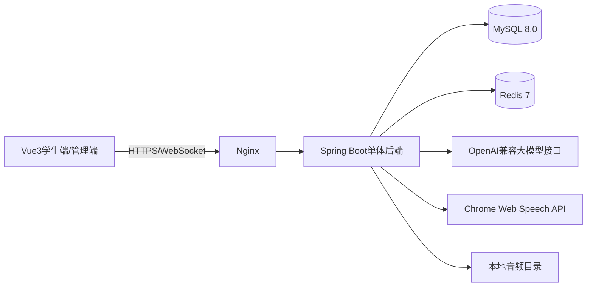

# AI模拟面试与能力提升平台系统实现方案

## 1. 文档说明

本方案根据“AI模拟面试与能力提升软件”项目要求编写，面向大学本科 JavaEE 课程设计。

系统重点实现以下闭环：

```text
选择岗位 → 题库组卷 → AI多轮面试 → 动态追问
       → 多维评估 → 生成报告 → 学习推荐 → 能力成长记录
```

本项目采用固定、简化、可独立运行的技术方案，突出 JavaEE 课程设计中的后端分层、数据库设计、权限控制、REST 接口、WebSocket 实时通信和前后端分离，不引入微服务集群、Kubernetes 或复杂的分布式组件。

## 2. 项目目标

系统面向计算机相关专业学生，解决以下问题：

1. 学生缺少接近真实企业流程的技术面试练习。
2. 传统面试反馈依赖人工，反馈速度慢且难以量化。
3. 通用题库不能体现 Java 后端和 Web 前端岗位的差异。
4. 技术能力、逻辑表达、沟通能力和应变能力缺少综合评价。

系统至少支持以下两个岗位：

- Java 后端开发工程师
- Web 前端工程师

每个岗位具有独立的能力模型、题库、知识库标签和评分权重。Python 算法工程师可以作为后续扩展，不作为本课程设计的必做内容。

## 3. 固定技术栈

### 3.1 前端

| 技术 | 固定版本/选型 | 用途 |
|---|---|---|
| 开发语言 | TypeScript 5 | 前端开发 |
| 框架 | Vue 3.4 | 构建页面和组件 |
| 构建工具 | Vite 5 | 项目构建和开发服务器 |
| UI 组件 | Element Plus | 表单、表格、弹窗和布局 |
| 状态管理 | Pinia | 保存登录、面试和报告状态 |
| HTTP 客户端 | Axios | 调用后端 REST API |
| 图表 | ECharts | 雷达图、折线图和柱状图 |
| 实时通信 | WebSocket | 推送 AI 问题和面试进度 |
| 语音采集 | MediaRecorder API | 录制面试音频 |
| 语音转写 | Chrome Web Speech API | 将语音转换为文字 |

### 3.2 JavaEE 后端

| 技术 | 固定版本/选型 | 用途 |
|---|---|---|
| JDK | Java 17 | Java 运行环境 |
| 核心框架 | Spring Boot 3.3.x | 后端应用框架 |
| Web 框架 | Spring MVC | REST API |
| 安全框架 | Spring Security 6 + JWT | 登录、鉴权和角色控制 |
| ORM 框架 | MyBatis-Plus 3.5.x | 数据库访问 |
| 数据库 | MySQL 8.0 | 保存业务数据 |
| 缓存 | Redis 7 | 保存登录状态、会话缓存和限流数据 |
| 实时通信 | Spring WebSocket | 面试过程实时推送 |
| HTTP 调用 | Spring WebClient | 调用大模型接口 |
| 参数校验 | Jakarta Validation | 请求参数校验 |
| 数据库迁移 | Flyway | 初始化和升级数据库 |
| 构建工具 | Maven 3.9 | 依赖管理和打包 |

### 3.3 AI 与知识库

| 技术 | 固定选型 | 用途 |
|---|---|---|
| 大模型接口 | OpenAI 兼容 Chat API | 生成问题、追问和报告 |
| 演示模型 | 通义千问 Qwen-Plus | 中文面试对话和评估 |
| AI 调用封装 | `AiProvider` 接口 | 隔离模型调用细节 |
| 离线兜底 | `MockAiProvider` | 无网络或无 Key 时使用模板回答 |
| 知识库检索 | MySQL FULLTEXT + 标签过滤 | 召回岗位知识片段 |
| 文本分析 | Java 规则 + 大模型 | 关键词和能力点分析 |
| 语音分析 | Web Speech API + 音频时长 | 转写、语速和回答时长分析 |

### 3.4 部署

- Docker Compose
- Nginx
- Node.js 20
- Maven 3.9
- MySQL 8.0
- Redis 7

### 3.5 技术选型理由

1. Vue 3 和 Spring Boot 适合前后端分离开发。
2. Spring Security、MyBatis-Plus 和 MySQL 符合 JavaEE 课程教学内容。
3. WebSocket 可以体现实时交互能力。
4. WebClient 可以调用大模型，同时保持后端技术栈统一。
5. MySQL FULLTEXT 和标签检索足以支撑课程设计规模的轻量 RAG。
6. Mock AI 提供离线模式，避免答辩时因网络或 API Key 导致系统无法运行。
7. Docker Compose 可以一次启动完整系统，便于部署和验收。

## 4. 系统角色

### 4.1 学生

- 注册、登录和修改个人资料。
- 选择目标岗位。
- 进行文字或语音模拟面试。
- 查看 AI 动态追问。
- 查看面试评分和评估报告。
- 查看历史面试记录。
- 查看能力成长曲线。
- 获取学习资源和练习计划。

### 4.2 管理员

管理员属于实现扩展角色，用于维护系统数据：

- 管理岗位和能力模型。
- 管理面试题库。
- 管理知识库文档和知识片段。
- 配置评分权重。
- 管理学习资源。
- 查看系统统计数据。

## 5. 总体架构



### 5.1 分层结构

```text
表现层 Controller
        ↓
业务层 Service
        ↓
数据访问层 Mapper
        ↓
MySQL / Redis
```

AI 相关调用通过业务层的 `AiService` 统一完成，不允许 Controller 直接调用大模型。

### 5.2 后端模块

```text
auth       用户、登录和权限
position   岗位和能力模型
question   题库和题目标签
interview  面试会话和问答过程
knowledge  知识库和检索
ai         大模型调用和提示词
assessment 评分和报告
growth     能力成长和学习推荐
admin      管理员功能
common     统一响应、异常、配置和日志
```

## 6. 核心功能设计

### 6.1 用户与权限

登录流程：

```text
用户提交用户名和密码
        ↓
Spring Security 查询 sys_user
        ↓
BCrypt 校验密码
        ↓
生成 JWT
        ↓
前端保存 Token
        ↓
后续请求通过 Authorization 携带 Token
```

统一角色：

```text
ROLE_STUDENT
ROLE_ADMIN
```

管理员接口必须经过角色判断，学生只能访问自己的面试记录和报告。

### 6.2 岗位和能力模型

### Java 后端开发岗位

主要技能：

- Java 基础、面向对象、集合和异常
- 多线程、并发和 JVM
- Spring、Spring Boot
- MySQL、事务、索引和 SQL 优化
- Redis 和消息队列基础
- 项目经历和系统设计
- 沟通表达和问题解决能力

### Web 前端工程师岗位

主要技能：

- HTML、CSS、JavaScript
- 浏览器原理和网络请求
- Vue 3 组件化开发
- 前端工程化
- 性能优化
- 前端安全
- 项目经历和组件设计
- 用户体验和沟通能力

岗位能力模型由以下字段组成：

```text
position_id
skill_code
skill_name
description
weight
required_level
```

### 6.3 题库

每个岗位至少配置 20 道题，建议每个岗位配置 30 道题。

| 题型 | 建议比例 | 示例 |
|---|---:|---|
| 技术知识题 | 50% | 什么是 Spring IOC？ |
| 项目经历题 | 20% | 介绍项目中最复杂的模块 |
| 场景题 | 20% | 线上接口响应变慢如何排查？ |
| 行为题 | 10% | 如何处理团队意见不一致？ |

题目字段：

```text
id
position_id
type
content
background
difficulty
skill_tags_json
reference_answer
key_points_json
deduction_points_json
followup_templates_json
status
version
```

题目难度分为 1～5 级：

- 1 级：基础概念。
- 2 级：简单应用。
- 3 级：综合应用。
- 4 级：复杂场景。
- 5 级：系统设计和开放问题。

组卷规则：

```text
总题数 = 5～8 道
技术题 = 50%
项目题 = 20%
场景题 = 20%
行为题 = 10%
```

### 6.4 知识库与轻量 RAG

### 知识库内容

- Java 后端和 Web 前端技术栈。
- 常见面试考点。
- 技术概念解释。
- 优秀回答范例。
- 常见错误回答。
- 项目设计案例。
- 岗位能力要求。

### 知识库表设计

每篇知识文档切分为多个 `knowledge_chunk`，每个片段包含：

```text
title
content
position_id
skill_tags
keywords
source_type
status
```

### 检索流程

```text
学生回答
  ↓
提取关键词和岗位技能标签
  ↓
MySQL FULLTEXT 检索
  ↓
按 position_id 和 skill_tags 过滤
  ↓
取 Top 3～5 条知识片段
  ↓
拼接到大模型提示词
  ↓
生成追问或评分结果
```

这种方式属于课程设计规模的轻量 RAG：先检索知识，再把检索结果作为上下文输入大模型。系统不引入 Elasticsearch、Milvus 或独立向量数据库，降低部署和调试成本。

### 6.5 多轮面试

### 面试状态

```text
CREATED
  ↓
RUNNING
  ↓
WAITING_USER
  ↓
PROCESSING_AI
  ↓
WAITING_USER
  ↓
FINISHED
```

异常状态：

```text
ABORTED
TIMEOUT
```

### 面试流程

1. 学生选择岗位、难度、面试时长和输入方式。
2. 系统创建面试会话。
3. 根据岗位能力模型选择第一道题。
4. 学生输入文字或使用麦克风回答。
5. 系统保存回答内容和回答时长。
6. AI 分析回答中的关键词和知识点。
7. 系统检索相关知识片段。
8. AI 决定追问、下一题或结束面试。
9. 达到轮次或时间上限后结束面试。
10. 系统生成评估报告和提升计划。

### 动态追问规则

| 回答情况 | 系统处理 |
|---|---|
| 缺少关键知识点 | 追问缺失内容 |
| 回答模糊 | 要求举例或解释原因 |
| 出现技术错误 | 询问边界条件或故障后果 |
| 回答完整 | 提高难度，追问替代方案 |
| 连续两轮低分 | 降低难度或切换基础主题 |
| 连续两轮高分 | 进入项目深挖或系统设计 |
| 同一主问题追问超过 3 次 | 自动进入下一题 |

### 6.6 大模型调用设计

后端定义统一接口：

```java
public interface AiProvider {
    AiNextQuestionResult nextQuestion(AiInterviewContext context);
    AiTurnEvaluation evaluateTurn(AiEvaluationContext context);
    AiReport generateReport(AiReportContext context);
}
```

实际实现：

```text
OpenAiCompatibleProvider  调用通义千问接口
MockAiProvider            离线演示和自动化测试
```

通过配置切换：

```yaml
ai:
  provider: qwen
  api-url: ${AI_API_URL}
  api-key: ${AI_API_KEY}
  model: qwen-plus
  timeout: 30000
```

### AI 返回结构

大模型必须返回 JSON，后端校验后才发送给前端：

```json
{
  "action": "FOLLOW_UP",
  "question": "如果 Redis 热点 Key 同时失效，你会如何处理？",
  "targetSkills": ["Redis", "高并发"],
  "difficulty": 4,
  "coveredPoints": ["缓存击穿"],
  "missingPoints": ["互斥锁", "逻辑过期"],
  "confidence": 0.88
}
```

如果 JSON 校验失败，系统按以下顺序处理：

1. 自动重试一次。
2. 使用题目预设追问模板。
3. 使用 MockAiProvider 返回固定追问。

### 6.7 语音和文字交互

### 文字模式

文字回答直接提交给后端，并保存到 `interview_message.content`。

### 语音模式

```text
点击录音
  ↓
MediaRecorder 录制音频
  ↓
Chrome Web Speech API 实时转写
  ↓
页面显示字幕
  ↓
保存转写文字和音频文件
  ↓
文字进入 AI 分析流程
```

系统要求浏览器支持 Chrome。若浏览器不支持 Web Speech API，页面自动提示学生切换文字输入。

### 语音表达分析

本科课程设计不实现复杂情绪识别，主要使用以下可解释指标：

- 回答时长。
- 转写文字数量。
- 估算语速。
- 停顿次数。
- 语气词数量。
- 回答是否完整。
- 表达是否有明显重复。

估算语速：

```text
语速 = 转写字数 ÷ 回答时长（分钟）
```

## 7. 评分和报告设计

### 7.1 评分维度

| 维度 | 说明 |
|---|---|
| 技术正确性 | 技术结论是否正确 |
| 知识深度 | 是否理解原理、边界和实现细节 |
| 逻辑严谨性 | 回答结构是否清晰 |
| 岗位匹配度 | 是否符合目标岗位要求 |
| 沟通表达 | 是否准确、完整、有条理 |
| 语音表现 | 语速、停顿、清晰度和自信度 |

### 7.2 默认评分公式

```text
内容得分 = 技术正确性×30%
         + 知识深度×25%
         + 逻辑严谨性×20%
         + 项目证据×15%
         + 岗位匹配度×10%

表达得分 = 清晰度×30%
         + 流畅度×20%
         + 语速与停顿×20%
         + 自信度×15%
         + 沟通完整性×15%

总分 = 内容得分×50%
     + 表达得分×30%
     + 应变能力×10%
     + 岗位匹配度×10%
```

所有分数范围为 0～100，权重保存到数据库中，可以按岗位调整。

### 7.3 报告内容

报告页面包括：

1. 面试岗位、日期、时长和题目数量。
2. 总分和六维能力评分。
3. ECharts 能力雷达图。
4. 每道题的学生回答和 AI 评分。
5. 命中的关键知识点。
6. 缺失的关键点。
7. 评分理由和证据句。
8. 面试亮点。
9. 主要不足。
10. 具体改进建议。
11. 推荐练习题和学习资源。

## 8. 个性化能力提升

### 8.1 能力掌握度

每次面试结束后更新技能掌握度：

```text
新掌握度 = 旧掌握度×0.7 + 本次得分×0.3
```

### 8.2 短板识别

系统将以下情况判定为短板：

- 某技能连续两次得分低于 60。
- 某技能得分低于岗位要求等级。
- 某技能在多道题中都缺少关键知识点。
- 表达维度连续低于 60。

### 8.3 推荐规则

```text
推荐优先级 = (100 - 当前掌握度)
           × 岗位技能权重
```

推荐内容：

- 技术知识文章。
- 典型面试题。
- 错题重新练习。
- 项目讲解训练。
- 文字表达训练。
- 下一次模拟面试。

## 9. 数据库设计

本项目核心数据库控制在 9 张表以内。

### 9.1 用户表 `sys_user`

```sql
CREATE TABLE sys_user (
    id BIGINT PRIMARY KEY AUTO_INCREMENT,
    username VARCHAR(50) NOT NULL UNIQUE,
    password_hash VARCHAR(255) NOT NULL,
    real_name VARCHAR(50),
    role VARCHAR(20) NOT NULL DEFAULT 'STUDENT',
    major VARCHAR(100),
    status TINYINT NOT NULL DEFAULT 1,
    created_at DATETIME NOT NULL,
    updated_at DATETIME NOT NULL
);
```

### 9.2 岗位表 `position`

```text
id
code
name
description
competency_model_json
default_rounds
enabled
created_at
updated_at
```

### 9.3 题目表 `question`

```text
id
position_id
type
content
background
difficulty
skill_tags_json
reference_answer
key_points_json
deduction_points_json
followup_templates_json
status
version
created_at
updated_at
```

### 9.4 面试会话表 `interview_session`

```text
id
user_id
position_id
mode
difficulty
planned_rounds
current_round
status
total_score
started_at
finished_at
created_at
```

### 9.5 面试消息表 `interview_message`

```text
id
session_id
round_no
speaker
input_type
content_text
audio_path
audio_duration_ms
asr_text
question_id
keywords_json
created_at
```

### 9.6 知识片段表 `knowledge_chunk`

```text
id
position_id
title
content
keywords
skill_tags
source_type
status
created_at
```

在 `content` 和 `keywords` 字段上建立 MySQL FULLTEXT 索引。

### 9.7 评估报告表 `evaluation_report`

```text
id
session_id
total_score
dimension_scores_json
strengths_json
weaknesses_json
improvement_plan_json
report_text
created_at
```

### 9.8 能力记录表 `ability_record`

```text
id
user_id
position_id
skill_code
score
source_session_id
evaluated_at
```

### 9.9 学习资源表 `learning_resource`

```text
id
position_id
skill_code
title
resource_type
content_url
difficulty
enabled
created_at
```

## 10. REST 和 WebSocket 接口

### 10.1 认证接口

```text
POST /api/auth/register
POST /api/auth/login
POST /api/auth/logout
GET  /api/users/me
PUT  /api/users/me
```

### 10.2 岗位接口

```text
GET /api/positions
GET /api/positions/{id}
GET /api/positions/{id}/skills
```

### 10.3 面试接口

```text
POST /api/interviews
POST /api/interviews/{id}/start
POST /api/interviews/{id}/messages/text
POST /api/interviews/{id}/messages/audio
POST /api/interviews/{id}/finish
POST /api/interviews/{id}/abort
GET  /api/interviews/{id}
GET  /api/interviews/{id}/messages
GET  /api/interviews/{id}/report
```

### 10.4 成长接口

```text
GET /api/users/me/growth
GET /api/users/me/recommendations
GET /api/users/me/history
```

### 10.5 管理接口

```text
GET    /api/admin/questions
POST   /api/admin/questions
PUT    /api/admin/questions/{id}
DELETE /api/admin/questions/{id}
POST   /api/admin/knowledge
POST   /api/admin/knowledge/rebuild
GET    /api/admin/dashboard
```

### 10.6 WebSocket 地址

```text
/ws/interviews/{sessionId}
```

推送事件：

```text
QUESTION
TRANSCRIPT
FOLLOW_UP
TIMER
PROGRESS
REPORT_READY
ERROR
```

统一 REST 返回格式：

```json
{
  "code": 0,
  "message": "success",
  "data": {},
  "traceId": "202610131900001"
}
```

## 11. 前端页面设计

### 学生端

```text
/login                  登录页
/register               注册页
/home                   首页仪表盘
/positions              岗位选择
/positions/:id          岗位详情
/interview/setup        面试设置
/interview/:id          面试房间
/interview/:id/report   面试报告
/history                历史面试
/growth                 能力成长
/recommendations        学习推荐
/profile                个人中心
```

### 面试房间页面

必须包含：

- 当前岗位和难度。
- 面试倒计时。
- 当前 AI 问题。
- 文字输入框。
- 录音按钮。
- 实时转写区域。
- 当前轮次。
- 结束面试按钮。
- 网络和录音状态提示。

### 管理端

```text
/admin/dashboard
/admin/positions
/admin/questions
/admin/knowledge
/admin/resources
/admin/evaluation
/admin/users
```

## 12. 项目目录结构

```text
ai-interview/
├── backend/
│   └── src/main/java/com/example/interview/
│       ├── auth/
│       ├── position/
│       ├── question/
│       ├── interview/
│       ├── knowledge/
│       ├── ai/
│       ├── assessment/
│       ├── growth/
│       ├── admin/
│       └── common/
├── frontend/
│   └── src/
│       ├── views/
│       ├── components/
│       ├── stores/
│       ├── api/
│       └── router/
├── uploads/
├── docker-compose.yml
└── README.md
```

## 13. 关键业务流程

### 13.1 提交一轮回答

```text
前端发送文字或音频
        ↓
后端校验 JWT、会话状态和请求参数
        ↓
音频保存到 uploads 目录
        ↓
保存学生回答
        ↓
提取关键词和岗位技能
        ↓
MySQL FULLTEXT 检索知识片段
        ↓
PromptBuilder 拼接岗位、历史对话和知识片段
        ↓
AiProvider 调用大模型
        ↓
校验 JSON 结果
        ↓
保存 AI 问题
        ↓
通过 WebSocket 推送给前端
```

### 13.2 结束面试

```text
结束面试
  ↓
统计所有问答
  ↓
调用大模型进行逐题评分
  ↓
计算总分和岗位匹配度
  ↓
生成结构化报告
  ↓
更新 ability_record
  ↓
匹配 learning_resource
  ↓
展示报告和练习计划
```

## 14. 异常和降级方案

| 异常情况 | 处理方案 |
|---|---|
| 大模型接口超时 | 使用题目模板追问 |
| API Key 不可用 | 切换 MockAiProvider |
| AI 返回格式错误 | 自动重试后使用模板 |
| 语音识别不可用 | 提示使用文字输入 |
| 浏览器不支持录音 | 隐藏语音按钮，保留文字模式 |
| 网络中断 | 当前输入保存在浏览器，恢复后重新提交 |
| 报告生成失败 | 保存问答记录，允许重新生成 |
| 知识库无匹配结果 | 使用岗位通用题目和通用知识 |

## 15. 安全设计

1. 使用 BCrypt 加密用户密码。
2. 使用 JWT 进行身份认证。
3. 使用 Spring Security 控制接口权限。
4. 查询面试记录时校验用户归属关系。
5. 限制上传文件大小和格式。
6. 音频文件保存在受保护的本地目录。
7. 不在日志中保存密码、JWT 和模型密钥。
8. 使用 MyBatis-Plus 参数绑定防止 SQL 注入。
9. 对文本内容进行长度限制，防止恶意超长请求。
10. 管理员操作记录写入 `operation_log` 或应用日志。

## 16. 测试方案

### 16.1 单元测试

使用 JUnit 5 和 Mockito 测试：

- JWT 登录和角色权限。
- 面试状态转换。
- 题目筛选和随机组卷。
- 动态追问规则。
- 评分计算。
- 能力掌握度更新。
- 推荐优先级计算。

### 16.2 集成测试

使用 Spring Boot Test 和 MockMvc 测试：

- 注册和登录。
- 岗位和题库接口。
- 创建和结束面试。
- 提交文字回答。
- 提交音频回答。
- 获取报告和成长曲线。
- 管理员题库增删改查。

### 16.3 端到端测试

使用 Playwright 完成以下流程：

```text
登录 → 选择岗位 → 创建面试 → 完成多轮问答
→ 结束面试 → 查看报告 → 查看成长曲线
```

### 16.4 AI 质量测试

每个岗位准备 20 条人工标注的标准问答，检查：

- 追问是否与回答相关。
- 评分是否符合 Rubric。
- 报告字段是否完整。
- 改进建议是否对应学生短板。
- AI 评分与人工评分误差是否控制在 15 分以内。

## 17. 开发计划

### 第 1 周：基础工程

- 创建 Vue 和 Spring Boot 项目。
- 设计数据库和实体类。
- 完成登录、JWT 和角色权限。
- 完成岗位、能力模型和题库 CRUD。

### 第 2 周：文字面试

- 完成面试会话状态机。
- 实现题目组卷。
- 接入大模型接口。
- 实现文字问答和动态追问。
- 实现 WebSocket 消息推送。

### 第 3 周：报告和历史记录

- 实现逐题评分。
- 生成结构化报告。
- 完成雷达图和历史面试页面。
- 保存能力记录。

### 第 4 周：语音和知识库

- 接入 MediaRecorder。
- 接入 Web Speech API。
- 保存音频和转写文字。
- 实现 MySQL FULLTEXT 知识检索。
- 将检索结果注入大模型提示词。

### 第 5 周：个性化提升

- 实现能力短板识别。
- 实现资源推荐。
- 实现练习计划。
- 完善成长曲线。

### 第 6 周：测试和部署

- 完成管理员页面。
- 完成 MockAiProvider。
- 编写 Docker Compose。
- 完成功能、接口、安全和异常测试。
- 准备课程设计报告和答辩演示。

## 18. 部署运行

### 18.1 服务组成

```text
nginx
frontend
backend
mysql
redis
```

大模型使用外部 OpenAI 兼容接口，AI 配置通过环境变量注入。

### 18.2 配置文件示例

```yaml
spring:
  datasource:
    url: jdbc:mysql://mysql:3306/ai_interview?useUnicode=true&characterEncoding=utf8
    username: root
    password: ${MYSQL_PASSWORD}
  data:
    redis:
      host: redis
      port: 6379

ai:
  provider: ${AI_PROVIDER:mock}
  api-url: ${AI_API_URL:}
  api-key: ${AI_API_KEY:}
  model: ${AI_MODEL:qwen-plus}
```

### 18.3 启动顺序

```text
docker compose up -d mysql redis
mvn spring-boot:run
cd frontend && npm install && npm run dev
```

正式演示时使用：

```text
docker compose up -d
```

## 19. 答辩演示流程

1. 学生登录系统。
2. 选择 Java 后端岗位。
3. 查看岗位能力要求。
4. 选择文字或语音面试。
5. AI 提出第一道问题。
6. 学生回答，系统保存内容。
7. AI 根据关键词进行追问。
8. 完成 3～5 轮面试。
9. 查看六维评估报告。
10. 查看回答证据、亮点和不足。
11. 查看推荐练习和学习资源。
12. 查看能力成长曲线。
13. 切换 Web 前端岗位，展示题目和评分标准差异。
14. 管理员进入后台修改题目或知识片段。
15. 在无网络环境下切换 MockAiProvider，完成离线演示。

## 20. 最终验收标准

系统满足以下条件即可达到课程设计要求：

- 支持 Java 后端和 Web 前端两个岗位。
- 每个岗位至少有 20 道题。
- 题目覆盖技术知识、项目经历、场景和行为四类。
- 支持文字和语音两种输入方式。
- AI 可以进行至少 3 轮动态追问。
- 大模型参与对话管理、回答理解和报告生成。
- 系统能够检索岗位知识片段并注入 AI 提示词。
- 报告包含技术正确性、知识深度、逻辑、沟通和岗位匹配等维度。
- 报告包含分数、证据、亮点、不足和改进建议。
- 系统保存历史面试记录。
- 系统能够展示能力成长曲线。
- 系统能够根据能力短板推荐学习资源和练习计划。
- 管理员可以维护题库和知识库。
- 系统可以使用真实大模型，也可以使用 MockAiProvider 离线运行。
- 项目能够通过 Docker Compose 启动并完成完整演示。
